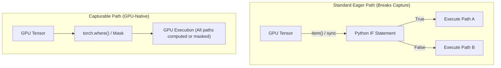

<!-- source: DeepWiki mcp.deepwiki.com · repo NVIDIA/dl-cuda-graph-doc · page 3.5 Handling Dynamic Patterns · fetched 2026-10-26 -->

# Handling Dynamic Patterns

<details>
<summary>Relevant source files</summary>

The following files were used as context for generating this wiki page:

- [docs/torch-cuda-graph/handling-dynamic-patterns.md](docs/torch-cuda-graph/handling-dynamic-patterns.md)

</details>


This section provides practical patterns for handling common dynamic behaviors when adopting CUDA Graphs in PyTorch. CUDA Graphs traditionally require static execution patterns—the same sequence of operations with the same memory addresses every replay. While recent CUDA versions (12.3+) introduced conditional nodes, these are not yet exposed through PyTorch's Python APIs as of version 2.9 [docs/torch-cuda-graph/handling-dynamic-patterns.md:8-13]().

## Types of Dynamic Patterns

Dynamic patterns that are incompatible with standard CUDA Graph capture fall into four primary categories:

1.  **Dynamic Control Flow**: Conditional execution based on runtime GPU values requiring CPU checks [docs/torch-cuda-graph/handling-dynamic-patterns.md:19-19]().
2.  **Dynamic Tensors**: Tensors whose memory addresses change across iterations [docs/torch-cuda-graph/handling-dynamic-patterns.md:21-21]().
3.  **Dynamic Scalars**: Scalar values that change each iteration and must be passed to GPU operations [docs/torch-cuda-graph/handling-dynamic-patterns.md:23-23]().
4.  **Dynamic Shapes**: Input dimensions that vary across iterations, affecting kernel launches and memory allocation [docs/torch-cuda-graph/handling-dynamic-patterns.md:25-25]().

Sources: [docs/torch-cuda-graph/handling-dynamic-patterns.md:15-27]()

---

## Dynamic Control Flow

Dynamic control flow is problematic because checking GPU values in Python requires CPU-GPU synchronization (e.g., via `.item()` or `.is_nonzero()`), which breaks graph capture [docs/torch-cuda-graph/handling-dynamic-patterns.md:29-31]().

### Common Failure Patterns
*   **NaN/Inf Checks**: Checking if a loss is valid before calling `.backward()` [docs/torch-cuda-graph/handling-dynamic-patterns.md:44-55]().
*   **Gradient Clipping**: `clip_grad_norm_` internally synchronizes to check if the total norm exceeds the threshold [docs/torch-cuda-graph/handling-dynamic-patterns.md:57-76]().
*   **Conditional Optimizer Steps (AMP)**: `scaler.step()` checks for invalid gradients on the CPU [docs/torch-cuda-graph/handling-dynamic-patterns.md:78-98]().
*   **Early Exit/Adaptive Inference**: Routing inputs through different network paths based on confidence scores [docs/torch-cuda-graph/handling-dynamic-patterns.md:100-120]().

### Implementation Strategies
To resolve these, developers should use GPU-native alternatives that avoid synchronization:

| Strategy | Code Entity / Function | Description |
| :--- | :--- | :--- |
| **Masking** | `torch.where()` | Replace `if/else` with element-wise selection [docs/torch-cuda-graph/handling-dynamic-patterns.md:126-126](). |
| **Clamping** | `torch.clamp()` | Replace conditional bounds checking [docs/torch-cuda-graph/handling-dynamic-patterns.md:126-126](). |
| **Capturable Optimizers** | `capturable=True` | Use optimizer flags that implement no-op logic on GPU when gradients are invalid [docs/torch-cuda-graph/handling-dynamic-patterns.md:126-130](). |

#### Data Flow: Python vs. Capturable Control Flow

Title: Data Flow Comparison for Dynamic Control

Sources: [docs/torch-cuda-graph/handling-dynamic-patterns.md:29-130]()

---

## Dynamic Tensors and Scalars

CUDA Graphs record specific memory addresses. If a tensor is reallocated or its pointer changes, the graph will continue to use the old address, leading to stale data or crashes.

### Solutions
*   **In-place Updates**: Use `tensor.copy_()` to update the contents of a fixed memory buffer instead of reassigning the variable [docs/torch-cuda-graph/handling-dynamic-patterns.md:126-130]().
*   **Static Buffers**: Pre-allocate buffers for dynamic scalars and update them before graph replay.

Sources: [docs/torch-cuda-graph/handling-dynamic-patterns.md:21-24]()

---

## Dynamic Shapes

Dynamic shapes are the most complex pattern to handle because they change the grid/block dimensions of CUDA kernels and memory requirements.

### Workarounds
1.  **Padding**: Pad all inputs to a fixed maximum size. This allows a single graph to handle all inputs but may waste GPU cycles on "padding" computations [docs/torch-cuda-graph/handling-dynamic-patterns.md:25-27]().
2.  **Bucketing**: Group inputs into a few predefined "buckets" (e.g., sequence lengths 128, 256, 512). Capture one graph per bucket. This is used extensively in the RNN-T implementation [docs/torch-cuda-graph/handling-dynamic-patterns.md:25-27]().
3.  **Multiple Graph Captures**: For models with highly variable shapes, maintain a cache of captured graphs keyed by input shape.

#### System Mapping: Bucketing Logic

Title: Bucketing Implementation for Dynamic Shapes
```mermaid
graph LR
    Input["Input Shape (L)"] --> Selector{"Shape Selector"}
    Selector -->| "L <= 128" | G1["Graph_Bucket_128"]
    Selector -->| "128 < L <= 256" | G2["Graph_Bucket_256"]
    Selector -->| "L > 256" | Eager["Eager Execution / Fallback"]
    
    subgraph "Code Entities"
        G1["CUDAGraph Object 1"]
        G2["CUDAGraph Object 2"]
        Selector["Python Logic (Outside Graph)"]
    end
```
Sources: [docs/torch-cuda-graph/handling-dynamic-patterns.md:25-27](), [docs/torch-cuda-graph/handling-dynamic-patterns.md:130-130]()

---

## Summary of Practical Patterns

| Problem | Workaround | Implementation Detail |
| :--- | :--- | :--- |
| **Loss NaN Check** | `torch.where` | Multiply gradients by 0 if NaN is detected on GPU. |
| **Grad Clipping** | `capturable=True` | Use `torch.nn.utils.clip_grad_norm_` with capturable support (where available). |
| **Variable Length** | **Bucketing** | Pre-capture 4-8 graphs for common sequence lengths. |
| **Changing Scalars** | **Static Tensors** | Store scalars in 1-element tensors and update via `.copy_()`. |

Sources: [docs/torch-cuda-graph/handling-dynamic-patterns.md:15-130]()

---

