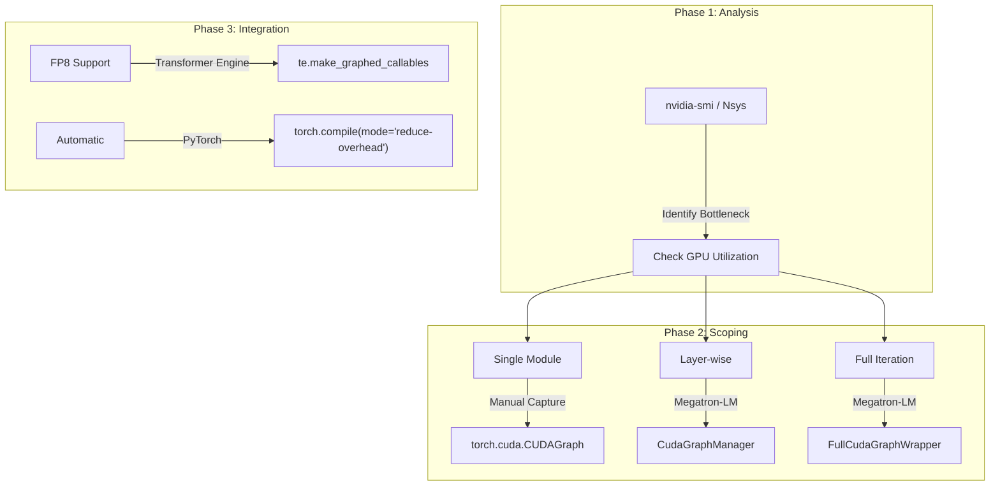
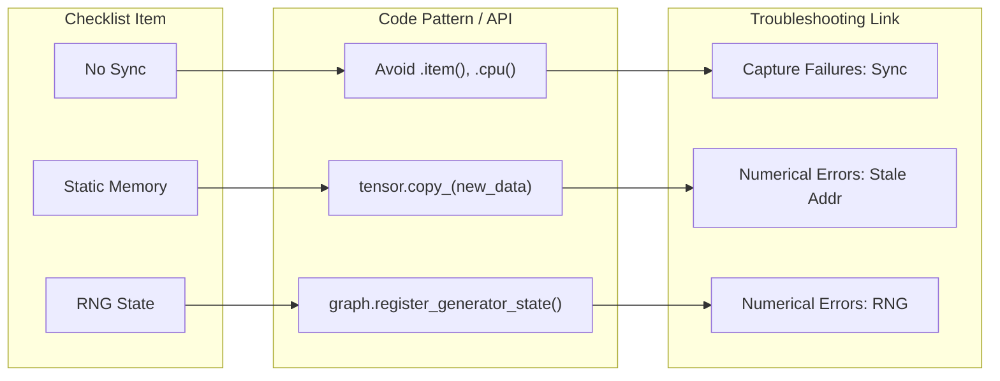

<!-- source: DeepWiki mcp.deepwiki.com · repo NVIDIA/dl-cuda-graph-doc · page 3.6 Best Practices and Quick Checklist · fetched 2026-10-26 -->

# Best Practices and Quick Checklist

Relevant source files

The following files were used as context for generating this wiki page:

- [docs/torch-cuda-graph/best-practices.md](docs/torch-cuda-graph/best-practices.md)
- [docs/torch-cuda-graph/quick-checklist.md](docs/torch-cuda-graph/quick-checklist.md)

This page provides a systematic adoption strategy for integrating CUDA Graphs into PyTorch applications and a comprehensive pre-capture checklist to ensure code compatibility.

## Systematic Adoption Strategy

Adopting CUDA Graphs is most successful when following an incremental, data-driven approach. This minimizes debugging complexity and ensures effort is spent on regions with the highest performance ROI.

### 1. Quantify Benefits and Identify Targets
Before implementation, verify that the workload is CPU-bound. Low GPU utilization (<80%) and a high volume of small kernels (<50 μs) are primary indicators that CUDA Graphs will provide significant speedups [docs/torch-cuda-graph/best-practices.md:17-21]().

Use Nsight Systems to identify:
*   **Long gaps between kernels**: Indicates the GPU is idle while the CPU processes the next launch [docs/torch-cuda-graph/best-practices.md:25-27]().
*   **Low kernel row occupancy**: Sparse execution on the timeline [docs/torch-cuda-graph/best-practices.md:29-29]().

### 2. Incremental Capture Scope
Start with small, self-contained regions and expand outward. This allows for easier isolation of synchronization or dynamic pattern issues.

| Step | Scope | Description |
| :--- | :--- | :--- |
| **1** | **Single Module** | Graph one transformer layer or MLP block. Easiest to debug [docs/torch-cuda-graph/best-practices.md:49-49](). |
| **2** | **Multiple Layers** | Extend to 2-3 layers. Handle inter-layer ops like LayerNorm or residuals [docs/torch-cuda-graph/best-practices.md:51-51](). |
| **3** | **Full Forward** | Capture the entire forward pass. Exclude data loading and preprocessing [docs/torch-cuda-graph/best-practices.md:52-53](). |
| **4** | **Forward + Backward** | Use `torch.cuda.make_graphed_callables()` or separate `torch.cuda.graph()` contexts [docs/torch-cuda-graph/best-practices.md:55-55](). |
| **5** | **Full Iteration** | Include Optimizer, Grad Scaling, and Clipping. Requires sync-free optimizers [docs/torch-cuda-graph/best-practices.md:57-57](). |

### 3. Choose the Right API
Select the API based on the required level of abstraction and framework integration.

**API Selection Flow**
1.  **Megatron-LM**: Use `CudaGraphManager` (per-layer) or `FullCudaGraphWrapper` (full iteration) via `TransformerConfig` [docs/torch-cuda-graph/best-practices.md:90-94]().
2.  **Transformer Engine**: Use `te.make_graphed_callables` for FP8 and Pipeline Parallelism support [docs/torch-cuda-graph/best-practices.md:88-88]().
3.  **General PyTorch**: Use `torch.compile(mode="reduce-overhead")` for automatic handling or `torch.cuda.CUDAGraph` for manual control [docs/torch-cuda-graph/best-practices.md:98-102]().

**Sources:** [docs/torch-cuda-graph/best-practices.md:17-102]()

---

## Pre-Capture Quick Checklist

Use this checklist to verify that PyTorch code adheres to CUDA Graph constraints before attempting capture.

### Asynchronous Execution & Sync-Free Code
*   [ ] **No Host-Device Sync**: Remove `torch.cuda.synchronize()`, `.item()`, `.cpu()`, and data-dependent `if` statements [docs/torch-cuda-graph/quick-checklist.md:15-20]().
*   [ ] **No Default Stream**: Ensure DDP/FSDP and gradient tape operations execute on a side stream before capture to avoid conflicts [docs/torch-cuda-graph/quick-checklist.md:24-27]().
*   [ ] **No Event/Stream Queries**: Remove `stream.query()` or `event.query()`. Disable `pin_memory=True` in DataLoaders as it triggers hidden queries [docs/torch-cuda-graph/quick-checklist.md:30-35]().

### Static Graph Requirements
*   [ ] **Static Topology**: Replace dynamic `if/else` with `torch.where()`. Use sync-free `clip_grad_norm_` [docs/torch-cuda-graph/quick-checklist.md:40-43]().
*   [ ] **Static Memory Addresses**: Use `.copy_()` to update input tensors. Keep global tensors and host pointer arrays for Grouped GEMM alive [docs/torch-cuda-graph/quick-checklist.md:47-51]().
*   [ ] **Static Scalars**: Convert CPU scalars to GPU tensors and update via `.fill_()`. Use capturable optimizers like `APEX FusedAdam` [docs/torch-cuda-graph/quick-checklist.md:54-57]().
*   [ ] **RNG Management**: Register custom generators with `graph.register_generator_state()` and use graph-safe state APIs [docs/torch-cuda-graph/quick-checklist.md:58-61]().

### Memory & Stream Management
*   [ ] **Fork-Join Integrity**: Side streams must fork from and join back to the capture stream using `wait_stream()` [docs/torch-cuda-graph/quick-checklist.md:73-74]().
*   [ ] **Persistent Inputs**: Ensure CUDA input tensors are not freed before replay [docs/torch-cuda-graph/quick-checklist.md:87-89]().
*   [ ] **No Output Reuse**: Do not reuse output tensors across iterations without cloning, as the graph writes to the same memory addresses [docs/torch-cuda-graph/quick-checklist.md:92-93]().

**Sources:** [docs/torch-cuda-graph/quick-checklist.md:13-93]()

---

## Implementation Mapping

The following diagrams bridge the conceptual best practices to the specific code entities and APIs used in the dl-cuda-graph-doc repository.

### Adoption Strategy to Code Entities
This diagram maps the "Incremental Approach" to the specific classes and functions used in the codebase.

**Adoption Workflow Mapping**

**Sources:** [docs/torch-cuda-graph/best-practices.md:47-58](), [docs/torch-cuda-graph/best-practices.md:86-102]()

### Constraint Verification to Code Patterns
This diagram maps the "Quick Checklist" items to specific code patterns and troubleshooting categories.

**Checklist to Code Patterns**

**Sources:** [docs/torch-cuda-graph/quick-checklist.md:15-22](), [docs/torch-cuda-graph/quick-checklist.md:49-49](), [docs/torch-cuda-graph/quick-checklist.md:60-60]()

---

