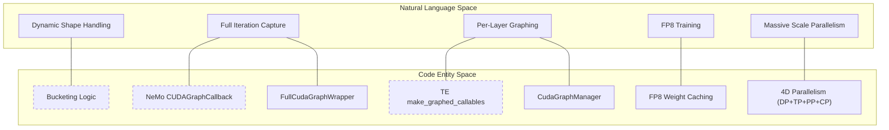
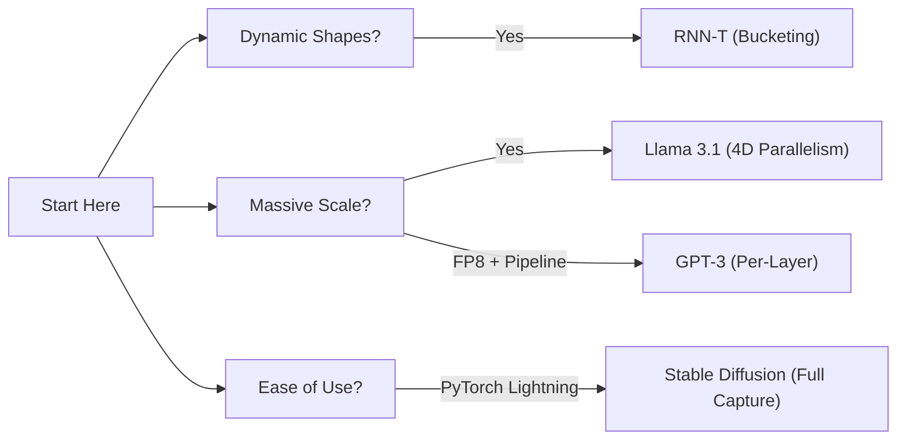

<!-- source: DeepWiki mcp.deepwiki.com · repo NVIDIA/dl-cuda-graph-doc · page 4 Real-World Examples (MLPerf Training) · fetched 2026-10-26 -->

# Real-World Examples (MLPerf Training)

Relevant source files

The following files were used as context for generating this wiki page:

- [docs/examples/introduction.md](docs/examples/introduction.md)

This section provides a high-level overview of five real-world MLPerf Training benchmark implementations that utilize CUDA Graphs. These examples demonstrate how to integrate CUDA Graphs across diverse model architectures, distributed training strategies, and framework stacks—ranging from pure PyTorch to high-level libraries like Transformer Engine and Megatron-LM.

## Comparison of Implementations

The following table summarizes the technical characteristics of each implementation, highlighting the trade-offs between capture scope, software stack, and performance gains.

| Aspect | RNN-T | Stable Diffusion v2 | GPT-3 175B | Llama 2 70B LoRA | Llama 3.1 405B |
| :--- | :--- | :--- | :--- | :--- | :--- |
| **Software Stack** | Pure PyTorch + APEX | NeMo + Lightning | NeMo + Megatron + TE | Megatron-LM + TE | NeMo + Megatron + TE |
| **Capture Scope** | Partial (Networks) | Full Iteration | Partial (Per-layer) | Partial (Per-layer) | Full Iteration |
| **Mechanism** | Custom `graph()` | `CUDAGraphCallback` | TE `make_graphed_callables` | TE `CudaGraphManager` | `FullCudaGraphWrapper` |
| **Static Shapes** | ❌ Bucketing | ✅ Fixed | ✅ Fixed | ✅ Fixed | ✅ Fixed |
| **Distributed** | DDP | DDP | 3D (DP+TP+PP) | DP + TP + CP | 4D (DP+TP+PP+CP) |
| **Precision** | FP16 | FP16 | BF16 + FP8 | BF16 + FP8 + FP4 | BF16 + FP4 |
| **Max Speedup** | Significant | ~1.58× | 2.2% - 3.0% | Variable | 15-25% |

Sources: [docs/examples/introduction.md:63-78]()

## Implementation Mapping

The diagram below maps the Natural Language concepts of these benchmarks to the specific Code Entities used to implement them.

**System to Code Entity Mapping**

Sources: [docs/examples/introduction.md:63-102]()

## Available Examples

### 🎤 RNN-T: Dynamic Shapes with Bucketing
The RNN-T (Recurrent Neural Network Transducer) example addresses the challenge of variable-length audio and text sequences. Because CUDA Graphs require static shapes, this implementation uses a **bucketing strategy** (4 buckets per network) and loop unrolling to minimize overhead while maintaining flexibility.
*   **Key Techniques:** 8 total graphs, async CPU-GPU pipeline, and greedy decoding with masks.
*   **For details, see [RNN-T: Dynamic Shapes with Bucketing](#4.1).**

### 🎨 Stable Diffusion v2: Full-Iteration Graphing
This example demonstrates capturing the entire training iteration—including the forward pass, backward pass, and optimizer step—within a single CUDA Graph. It leverages the NeMo `CUDAGraphCallback` and a "capturable" optimizer that uses a `noop` flag to handle conditional execution.
*   **Key Techniques:** Up to 1.58× speedup, PyTorch Lightning integration.
*   **For details, see [Stable Diffusion v2: Full-Iteration Graphing with PyTorch Lightning](#4.2).**

### 🧠 GPT-3 175B: Per-Layer Graphing with FP8
Large-scale models like GPT-3 often use Pipeline Parallelism (PP), which makes full-iteration capture difficult due to complex interleaved microbatch schedules. This implementation uses **per-layer graphing** via Transformer Engine (TE) and manages FP8 weight caching with GPU-controlled no-ops.
*   **Key Techniques:** `make_graphed_callables`, memory pool management across 3D parallelism.
*   **For details, see [GPT-3 175B: Per-Layer Graphing with FP8 and Pipeline Parallelism](#4.3).**

### 🦙 Llama 2 70B LoRA: Fine-Tuning with Per-Layer Graphing
This example focuses on Parameter-Efficient Fine-Tuning (PEFT) using LoRA adapters. It utilizes the `CudaGraphManager` for per-layer graphing and handles mixed-precision execution (FP8 and FP4).
*   **Key Techniques:** LoRA adapter integration, automated graphing for PP schedules.
*   **For details, see [Llama 2 70B LoRA: Fine-Tuning with Per-Layer Graphing](#4.4).**

### 🦙 Llama 3.1 405B: Full-Iteration Graphing at Massive Scale
The Llama 3.1 405B example represents the cutting edge of CUDA Graph integration in Megatron-LM. It uses the `FullCudaGraphWrapper` to capture training iterations at massive scale across 4D parallelism (Data, Tensor, Pipeline, and Context Parallelism).
*   **Key Techniques:** FP4 precision support, 15-25% performance gains at scale.
*   **For details, see [Llama 3.1 405B: Full-Iteration Graphing at Massive Scale](#4.5).**

## Summary of Learning Paths

The examples are categorized by their primary technical challenges to help you find the most relevant implementation for your project:

**Benchmark Decision Matrix**

Sources: [docs/examples/introduction.md:108-114]()

---

