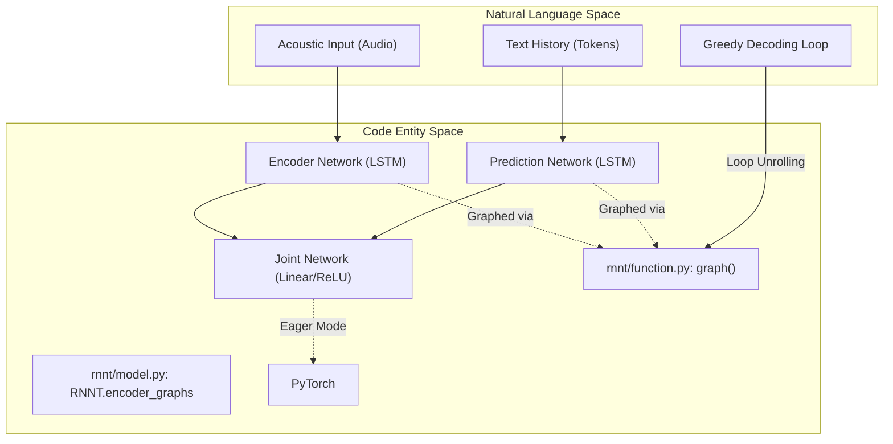
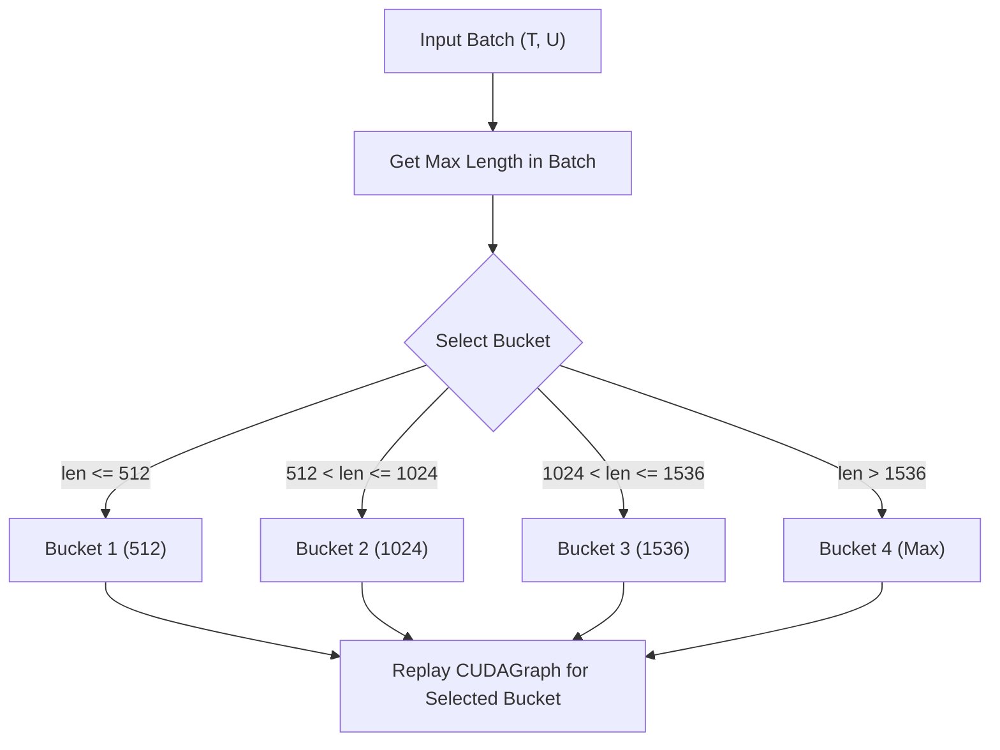

<!-- source: DeepWiki mcp.deepwiki.com · repo NVIDIA/dl-cuda-graph-doc · page 4.1 RNN-T: Dynamic Shapes with Bucketing · fetched 2026-10-26 -->

# RNN-T: Dynamic Shapes with Bucketing

Relevant source files

The following files were used as context for generating this wiki page:

- [docs/examples/rnnt.md](docs/examples/rnnt.md)

This page documents the CUDA Graph implementation for the RNN-T (Recurrent Neural Network Transducer) speech recognition model, based on NVIDIA's MLPerf Training implementation. It focuses on solving the challenges of variable-length sequences and dynamic control flow using bucketing and mask-based transformations.

## Overview

RNN-T is a sequence-to-sequence architecture for end-to-end automatic speech recognition. It consists of three primary components: an **Encoder** (acoustic features), a **Prediction Network** (text history), and a **Joint Network** (combining both to produce output probabilities) [docs/examples/rnnt.md:13-21]().

The primary challenge for CUDA Graph adoption in RNN-T is the inherent dynamism of speech data:
1.  **Variable Sequence Lengths**: Audio and text sequences vary significantly across batches [docs/examples/rnnt.md:44-44]().
2.  **Dynamic Control Flow**: Evaluation uses greedy decoding, an iterative process where the number of steps depends on the generated tokens [docs/examples/rnnt.md:10-11]().

### System Architecture to Code Mapping

The following diagram maps the high-level RNN-T components to their specific implementations and graphing strategies in the codebase.

**RNN-T Architecture Mapping**

Sources: [docs/examples/rnnt.md:17-21](), [docs/examples/rnnt.md:82-88](), [docs/examples/rnnt.md:129-132]()

## Integration Approach: Partial Graphing

RNN-T applies "Partial Graphing," where only the computationally expensive, static-topology components are captured into CUDA Graphs, while dynamic metadata-dependent operations remain in eager mode.

### Training Scope
In training, the Encoder and Prediction networks are captured as separate forward and backward graphs [docs/examples/rnnt.md:62-67]().
*   **Graphed**: Recurrent LSTM operations (Encoder and Prediction networks).
*   **Eager**: Joint network, loss computation, and gradient scaling. These require dynamic metadata (e.g., `batch_offset`, `packed_batch`) that changes based on actual sequence lengths [docs/examples/rnnt.md:67-68]().

### Evaluation Scope
Evaluation defaults to `cg_unroll_pipeline` mode [docs/examples/rnnt.md:70-74]().
*   **Encoder**: Runs once per batch in eager mode.
*   **Decoding Loop**: The iterative prediction and joint network inference are captured as a single unrolled graph to minimize CPU-GPU synchronization during token generation [docs/examples/rnnt.md:70-74]().

Sources: [docs/examples/rnnt.md:60-75]()

## Handling Dynamic Shapes: Bucketing

Since CUDA Graphs require static input shapes and memory addresses, RNN-T uses a **bucketing strategy** to handle variable sequence lengths without padding every sequence to the global maximum, which would be computationally wasteful.

### Bucketing Implementation
The implementation defines 4 buckets for the Encoder and 4 buckets for the Prediction network, resulting in 8 total graph pairs (forward + backward) [docs/examples/rnnt.md:129-132]().

| Network | Number of Buckets | Logic |
| :--- | :--- | :--- |
| **Encoder** | 4 | Based on audio sequence length ($T$) [docs/examples/rnnt.md:130-131]() |
| **Prediction** | 4 | Based on text sequence length ($U$) [docs/examples/rnnt.md:131-132]() |

### Data Flow and Execution
1.  **Capture**: During the first few iterations, the model captures a graph for each bucket.
2.  **Dispatch**: For each batch, the implementation calculates the maximum sequence length and selects the smallest bucket that fits the data [docs/examples/rnnt.md:135-138]().
3.  **Execution**: Inputs are copied into the pre-allocated static buffers associated with that bucket's graph [docs/examples/rnnt.md:118-120]().

**Bucketing Selection Logic**

Sources: [docs/examples/rnnt.md:129-138]()

## Greedy Decoding with Masking

Evaluation involves a `while` loop that continues until all sequences in a batch have produced a "stop" token. This dynamic control flow is normally incompatible with CUDA Graphs.

### Mask-based Transformation
To graph this, the implementation transforms the dynamic loop into a fixed-length execution using **masking** [docs/examples/rnnt.md:144-148]():
1.  **Static Iterations**: The loop is unrolled for a fixed number of steps (e.g., 5 steps) [docs/examples/rnnt.md:74-74]().
2.  **Masking**: Operations for sequences that have already finished are "masked out" using `torch.where` or multiplication by zero, allowing the GPU to continue executing the graph kernels without changing the result for completed sequences [docs/examples/rnnt.md:144-148]().
3.  **Pipeline Unrolling**: By unrolling multiple decoding steps into a single graph, the implementation reduces the number of host-to-device launches and allows the CPU to stay ahead of the GPU [docs/examples/rnnt.md:74-74]().

Sources: [docs/examples/rnnt.md:10-11](), [docs/examples/rnnt.md:70-74](), [docs/examples/rnnt.md:144-148]()

## Custom Graph Wrapper

The RNN-T implementation utilizes a custom `graph()` function in `rnnt/function.py` instead of standard PyTorch APIs to provide granular control over memory pools and autograd integration [docs/examples/rnnt.md:82-88]().

### Key Functions
*   **`graph()`**: A wrapper that takes a module and sample arguments, performs a warmup, and captures both forward and backward graphs [docs/examples/rnnt.md:98-115]().
*   **Memory Management**: It uses `pool=fwd_graph.pool()` to ensure the backward graph shares the same memory pool as the forward graph, reducing overall memory footprint [docs/examples/rnnt.md:110-112]().
*   **`Graphed(torch.autograd.Function)`**: A custom autograd function where the `forward` and `backward` static methods handle the `replay()` of the respective CUDA Graphs [docs/examples/rnnt.md:116-120]().

Sources: [docs/examples/rnnt.md:88-120]()

---

