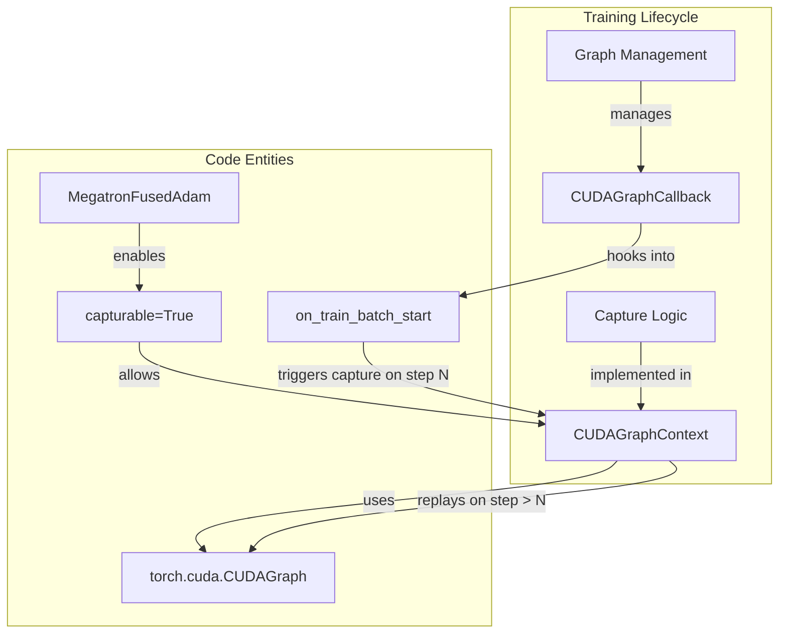
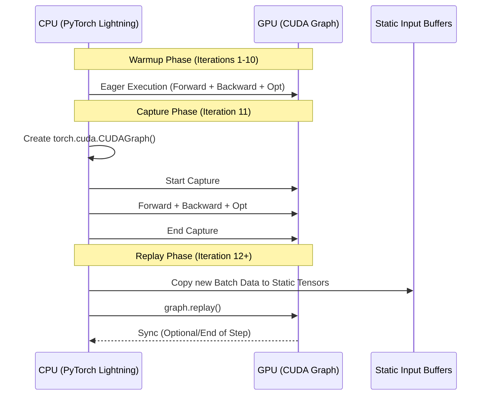

<!-- source: DeepWiki mcp.deepwiki.com · repo NVIDIA/dl-cuda-graph-doc · page 4.2 Stable Diffusion v2: Full-Iteration Graphing with PyTorch Lightning · fetched 2026-10-26 -->

# Stable Diffusion v2: Full-Iteration Graphing with PyTorch Lightning

Relevant source files

The following files were used as context for generating this wiki page:

- [docs/examples/stable-diffusion-v2.md](docs/examples/stable-diffusion-v2.md)

This page documents the CUDA Graph optimization strategy for Stable Diffusion v2 (SDv2) as implemented in the NVIDIA MLPerf Training benchmarks (v3.1 through v5.0). The implementation demonstrates **full-iteration graphing**, which captures the entire training lifecycle—forward pass, backward pass, and optimizer update—into a single executable graph to eliminate CPU-GPU launch overhead.

## Overview

Stable Diffusion v2 is a latent diffusion model consisting of a Variational Autoencoder (VAE), a CLIP text encoder, and a UNet. In the MLPerf Training configuration, only the UNet (~865M parameters) is trained, while the VAE and CLIP components are frozen and used for offline preprocessing `[docs/examples/stable-diffusion-v2.md:22-49]()`.

The training process uses fixed-size tensors:
*   **Latent moments**: `bs × 8 × 64 × 64` `[docs/examples/stable-diffusion-v2.md:51-51]()`.
*   **Text embeddings**: `bs × 77 × 1024` `[docs/examples/stable-diffusion-v2.md:51-51]()`.

Because the shapes are static and the model components are fixed during training, SDv2 is an ideal candidate for aggressive CUDA Graph optimization.

## Full-Iteration Capture Scope

Unlike per-layer graphing, SDv2 utilizes a "Full Iteration" scope. This means the CUDA Graph is captured once and replayed for every training step, encompassing all operations between data loading and the next iteration's start.

### Graphed Components
The following operations are included within the single captured graph:
1.  **UNet Forward Propagation**: The core denoising logic.
2.  **Loss Computation**: Mean Squared Error (MSE) calculation.
3.  **Backward Pass**: Autograd engine execution.
4.  **Gradient Management**: Gradient scaling (for FP16/AMP) and gradient clipping `[docs/examples/stable-diffusion-v2.md:93-93]()`.
5.  **Optimizer Update**: `MegatronFusedAdam` execution.
6.  **Gradient Zeroing**: Preparing for the next iteration `[docs/examples/stable-diffusion-v2.md:93-93]()`.

### Non-Graphed Components
Operations that remain on the eager path (outside the graph) include:
*   **Data Loading**: Uses static buffers to feed the graph.
*   **LR Scheduling**: Handled via tensor-based logic outside the graph.
*   **Logging and Checkpointing**: Occur at specific intervals and are not part of the timing-critical path `[docs/examples/stable-diffusion-v2.md:94-94]()`.

**Sources:** `[docs/examples/stable-diffusion-v2.md:87-106]()`

## Implementation Architecture

The integration utilizes a specialized NeMo/PyTorch Lightning callback system to manage the graph lifecycle without modifying the core model code.

### Entity Relationship: Natural Language to Code
The following diagram maps the high-level training concepts to the specific code entities used in the SDv2 implementation.

**Diagram: SDv2 Code Entity Mapping**

**Sources:** `[docs/examples/stable-diffusion-v2.md:107-130]()`

### Data Flow and Capture Process
The implementation uses a `CUDAGraphCallback` to intercept the PyTorch Lightning training loop. The first few iterations are used for "warmup" to allow the autograd engine and allocator to stabilize before capture occurs.

**Diagram: Full-Iteration Data Flow**

**Sources:** `[docs/examples/stable-diffusion-v2.md:107-140]()`

## Key Technical Components

### 1. NeMo CUDAGraphCallback
The `CUDAGraphCallback` automates the transition from eager execution to graphed execution. It handles:
*   **Warmup**: Executing a configurable number of eager steps to prime the CUDA memory allocator `[docs/examples/stable-diffusion-v2.md:107-120]()`.
*   **Memory Management**: Ensuring that the tensors used during capture are the same ones used during replay (address stability).
*   **RNG State**: Managing seed offsets to ensure stochasticity (like dropout or noise) remains correct across replays.

### 2. Capturable Optimizer
Standard PyTorch optimizers often contain host-side logic or dynamic branching that breaks CUDA Graph capture. The SDv2 implementation uses `MegatronFusedAdam` with the `capturable=True` flag.
*   **No-op Flag**: The optimizer is modified to support a "noop" flag. This allows the optimizer step to be captured into the graph even if it isn't executed every single step (e.g., during gradient accumulation), by effectively turning the kernels into no-ops when the flag is set `[docs/examples/stable-diffusion-v2.md:89-93]()`.

### 3. Static Input Buffers
To feed data into a captured graph, the memory addresses of the input tensors must remain constant. The implementation uses **Static Input Buffers**:
*   Data is loaded from the `DataLoader` into a temporary CPU tensor.
*   This data is then copied into a pre-allocated GPU tensor that was used during the graph capture phase `[docs/examples/stable-diffusion-v2.md:94-94]()`.

## Performance Impact

The transition from eager execution to full-iteration CUDA Graphs provides significant speedups by eliminating the "gaps" between kernels where the GPU would otherwise be idle waiting for the CPU to launch the next command.

| Metric | Eager Execution | CUDA Graph (Full) | Improvement |
| :--- | :--- | :--- | :--- |
| **Step Time (H100)** | Base | Optimized | ~1.58× Speedup |
| **CPU Utilization** | High (Launch bound) | Low (Management only) | Significant Reduction |
| **GPU Utilization** | Jittery | Solid/Flat | Max Throughput |

**Sources:** `[docs/examples/stable-diffusion-v2.md:10-10](), [docs/examples/stable-diffusion-v2.md:89-89]()`

## Summary of Constraints
For this implementation to function, the following conditions must be met:
1.  **Static Shapes**: Batch size and sequence lengths must not change between iterations `[docs/examples/stable-diffusion-v2.md:50-51]()`.
2.  **No Host Synchronization**: No `.item()` calls or `print(tensor)` operations can exist within the training step `[docs/examples/stable-diffusion-v2.md:95-95]()`.
3.  **Address Stability**: All model parameters and optimizer states must remain at fixed memory addresses `[docs/examples/stable-diffusion-v2.md:107-115]()`.

---

