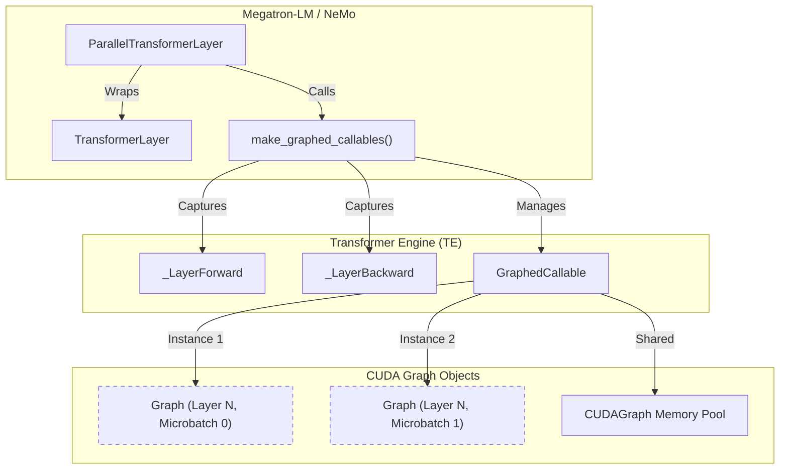
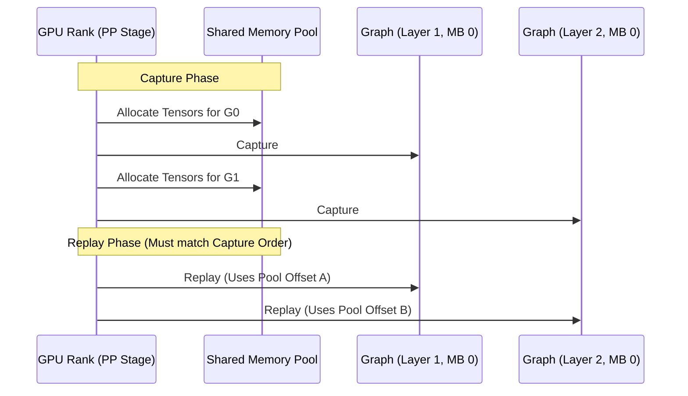

<!-- source: DeepWiki mcp.deepwiki.com · repo NVIDIA/dl-cuda-graph-doc · page 4.3 GPT-3 175B: Per-Layer Graphing with FP8 and Pipeline Parallelism · fetched 2026-10-26 -->

# GPT-3 175B: Per-Layer Graphing with FP8 and Pipeline Parallelism

Relevant source files

The following files were used as context for generating this wiki page:

- [docs/examples/gpt-3-175b.md](docs/examples/gpt-3-175b.md)

This page documents the CUDA Graph optimization strategy for GPT-3 175B training, based on NVIDIA's MLPerf Training v4.1 implementation. It details the use of Transformer Engine's `make_graphed_callables` for per-layer, per-microbatch graphing in a 3D-parallel environment (TP/PP/DP).

## Overview

GPT-3 175B consists of 96 transformer layers with 175 billion parameters [docs/examples/gpt-3-175b.md:15-20](). Training at this scale utilizes 3D parallelism to partition the model across thousands of GPUs [docs/examples/gpt-3-175b.md:28-28](). The implementation leverages **Transformer Engine (TE)** to handle compute-intensive operations in FP8 precision while using CUDA Graphs to eliminate kernel launch overhead in the transformer blocks [docs/examples/gpt-3-175b.md:40-42]().

### Technical Challenges
1.  **Pipeline Parallelism (PP) Complexity**: Ranks execute interleaved microbatch schedules, requiring graphs to handle non-linear execution ordering [docs/examples/gpt-3-175b.md:52-54]().
2.  **Graph Volume**: With 96 layers and multiple microbatches, a single GPU may manage over 1,500 graphs (96 layers × 8 microbatches × 2 for fwd/bwd) [docs/examples/gpt-3-175b.md:55-55]().
3.  **FP8 Coordination**: Global scaling factors must be synchronized across graphed layers [docs/examples/gpt-3-175b.md:56-56]().
4.  **Memory Constraints**: High-parameter models leave little headroom for graph memory overhead, requiring strict memory pool management [docs/examples/gpt-3-175b.md:57-57]().

**Sources:** [docs/examples/gpt-3-175b.md:15-59]()

---

## Integration Architecture: Per-Layer Graphing

The implementation uses **per-layer graphing**, where each transformer layer is captured as a separate CUDA graph for every microbatch it processes [docs/examples/gpt-3-175b.md:68-70]().

### Capture Scope
*   **Graphed**: Individual transformer layers (Self-attention and MLP), backward pass gradient computations, and FP8 quantization/dequantization operations [docs/examples/gpt-3-175b.md:72-77]().
*   **Eager Mode**: Embedding layers, Layer Normalization, Pipeline Parallel communication (`send`/`recv`), Data Parallel all-reduce, and the Optimizer step [docs/examples/gpt-3-175b.md:79-88]().

### Code Entity Mapping: TE and Megatron-LM
The following diagram illustrates how the natural language concept of "Per-Layer Graphing" maps to specific code entities in the Transformer Engine and Megatron-LM stack.

**Diagram: GPT-3 Per-Layer Graphing Entities**

**Sources:** [docs/examples/gpt-3-175b.md:68-110](), [docs/examples/gpt-3-175b.md:144-162]()

---

## FP8 Weight Caching and GPU No-Ops

A critical optimization in GPT-3 175B is **FP8 weight caching** (`fp8_weight_caching=True`) [docs/examples/gpt-3-175b.md:77-77](). 

In a standard FP8 implementation, weights are re-quantized for every microbatch. To save compute, the implementation quantizes weights only during the first microbatch and caches them for subsequent microbatches in the same iteration [docs/examples/gpt-3-175b.md:77-77]().

### GPU-Controlled No-Ops
Because CUDA Graphs have a static topology, the quantization kernels cannot be "removed" from the graph for subsequent microbatches. Instead, the implementation uses **GPU-controlled no-ops**:
1.  A "skip flag" resides in GPU memory.
2.  The quantization kernel checks this flag.
3.  If the flag is set (microbatch > 0), the kernel exits immediately without performing work [docs/examples/gpt-3-175b.md:77-77]().

**Sources:** [docs/examples/gpt-3-175b.md:72-77]()

---

## Pipeline Parallelism and Memory Pool Management

GPT-3 175B uses an **interleaved pipeline schedule** to reduce the pipeline bubble [docs/examples/gpt-3-175b.md:42-42](). This creates a complex execution sequence where a single GPU rank may process Layer 1 (Microbatch 0), then Layer 10 (Microbatch 0), then Layer 1 (Microbatch 1), and so on.

### Memory Pool Sharing
To minimize memory footprint, all graphs for a single layer across different microbatches share the same **CUDA Graph Memory Pool** [docs/examples/gpt-3-175b.md:164-168](). 

### Strict Replay Ordering
Because multiple graphs share a memory pool, they must be replayed in the **exact same order** they were captured [docs/examples/gpt-3-175b.md:57-57](). If the replay order deviates from the capture order (e.g., due to a change in the pipeline schedule), the memory addresses assigned during capture may overlap incorrectly, leading to silent data corruption [docs/examples/gpt-3-175b.md:57-57]().

**Diagram: Memory Pool and Pipeline Interleaving**

**Sources:** [docs/examples/gpt-3-175b.md:52-59](), [docs/examples/gpt-3-175b.md:164-170]()

---

## Implementation Summary Table

| Feature | Implementation Detail |
| :--- | :--- |
| **Graphing Tool** | Transformer Engine `make_graphed_callables` [docs/examples/gpt-3-175b.md:63-63]() |
| **Granularity** | Per-layer, per-microbatch [docs/examples/gpt-3-175b.md:70-70]() |
| **FP8 Support** | Weight caching with GPU-controlled no-ops [docs/examples/gpt-3-175b.md:77-77]() |
| **Parallelism** | TP=4, PP=6, DP (Scale up to 11,616 GPUs) [docs/examples/gpt-3-175b.md:104-104]() |
| **Memory Strategy** | Shared pool across microbatches for each layer [docs/examples/gpt-3-175b.md:164-168]() |
| **Execution** | Manual replay within the Megatron-LM pipeline engine [docs/examples/gpt-3-175b.md:54-54]() |

**Sources:** [docs/examples/gpt-3-175b.md:40-110]()

---

