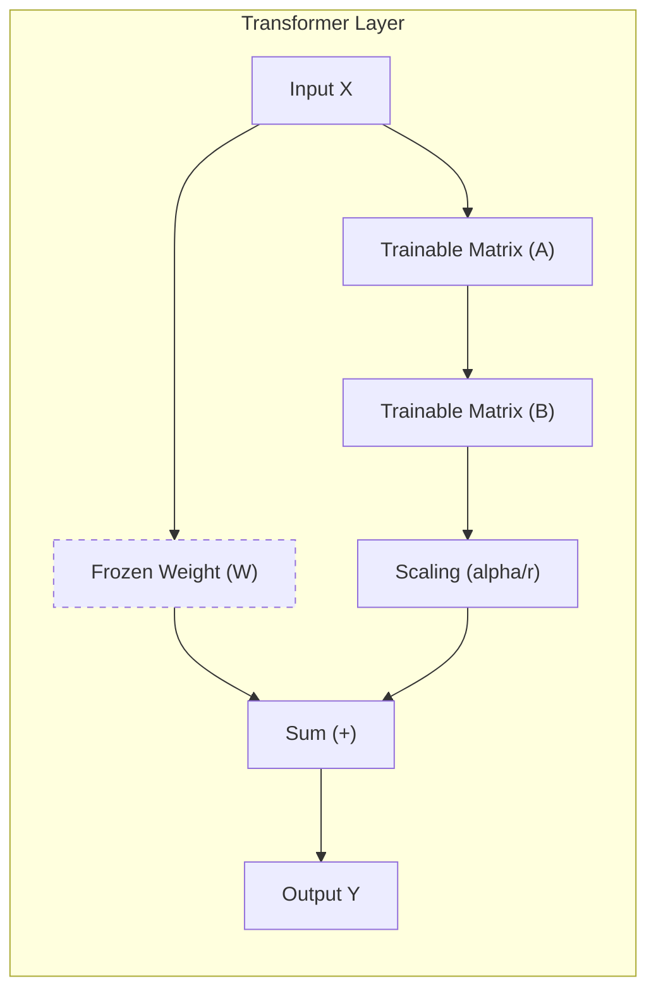
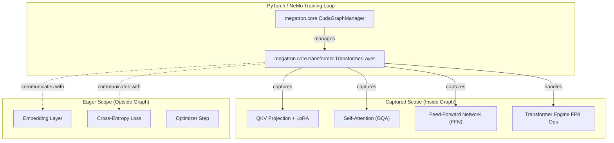

<!-- source: DeepWiki mcp.deepwiki.com · repo NVIDIA/dl-cuda-graph-doc · page 4.4 Llama 2 70B LoRA: Fine-Tuning with Per-Layer Graphing · fetched 2026-10-26 -->

# Llama 2 70B LoRA: Fine-Tuning with Per-Layer Graphing

Relevant source files

The following files were used as context for generating this wiki page:

- [docs/assets/lora-arch.png](docs/assets/lora-arch.png)
- [docs/examples/llama2-70b-lora.md](docs/examples/llama2-70b-lora.md)

This page documents the CUDA Graph implementation for Llama 2 70B LoRA fine-tuning as featured in the NVIDIA MLPerf Training v5.0 submission. The implementation utilizes a per-layer graphing strategy to manage the complexity of a 70-billion parameter model while integrating parameter-efficient fine-tuning (LoRA) and mixed-precision (FP8/BF16) execution.

## Overview

Llama 2 70B is a decoder-only transformer architecture consisting of 80 layers [docs/examples/llama2-70b-lora.md:15-15](). Fine-tuning this model at scale traditionally requires significant memory; however, this implementation uses **Low-Rank Adaptation (LoRA)** to freeze the base model weights and train only small adapter matrices (A and B) [docs/examples/llama2-70b-lora.md:17-17]().

The primary technical challenge for CUDA Graphs in this context is the integration of **FP8 precision** via Transformer Engine, which involves mutable scaling factors that must be managed as graph state, and the coordination of 80 distinct transformer layers [docs/examples/llama2-70b-lora.md:55-57]().

### LoRA Architecture
The following diagram illustrates the low-rank decomposition where the pre-trained weights $W$ remain frozen, and only the low-rank matrices $A$ and $B$ are updated during the backward pass.

**Figure: LoRA Low-Rank Decomposition**

Sources: [docs/examples/llama2-70b-lora.md:19-21](), [docs/assets/lora-arch.png:1-31]()

## Implementation: Megatron-Core CudaGraphManager

The implementation leverages the `CudaGraphManager` within **Megatron-Core** to perform automatic just-in-time (JIT) CUDA graph capture [docs/examples/llama2-70b-lora.md:61-61](). Unlike full-iteration graphing, this approach targets individual `TransformerLayer` instances [docs/examples/llama2-70b-lora.md:91-91]().

### Per-Layer Graphing Strategy
The `CudaGraphManager` employs a two-phase **record-then-capture** strategy to handle the execution flow:

1.  **Recording Phase (Warmup):** The manager monitors the execution sequence of each layer across all microbatches to identify the static topology [docs/examples/llama2-70b-lora.md:67-67]().
2.  **Capture Phase:** The manager creates separate CUDA graphs for every layer, for every microbatch, and for both forward and backward passes [docs/examples/llama2-70b-lora.md:68-68]().

For Llama 2 70B (80 layers) without pipeline parallelism, this results in $80 \text{ layers} \times 2 \text{ passes} = 160$ total graphs [docs/examples/llama2-70b-lora.md:68-68]().

### Data Flow and Code Entities
The following diagram maps the high-level fine-tuning components to the specific code entities responsible for the CUDA Graph lifecycle.

**Llama 2 LoRA Graphing Entity Map**

Sources: [docs/examples/llama2-70b-lora.md:61-72](), [docs/examples/llama2-70b-lora.md:93-101]()

## Capture Scope and Precision

The per-layer capture ensures that compute-intensive components are accelerated while high-level orchestration remains flexible in eager mode.

### What is Captured
Each captured `TransformerLayer` graph includes:
*   **Input LayerNorm** [docs/examples/llama2-70b-lora.md:95-95]()
*   **Self-Attention:** QKV projections (including LoRA adapter matrices), Grouped-Query Attention (GQA) logic, and output projections [docs/examples/llama2-70b-lora.md:96-99]()
*   **Post-Attention LayerNorm** [docs/examples/llama2-70b-lora.md:100-100]()
*   **MLP/Feed-Forward Block:** Gated Linear Unit (GLU) and projections [docs/examples/llama2-70b-lora.md:101-101]()

### Precision and Memory
*   **Mixed Precision:** The model uses **BF16** as the base precision, with **FP8** (via Transformer Engine) used for compute-intensive linear layers [docs/examples/llama2-70b-lora.md:46-46]().
*   **Static Shapes:** A fixed sequence length of 8,192 tokens is used (no sequence packing), which is a prerequisite for successful CUDA Graph capture [docs/examples/llama2-70b-lora.md:47-47]().
*   **Parameter Efficiency:** LoRA reduces the trainable parameters to ~55M (0.08% of the 70B total), significantly lowering the memory footprint during the backward pass within the graph [docs/examples/llama2-70b-lora.md:17-17]().

## Configuration

To enable this implementation in the MLPerf benchmark environment, the following environment variables are utilized:

| Variable | Value | Description |
| :--- | :--- | :--- |
| `MCORE_CUDA_GRAPH` | `1` | Enables internal Megatron-Core `CudaGraphManager` [docs/examples/llama2-70b-lora.md:82-82]() |
| `LAYER_CUDA_GRAPH` | `0` | Disables external Transformer Engine `make_graphed_callables` [docs/examples/llama2-70b-lora.md:82-82]() |

The internal `CudaGraphManager` was preferred for the v5.0 submission due to its automatic handling of complex distributed patterns and simpler integration with Megatron-Core's `TransformerLayer` [docs/examples/llama2-70b-lora.md:86-86]().

Sources:
* [docs/examples/llama2-70b-lora.md:1-101]()
* [docs/assets/lora-arch.png:1-31]()

---

