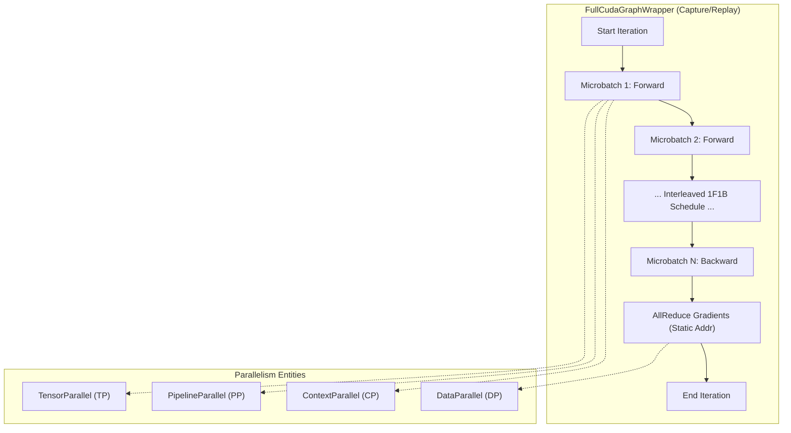
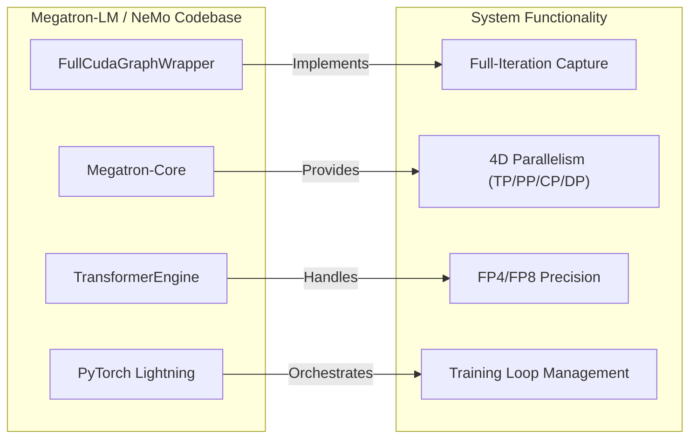

<!-- source: DeepWiki mcp.deepwiki.com · repo NVIDIA/dl-cuda-graph-doc · page 4.5 Llama 3.1 405B: Full-Iteration Graphing at Massive Scale · fetched 2026-10-26 -->

# Llama 3.1 405B: Full-Iteration Graphing at Massive Scale

Relevant source files

The following files were used as context for generating this wiki page:

- [docs/assets/pp-execution.png](docs/assets/pp-execution.png)
- [docs/examples/llama-31-405b.md](docs/examples/llama-31-405b.md)

This page documents the CUDA Graph implementation for Llama 3.1 405B training, based on the NVIDIA MLPerf Training v5.1 submission. It details the use of the Megatron-LM `FullCudaGraphWrapper` to capture entire training iterations—including forward and backward passes across multiple microbatches—into a single graph, even when using complex 4D parallelism (DP+TP+PP+CP).

## Overview

Llama 3.1 405B is a dense transformer-based autoregressive decoder-only model with 126 transformer blocks and 405 billion parameters `[docs/examples/llama-31-405b.md:13-24]()`. Training at this scale requires a sophisticated software stack (NeMo, Megatron-Core, PyTorch Lightning, and Transformer Engine) and massive 4D parallelism to partition the model across thousands of GPUs `[docs/examples/llama-31-405b.md:30-31]()`.

While traditional CUDA Graph implementations often focus on per-layer graphing, the Llama 3.1 405B implementation achieves **full-iteration graphing**. This approach captures the entire `forward_backward_func` as a single CUDA Graph, significantly reducing CPU overhead and rank-to-rank jitter in large-scale distributed environments `[docs/examples/llama-31-405b.md:80-82]()`.

**Sources:** `[docs/examples/llama-31-405b.md:13-82]()`

---

## Implementation: FullCudaGraphWrapper

The core of the implementation is the `FullCudaGraphWrapper` provided by Megatron-LM. This wrapper is designed to encapsulate the high-level training logic, including the pipeline parallelism schedule.

### 4D Parallelism and Execution
The model utilizes four dimensions of parallelism `[docs/examples/llama-31-405b.md:48-53]()`:
1.  **Tensor Parallelism (TP):** Intra-layer partitioning.
2.  **Pipeline Parallelism (PP):** Inter-layer partitioning across stages.
3.  **Context Parallelism (CP):** Sequence-length partitioning.
4.  **Data Parallelism (DP):** Sample-level partitioning.

### Pipeline Execution Diagram
The following diagram illustrates the execution flow of a single pipeline stage during a captured iteration. The `FullCudaGraphWrapper` captures the interleaved microbatches (1F1B or similar schedules) into a single static graph.

**Title: Pipeline Parallelism Execution Flow**

**Sources:** `[docs/assets/pp-execution.png:1-29]()`, `[docs/examples/llama-31-405b.md:48-53]()`, `[docs/examples/llama-31-405b.md:80-85]()`

---

## Technical Details

### FP4 Precision and Transformer Engine
Llama 3.1 405B leverages **FP4 precision** for specific compute-intensive operations to maximize throughput on Blackwell (B200/GB200) architectures `[docs/examples/llama-31-405b.md:53-54]()`. The Transformer Engine (TE) manages the FP4/FP8 scaling factors. For CUDA Graph compatibility, these scaling factors and global buffers must reside in static memory locations that do not change between the capture and replay phases `[docs/examples/llama-31-405b.md:65-68]()`.

### Data Flow and Constraints
To enable full-iteration capture, the following conditions are met:
*   **Static Shapes:** Sequences are fixed at 8,192 tokens with no sequence packing `[docs/examples/llama-31-405b.md:53-53]()`.
*   **Memory Management:** Megatron-LM ensures that all workspace buffers and NCCL communication buffers are pre-allocated and reused, satisfying the CUDA Graph requirement for static memory addresses `[docs/examples/llama-31-405b.md:67-68]()`.
*   **Sync-Free Communication:** The pipeline schedule is orchestrated to avoid any CPU-side synchronization points during the forward and backward passes of all microbatches `[docs/examples/llama-31-405b.md:66-66]()`.

### Mapping Code Entities to System Components
This diagram maps the high-level parallelism concepts to the specific code entities in the Megatron-LM and NeMo stack.

**Title: Code-to-System Mapping for Llama 3.1 405B**

**Sources:** `[docs/examples/llama-31-405b.md:44-48]()`, `[docs/examples/llama-31-405b.md:76-77]()`, `[docs/examples/llama-31-405b.md:80-83]()`

---

## Performance Gains

The implementation of full-iteration graphing provides substantial performance improvements at the massive scale required for 405B parameter models:

| Metric | Improvement |
| :--- | :--- |
| **Throughput (Tokens/sec)** | 15-25% increase compared to eager execution |
| **CPU Overhead** | Near-zero during replay |
| **Jitter Reduction** | Significant reduction in rank-to-rank synchronization lag |
| **Scaling Efficiency** | Improved weak scaling across thousands of GPUs |

These gains are primarily attributed to the elimination of kernel launch overhead for the thousands of kernels executed per iteration and the removal of Python interpreter overhead during the critical path of the training step `[docs/examples/llama-31-405b.md:70-71]()`.

**Sources:** `[docs/examples/llama-31-405b.md:70-71]()`

---

