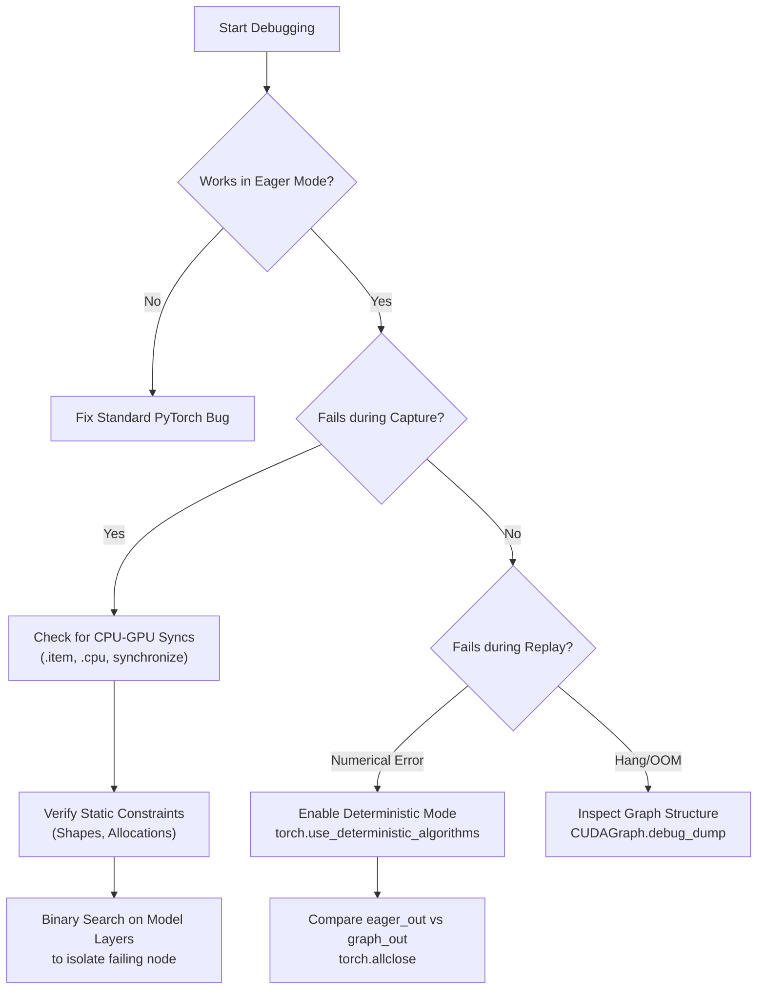
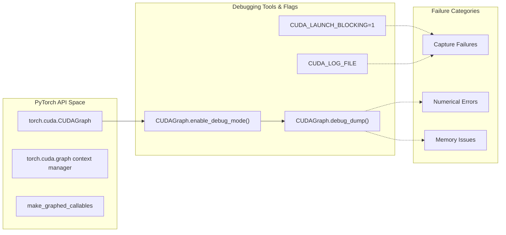

<!-- source: DeepWiki mcp.deepwiki.com · repo NVIDIA/dl-cuda-graph-doc · page 5.1 Debugging Strategies · fetched 2026-10-26 -->

# Debugging Strategies

<details>
<summary>Relevant source files</summary>

The following files were used as context for generating this wiki page:

- [docs/troubleshooting/debugging-strategies.md](docs/troubleshooting/debugging-strategies.md)

</details>


This section provides systematic approaches to debug CUDA graph issues in PyTorch applications. Debugging CUDA Graphs requires a shift in mindset because errors may occur during the **capture** phase (definition) or the **replay** phase (execution), each presenting distinct symptoms and root causes [docs/troubleshooting/debugging-strategies.md:8-15]().

## General Debugging Workflow

When encountering issues, follow this systematic multi-step strategy to isolate the failure point.

### 1. Baseline Validation (Eager Mode)
Always verify that the code executes correctly in eager mode before attempting to graph it [docs/troubleshooting/debugging-strategies.md:17-19](). If the model fails in eager execution, the issue is unrelated to CUDA Graphs. This step separates model-level logic bugs from graph-specific constraint violations [docs/troubleshooting/debugging-strategies.md:19-20]().

### 2. Isolation via Binary Search and Simplification
If eager mode works but the graphed version fails, isolate the problematic region using a binary search approach [docs/troubleshooting/debugging-strategies.md:21-25]().

*   **Binary Search**: Start by graphing the entire model. If it fails, graph only the first half, then the first quarter, until the smallest failing section is identified [docs/troubleshooting/debugging-strategies.md:27-30]().
*   **Progressive Simplification**: Gradually disable complex features to reach a "minimal failing example" [docs/troubleshooting/debugging-strategies.md:32-40]():
    1. Disable Pipeline Parallelism (PP).
    2. Set `model.eval()` to remove dropout.
    3. Temporarily remove random operations.
    4. Reduce the number of layers and input sizes.

### 3. Diagnostic Logging and Error Reporting
CUDA Graph capture failures often throw informative PyTorch error messages [docs/troubleshooting/debugging-strategies.md:42-44](). To improve the accuracy of these messages:
*   **Synchronous Launches**: Set `CUDA_LAUNCH_BLOCKING=1` to pinpoint the exact operation triggering the error [docs/troubleshooting/debugging-strategies.md:44-44]().
*   **Driver Logging**: Use `CUDA_LOG_FILE=stderr` to capture low-level CUDA driver diagnostics [docs/troubleshooting/debugging-strategies.md:46-50]().
*   **Advanced Diagnostics**: In CUDA 12.9+, use the CUDA Error Log Management APIs or `cuda-python` bindings to register callbacks for stack traces upon error [docs/troubleshooting/debugging-strategies.md:52-52]().

**Sources:** [docs/troubleshooting/debugging-strategies.md:17-52]()

## Inspection and Verification Techniques

### Graph Structure Visualization
For structural issues, PyTorch allows dumping the captured graph to disk for inspection [docs/troubleshooting/debugging-strategies.md:85-88](). This helps verify that all expected operations were captured and that memory addresses remain static [docs/troubleshooting/debugging-strategies.md:101-105]().

```python
# Enable debug mode and dump graph
g = torch.cuda.CUDAGraph()
g.enable_debug_mode() [docs/troubleshooting/debugging-strategies.md:92-92]()

with torch.cuda.graph(g):
    output = model(static_input)

# Dump graph for inspection
g.debug_dump("/tmp/graph_debug") [docs/troubleshooting/debugging-strategies.md:98-98]()
```

### Numerical Comparison Workflow
For "silent" failures where the graph runs but produces incorrect results (NaNs, Infs, or precision loss), use a systematic comparison against eager mode [docs/troubleshooting/debugging-strategies.md:107-110]().

| Step | Action | Code/Entity |
| :--- | :--- | :--- |
| **1** | **Enable Determinism** | `torch.use_deterministic_algorithms(True)` [docs/troubleshooting/debugging-strategies.md:111-111]() |
| **2** | **Fix Randomness** | `torch.manual_seed(42)` [docs/troubleshooting/debugging-strategies.md:111-111]() |
| **3** | **Capture activations** | Use global lists to store internal tensors for inspection [docs/troubleshooting/debugging-strategies.md:113-113]() |
| **4** | **Replay & Compare** | Use `torch.allclose()` to compare `eager_out` and `graph_out` [docs/troubleshooting/debugging-strategies.md:118-133]() |

**Sources:** [docs/troubleshooting/debugging-strategies.md:85-133]()

## Debugging Architecture: From Logic to Code

The following diagrams map the debugging workflow and the relationship between PyTorch entities and CUDA Graph debugging tools.

### Debugging Logic Flow
This diagram illustrates the decision tree for identifying the source of a CUDA Graph failure.


**Sources:** [docs/troubleshooting/debugging-strategies.md:15-40](), [docs/troubleshooting/debugging-strategies.md:107-133]()

### Code Entity Mapping
This diagram bridges the conceptual debugging strategies with the specific PyTorch and CUDA code entities used to implement them.


**Sources:** [docs/troubleshooting/debugging-strategies.md:44-52](), [docs/troubleshooting/debugging-strategies.md:58-62](), [docs/troubleshooting/debugging-strategies.md:91-98]()

## Debugging Checklist

Before escalating an issue, verify the following requirements:

*   **Execution Environment**:
    *   [ ] Does it work in eager mode? [docs/troubleshooting/debugging-strategies.md:141-141]()
    *   [ ] Is all CPU-only code (e.g., tokenizers) moved outside the capture region? [docs/troubleshooting/debugging-strategies.md:142-142]()
*   **Constraint Adherence**:
    *   [ ] Are there any hidden CPU-GPU syncs (`.item()`, `.cpu()`)? [docs/troubleshooting/debugging-strategies.md:143-143]()
    *   [ ] Is control flow deterministic (no data-dependent `if` statements)? [docs/troubleshooting/debugging-strategies.md:144-144]()
    *   [ ] Are all tensor shapes strictly static? [docs/troubleshooting/debugging-strategies.md:145-145]()
*   **Implementation Details**:
    *   [ ] Did you perform at least 3 warmup iterations? [docs/troubleshooting/debugging-strategies.md:146-146]()
    *   [ ] Are you using `.copy_()` for graph inputs instead of reassignment? [docs/troubleshooting/debugging-strategies.md:147-147]()
    *   [ ] For DDP: Are you using 11+ warmup iterations? [docs/troubleshooting/debugging-strategies.md:148-148]()
    *   [ ] For AMP: Is `cache_enabled=False` set? [docs/troubleshooting/debugging-strategies.md:149-149]()

**Sources:** [docs/troubleshooting/debugging-strategies.md:137-152]()

---

