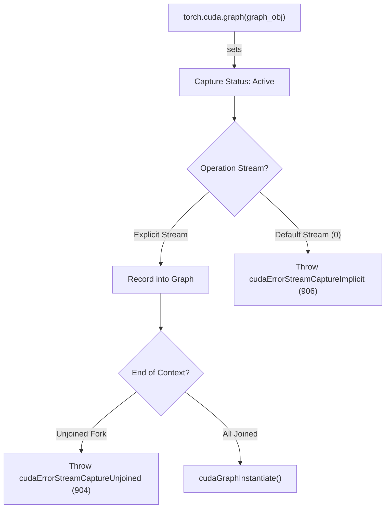
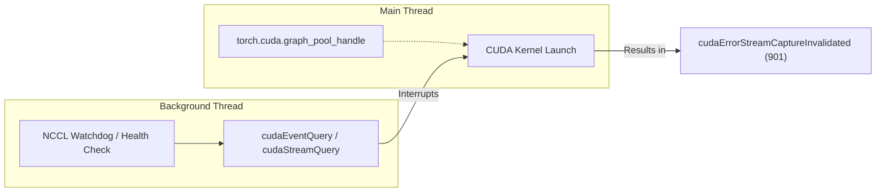

<!-- source: DeepWiki mcp.deepwiki.com · repo NVIDIA/dl-cuda-graph-doc · page 5.2 Capture Failures · fetched 2026-10-26 -->

# Capture Failures

Relevant source files

The following files were used as context for generating this wiki page:

- [docs/troubleshooting/capture-failures.md](docs/troubleshooting/capture-failures.md)

This section covers **explicit failures** that occur during CUDA graph capture—errors that prevent the graph from being created in the first place. [docs/troubleshooting/capture-failures.md:8-11]()

## Understanding Capture Failures

When you attempt to capture a CUDA graph, it records the sequence of CUDA operations launched during the capture scope. This recording process imposes strict requirements: operations must be deterministic, asynchronous, and execute on properly synchronized streams. Any violation of these requirements causes **capture to fail immediately** with an explicit error message. [docs/troubleshooting/capture-failures.md:13-15]()

These failures are easier to debug compared to silent failures (such as numerical errors) because the CUDA runtime provides clear error codes and PyTorch often gives helpful context. [docs/troubleshooting/capture-failures.md:17-17]()

### Why Capture Fails

PyTorch CUDA graphs record a fixed sequence of GPU operations for replay. This design creates several strict requirements: [docs/troubleshooting/capture-failures.md:19-22]()

1.  **No CPU-GPU synchronization**: Graphs capture GPU work only. Operations like `.item()` or `.cpu()` that block the CPU cannot be captured. [docs/troubleshooting/capture-failures.md:23-23]()
2.  **Proper stream dependencies**: All streams used during capture must form a tree branching from the capture stream. [docs/troubleshooting/capture-failures.md:25-25]()
3.  **No forbidden operations**: Certain CUDA operations, such as querying event status from other threads, are incompatible. [docs/troubleshooting/capture-failures.md:27-27]()
4.  **Avoid default stream**: The default stream (stream 0) has implicit synchronization behavior that makes it incompatible with graphs. [docs/troubleshooting/capture-failures.md:29-29]()

### Common Error Codes

| Error Code | Name | Meaning |
| :--- | :--- | :--- |
| 900 | `cudaErrorStreamCaptureUnsupported` | Forbidden operation during capture |
| 901 | `cudaErrorStreamCaptureInvalidated` | Capture interrupted by external work or thread |
| 904 | `cudaErrorStreamCaptureUnjoined` | Stream didn't rejoin before capture ended |
| 905 | `cudaErrorStreamCaptureIsolation` | Captured stream depends on uncaptured work |
| 906 | `cudaErrorStreamCaptureImplicit` | Operation would create forbidden dependency on default stream |

[docs/troubleshooting/capture-failures.md:31-42]()

**Sources:** [docs/troubleshooting/capture-failures.md:8-42]()

---

## Synchronization Failures

CPU-GPU synchronization is one of the most frequent causes of capture failure. Any operation that blocks the CPU waiting for GPU results will fail because the CPU is merely recording operations, not executing them. [docs/troubleshooting/capture-failures.md:47-57]()

### Host-Device Sync: Forbidden Operations
**Error**: `cudaErrorStreamCaptureUnsupported (900)`

**Common culprits and alternatives**:
*   **`.item()`**: Use `torch.where()` for GPU-side conditionals or keep as a tensor. [docs/troubleshooting/capture-failures.md:81-88]()
*   **`.cpu()`**: Use `.to('cpu', non_blocking=True)` outside the graph scope. [docs/troubleshooting/capture-failures.md:84-84]()
*   **`print(tensor)`**: Log values after graph replay. [docs/troubleshooting/capture-failures.md:85-85]()

**Detection**: Use `torch.cuda.set_sync_debug_mode(1)` to warn or `(2)` to error on synchronizations during development. [docs/troubleshooting/capture-failures.md:112-118]()

**Sources:** [docs/troubleshooting/capture-failures.md:47-121]()

---

## Memory Allocation and Deallocation

Memory operations like `cudaMalloc` and `cudaFree` have varying support. PyTorch's caching allocator implements special handling to work around these restrictions. [docs/troubleshooting/capture-failures.md:125-127]()

### Device Memory Handling
While `cudaMalloc` is generally restricted, PyTorch wraps these calls in a relaxed capture mode internally. [docs/troubleshooting/capture-failures.md:131-133]()
*   **`cudaMalloc`**: Allowed via PyTorch's internal wrapper.
*   **`cudaFree`**: Intentionally skipped during capture. PyTorch's allocator checks `is_capturing` and makes `empty_cache()` a safe no-op. [docs/troubleshooting/capture-failures.md:133-133]()

### Pinned Memory Allocation
**Error**: `cudaErrorStreamCaptureUnsupported (900)`
**Cause**: `cudaHostAlloc` (pinned memory) is strictly forbidden during capture. [docs/troubleshooting/capture-failures.md:175-177]()
**Solution**: Pre-allocate all pinned memory buffers before starting the capture. [docs/troubleshooting/capture-failures.md:195-197]()

**Sources:** [docs/troubleshooting/capture-failures.md:125-201]()

---

## Stream and Event Failures

### Stream Fork-Join Violations
**Error**: `cudaErrorStreamCaptureUnjoined (904)`
**Cause**: A stream was forked (via `s1.wait_stream(s_capture)`) but did not rejoin the capture stream before the capture ended. [docs/troubleshooting/capture-failures.md:214-216]()

### Default Stream Conflicts
**Error**: `cudaErrorStreamCaptureImplicit (906)`
**Cause**: Using the legacy default stream (Stream 0) during capture. This often happens in:
*   **DDP/FSDP**: Collective operations might default to stream 0. [docs/troubleshooting/capture-failures.md:310-312]()
*   **Gradient Tape**: PyTorch's autograd engine might use the default stream for certain overhead tasks. [docs/troubleshooting/capture-failures.md:314-315]()

### Capture-to-Code Mapping: Stream Lifecycle

The following diagram illustrates the relationship between PyTorch stream entities and the CUDA driver's capture state.

**Stream Capture Logic**

**Sources:** [docs/troubleshooting/capture-failures.md:214-230](), [docs/troubleshooting/capture-failures.md:300-320]()

---

## Forbidden Operations

### Background Thread Queries
**Error**: `cudaErrorStreamCaptureInvalidated (901)`
**Cause**: This occurs when a background thread (like a monitoring thread or a NCCL watchdog) queries the status of a stream or event currently being captured. [docs/troubleshooting/capture-failures.md:330-335]()

### NCCL Watchdog Conflicts
The NCCL watchdog thread periodically checks the health of GPU operations. If this check occurs during an active capture, it can invalidate the capture. [docs/troubleshooting/capture-failures.md:360-362]()
**Workaround**: Disable the NCCL watchdog during the capture phase using `NCCL_ASYNC_ERROR_HANDLING=0` or by ensuring the watchdog doesn't query the specific capture stream. [docs/troubleshooting/capture-failures.md:370-375]()

### Code Entity Relationship: Forbidden Interactions

This diagram maps high-level background processes to the specific CUDA error codes they trigger.

**Background Process Interference**

**Sources:** [docs/troubleshooting/capture-failures.md:330-350](), [docs/troubleshooting/capture-failures.md:360-380]()

---

## Summary of Workarounds

| Failure Category | Primary Solution |
| :--- | :--- |
| **Synchronization** | Use `torch.cuda.set_sync_debug_mode(2)` to find and remove `.item()` calls. |
| **Pinned Memory** | Move `tensor.pin_memory()` calls outside the `torch.cuda.graph` context. |
| **Stream Fork/Join** | Ensure `s_capture.wait_stream(s_forked)` is called before exiting the context. |
| **Default Stream** | Wrap all code in `with torch.cuda.stream(explicit_stream):`. |
| **NCCL Watchdog** | Temporarily disable async error handling during the capture warmup phase. |

**Sources:** [docs/troubleshooting/capture-failures.md:385-410]()

---

