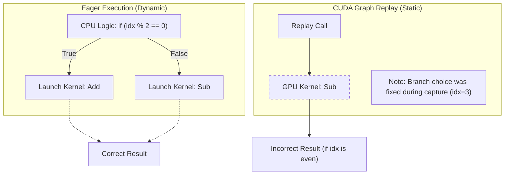
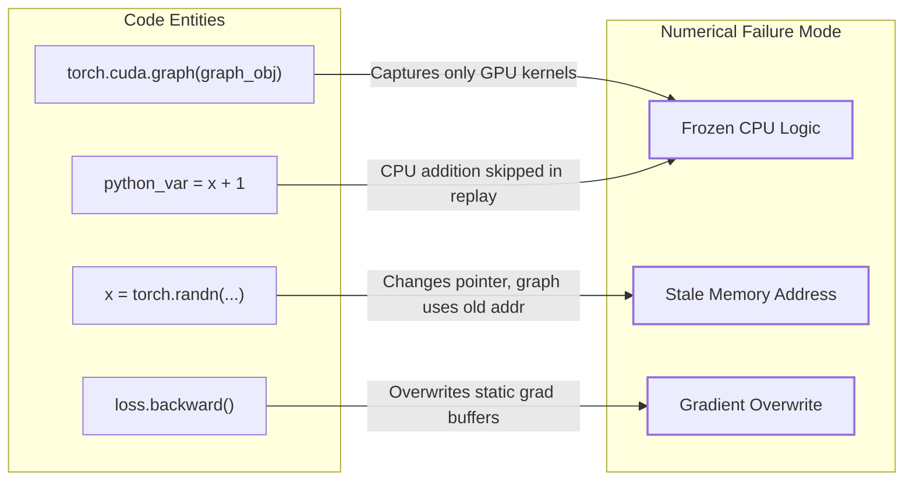

<!-- source: DeepWiki mcp.deepwiki.com · repo NVIDIA/dl-cuda-graph-doc · page 5.3 Numerical Errors · fetched 2026-10-26 -->

# Numerical Errors

Relevant source files

The following files were used as context for generating this wiki page:

- [docs/troubleshooting/numerical-errors.md](docs/troubleshooting/numerical-errors.md)

Numerical errors represent one of the most significant challenges when implementing CUDA Graphs in PyTorch. Unlike capture failures, which result in immediate runtime exceptions, numerical errors often manifest as "silent failures"—the code executes to completion, but produces incorrect results, NaN/Inf values, or numerical drift [docs/troubleshooting/numerical-errors.md:6-15]().

## Understanding Numerical Errors

Numerical errors are inherently difficult to debug because CUDA Graphs are static and GPU-only, whereas standard PyTorch code is dynamic and involves CPU-side logic [docs/troubleshooting/numerical-errors.md:27-27](). During graph replay, all CPU code within the captured region is skipped, meaning intermediate states cannot be inspected with standard debuggers or print statements [docs/troubleshooting/numerical-errors.md:25-25]().

### Failure Categories
| Category | Description |
| :--- | :--- |
| **Dynamic Behavior** | Control flow, dynamic tensors, or shapes that change across iterations but are "frozen" during capture [docs/troubleshooting/numerical-errors.md:33-33](). |
| **Race Conditions** | Modifying pinned memory on the CPU while the GPU is still reading from it [docs/troubleshooting/numerical-errors.md:34-34](). |
| **Tensor Reassignment** | Tensors freed or reassigned before replay, leading to stale memory references [docs/troubleshooting/numerical-errors.md:35-35](). |
| **Output Overwriting** | Graph outputs overwritten on each replay, corrupting accumulated results like gradients [docs/troubleshooting/numerical-errors.md:36-36](). |
| **Eliminated CPU Logic** | Host-side state mutations (e.g., counters) that are skipped during replay [docs/troubleshooting/numerical-errors.md:37-37](). |
| **Library Unawareness** | Libraries or hooks that are not stream-aware and fail to record operations in the graph [docs/troubleshooting/numerical-errors.md:38-38](). |

**Sources:** [docs/troubleshooting/numerical-errors.md:13-41]()

---

## Dynamic Behavior: Frozen Execution Paths

The fundamental constraint of CUDA Graphs is that they capture a single execution path. If the logic depends on a Python conditional (`if/else`), only the branch taken during the capture phase is recorded [docs/troubleshooting/numerical-errors.md:49-54]().

### The "Frozen Branch" Problem
If a graph is captured while a condition is `True`, every subsequent replay will execute that specific set of kernels, even if the condition logically evaluates to `False` on the CPU [docs/troubleshooting/numerical-errors.md:55-82]().

### Solution: GPU-Side Selection
To fix this, developers must eliminate Python-side control flow by executing all possible branches and selecting the result using GPU-side operations like `torch.where()`. The condition must be stored in a GPU tensor so that it can be updated between replays [docs/troubleshooting/numerical-errors.md:99-113]().

### Data Flow: Eager vs. Graphed Control Flow

The following diagram illustrates how dynamic control flow becomes static within a CUDA Graph.

**Control Flow Capture Mechanism**

**Sources:** [docs/troubleshooting/numerical-errors.md:49-95]()

---

## Tensor Management and Reassignment

A common source of "Wrong Results" is the reassignment of tensors between the capture phase and the replay phase. CUDA Graphs record the **memory addresses** of tensors, not the Python object references [docs/troubleshooting/numerical-errors.md:35-35]().

### Tensor Reassignment vs. In-place Copy
If a tensor used during capture is later reassigned (e.g., `x = new_tensor`), the graph still points to the old memory address. Subsequent updates to `x` will not be seen by the graph replay [docs/troubleshooting/numerical-errors.md:35-35]().

**Corrective Action:** Use in-place operations like `x.copy_(new_data)` or `x.fill_(value)` to update the contents of the memory address that the graph has already recorded [docs/troubleshooting/numerical-errors.md:121-121]().

### Uninitialized Memory
If a graph is captured before tensors are properly initialized, the kernels may record operations on garbage memory. This is particularly prevalent when using `torch.empty()` without a subsequent initialization before the `torch.cuda.graph()` context manager [docs/troubleshooting/numerical-errors.md:33-41]().

---

## Gradient Accumulation and Output Reuse

In training loops, CUDA Graphs can cause issues with gradient accumulation. Because the graph writes to the same output memory locations every time it is replayed, it can overwrite existing data rather than accumulating it [docs/troubleshooting/numerical-errors.md:36-36]().

### Implementation Mapping: Code to Numerical Behavior

The following diagram maps specific code patterns to their resulting numerical failure modes in a CUDA Graph context.

**Code-to-Numerical Error Mapping**

**Sources:** [docs/troubleshooting/numerical-errors.md:27-39](), [docs/troubleshooting/numerical-errors.md:49-54]()

---

## RNG State and Library Awareness

### Random Number Generation (RNG)
Standard PyTorch RNG calls may not behave as expected within a graph. If the RNG state is managed on the CPU, the graph might capture a single "random" sequence and repeat it identically on every replay, leading to a lack of stochasticity in training [docs/troubleshooting/numerical-errors.md:23-23](). Developers should use graph-compatible RNG utilities provided by `torch.cuda` to ensure the GPU-side state is updated.

### Library Stream Awareness
Some third-party libraries or custom CUDA extensions might not be "stream-aware." If a library launches kernels on a different stream than the one being captured, those operations will be missing from the graph entirely, leading to missing data or uninitialized outputs [docs/troubleshooting/numerical-errors.md:38-38]().

**Sources:** [docs/troubleshooting/numerical-errors.md:23-41]()

---

