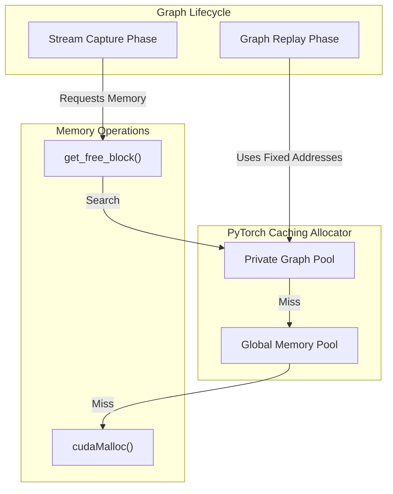
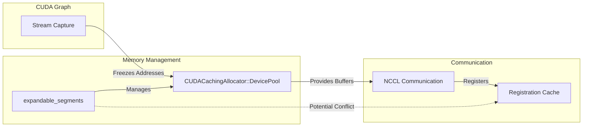

<!-- source: DeepWiki mcp.deepwiki.com · repo NVIDIA/dl-cuda-graph-doc · page 5.4 Memory Issues · fetched 2026-10-26 -->

# Memory Issues

<details>
<summary>Relevant source files</summary>

The following files were used as context for generating this wiki page:

- [docs/troubleshooting/memory-issues.md](docs/troubleshooting/memory-issues.md)

</details>


This section covers memory-related issues when using CUDA graphs, specifically illegal memory access, segmentation faults, and out-of-memory (OOM) errors. These problems often arise from the fundamental difference between PyTorch's dynamic memory management and CUDA's static graph execution model [docs/troubleshooting/memory-issues.md:8-11]().

## Illegal Memory Access and Segmentation Faults

**Symptoms**: Illegal memory access errors, segmentation faults, or corrupted outputs during graph replay [docs/troubleshooting/memory-issues.md:17]().

**Technical Root Cause**: CUDA graphs capture absolute memory addresses during the capture phase. During replay, the graph executes operations using these exact addresses. If the underlying tensors have been deallocated or moved, the graph accesses invalid memory [docs/troubleshooting/memory-issues.md:19-21]().

### Common Failure Scenarios

| Scenario | Description | Result |
| :--- | :--- | :--- |
| **Input Out of Scope** | A tensor created inside a function is garbage-collected after the function returns, but the graph still references its address [docs/troubleshooting/memory-issues.md:23](). | Illegal Memory Access / Segfault |
| **Tensor Reassignment** | Using `x = new_tensor` instead of `x.copy_(new_tensor)` changes the pointer. The graph continues to point to the old (freed) address [docs/troubleshooting/memory-issues.md:24](). | Corrupted Output / Segfault |
| **CPU Tensor Cleanup** | A host-to-device (H2D) copy is captured, but the source CPU tensor is garbage-collected before the graph is replayed [docs/troubleshooting/memory-issues.md:25](). | Illegal Memory Access |

**Resolution**:
1.  **Persistence**: Ensure all tensors used as graph inputs remain alive for the entire lifetime of the graph object [docs/troubleshooting/memory-issues.md:35]().
2.  **In-place Updates**: Update tensor contents using `.copy_()` or `.fill_()` to maintain static memory addresses [docs/troubleshooting/memory-issues.md:36]().
3.  **Storage**: Store input/output tensors in a persistent class or module to prevent garbage collection [docs/troubleshooting/memory-issues.md:37]().

Sources: [docs/troubleshooting/memory-issues.md:15-38]()

---

## PyTorch Caching Allocator and Memory Pools

PyTorch manages GPU memory through a caching allocator to avoid the overhead of frequent `cudaMalloc` and `cudaFree` calls [docs/troubleshooting/memory-issues.md:43-48]().

### Memory Statistics Definitions
*   **Reserved**: Total memory obtained from CUDA via `cudaMalloc` (the "working set") [docs/troubleshooting/memory-issues.md:54]().
*   **Allocated**: Memory currently assigned to active tensors [docs/troubleshooting/memory-issues.md:55]().
*   **Active**: Memory for tensors still in use, including those whose deallocation is deferred (e.g., via `record_stream()`) [docs/troubleshooting/memory-issues.md:56]().
*   **Inactive Split**: Fragmented memory within a reserved block that cannot be returned to the system because part of the block is still allocated [docs/troubleshooting/memory-issues.md:57]().

### Pool and Stream Isolation
The allocator organizes memory into **pools** (Global vs. Private Graph Pools). Blocks are further isolated by the **stream** they were allocated on. A block freed on `Stream A` cannot satisfy an allocation on `Stream B` until a synchronization event occurs [docs/troubleshooting/memory-issues.md:50]().

**Allocator Interaction Diagram**
The following diagram illustrates how the `CUDACachingAllocator` interacts with CUDA Graph private pools.


Sources: [docs/troubleshooting/memory-issues.md:43-58]()

---

## Memory Pool Management with Multiple Graphs

When capturing multiple graphs, managing how they share memory is critical to avoiding OOM errors. By default, every capture creates a new private pool, which can lead to massive memory overhead [docs/troubleshooting/memory-issues.md:112-116]().

### Sharing Memory Pools
To minimize overhead, you can pass a `pool` handle from one graph to another. This allows the second graph to reuse the memory addresses reserved by the first graph [docs/troubleshooting/memory-issues.md:118-125]().

**Implementation via `torch.cuda.make_graphed_callables`**:
The high-level API handles pool sharing automatically for sequential modules.

```python
# Example of sharing pools manually
g1 = torch.cuda.CUDAGraph()
with torch.cuda.graph(g1):
    static_out1 = model1(static_in1)

g2 = torch.cuda.CUDAGraph()
# Reuse g1's pool for g2
with torch.cuda.graph(g2, pool=g1.pool()):
    static_out2 = model2(static_out1)
```

### The "Double Memory" Problem
During the capture phase, the allocator cannot reuse memory that was already allocated in the global pool. This means that for the duration of the capture, you effectively need enough memory for both the eager-mode tensors and the graph-managed tensors [docs/troubleshooting/memory-issues.md:108-110]().

Sources: [docs/troubleshooting/memory-issues.md:103-125]()

---

## Expandable Segments and NCCL Interaction

PyTorch 2.0+ introduced `expandable_segments` to reduce memory fragmentation. This feature uses virtual memory mapping to allow segments to grow without requiring contiguous physical memory [docs/troubleshooting/memory-issues.md:130-135]().

### NCCL Buffer Registration Issues
NCCL (NVIDIA Collective Communications Library) requires memory buffers to be registered for efficient DMA transfers. 
*   **Conflict**: When `expandable_segments` is enabled, the underlying physical memory addresses can change or be non-contiguous in a way that interferes with NCCL's registration cache [docs/troubleshooting/memory-issues.md:138-142]().
*   **Symptom**: OOM errors or hangs during distributed training (DDP/FSDP) when CUDA Graphs are used in conjunction with NCCL operations [docs/troubleshooting/memory-issues.md:144]().

**Code Entity Relationship: Memory and Communication**



**Workaround**:
If encountering OOMs during multi-GPU graph capture, disable expandable segments:
`export PYTORCH_CUDA_ALLOC_CONF=expandable_segments:False` [docs/troubleshooting/memory-issues.md:148]().

Sources: [docs/troubleshooting/memory-issues.md:130-148]()

---

## Troubleshooting Memory Leaks

Memory leaks in CUDA Graphs usually stem from the graph object holding references to tensors indefinitely [docs/troubleshooting/memory-issues.md:152]().

### Identifying Leaks
1.  **Graph Object Lifetime**: If `torch.cuda.CUDAGraph` objects are created in a loop without being deleted, the private memory pools associated with them will never be freed [docs/troubleshooting/memory-issues.md:155]().
2.  **Stale Tensors**: Tensors captured in the graph's `static_inputs` or `static_outputs` are kept alive as long as the graph object exists [docs/troubleshooting/memory-issues.md:158]().

### Best Practices for Cleanup
*   **Resetting Graphs**: Use `graph.reset()` to clear the captured nodes and associated references [docs/troubleshooting/memory-issues.md:162]().
*   **Explicit Deletion**: Use `del graph` and call `torch.cuda.empty_cache()` if you need to reclaim memory from a private pool immediately [docs/troubleshooting/memory-issues.md:165]().

Sources: [docs/troubleshooting/memory-issues.md:152-168]()

---

