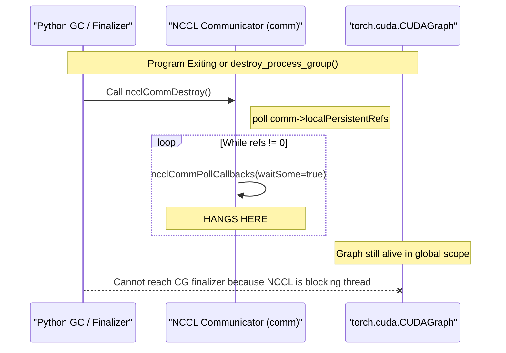
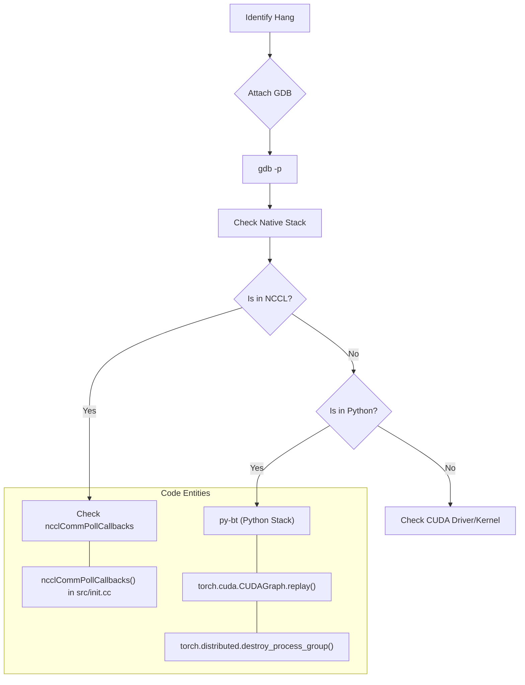

<!-- source: DeepWiki mcp.deepwiki.com · repo NVIDIA/dl-cuda-graph-doc · page 5.5 Process Hang · fetched 2026-10-26 -->

# Process Hang

Relevant source files

The following files were used as context for generating this wiki page:

- [docs/troubleshooting/process-hang.md](docs/troubleshooting/process-hang.md)

This section covers debugging hanging or stuck processes when using CUDA graphs. Process hangs typically occur during teardown due to resource dependency conflicts or during execution due to captured infinite loops or synchronization deadlocks.

## NCCL Communicator Destruction with Active CUDA Graphs

A common hang occurs during program exit or when calling `destroy_process_group()`. This is often caused by a violation of the required destruction order between NCCL communicators and CUDA graph objects.

### Symptom and Mechanism

**Symptom**: The process hangs indefinitely at the end of a script or during `torch.distributed.destroy_process_group()` [docs/troubleshooting/process-hang.md:17-17]().

**Mechanism**: Starting from NCCL 2.26, the communicator destruction logic implementation in `src/init.cc` polls until all CUDA graphs referencing that specific communicator are destroyed [docs/troubleshooting/process-hang.md:21-29](). This polling prevents the "use-after-free" scenario where a CUDA graph might attempt to launch a kernel on a communicator that has already been finalized.

### Destruction Order Conflict

In PyTorch, both `torch.cuda.CUDAGraph` objects and NCCL communicators (managed by `ProcessGroupNCCL`) are subject to Python's garbage collection. There is no native guarantee that the graph will be collected before the communicator. If the communicator's destruction is triggered while a graph still holds a persistent reference to it, the NCCL internal loop will block forever [docs/troubleshooting/process-hang.md:31-33]().

The following diagram illustrates the lifecycle conflict between the Python Garbage Collector and the NCCL Watchdog:

**NCCL-Graph Destruction Deadlock**

Sources: [docs/troubleshooting/process-hang.md:21-33]()

### Common Triggers

1.  **Direct Reference**: A graph object exists in the local scope and `destroy_process_group()` is called explicitly [docs/troubleshooting/process-hang.md:35-60]().
2.  **Global/Class Attributes**: Graphs stored as class attributes or global variables survive the function scope and are often cleaned up by Python *after* the distributed process group has been torn down [docs/troubleshooting/process-hang.md:62-94]().
3.  **Distributed Wrappers**: Operations captured inside `DistributedDataParallel` (DDP) or `FullyShardedDataParallel` (FSDP) hooks can keep references to NCCL communicators within the graph [docs/troubleshooting/process-hang.md:96-99]().

### Solutions

| Solution | Implementation | Description |
| :--- | :--- | :--- |
| **Explicit Deletion** | `del graph` or `graph.reset()` | Manually release the graph object before calling `destroy_process_group()` [docs/troubleshooting/process-hang.md:103-114](). |
| **atexit Handler** | `atexit.register(cleanup_fn)` | Register a cleanup function to reset all global/cached graphs before Python finalizes modules [docs/troubleshooting/process-hang.md:116-135](). |

Sources: [docs/troubleshooting/process-hang.md:103-135]()

## Distributed Training Hangs

Hangs in distributed environments often stem from rank-to-rank synchronization issues captured within a graph.

### Cross-Rank Synchronization Issues
When using CUDA graphs with collective operations (e.g., `all_reduce`), every rank must replay the graph. If one rank skips a replay or enters a different execution path (due to dynamic control flow not captured in the graph), other ranks will hang waiting for the collective to complete.

### Async Error Handling
If `TORCH_NCCL_ASYNC_ERROR_HANDLING` is enabled, a failure on one rank may attempt to abort the communicator. However, if other ranks are currently replaying a CUDA graph that utilizes that communicator, the interaction between the async error handler and the graph replay can lead to a hard process hang instead of a clean error report.

## Debugging Implementation

When a process is stuck, the primary goal is to determine if the hang is in the Python interpreter, the CUDA driver, or the NCCL synchronization loop.

**Process Hang Debugging Workflow**

### Using GDB with Python Symbols
To inspect the state of a hanging process, use GDB with Python debug symbols to bridge the gap between native C++ frames and Python code [docs/troubleshooting/process-hang.md:139-140]().

1.  **Attach to process**: `gdb -p <process_id>` [docs/troubleshooting/process-hang.md:146]().
2.  **Get Python trace**: Inside GDB, use `py-bt` to see exactly which Python line triggered the hang [docs/troubleshooting/process-hang.md:149-150]().
3.  **Inspect Native stack**: Use `bt` to see if the process is stuck in `ncclCommPollCallbacks` or a CUDA synchronization primitive [docs/troubleshooting/process-hang.md:152-152]().

Sources: [docs/troubleshooting/process-hang.md:137-152]()

---

