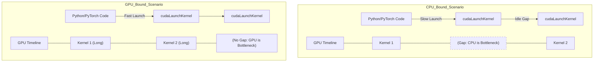
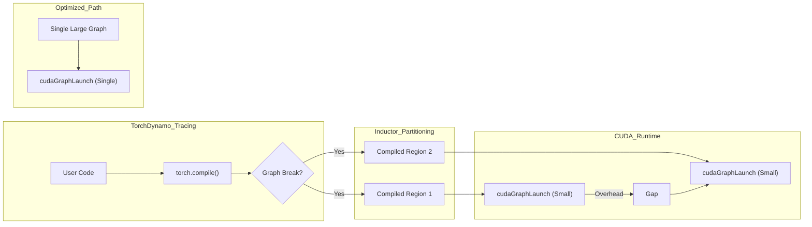

<!-- source: DeepWiki mcp.deepwiki.com · repo NVIDIA/dl-cuda-graph-doc · page 5.6 Performance Issues · fetched 2026-10-26 -->

# Performance Issues

<details>
<summary>Relevant source files</summary>

The following files were used as context for generating this wiki page:

- [docs/troubleshooting/performance-issues.md](docs/troubleshooting/performance-issues.md)

</details>


CUDA Graphs are designed to eliminate CPU-side kernel launch overhead, but their effectiveness depends heavily on the workload characteristics and the integration strategy. This page details common scenarios where CUDA Graphs may fail to deliver expected speedups, how to diagnose these bottlenecks using profiling tools, and how to optimize implementation for maximum performance.

## Introduction

CUDA Graphs primarily benefit **CPU-bound** workloads. If a workload is already GPU-bound, or if the graphed portion does not cover the actual bottleneck, users may see minimal improvement or even performance regression [docs/troubleshooting/performance-issues.md:13-18](). 

Performance issues typically stem from five main causes:
1. **Workload Nature**: The application is not CPU-bound or the wrong range was graphed [docs/troubleshooting/performance-issues.md:29-29]().
2. **Graph Fragmentation**: Too many small graphs resulting from graph breaks [docs/troubleshooting/performance-issues.md:30-30]().
3. **Copy Overhead**: High latency in copying data into static input tensors [docs/troubleshooting/performance-issues.md:31-31]().
4. **Communication Gaps**: Deferred gradient hooks in `make_graphed_callables` preventing overlap [docs/troubleshooting/performance-issues.md:32-32]().
5. **Hardware Limits**: Excessive CUDA streams causing channel serialization [docs/troubleshooting/performance-issues.md:33-33]().

## Debugging Strategy: Nsight Systems Comparison

The primary diagnostic method is comparing **Nsight Systems** profiles with and without CUDA Graphs enabled [docs/troubleshooting/performance-issues.md:21-21]().

| Profiling Mode | Command/Flag | Purpose |
| :--- | :--- | :--- |
| **Baseline** | `nsys profile -o baseline python train.py` | Establish non-graphed performance [docs/troubleshooting/performance-issues.md:21-21](). |
| **Graph Trace** | `--cuda-graph-trace` | Specifically trace graph activities [docs/troubleshooting/performance-issues.md:23-23](). |
| **Granularity: graph** | Default | Low overhead; traces the graph as a single unit [docs/troubleshooting/performance-issues.md:23-23](). |
| **Granularity: node** | Optional | High overhead; traces individual nodes within the graph [docs/troubleshooting/performance-issues.md:23-23](). |

**Sources:** [docs/troubleshooting/performance-issues.md:21-24]()

## Bottleneck Identification

### 1. Not CPU-Bound or Wrong Range
CUDA Graphs eliminate the time the CPU spends processing kernel launches. If the GPU is already fully utilized (>95%), there is no "gap" for CUDA Graphs to fill [docs/troubleshooting/performance-issues.md:41-43]().

**Diagnosis with Nsight Systems:**
*   **Not CPU-bound**: GPU utilization is high (>95%) in both baseline and graphed runs. The CPU timeline shows kernel launches completing far ahead of GPU execution [docs/troubleshooting/performance-issues.md:50-50]().
*   **Wrong Capture Range**: GPU utilization remains low, and the timeline shows significant idle regions *outside* the `cudaGraphLaunch` events [docs/troubleshooting/performance-issues.md:51-51]().

### 2. Too Many Small CUDA Graphs
When using `torch.compile(mode="reduce-overhead")`, the framework may encounter "Graph Breaks." A graph break occurs when `torch.compile` meets code it cannot trace, such as data-dependent control flow or `.item()` calls [docs/troubleshooting/performance-issues.md:63-67]().

**Example of Fragmentation:**
[docs/troubleshooting/performance-issues.md:81-102]()
```python
@torch.compile(mode="reduce-overhead")
def forward(x):
    x = layer1(x)
    print(x.sum().item())  # Graph break! .item() syncs GPU
    x = layer2(x)
    if x.sum() > 0:        # Graph break! Data-dependent control flow
        x = layer3(x)
    return x
```

**Identification and Fix:**
*   **Log Breaks**: Run with `TORCH_LOGS=graph_breaks python train.py` [docs/troubleshooting/performance-issues.md:74-75]().
*   **Fix**: Remove `.item()` calls and use `torch.where()` instead of Python `if` statements to keep the computation within a single graph [docs/troubleshooting/performance-issues.md:106-106]().

### 3. Input Tensor Copy Overhead
CUDA Graphs require static memory addresses. If you must copy new data into these static buffers before every replay, the copy time might exceed the savings from reduced launch overhead [docs/troubleshooting/performance-issues.md:112-112]().

**Fix**: Use `copy_()` into pre-allocated tensors that were used during the capture phase [docs/troubleshooting/performance-issues.md:112-112]().

### 4. Communication Overlap Issues
When using `torch.cuda.make_graphed_callables()`, autograd hooks (like DDP AllReduce) are deferred until the graph finishes execution. This prevents the overlap of computation and communication [docs/troubleshooting/performance-issues.md:32-32]().

**Sources:** [docs/troubleshooting/performance-issues.md:25-112]()

## Technical Implementation and Data Flow

The following diagrams illustrate how performance issues manifest in the interaction between the PyTorch runtime and the CUDA Driver.

### Diagram: CPU-Bound vs GPU-Bound Execution
This diagram bridges the concept of "bottlenecks" to the timeline of `cudaLaunchKernel` calls.


**Sources:** [docs/troubleshooting/performance-issues.md:41-44](), [docs/troubleshooting/performance-issues.md:55-58]()

### Diagram: Graph Fragmentation and Runtime Entities
This diagram maps `torch.compile` entities to the resulting CUDA Graph structure.


**Sources:** [docs/troubleshooting/performance-issues.md:63-68](), [docs/troubleshooting/performance-issues.md:77-78]()

## Optimization Checklist

To ensure maximum performance, verify the following:

1.  **Check GPU Metrics**: Use `nvidia-smi dmon -s u` or `nsys profile --gpu-metrics-devices=all`. If utilization is already near 100%, graphs will provide little benefit [docs/troubleshooting/performance-issues.md:55-55]().
2.  **Minimize Streams**: Avoid using too many concurrent CUDA streams within a graph, as this can lead to hardware channel serialization [docs/troubleshooting/performance-issues.md:33-33]().
3.  **Manual Graphing**: For complex scenarios where `torch.compile` creates too many fragments, use the low-level `torch.cuda.graph()` API to manually define a wider capture range [docs/troubleshooting/performance-issues.md:108-108]().
4.  **Profile Granularity**: When profiling, start with `graph` granularity to avoid the high overhead of `node` granularity [docs/troubleshooting/performance-issues.md:23-23]().

**Sources:** [docs/troubleshooting/performance-issues.md:23-23](), [docs/troubleshooting/performance-issues.md:33-33](), [docs/troubleshooting/performance-issues.md:55-55](), [docs/troubleshooting/performance-issues.md:108-108]()

---

