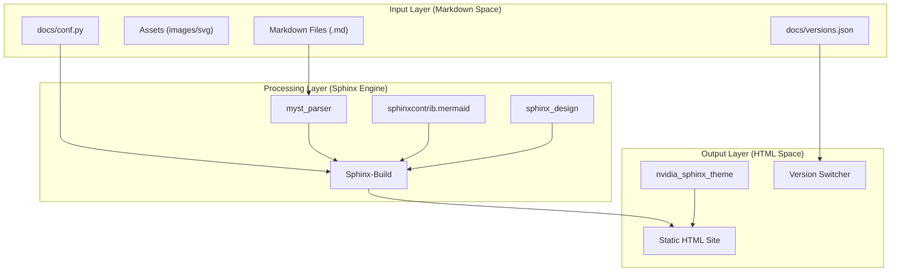
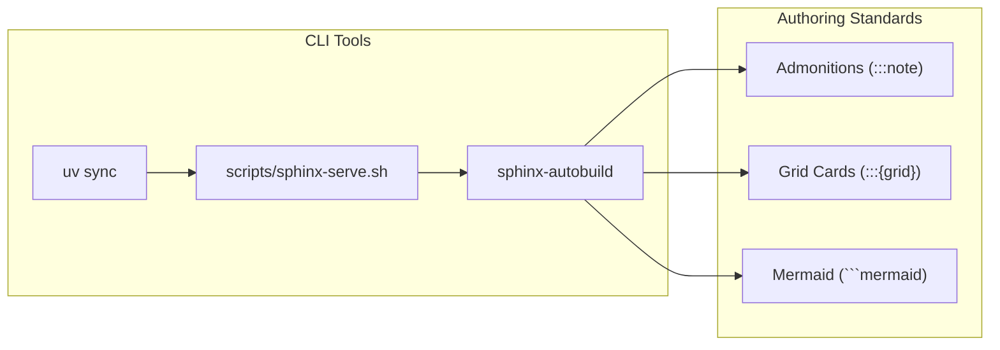

<!-- source: DeepWiki mcp.deepwiki.com · repo NVIDIA/dl-cuda-graph-doc · page 6 Documentation Infrastructure · fetched 2026-10-26 -->

# Documentation Infrastructure

Relevant source files

The following files were used as context for generating this wiki page:

- [CONTRIBUTING.md](CONTRIBUTING.md)
- [docs/conf.py](docs/conf.py)
- [pyproject.toml](pyproject.toml)

The `dl-cuda-graph-doc` repository utilizes a modern Python-based documentation stack to deliver a high-performance, versioned, and visually rich technical guide. The system is built on Sphinx and optimized for Markdown-first authoring using the MyST-Parser. This infrastructure ensures that complex technical concepts—such as CUDA Graph lifecycles and distributed training patterns—can be documented using interactive components like Mermaid diagrams and grid layouts.

### System Architecture Overview

The documentation system bridges standard Python development tools with specialized Sphinx extensions to create a static site hosted via GitHub Pages or similar platforms.

**Documentation Stack and Code Entities**

**Sources:** [docs/conf.py:20-25](), [docs/conf.py:53-55](), [CONTRIBUTING.md:32-43]()

---

### [Sphinx Build System and Configuration](#6.1)

The core of the documentation is managed by `docs/conf.py`, which defines the extensions, theme, and metadata for the project. The system is configured to support a "Markdown-first" workflow, allowing developers to write documentation without learning reStructuredText.

*   **Extensions**: The build uses `myst_parser` for Markdown support, `sphinx_copybutton` for code snippets, `sphinx_design` for layout components (cards/grids), and `sphinxcontrib.mermaid` for architectural diagrams [docs/conf.py:20-25]().
*   **Theme**: It employs the `nvidia_sphinx_theme` to provide a consistent visual identity [docs/conf.py:53]().
*   **Versioning**: Version control is handled through a combination of the `release` variable in `conf.py` and a `docs/versions.json` file that feeds the UI's version switcher [docs/conf.py:15](), [docs/conf.py:63-66]().
*   **Static Assets**: Images and supplementary files are stored in `docs/assets/` and mapped via `html_static_path` [docs/conf.py:70]().

For a deep dive into extension settings and versioning logic, see **[Sphinx Build System and Configuration](#6.1)**.

**Sources:** [docs/conf.py:9-74](), [pyproject.toml:16-25]()

---

### [Local Development and Contributing](#6.2)

The repository provides a streamlined developer experience using `uv` for dependency management and a dedicated serving script for live previews.

**Development Workflow and Tools**

**Sources:** [CONTRIBUTING.md:48-65](), [CONTRIBUTING.md:91-101]()

*   **Environment Management**: Dependencies are defined in `pyproject.toml` under the `docs` group and managed via `uv` [pyproject.toml:16-25]().
*   **Live Preview**: Contributors can use `./scripts/sphinx-serve.sh` to launch a local server with hot-reloading at `http://127.0.0.1:8000` [CONTRIBUTING.md:50-57]().
*   **Authoring Syntax**: The project enforces specific Markdown standards, including the use of `colon_fence` for admonitions (Notes, Tips, Warnings) and `grid-item-card` for landing page navigation [docs/conf.py:32-37](), [CONTRIBUTING.md:103-127]().
*   **Contribution Pipeline**: The workflow follows a standard Fork-and-PR model with specific requirements for `toctree` updates in `docs/index.md` [CONTRIBUTING.md:69-82]().

For detailed setup instructions and Markdown syntax references, see **[Local Development and Contributing](#6.2)**.

**Sources:** [CONTRIBUTING.md:6-136](), [pyproject.toml:1-30]()

---

