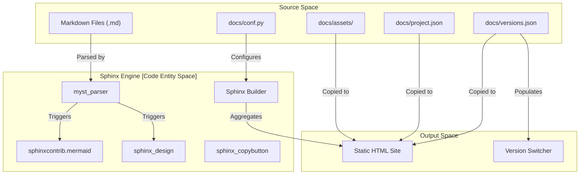
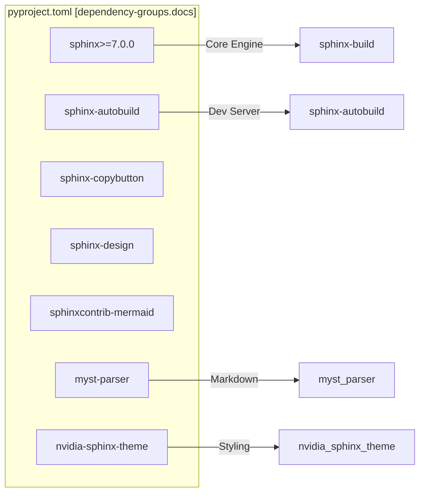

<!-- source: DeepWiki mcp.deepwiki.com · repo NVIDIA/dl-cuda-graph-doc · page 6.1 Sphinx Build System and Configuration · fetched 2026-10-26 -->

# Sphinx Build System and Configuration

Relevant source files

The following files were used as context for generating this wiki page:

- [docs/assets/.gitkeep](docs/assets/.gitkeep)
- [docs/conf.py](docs/conf.py)
- [docs/project.json](docs/project.json)
- [docs/versions.json](docs/versions.json)
- [pyproject.toml](pyproject.toml)

This page documents the technical infrastructure used to build and render the CUDA Graph Best Practice documentation. The system leverages Sphinx as the core engine, utilizing a suite of extensions to support modern Markdown authoring, interactive diagrams, and NVIDIA-branded styling.

## Build Pipeline Architecture

The documentation build process transforms Markdown source files into a structured HTML website. The pipeline integrates several third-party extensions into the Sphinx lifecycle to handle specialized content like Mermaid diagrams and UI components.

### Build Component Relationship

The following diagram illustrates how configuration files and extensions interact within the Sphinx build environment.

**Documentation Build Flow**

**Sources:** [docs/conf.py:20-25](), [docs/conf.py:70-73](), [pyproject.toml:17-25]()

---

## Core Configuration (`conf.py`)

The `docs/conf.py` file serves as the central authority for the build system, defining project metadata, enabled extensions, and theme-specific behavior.

### Project Metadata
The documentation identifies as "CUDA Graph Best Practice for PyTorch" [docs/conf.py:12-14](). The `release` variable is set to `"latest"` by default [docs/conf.py:15](), which is used by the version switcher to identify the current build context.

### Enabled Extensions
The system relies on four primary extensions to extend standard Sphinx functionality:

| Extension | Purpose | Reference |
| :--- | :--- | :--- |
| `myst_parser` | Enables Markdown support with advanced syntax (MyST). | [docs/conf.py:21]() |
| `sphinx_copybutton` | Adds a "copy" icon to code blocks for easy snippet extraction. | [docs/conf.py:22]() |
| `sphinx_design` | Provides responsive grid layouts, cards, and tabs. | [docs/conf.py:23]() |
| `sphinxcontrib.mermaid` | Renders Mermaid.js diagrams directly from code blocks. | [docs/conf.py:24]() |

### Markdown Processing (MyST-Parser)
To support rich technical documentation, `myst_enable_extensions` activates specific syntax features:
*   **`colon_fence`**: Allows using `:::` for admonitions (Notes, Warnings) [docs/conf.py:33]().
*   **`deflist`**: Supports standard term-definition lists [docs/conf.py:34]().
*   **`fieldlist`**: Used for metadata in `sphinx_design` cards [docs/conf.py:35]().
*   **`tasklist`**: Enables GitHub-style checkboxes [docs/conf.py:36]().
*   **`myst_heading_anchors`**: Automatically generates HTML anchors for headers up to level 5, facilitating deep linking [docs/conf.py:38]().

**Sources:** [docs/conf.py:20-45](), [pyproject.toml:17-25]()

---

## Visual Theme and Assets

The documentation uses the `nvidia_sphinx_theme` to ensure visual consistency with NVIDIA's technical ecosystem [docs/conf.py:53]().

### Theme Configuration
The `html_theme_options` dictionary configures the site header and navigation:
*   **GitHub Link**: Adds a link to the repository using FontAwesome icons [docs/conf.py:56-62]().
*   **Version Switcher**: Configures the UI component that allows users to jump between different versions of the documentation. It points to `../versions.json` relative to the build root [docs/conf.py:63-67]().

### Static Assets
Static content is managed through specific directory mappings:
*   **`docs/assets/`**: Referenced in Markdown as `assets/image.png`. This folder is registered in `html_static_path` [docs/conf.py:70](), [docs/assets/.gitkeep:1-2]().
*   **Extra Files**: `project.json` and `versions.json` are included in the build output via `html_extra_path` to ensure the version switcher can find them at runtime [docs/conf.py:73]().

**Sources:** [docs/conf.py:53-74](), [docs/assets/.gitkeep:1-2]()

---

## Versioning and Metadata Files

The build system uses two JSON files to manage deployment state and version navigation.

### `docs/versions.json`
This file controls the dropdown menu in the documentation UI. It maps version names to their respective URLs.
*   **`preferred`**: Boolean indicating the default version [docs/versions.json:3]().
*   **`version`**: The display name in the dropdown (e.g., `"latest"`) [docs/versions.json:4]().
*   **`url`**: The relative path to that version's documentation root [docs/versions.json:5]().

### `docs/project.json`
A machine-readable file containing basic project identity, used by the theme to verify the project name and version during the build process [docs/project.json:1]().

**Sources:** [docs/versions.json:1-8](), [docs/project.json:1]()

---

## Dependency Management

Dependencies are managed via `pyproject.toml` using the `dependency-groups` feature. This ensures that all developers and CI/CD pipelines use consistent versions of the Sphinx toolchain.

**Code Entity Space: Dependency Mapping**

**Sources:** [pyproject.toml:16-25]()

---

