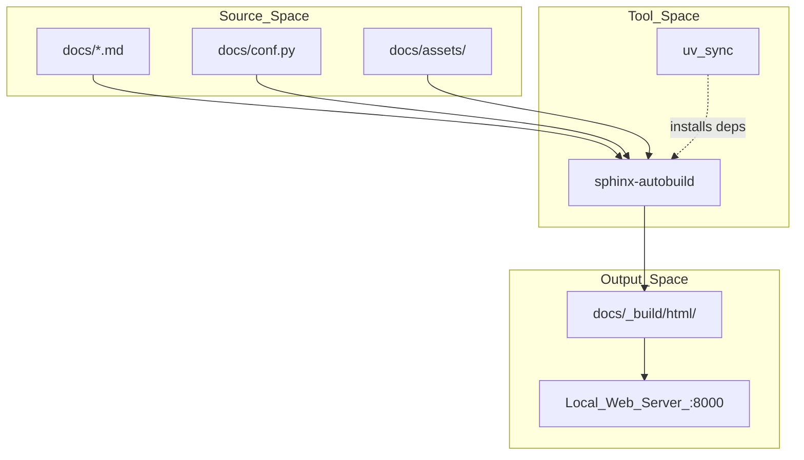
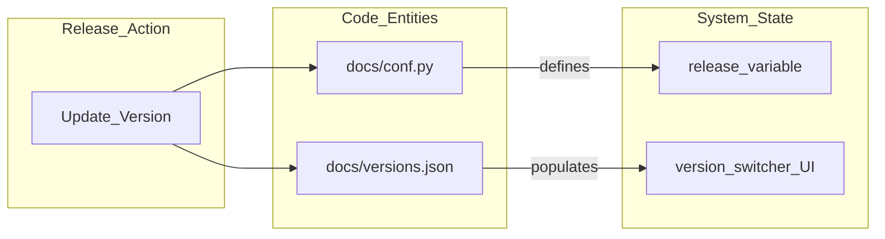

<!-- source: DeepWiki mcp.deepwiki.com · repo NVIDIA/dl-cuda-graph-doc · page 6.2 Local Development and Contributing · fetched 2026-10-26 -->

# Local Development and Contributing

<details>
<summary>Relevant source files</summary>

The following files were used as context for generating this wiki page:

- [.gitignore](.gitignore)
- [CONTRIBUTING.md](CONTRIBUTING.md)
- [docs/contributing.md](docs/contributing.md)
- [scripts/sphinx-serve.sh](scripts/sphinx-serve.sh)

</details>


This page details the development workflow for the `dl-cuda-graph-doc` repository. It covers the setup of the Sphinx-based documentation environment, authoring standards using MyST Markdown, and the process for contributing and releasing new versions of the guide.

## Development Environment Setup

The documentation project uses `uv` as its primary package manager and environment orchestrator to manage Python dependencies defined in `pyproject.toml`.

### Automated Setup and Live Preview
The most efficient way to develop locally is using the provided `sphinx-serve.sh` script. This script automates dependency installation and starts a live-reloading web server.

1.  **Run the serve script**: `[scripts/sphinx-serve.sh:1-24]()`
    *   It checks for the existence of `uv`. If missing, it installs it via the official Astral installer `[scripts/sphinx-serve.sh:11-15]()`.
    *   It runs `uv sync --group docs` to synchronize the local environment with the documentation-specific dependency group `[scripts/sphinx-serve.sh:18-18]()`.
    *   It launches `sphinx-autobuild`, which watches the `docs/` directory for changes and serves the result at `http://127.0.0.1:8000` `[scripts/sphinx-serve.sh:23-23]()`.

### Manual Commands
For users who prefer granular control, the following `uv` commands can be used:

| Action | Command |
| :--- | :--- |
| **Install Dependencies** | `uv sync --group docs` |
| **One-time Build** | `uv run --group docs sphinx-build docs docs/_build/html` |
| **Start Live Server** | `uv run --group docs sphinx-autobuild docs docs/_build/html --open-browser` |

**Sources:** `[CONTRIBUTING.md:61-65]()`, `[scripts/sphinx-serve.sh:10-24]()`

## Documentation Structure

The repository is organized to separate documentation source files from configuration and assets.

### File Organization
*   **`docs/`**: Contains all `.md` source files `[CONTRIBUTING.md:34-34]()`.
*   **`docs/conf.py`**: The central Sphinx configuration file `[CONTRIBUTING.md:35-35]()`.
*   **`docs/assets/`**: Storage for images, diagrams, and other static files `[CONTRIBUTING.md:41-41]()`.
*   **`docs/versions.json`**: Configuration for the documentation version switcher `[CONTRIBUTING.md:42-42]()`.
*   **`docs/project.json`**: Metadata describing the documentation project `[CONTRIBUTING.md:43-43]()`.

### Local Development Flow
The following diagram illustrates the transformation from Markdown source to a locally hosted preview.

**Local Documentation Build Pipeline**

**Sources:** `[CONTRIBUTING.md:32-43]()`, `[scripts/sphinx-serve.sh:18-23]()`

## Authoring Standards

This project uses **MyST (Markedly Structured Text)**, which allows for advanced Sphinx features within standard Markdown files.

### Markdown Reference
The following components are standardized across the documentation:

| Feature | Syntax / Directive | Use Case |
| :--- | :--- | :--- |
| **Admonitions** | `:::{note}`, `:::{tip}`, `:::{warning}` | Highlighting important notes, tips, or hazards `[CONTRIBUTING.md:95-95]()`. |
| **Grid Cards** | `::::{grid}` and `:::{grid-item-card}` | Creating landing pages or feature overviews `[CONTRIBUTING.md:101-101]()`. |
| **Mermaid** | ` ```mermaid ` | Technical diagrams and flowcharts `[CONTRIBUTING.md:100-100]()`. |
| **Code Blocks** | ` ```python ` | Syntax-highlighted code examples `[CONTRIBUTING.md:96-96]()`. |

### Adding New Pages
To add a new page to the documentation:
1.  Create the file (e.g., `docs/section/page.md`) `[CONTRIBUTING.md:71-71]()`.
2.  Register the file in the `toctree` (Table of Contents tree) within `docs/index.md` to ensure it appears in the navigation sidebar `[CONTRIBUTING.md:72-80]()`.

**Sources:** `[CONTRIBUTING.md:69-101]()`

## Contribution Workflow

We welcome contributions via GitHub Pull Requests.

### Process for Contributors
1.  **Fork and Branch**: Create a feature branch from your fork `[CONTRIBUTING.md:23-24]()`.
2.  **Implementation**: Follow the content guidelines: be concise, use practical examples, and use the latest PyTorch APIs `[CONTRIBUTING.md:84-89]()`.
3.  **Local Verification**: Ensure the documentation builds without errors using `./scripts/sphinx-serve.sh` `[CONTRIBUTING.md:82-82]()`.
4.  **Submission**: Submit a PR with a descriptive title and link any relevant issues `[CONTRIBUTING.md:130-133]()`.

### Repository Integrity
The `.gitignore` file is configured to prevent build artifacts and environment files from being committed:
*   `docs/_build/` is ignored to keep the repository clean of generated HTML `[.gitignore:2-2]()`.
*   Python artifacts (`__pycache__`, `.pyc`) and environment folders (`venv/`, `env/`, `.Python`) are excluded `[.gitignore:5-12]()`.

**Sources:** `[CONTRIBUTING.md:21-27]()`, `[CONTRIBUTING.md:129-136]()`, `[.gitignore:1-12]()`

## Versioning and Release Process

Maintainers manage the lifecycle of the documentation through explicit versioning.

### Release Steps
When a new version (e.g., `v1.0`) is ready for release, the following entities must be updated:

1.  **`docs/conf.py`**: Update the `release` variable to the target version string `[CONTRIBUTING.md:149-152]()`.
2.  **`docs/versions.json`**: Add the new version entry to the JSON array. This controls the version switcher in the UI.
    *   The `preferred` flag indicates the version that should be shown by default `[CONTRIBUTING.md:141-147]()`.

**Version Configuration Mapping**

**Sources:** `[CONTRIBUTING.md:139-154]()`

---

