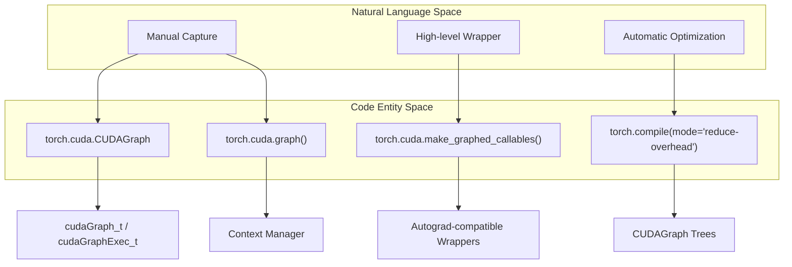
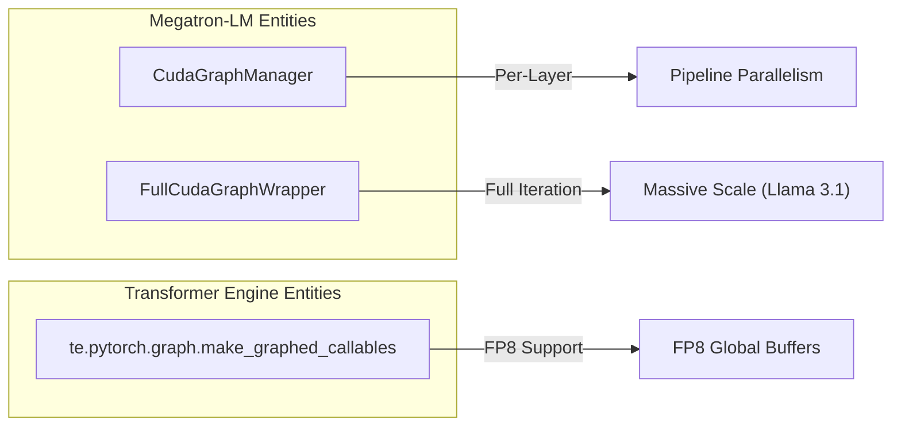

<!-- source: DeepWiki mcp.deepwiki.com · repo NVIDIA/dl-cuda-graph-doc · page 7 Glossary · fetched 2026-10-26 -->

# Glossary

Relevant source files

The following files were used as context for generating this wiki page:

- [THIRD-PARTY-NOTICES.md](THIRD-PARTY-NOTICES.md)
- [docs/assets/lora-arch.png](docs/assets/lora-arch.png)
- [docs/assets/pp-execution.png](docs/assets/pp-execution.png)
- [docs/conf.py](docs/conf.py)
- [docs/cuda-graph-basics/constraints.md](docs/cuda-graph-basics/constraints.md)
- [docs/cuda-graph-basics/cuda-graph.md](docs/cuda-graph-basics/cuda-graph.md)
- [docs/cuda-graph-basics/introduction.md](docs/cuda-graph-basics/introduction.md)
- [docs/examples/introduction.md](docs/examples/introduction.md)
- [docs/torch-cuda-graph/handling-dynamic-patterns.md](docs/torch-cuda-graph/handling-dynamic-patterns.md)
- [docs/torch-cuda-graph/sync-free-code.md](docs/torch-cuda-graph/sync-free-code.md)
- [docs/torch-cuda-graph/te-megatron-cuda-graphs.md](docs/torch-cuda-graph/te-megatron-cuda-graphs.md)
- [docs/torch-cuda-graph/torch-integration.md](docs/torch-cuda-graph/torch-integration.md)

This page provides definitions for codebase-specific terms, CUDA/GPU jargon, framework abbreviations, and domain concepts used throughout the `dl-cuda-graph-doc` project. It serves as a technical reference for onboarding engineers to understand the implementation details and data flow of CUDA Graph integration in PyTorch.

## Core Concepts & CUDA Jargon

| Term | Definition | Reference |
|:---|:---|:---|
| **CUDA Graph** | A directed acyclic graph (DAG) of GPU operations (nodes) and their dependencies (edges) launched as a single unit to reduce CPU overhead. | [docs/cuda-graph-basics/cuda-graph.md:13-18]() |
| **Launch Overhead** | The cumulative time spent by the CPU/Driver preparing a kernel for execution (Language transitions, runtime processing, driver operations). | [docs/cuda-graph-basics/introduction.md:29-56]() |
| **Stream Capture** | A mechanism to record operations issued to a CUDA stream into a graph object instead of executing them immediately. | [docs/torch-cuda-graph/torch-integration.md:27-32]() |
| **Instantiation** | The phase where a defined graph is validated and transformed into an executable graph (`cudaGraphExec_t`), pre-allocating resources. | [docs/cuda-graph-basics/cuda-graph.md:39-40]() |
| **Static Topology** | The requirement that the set of nodes and their connectivity in a graph cannot change after instantiation. | [docs/cuda-graph-basics/constraints.md:43-46]() |
| **Sync-Free Code** | Code that avoids blocking the CPU to wait for GPU results (e.g., avoiding `.item()` or `cudaDeviceSynchronize`). | [docs/torch-cuda-graph/sync-free-code.md:13-16]() |

**Sources:** [docs/cuda-graph-basics/introduction.md:29-56](), [docs/cuda-graph-basics/cuda-graph.md:13-40](), [docs/cuda-graph-basics/constraints.md:43-46](), [docs/torch-cuda-graph/sync-free-code.md:13-16](), [docs/torch-cuda-graph/torch-integration.md:27-32]()

---

## PyTorch Integration Entities

### Code Entity Space: APIs and Classes
The following diagram bridges the natural language concepts of "Graphing" to the specific classes and functions implemented in PyTorch and this documentation.

**Diagram: PyTorch CUDA Graph Entity Mapping**

**Sources:** [docs/torch-cuda-graph/torch-integration.md:33-45](), [docs/conf.py:20-25]()

### Memory Management
*   **Private Memory Pool**: PyTorch uses a dedicated memory pool for CUDA Graph allocations to ensure memory addresses remain stable during replay. [docs/torch-cuda-graph/torch-integration.md:58-59]()
*   **Warmup**: The process of running several "eager" iterations before capture to stabilize the caching allocator and ensure all necessary kernels are loaded. [docs/torch-cuda-graph/torch-integration.md:99-103]()

---

## Domain Specific Terms (ML & Distributed)

### Precision and Quantization
*   **FP8 (8-bit Floating Point)**: A low-precision format used in modern GPUs (H100+) for training. It requires global buffer management for "amax" (maximum absolute value) history and scaling factors. [docs/torch-cuda-graph/te-megatron-cuda-graphs.md:41-42]()
*   **FP4**: An even lower precision format used in Llama 3.1 405B benchmarks for maximum throughput. [docs/examples/introduction.md:74-75]()
*   **Dynamic Scaling**: The process of updating FP8 scale factors based on runtime values. This is a "true dependency" that often breaks graph capture. [docs/torch-cuda-graph/te-megatron-cuda-graphs.md:47-53]()

### Distributed Parallelism (3D Parallelism)
*   **TP (Tensor Parallelism)**: Splitting individual layers across multiple GPUs.
*   **PP (Pipeline Parallelism)**: Splitting model layers across stages, processing microbatches in an interleaved schedule. [docs/torch-cuda-graph/te-megatron-cuda-graphs.md:70-74]()
*   **DP (Data Parallelism)**: Distributing data across multiple GPU ranks, usually involving `NCCL` all-reduce operations. [docs/examples/introduction.md:73-74]()

**Diagram: Distributed Training Graph Integration**

**Sources:** [docs/torch-cuda-graph/te-megatron-cuda-graphs.md:13-27](), [docs/examples/introduction.md:63-78]()

---

## Dynamic Pattern Handling

*   **Bucketing**: A strategy for handling dynamic shapes (e.g., in RNN-T) by creating multiple graphs for different sequence length ranges. [docs/examples/introduction.md:76-77]()
*   **Conditional Nodes**: A CUDA 12.3+ feature allowing GPU-side branching (IF/WHILE) within a graph. Currently not exposed in PyTorch 2.x Python APIs. [docs/cuda-graph-basics/constraints.md:48-50]()
*   **Capturable Optimizer**: An optimizer implementation (like `DistributedFusedLAMB`) that uses a "noop" flag to conditionally skip updates without CPU-GPU synchronization. [docs/examples/introduction.md:76-77]()

**Sources:** [docs/cuda-graph-basics/constraints.md:48-50](), [docs/examples/introduction.md:76-77](), [docs/torch-cuda-graph/handling-dynamic-patterns.md:13-15]()

---

## Troubleshooting Taxonomy

| Category | Description | Key Indicators |
|:---|:---|:---|
| **Capture Failure** | Errors occurring during `cudaStreamEndCapture`. | `CUDA_ERROR_STREAM_CAPTURE_UNSUPPORTED` [docs/cuda-graph-basics/constraints.md:28-29]() |
| **Numerical Error** | Graph runs but produces wrong results or NaNs. | Often caused by "Replay Order Mismatch" in shared memory pools. [docs/torch-cuda-graph/te-megatron-cuda-graphs.md:82-83]() |
| **Process Hang** | The application stops responding during replay. | Often due to NCCL watchdog conflicts or invalid syncs. |
| **Silent Failure** | The graph executes but uses stale parameters (e.g., a Python scalar changed but the graph used the captured value). | No error raised, but output is incorrect. [docs/cuda-graph-basics/constraints.md:82-85]() |

**Sources:** [docs/cuda-graph-basics/constraints.md:82-85](), [docs/torch-cuda-graph/te-megatron-cuda-graphs.md:82-83]()

---

## Documentation Infrastructure

*   **Sphinx**: The documentation generator used for this project. [docs/conf.py:4-7]()
*   **MyST-Parser**: Enables writing documentation in Markdown with support for advanced features like admonitions (`:::`) and tables. [docs/conf.py:20-21](), [docs/conf.py:32-37]()
*   **nvidia-sphinx-theme**: The visual theme used for the HTML output. [docs/conf.py:53-54]()
*   **Mermaid**: The diagramming language used for all technical flowcharts in this wiki. [docs/conf.py:24-25]()

**Sources:** [docs/conf.py:4-54](), [THIRD-PARTY-NOTICES.md:7-15]()