# Page: Overview

# Overview

<details>
<summary>Relevant source files</summary>

The following files were used as context for generating this wiki page:

- [CONTRIBUTING.md](CONTRIBUTING.md)
- [README.md](README.md)
- [docs/index.md](docs/index.md)

</details>


Welcome to the technical documentation for using CUDA Graphs effectively within the PyTorch ecosystem. This repository serves as a comprehensive guide for optimizing deep learning workloads by minimizing CPU-side overhead and maximizing GPU throughput through graph-based execution [README.md:1-3]().

## Repository Purpose and Scope

The primary objective of this documentation is to bridge the gap between low-level CUDA Graph mechanics and high-level framework usage in PyTorch [docs/index.md:8-12](). It targets Machine Learning Engineers, Framework Developers, and CUDA Practitioners who need to scale models or reduce latency in production environments.

The project utilizes a dual-licensing model:
*   **Documentation Content**: Licensed under [CC-BY-4.0](LICENSE-DOCS) [README.md:42]().
*   **Code and Scripts**: Licensed under the [MIT License](LICENSE) [README.md:43]().

For a detailed breakdown of the project goals, target personas, and legal notices, see [Repository Purpose and Scope](#1.1).

**Sources:** [README.md:1-3](), [README.md:40-45](), [docs/index.md:8-12]()

---

## Content Organization

The documentation is structured into five core pillars, moving from foundational theory to complex multi-node implementations and troubleshooting.

### Documentation Component Mapping
The following diagram maps high-level documentation concepts to the physical directory structure and key entry points.

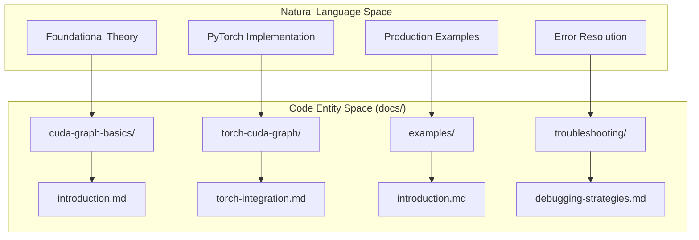
**Sources:** [CONTRIBUTING.md:32-43](), [docs/index.md:132-184]()

---

## Navigation and Learning Paths

This guide is designed to be consumed in three distinct ways depending on user expertise and immediate needs:

1.  **Systematic Learning Path**: A step-by-step journey from understanding the "Launch Overhead Problem" to implementing "Sync-Free Code" [docs/index.md:26-35]().
2.  **Quick-Reference Reference**: Targeted links for users facing specific runtime issues like `Capture Failures` or `Numerical Errors` [docs/index.md:36-47]().
3.  **Framework-Specific Paths**: Specialized tracks for standard PyTorch users (focusing on `torch.compile`) vs. large-scale model developers using `Megatron-LM` or `Transformer Engine` [docs/index.md:50-55]().

For details on how to navigate these paths and an explanation of the `toctree` structure, see [Navigation and Learning Paths](#1.2).

### Technical Interface Overview
This diagram bridges the user's intent (e.g., "I want to capture a graph") to the specific PyTorch and NVIDIA framework entities discussed in the guide.

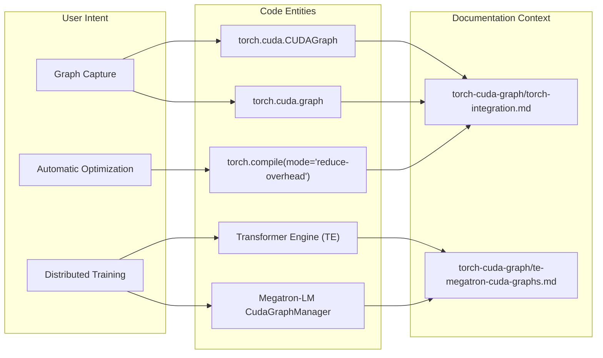
**Sources:** [docs/index.md:50-55](), [docs/index.md:149-159](), [README.md:12-14]()

---

## Major Sections

| Section | Description | Key Topics |
| :--- | :--- | :--- |
| **CUDA Graph Basics** | Fundamental theory of GPU execution. | Launch overhead, DAG models, constraints [docs/index.md:16](). |
| **PyTorch Integration** | Framework-specific APIs and best practices. | `CUDAGraph`, `torch.compile`, Sync-free code [docs/index.md:17](). |
| **Real-World Examples** | MLPerf benchmark implementations. | Llama 3.1, GPT-3, Stable Diffusion [docs/index.md:18](). |
| **Troubleshooting** | Resolving runtime and performance bugs. | Memory leaks, process hangs, NaN/Inf errors [docs/index.md:19](). |
| **Infrastructure** | Build system and contribution guide. | Sphinx, MyST, local development [CONTRIBUTING.md:48-66](). |

**Sources:** [docs/index.md:16-20](), [CONTRIBUTING.md:32-43](), [README.md:9-14]()

---

# Page: Repository Purpose and Scope

# Repository Purpose and Scope

<details>
<summary>Relevant source files</summary>

The following files were used as context for generating this wiki page:

- [LICENSE](LICENSE)
- [LICENSE-DOCS](LICENSE-DOCS)
- [README.md](README.md)
- [THIRD-PARTY-NOTICES.md](THIRD-PARTY-NOTICES.md)

</details>


The `dl-cuda-graph-doc` repository serves as a comprehensive technical guide for optimizing Deep Learning (DL) workloads using **CUDA Graphs** within the PyTorch ecosystem [README.md:1-3](). It addresses the critical need for reducing CPU-side overhead in high-performance training and inference, particularly for large-scale models like Llama 3.1 and GPT-3 [README.md:9-15]().

## Core Documentation Scope

The project provides a structured knowledge base covering the entire lifecycle of CUDA Graph adoption, from theoretical fundamentals to large-scale distributed implementation [README.md:9-15]().

| Domain | Technical Coverage |
| :--- | :--- |
| **CUDA Fundamentals** | Kernel launch overhead, graph nodes/edges, and stream capture mechanics [README.md:11](). |
| **Framework Integration** | PyTorch `CUDAGraph` APIs, `torch.compile` (reduce-overhead), and Transformer Engine [README.md:12](). |
| **Distributed Scaling** | Implementation details for Megatron-LM, including 4D parallelism (TP/PP/DP/CP) [README.md:12-13](). |
| **Real-world Examples** | MLPerf Training benchmarks (Stable Diffusion v2, GPT-3 175B, Llama 3.1 405B) [README.md:13](). |
| **Operational Support** | Debugging capture failures, numerical stability, and memory management [README.md:14](). |

**Sources:** [README.md:1-15]()

## Target Audience

This documentation is engineered for three primary technical personas:

1.  **Machine Learning Engineers**: Focused on accelerating training throughput and reducing latency in production pipelines using PyTorch and PyTorch Lightning [README.md:3,13]().
2.  **Framework Developers**: Users of low-level libraries such as **Transformer Engine** or **Megatron-LM** who need to understand how CUDA Graphs interact with FP8 precision and complex parallelism [README.md:12-13]().
3.  **CUDA Developers**: Engineers looking to bridge the gap between native CUDA Graph features and high-level framework abstractions [README.md:11-12]().

## System Context: Documentation to Code Entities

The following diagram maps the documentation sections to the specific technologies and codebases they reference.

**Documentation Knowledge Mapping**
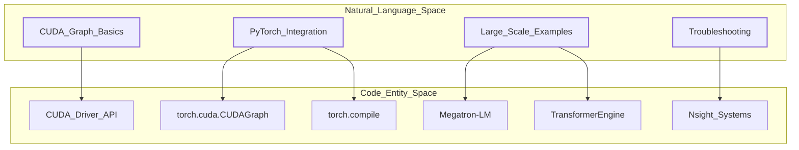
**Sources:** [README.md:9-15](), [THIRD-PARTY-NOTICES.md:17-28]()

## Licensing Model

The repository operates under a dual-licensing model to distinguish between instructional content and functional tooling [README.md:38-44]().

### Documentation License: CC-BY-4.0
All Markdown content and visual assets are licensed under **Creative Commons Attribution 4.0 International** [LICENSE-DOCS:1-5]().
*   **Permissions**: Users are free to share, copy, and adapt the material for any purpose, including commercial use [LICENSE-DOCS:9-14]().
*   **Requirements**: Attribution must be provided to NVIDIA Corporation [LICENSE-DOCS:18-21]().

### Code License: MIT
The underlying infrastructure, including build scripts (`scripts/sphinx-serve.sh`) and configuration files (`docs/conf.py`), is licensed under the **MIT License** [LICENSE:1-2](), [README.md:43-44]().
*   **Permissions**: Broad usage, modification, and distribution rights with minimal restrictions [LICENSE:4-8]().
*   **Warranty**: Provided "as is" without warranty of any kind [LICENSE:14-16]().

**Sources:** [LICENSE:1-20](), [LICENSE-DOCS:1-28](), [README.md:38-44]()

## Dependency Landscape

The project integrates several third-party components to build and render the documentation suite.

**Infrastructure and Dependency Map**
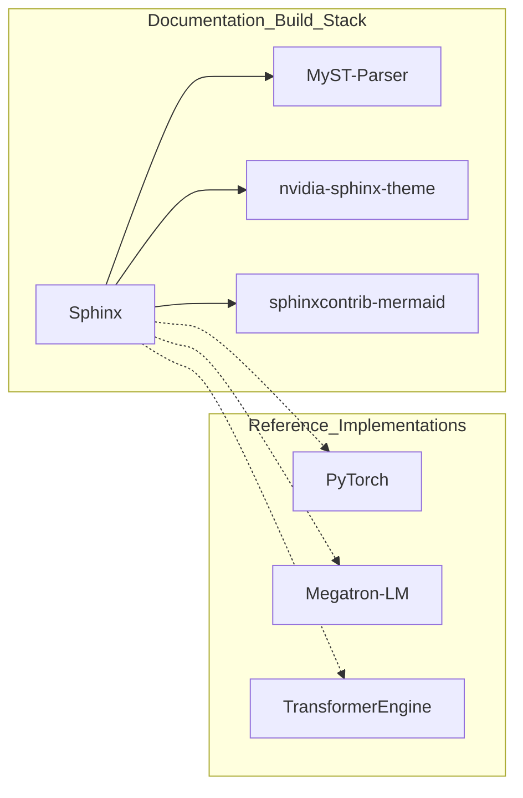

| Component | Role | License |
| :--- | :--- | :--- |
| `Sphinx` | Primary build engine [THIRD-PARTY-NOTICES.md:9]() | BSD-2-Clause |
| `MyST-Parser` | Markdown support [THIRD-PARTY-NOTICES.md:14]() | MIT |
| `nvidia-sphinx-theme` | Visual styling [THIRD-PARTY-NOTICES.md:15]() | NVIDIA Proprietary |
| `PyTorch` | Target framework [THIRD-PARTY-NOTICES.md:23]() | BSD-3-Clause |
| `Megatron-LM` | Distributed training examples [THIRD-PARTY-NOTICES.md:27]() | BSD-3-Clause |

**Sources:** [THIRD-PARTY-NOTICES.md:1-28]()

---

# Page: Navigation and Learning Paths

# Navigation and Learning Paths

<details>
<summary>Relevant source files</summary>

The following files were used as context for generating this wiki page:

- [docs/contributing.md](docs/contributing.md)
- [docs/index.md](docs/index.md)
- [docs/reference.md](docs/reference.md)

</details>


This page describes the organizational structure of the `dl-cuda-graph-doc` repository and outlines three distinct navigation modes designed to assist users based on their expertise level and specific technical requirements. The guide is structured to transition from fundamental CUDA concepts to high-level framework implementations and real-world performance optimization.

## Documentation Structure and Toctree

The documentation is organized into six major functional blocks, managed via a hierarchical `toctree` structure [docs/index.md:132-192](). This structure ensures that foundational knowledge precedes implementation details and troubleshooting.

### Structural Overview

| Section | Content Scope | Target Audience |
| :--- | :--- | :--- |
| **1. Overview** | High-level purpose, scope, and navigation paths. | All users |
| **2. CUDA Graph Basics** | Launch overhead theory, DAG models, and constraints. | New users, CUDA developers |
| **3. PyTorch Integration** | APIs (`CUDAGraph`, `torch.compile`), TE, and Megatron-LM. | ML Engineers, Framework Devs |
| **4. Examples** | MLPerf Training implementations (Llama 3.1, GPT-3, SDv2). | Performance Engineers |
| **5. Troubleshooting** | Debugging capture, numerical errors, and memory. | All users (reactive) |
| **6. Infrastructure** | Sphinx build system and contribution guides. | Contributors |

### Logic Flow Diagram
The following diagram illustrates how the `toctree` sections relate to the software development lifecycle of a CUDA-graphed application.

**Development Lifecycle and Document Mapping**
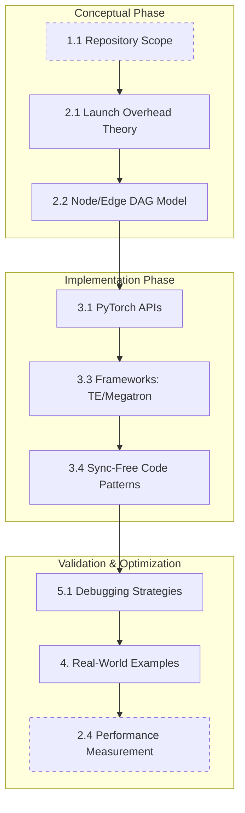
Sources: [docs/index.md:15-20](), [docs/index.md:132-192]()

---

## Learning Path: Systematic Understanding

For users new to CUDA Graphs, the guide recommends a linear progression. This path focuses on the "Define-Instantiate-Execute" lifecycle before moving to complex framework abstractions [docs/index.md:26-35]().

1.  **Foundations**: Start with **CUDA Graph Basics** to understand the CPU-GPU producer-consumer bottleneck and the source of kernel launch overhead.
2.  **PyTorch Mechanics**: Move to **PyTorch Integration** to learn the low-level `torch.cuda.CUDAGraph` class and the `torch.cuda.graph()` context manager.
3.  **Code Adaptation**: Study **Writing Sync-Free Code** and **Handling Dynamic Patterns** to identify and eliminate host-device synchronizations that break capture.
4.  **Verification**: Use the **Troubleshooting** section to validate numerical parity between eager mode and graphed execution.

Sources: [docs/index.md:30-34]()

---

## Quick Reference: Problem Solving

The documentation provides a reactive path for users who have already implemented CUDA Graphs but are encountering runtime or performance issues [docs/index.md:36-49]().

### Issue-to-Resolution Mapping

| Symptom | Code Entity / Section | Link |
| :--- | :--- | :--- |
| **Illegal Memory Access** | `torch.cuda.CUDAGraph` Memory Pool | [Memory Issues](troubleshooting/memory-issues.md) |
| **Runtime Error during Capture** | `torch.cuda.graph` context | [Capture Failures](troubleshooting/capture-failures.md) |
| **Losses diverge / NaNs** | RNG states, `manual_seed` | [Numerical Errors](troubleshooting/numerical-errors.md) |
| **No Speedup** | `nvidia-smi`, Nsight Systems | [Performance Issues](troubleshooting/performance-issues.md) |
| **Process Stalls** | NCCL Watchdog, `ProcessGroup` | [Process Hang](troubleshooting/process-hang.md) |

Sources: [docs/index.md:40-47]()

---

## Framework-Specific Paths

Advanced users working with specialized NVIDIA libraries can bypass general PyTorch documentation to access framework-specific implementations [docs/index.md:50-55]().

### Megatron-LM and Transformer Engine (TE)
Users training large-scale models (e.g., GPT-3, Llama 3.1) should focus on the interaction between model parallelism and graph capture [docs/index.md:52]().

*   **`make_graphed_callables` (TE)**: Optimized for FP8 precision and pipeline parallelism.
*   **`CudaGraphManager` (Megatron-LM)**: Handles per-layer graphing to balance memory overhead and performance.
*   **`FullCudaGraphWrapper` (Megatron-LM)**: Captures the entire training iteration for maximum overhead reduction in massive scale-out scenarios.

### Pure PyTorch and torch.compile
Users looking for automated solutions should investigate the `reduce-overhead` mode of `torch.compile` [docs/index.md:54]().

*   **CUDAGraph Trees**: Internal mechanism for managing shared memory pools across multiple graph segments.
*   **Inductor Integration**: How the compiler automatically partitions code into graphable and non-graphable regions.

**Framework Entity Association**
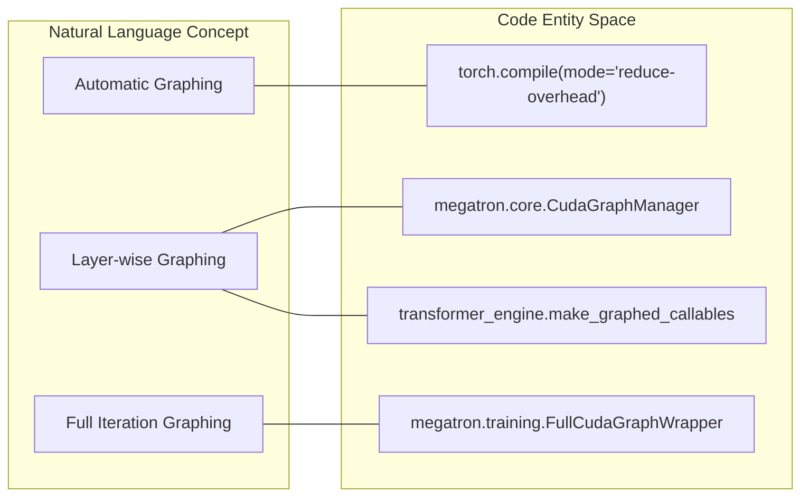
Sources: [docs/index.md:52-55](), [docs/reference.md:29-32]()

---

## Documentation Infrastructure

The guide is built using a modern Sphinx pipeline to ensure technical accuracy and readability [docs/contributing.md:1-19]().

*   **Build System**: Uses `Sphinx` with `MyST-Parser` for Markdown support and `nvidia-sphinx-theme` for visual consistency [docs/index.md:1-4]().
*   **Version Control**: Managed via `docs/versions.json` for multi-version documentation support.
*   **Interactive Components**: Includes `sphinx-copybutton` for code snippets and `mermaid` for architectural diagrams.

Sources: [docs/contributing.md:10-18](), [docs/reference.md:42-43]()

---

# Page: CUDA Graph Fundamentals

# CUDA Graph Fundamentals

<details>
<summary>Relevant source files</summary>

The following files were used as context for generating this wiki page:

- [docs/cuda-graph-basics/cuda-graph.md](docs/cuda-graph-basics/cuda-graph.md)
- [docs/cuda-graph-basics/introduction.md](docs/cuda-graph-basics/introduction.md)

</details>


This section provides a technical overview of the core concepts, architecture, and operational model of CUDA Graphs. It introduces the fundamental problem of kernel launch overhead in high-performance computing and explains how the CUDA Graph framework addresses these bottlenecks through a "define-instantiate-execute" lifecycle.

## The Launch Overhead Problem and CUDA Graph Solution

In traditional CUDA programming, the CPU and GPU operate in a producer-consumer relationship. The CPU orchestrates work by launching individual kernels, while the GPU executes them. However, as GPU throughput has increased, the CPU-side overhead required to manage these launches has become a primary bottleneck [docs/cuda-graph-basics/introduction.md:21-24]().

### Sources of Overhead
Every individual kernel launch (e.g., a `torch.matmul()` call) incurs cumulative latency from four primary stages:
1.  **Language Transitions**: Crossing the Python/C++ boundary and GIL management [docs/cuda-graph-basics/introduction.md:31-35]().
2.  **Runtime Processing**: Dispatch logic, parameter validation, and algorithm selection (e.g., cuDNN heuristics) [docs/cuda-graph-basics/introduction.md:37-44]().
3.  **Driver Operations**: Command buffer management and parameter validation [docs/cuda-graph-basics/introduction.md:45-49]().
4.  **Hardware Submission**: PCIe communication and hardware scheduling [docs/cuda-graph-basics/introduction.md:51-55]().

### The CUDA Graph Solution
CUDA Graphs solve this by shifting the "work preparation" from the critical path of execution to a one-time setup phase. Instead of launching kernels individually, developers bundle operations into a graph that is submitted to the GPU as a single unit [docs/cuda-graph-basics/cuda-graph.md:17-18]().

For details on the CPU-GPU bottleneck and the lifecycle of a graph, see **[The Launch Overhead Problem and CUDA Graph Solution](#2.1)**.

---

## CUDA Graph Structure: Nodes, Edges, and Creation

A CUDA Graph is represented as a **Directed Acyclic Graph (DAG)** where nodes represent work units and edges represent dependencies [docs/cuda-graph-basics/cuda-graph.md:44-45]().

### Node Types
Nodes encapsulate specific GPU operations, including:
*   **Kernel Nodes**: Computational work [docs/cuda-graph-basics/cuda-graph.md:50]().
*   **Memory Nodes**: Data transfers (D2D, H2D, D2H) and management (alloc/free) [docs/cuda-graph-basics/cuda-graph.md:51-52]().
*   **Host Nodes**: CPU-side functions synchronized with the GPU [docs/cuda-graph-basics/cuda-graph.md:53]().
*   **Empty Nodes**: Synchronization points for coordinating complex dependencies [docs/cuda-graph-basics/cuda-graph.md:54]().

### Creation Methods
There are two primary workflows for generating these structures:
1.  **Explicit Construction**: Manually building the DAG using the CUDA API (e.g., `cudaGraphAddKernelNode`) [docs/cuda-graph-basics/cuda-graph.md:93-125]().
2.  **Stream Capture**: Recording existing stream-based work into a graph, which is the preferred method for complex frameworks like PyTorch [docs/cuda-graph-basics/cuda-graph.md:162-170]().

**Diagram: Mapping Concepts to CUDA API Entities**

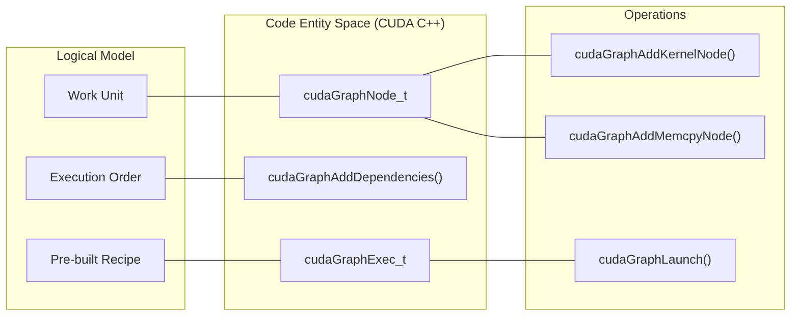
Sources: [docs/cuda-graph-basics/cuda-graph.md:108-140]()

For details on the DAG model and creation mechanics, see **[CUDA Graph Structure: Nodes, Edges, and Creation Methods](#2.2)**.

---

## CUDA Graph Constraints

To achieve high-performance replay, CUDA Graphs impose several strict runtime constraints. These restrictions ensure that the GPU driver can optimize the execution path without checking for CPU-side state changes during replay.

*   **Static Topology**: The number of nodes and their dependency edges cannot change after instantiation [docs/cuda-graph-basics/cuda-graph.md:56-57]().
*   **Asynchronous Restrictions**: Operations that require CPU-GPU synchronization (e.g., `cudaStreamSynchronize`, `cudaMemcpy` to host) are generally forbidden during capture [docs/cuda-graph-basics/introduction.md:70]().
*   **Static Parameters**: While some parameters can be updated, the underlying memory addresses and kernel configurations are typically fixed at instantiation [docs/cuda-graph-basics/cuda-graph.md:56-57]().

For a complete list of runtime and memory restrictions, see **[CUDA Graph Constraints](#2.3)**.

---

## Quantitative Benefits and Measurement

The primary goal of CUDA Graphs is to increase GPU utilization by reducing the time the GPU spends idle while waiting for the CPU to dispatch work [docs/cuda-graph-basics/introduction.md:68-70]().

### Performance Metrics
*   **GPU Utilization**: Measured via tools like `nvidia-smi`; graphs aim to eliminate the "sawtooth" pattern caused by launch gaps.
*   **Jitter Reduction**: Graphs provide more deterministic execution times by removing variable CPU-side software latencies [docs/cuda-graph-basics/introduction.md:27-28]().
*   **Profiling**: Using Nsight Systems to visualize the elimination of gaps between kernels in the timeline.

**Diagram: Execution Workflow Comparison**

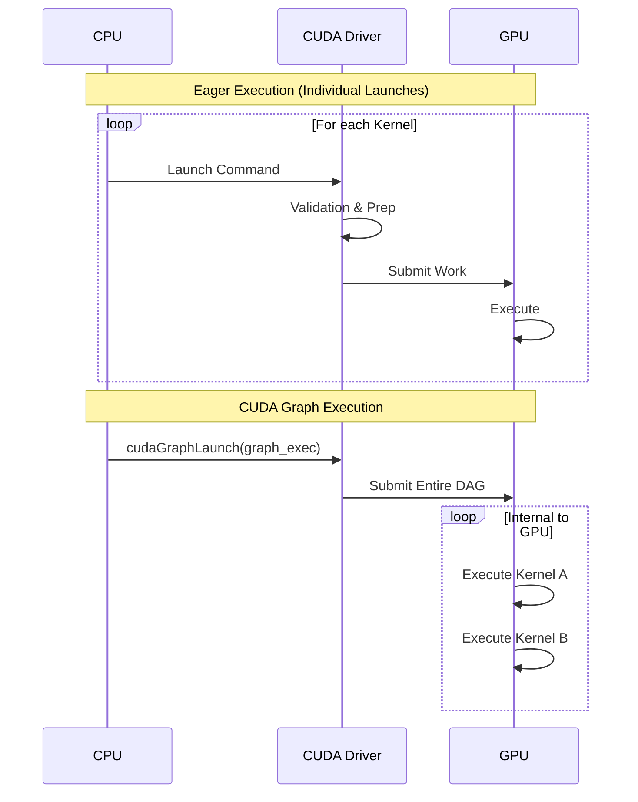
Sources: [docs/cuda-graph-basics/cuda-graph.md:19-34](), [docs/cuda-graph-basics/introduction.md:27-28]()

For details on measurement techniques and break-even analysis, see **[Quantitative Benefits and Measurement](#2.4)**.

---

# Page: The Launch Overhead Problem and CUDA Graph Solution

# The Launch Overhead Problem and CUDA Graph Solution

<details>
<summary>Relevant source files</summary>

The following files were used as context for generating this wiki page:

- [docs/cuda-graph-basics/cuda-graph.md](docs/cuda-graph-basics/cuda-graph.md)
- [docs/cuda-graph-basics/introduction.md](docs/cuda-graph-basics/introduction.md)

</details>


This page details the technical challenges of the CPU-GPU producer-consumer bottleneck in deep learning and explains how CUDA Graphs provide a structural solution to these inefficiencies. It covers the specific phases of kernel launch overhead and the define-instantiate-execute lifecycle used to mitigate them.

## The Producer-Consumer Bottleneck

In modern deep learning applications, the CPU and GPU operate in a producer-consumer relationship [docs/cuda-graph-basics/introduction.md:21-23](). The CPU acts as the orchestrator, dispatching operations, while the GPU driver queues these operations for hardware execution.

As GPU compute power has grown exponentially, the performance gap between CPU orchestration and GPU execution has widened [docs/cuda-graph-basics/introduction.md:21-23](). When a GPU executes a kernel in microseconds, the CPU can become the bottleneck if it cannot prepare the next operation fast enough. This leads to GPU underutilization, where the hardware sits idle waiting for the next command [docs/cuda-graph-basics/introduction.md:23-24]().

### Sources of Launch Overhead

Every time a framework like PyTorch executes a CUDA operation (e.g., `torch.matmul()`), it incurs a cumulative overhead across four primary layers:

| Layer | Duration (Typical) | Key Operations |
| :--- | :--- | :--- |
| **1. Language Transitions** | 10-100 μs | Python/C++ boundary crossing, GIL acquisition, object marshalling [docs/cuda-graph-basics/introduction.md:31-35](). |
| **2. Runtime Processing** | 5-20 μs | Operator dispatch logic, workspace memory preparation, library transitions (cuDNN/cuBLAS) [docs/cuda-graph-basics/introduction.md:37-43](). |
| **3. Driver Operations** | 5-15 μs | Parameter validation, command buffer management, submission to hardware queue [docs/cuda-graph-basics/introduction.md:45-49](). |
| **4. Hardware Submission** | 1-5 μs | PCIe communication, GPU command processor ingestion, hardware scheduling [docs/cuda-graph-basics/introduction.md:51-55](). |

**Sources:** [docs/cuda-graph-basics/introduction.md:29-60]()

## The CUDA Graph Solution

CUDA Graph addresses the launch overhead problem by allowing developers to define a workflow of multiple operations and their dependencies once, then launch the entire sequence as a single unit [docs/cuda-graph-basics/cuda-graph.md:17-18]().

### The Define-Instantiate-Execute Lifecycle

CUDA Graphs move the heavy lifting of kernel preparation from the hot path (execution) to an upfront setup phase.

1.  **Definition**: The user describes the operations (nodes) and their execution order (edges). This creates a Directed Acyclic Graph (DAG) [docs/cuda-graph-basics/cuda-graph.md:38-38]().
2.  **Instantiation**: The CUDA runtime validates the graph, pre-allocates resources, and builds optimized launch descriptors. This "bakes" the graph into an executable form (`cudaGraphExec_t`) [docs/cuda-graph-basics/cuda-graph.md:39-40]().
3.  **Execution**: The prepared graph is launched via a single CPU call (e.g., `cudaGraphLaunch`). The GPU driver handles the entire sequence without further CPU intervention [docs/cuda-graph-basics/cuda-graph.md:40-40]().

### Mapping Concepts to Code Entities

The following diagram bridges the conceptual "recipe" of a CUDA Graph to the actual CUDA C++ API entities used to implement them.

**Diagram: CUDA Graph API Entity Mapping**
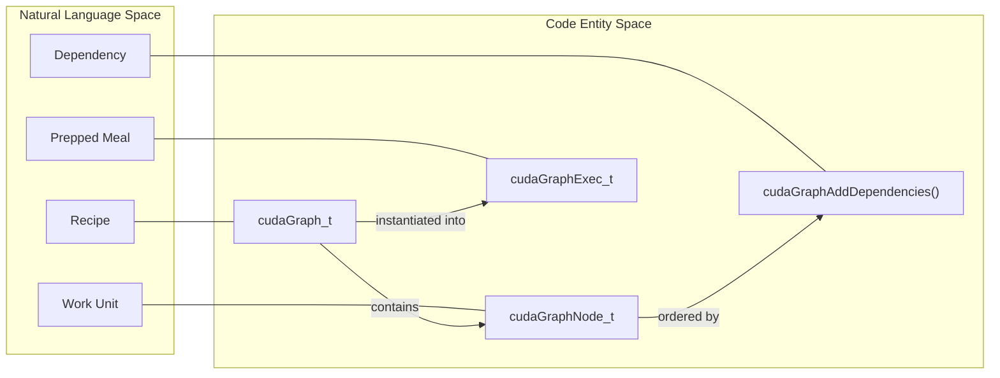
**Sources:** [docs/cuda-graph-basics/cuda-graph.md:38-40](), [docs/cuda-graph-basics/cuda-graph.md:107-134]()

## Graph Structure: Nodes and Edges

A CUDA Graph is a Directed Acyclic Graph (DAG) representing the execution flow of GPU operations [docs/cuda-graph-basics/cuda-graph.md:44-44]().

### Nodes (Work Units)
Nodes encapsulate specific operations. Once a graph is instantiated, nodes are immutable, though some parameters like memory addresses can be updated via specialized APIs [docs/cuda-graph-basics/cuda-graph.md:56-56]().
*   **Kernel Nodes**: Computational work (e.g., matrix multiplication) [docs/cuda-graph-basics/cuda-graph.md:50-50]().
*   **Memory Nodes**: Copies (H2D, D2H, D2D) or memory management (alloc/free) [docs/cuda-graph-basics/cuda-graph.md:51-52]().
*   **Host Nodes**: CPU-side functions triggered during graph execution [docs/cuda-graph-basics/cuda-graph.md:53-53]().
*   **Empty Nodes**: Used for synchronization and grouping dependencies [docs/cuda-graph-basics/cuda-graph.md:54-54]().

### Edges (Dependencies)
Edges define the execution order [docs/cuda-graph-basics/cuda-graph.md:58-58]().
*   **Sequential**: Node B follows Node A [docs/cuda-graph-basics/cuda-graph.md:62-62]().
*   **Parallel**: Independent nodes (B and C) can run simultaneously if GPU resources allow [docs/cuda-graph-basics/cuda-graph.md:63-63]().

**Diagram: Logical Flow to Node Dependencies**
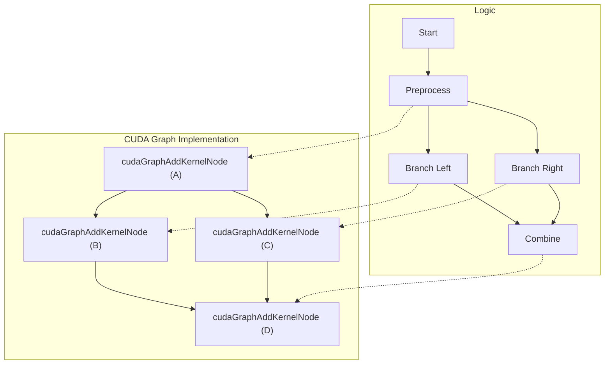
**Sources:** [docs/cuda-graph-basics/cuda-graph.md:72-87](), [docs/cuda-graph-basics/cuda-graph.md:119-130]()

## Implementation: Explicit Construction

In the explicit construction method, the developer manually manages the graph object and its components. This provides the highest level of control but requires significant low-level management.

| Function | Purpose |
| :--- | :--- |
| `cudaGraphCreate()` | Initializes a new `cudaGraph_t` object [docs/cuda-graph-basics/cuda-graph.md:109-109](). |
| `cudaGraphAddKernelNode()` | Adds a computation node with specific `cudaKernelNodeParams` [docs/cuda-graph-basics/cuda-graph.md:120-121](). |
| `cudaGraphAddDependencies()` | Connects nodes to define the execution DAG [docs/cuda-graph-basics/cuda-graph.md:129-130](). |
| `cudaGraphInstantiate()` | Compiles the `cudaGraph_t` into a runnable `cudaGraphExec_t` [docs/cuda-graph-basics/cuda-graph.md:134-134](). |
| `cudaGraphLaunch()` | Submits the entire instantiated graph to a `cudaStream_t` [docs/cuda-graph-basics/cuda-graph.md:138-138](). |

**Sources:** [docs/cuda-graph-basics/cuda-graph.md:107-140]()

---

# Page: CUDA Graph Structure: Nodes, Edges, and Creation Methods

# CUDA Graph Structure: Nodes, Edges, and Creation Methods

<details>
<summary>Relevant source files</summary>

The following files were used as context for generating this wiki page:

- [docs/cuda-graph-basics/cuda-graph.md](docs/cuda-graph-basics/cuda-graph.md)

</details>


This page details the technical architecture of CUDA Graphs, focusing on the Directed Acyclic Graph (DAG) model, the specific types of operations (nodes) supported, and the mechanisms for defining dependencies (edges). It also compares the two primary methods of graph creation: explicit construction and stream capture.

## The DAG Model

A CUDA Graph is represented as a Directed Acyclic Graph (DAG) [docs/cuda-graph-basics/cuda-graph.md:42-44](). This model allows the CUDA runtime to understand the entire workflow upfront, enabling optimizations that are impossible in the traditional stream-based "fire-and-forget" model.

### Nodes: The Units of Work
Nodes represent the functional units of a graph. Each node encapsulates a specific GPU or synchronization operation [docs/cuda-graph-basics/cuda-graph.md:46-48]().

| Node Type | Description |
| :--- | :--- |
| **Kernel Nodes** | Represent computational work such as matrix multiplications or convolutions [docs/cuda-graph-basics/cuda-graph.md:50-50](). |
| **Memory Nodes** | Handle data movement (Host-to-Device, Device-to-Device) and memory management (allocation/freeing) [docs/cuda-graph-basics/cuda-graph.md:51-52](). |
| **Host Nodes** | CPU-side functions triggered during graph execution, synchronized with the GPU workflow [docs/cuda-graph-basics/cuda-graph.md:53-53](). |
| **Empty Nodes** | Contain no work; used as logical synchronization points to simplify complex dependency structures [docs/cuda-graph-basics/cuda-graph.md:54-54](). |
| **Child Graph Nodes** | Allow nesting of graphs, enabling modular graph design. |

Nodes are immutable once the graph is instantiated; while certain parameters like memory addresses can be updated via specialized APIs, the operation type itself cannot change [docs/cuda-graph-basics/cuda-graph.md:56-56]().

### Edges: The Dependency Logic
Edges define the execution constraints between nodes [docs/cuda-graph-basics/cuda-graph.md:58-58](). An edge from Node A to Node B ensures that Node B does not begin execution until Node A has completed.

*   **Sequential Dependencies**: Create a strict linear order (e.g., Forward Pass $\rightarrow$ Backward Pass) [docs/cuda-graph-basics/cuda-graph.md:61-61]().
*   **Parallel Opportunities**: Nodes with no mutual dependencies can be scheduled concurrently by the hardware (e.g., parallel branches in a multi-head attention layer) [docs/cuda-graph-basics/cuda-graph.md:62-62]().
*   **Fork-Join Model**: A single node can have multiple outgoing edges (fork) or multiple incoming edges (join/synchronization point) [docs/cuda-graph-basics/cuda-graph.md:63-64]().

**Sources:** [docs/cuda-graph-basics/cuda-graph.md:42-66]()

---

## Creation Methods

There are two primary ways to generate a `cudaGraph_t` object: Explicit Construction and Stream Capture.

### 1. Explicit Graph Construction
This method involves manually calling CUDA Driver or Runtime APIs to add nodes and define dependencies. It provides the highest level of control but requires significant boilerplate code.

**Key API Entities:**
*   `cudaGraphCreate`: Initializes the graph object [docs/cuda-graph-basics/cuda-graph.md:109-109]().
*   `cudaGraphAddKernelNode`: Adds a compute kernel with specific `cudaKernelNodeParams` [docs/cuda-graph-basics/cuda-graph.md:120-121]().
*   `cudaGraphAddDependencies`: Manually links nodes to form edges [docs/cuda-graph-basics/cuda-graph.md:129-130]().

**Implementation Flow:**
1.  Define kernel parameters (grid/block dimensions, function pointers).
2.  Add nodes to the graph.
3.  Define edges.
4.  Instantiate via `cudaGraphInstantiate` [docs/cuda-graph-basics/cuda-graph.md:134-134]().

**Sources:** [docs/cuda-graph-basics/cuda-graph.md:93-140]()

### 2. Stream Capture
Stream capture is the preferred method for most deep learning applications because it allows developers to "record" existing stream-based code without major refactoring.

**How it works:**
The user initiates capture on a specific CUDA stream using `cudaStreamBeginCapture`. All subsequent work launched into that stream (and its joined branches) is redirected into a graph instead of being executed immediately [docs/cuda-graph-basics/cuda-graph.md:166-172]().

**The Fork-Join Model in Capture:**
Capture handles complex dependencies via the stream's natural synchronization primitives:
*   **Fork**: Launching kernels into different streams that were branched from the capturing stream.
*   **Join**: Using `cudaEventRecord` and `cudaStreamWaitEvent` to merge parallel work back into the capturing stream [docs/cuda-graph-basics/cuda-graph.md:175-177]().

**Sources:** [docs/cuda-graph-basics/cuda-graph.md:156-177]()

---

## Visualizing Graph Lifecycle and Entities

The following diagrams illustrate how the conceptual DAG relates to specific CUDA API entities and the lifecycle of a graph from definition to execution.

### Diagram 1: Conceptual DAG to Code Entity Mapping
This diagram maps the components of a CUDA Graph to the specific C++ structures and functions used in the `cuda-graph-basics` examples.

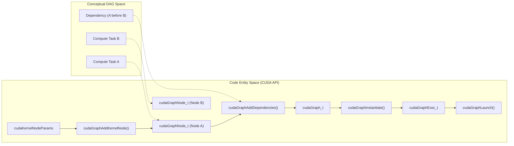
**Sources:** [docs/cuda-graph-basics/cuda-graph.md:107-140]()

### Diagram 2: Stream Capture Lifecycle
This diagram shows the state transition of a CUDA Stream during the capture process, highlighting the functions that manage the "Recording" phase.

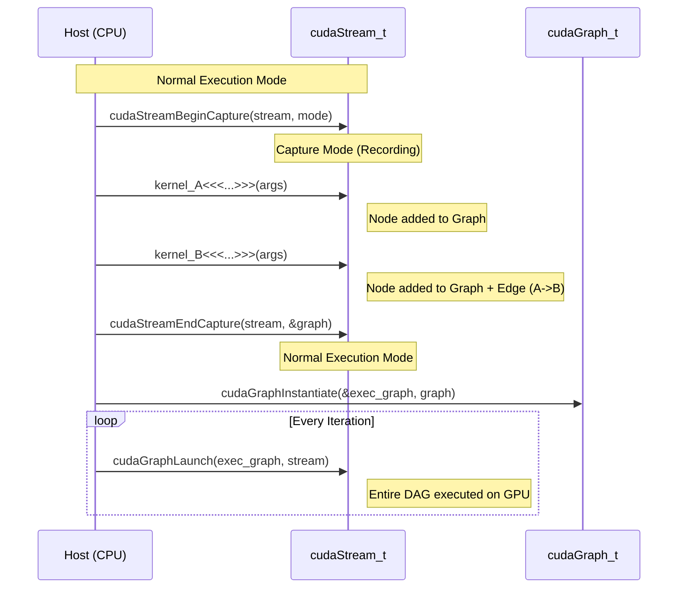
**Sources:** [docs/cuda-graph-basics/cuda-graph.md:166-174](), [docs/cuda-graph-basics/cuda-graph.md:36-40]()

---

## Comparison: Explicit vs. Capture

| Feature | Explicit Construction | Stream Capture |
| :--- | :--- | :--- |
| **Ease of Use** | Low (Verbose) | High (Wraps existing code) |
| **Control** | Absolute control over every node/edge | Limited to what is launched in stream |
| **Flexibility** | High (Can build non-linear logic easily) | Moderate (Requires events for fork/join) |
| **Maintenance** | High (API changes require code updates) | Low (Captures logic automatically) |
| **Use Case** | Custom library primitives, dynamic graphs | DL Frameworks (PyTorch, TensorFlow) |

**Sources:** [docs/cuda-graph-basics/cuda-graph.md:142-154](), [docs/cuda-graph-basics/cuda-graph.md:179-188]()

---

# Page: CUDA Graph Constraints

# CUDA Graph Constraints

<details>
<summary>Relevant source files</summary>

The following files were used as context for generating this wiki page:

- [docs/cuda-graph-basics/constraints.md](docs/cuda-graph-basics/constraints.md)

</details>


This page documents the fundamental runtime constraints imposed by the CUDA driver and runtime on CUDA Graphs. Understanding these limitations is essential for determining workload suitability and ensuring correct implementation during the define-instantiate-execute lifecycle.

## 1. Asynchronous Restrictions

CUDA Graphs are built upon an asynchronous execution model where the CPU submits work to the GPU and continues without waiting. This model prohibits any operations that would force immediate coordination between the host and device during the capture phase.

### No Host-Device Synchronization
Operations that synchronize the CPU with the GPU are strictly prohibited during stream capture [docs/cuda-graph-basics/constraints.md:19-21](). Prohibited operations include:
*   `cudaDeviceSynchronize()`: Blocks the CPU until all device work completes [docs/cuda-graph-basics/constraints.md:23-23]().
*   `cudaStreamSynchronize()`: Forbidden on the capturing stream as it blocks the CPU until the stream completes [docs/cuda-graph-basics/constraints.md:24-24]().
*   `cudaEventSynchronize()`: Blocks the CPU until a specific event is signaled [docs/cuda-graph-basics/constraints.md:25-25]().
*   **Synchronous Memory Operations**: Any `cudaMemcpy` call without the `Async` suffix is prohibited because the driver cannot record operations requiring immediate CPU-GPU coordination [docs/cuda-graph-basics/constraints.md:26-28]().

### No Default Stream
Graph capture must occur on a non-default stream [docs/cuda-graph-basics/constraints.md:30-32](). The default stream (stream 0) possesses special semantics and implicit synchronization behavior that conflict with the requirements of the capture process.

### No Stream/Event Query Operations
Querying the runtime state is incompatible with graph capture. Developers cannot use `cudaStreamQuery()` or `cudaEventQuery()` during capture because these operations require inspecting active runtime state rather than recording a command [docs/cuda-graph-basics/constraints.md:34-41]().

---
**Sources:** [docs/cuda-graph-basics/constraints.md:15-42]()

## 2. Static Topology and Parameters

A CUDA Graph represents a fixed execution plan. Once a graph is instantiated, its internal structure and most of its launch parameters are frozen.

### Static Graph Topology
The graph records a fixed set of nodes and dependency edges [docs/cuda-graph-basics/constraints.md:43-45](). 
*   **Data-Dependent Branching**: Control flow decisions based on values computed during execution (e.g., `if (value > threshold) launch_kernel_a()`) are prohibited [docs/cuda-graph-basics/constraints.md:52-61]().
*   **Variable Loops**: Loop counts determined by GPU computation results cannot be captured [docs/cuda-graph-basics/constraints.md:63-63]().
*   **Conditional Nodes (CUDA 12.3+)**: While `cudaGraphConditionalHandle` allows GPU-side branching, the topology remains static—all possible execution paths must be defined at capture time [docs/cuda-graph-basics/constraints.md:47-50]().

### Static Parameters and Shapes
By default, the graph captures exact pointers and kernel descriptors at definition time [docs/cuda-graph-basics/constraints.md:68-70]().
*   **Memory Addresses**: Every graph launch reads from and writes to the same virtual memory addresses used during capture [docs/cuda-graph-basics/constraints.md:72-74]().
*   **Kernel Configurations**: Grid dimensions, block dimensions, and shared memory sizes are stored in the launch descriptor and cannot be changed between launches without using Graph Update APIs (`cudaGraphExecNodeSetParams`) [docs/cuda-graph-basics/constraints.md:78-80]().
*   **Static Shapes**: Data shapes must remain constant. Changing shapes typically violates multiple constraints: it alters kernel configurations, memory access patterns, and often requires new memory allocations [docs/cuda-graph-basics/constraints.md:87-96]().

| Constraint Type | Description | Workaround |
| :--- | :--- | :--- |
| **Topology** | Nodes and edges are fixed. | Use Conditional Nodes (CUDA 12.3+) or multiple graphs. |
| **Memory** | Virtual addresses are captured. | Update values at fixed addresses or use Graph Update APIs. |
| **Kernels** | Arguments and grid dims are frozen. | Pass data via device memory instead of scalar arguments. |

---
**Sources:** [docs/cuda-graph-basics/constraints.md:43-98]()

## 3. Capture Scope and Execution Rules

The capture process is strictly bounded by the stream state and the environment in which the capture is initiated.

### Self-Contained Stream Capture
A graph capture must be self-contained within the stream(s) involved.
*   **Fork-Join Model**: Capture can involve multiple streams via `cudaStreamWaitEvent`, but all work must eventually join back to the primary capturing stream before `cudaStreamEndCapture` is called [docs/cuda-graph-basics/constraints.md:104-106]().
*   **Unjoined Work**: If work is launched on a forked stream but not joined back to the capturing stream, the capture will fail [docs/cuda-graph-basics/constraints.md:108-110]().

### CPU Code Exclusion
Only GPU operations are recorded. Any CPU-side logic (calculations, logging, or print statements) executed during the capture phase is executed **once** during capture and is **not** part of the recorded graph [docs/cuda-graph-basics/constraints.md:112-117]().

### Multi-threading Constraints
Graph capture is thread-local. A stream can only be in capture mode in one thread at a time [docs/cuda-graph-basics/constraints.md:119-121]().
*   **Global Capture**: `cudaStreamBeginCapture` with `cudaStreamCaptureModeGlobal` fails if any other thread in the process is capturing [docs/cuda-graph-basics/constraints.md:123-125]().
*   **Thread Local Capture**: `cudaStreamCaptureModeThreadLocal` allows concurrent captures across different threads, provided they use different streams [docs/cuda-graph-basics/constraints.md:127-129]().

---
**Sources:** [docs/cuda-graph-basics/constraints.md:100-131]()

## 4. Memory Management and Lifetimes

Memory operations within graphs are subject to strict lifecycle rules to prevent use-after-free errors or invalid pointer references.

### Memory API Restrictions
Standard `cudaMalloc` and `cudaFree` are prohibited during capture unless using **Stream Capture with Memory Pools** (CUDA 11.4+) [docs/cuda-graph-basics/constraints.md:135-137]().
*   **Traditional Capture**: Allocations must occur before capture begins [docs/cuda-graph-basics/constraints.md:139-140]().
*   **Relaxed Capture**: `cudaMallocAsync` and `cudaFreeAsync` can be captured into nodes, but the resulting addresses are managed by the CUDA driver's internal graph memory pool [docs/cuda-graph-basics/constraints.md:142-144]().

### Lifetime Requirements
All memory addresses referenced by a graph must remain valid for the entire lifetime of the `cudaGraphExec_t` (the executable graph) [docs/cuda-graph-basics/constraints.md:148-150](). Freeing a buffer that is used by an instantiated graph and then launching that graph results in undefined behavior (usually a device-side illegal memory access) [docs/cuda-graph-basics/constraints.md:152-154]().

### Multi-Device Considerations
A single CUDA Graph is associated with a specific GPU device. While a graph can contain nodes that execute on different devices (using `cudaSetDevice` during capture), the management of peer-to-peer access and memory visibility must be handled explicitly [docs/cuda-graph-basics/constraints.md:158-164]().

---
**Sources:** [docs/cuda-graph-basics/constraints.md:133-164]()

## 5. System Mapping: Constraints to Code Entities

The following diagrams illustrate how the conceptual constraints described above map to specific CUDA API functions and runtime behaviors.

### Diagram: Capture State and Forbidden Operations
This diagram shows how the `cudaStreamCaptureStatus` transition restricts the use of specific API calls.

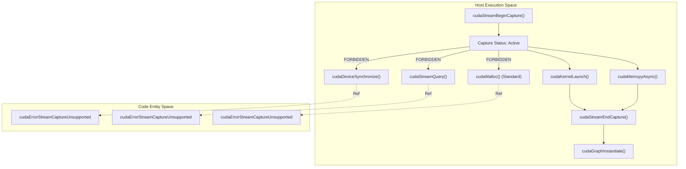
**Sources:** [docs/cuda-graph-basics/constraints.md:19-41](), [docs/cuda-graph-basics/constraints.md:135-137]()

### Diagram: Parameter Persistence vs. Updates
This diagram illustrates the data flow for kernel parameters and the role of Graph Update APIs in bypassing static constraints.

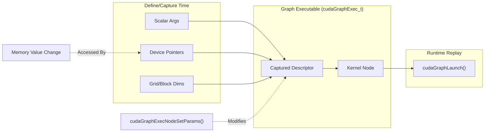
**Sources:** [docs/cuda-graph-basics/constraints.md:68-85]()

---

# Page: Quantitative Benefits and Measurement

# Quantitative Benefits and Measurement

<details>
<summary>Relevant source files</summary>

The following files were used as context for generating this wiki page:

- [docs/cuda-graph-basics/quantitative-benefits.md](docs/cuda-graph-basics/quantitative-benefits.md)

</details>


This section provides practical methods to quantify the performance advantages of CUDA Graphs within an application. Measuring these benefits involves analyzing GPU utilization, calculating kernel launch overhead reduction, and assessing improvements in timing consistency (jitter).

## Common CUDA Graph Benefits

CUDA Graphs provide three primary quantifiable performance improvements:

1.  **Higher GPU Utilization**: By eliminating the CPU-side launch bottleneck, the GPU spends more time executing kernels and less time idling. This is critical when the CPU cannot queue work fast enough to keep the GPU pipeline full [docs/cuda-graph-basics/quantitative-benefits.md:17-20]().
2.  **Reduced Kernel Launch Overhead**: Graphs reduce driver-side and hardware-side overhead by submitting an entire sequence of operations as a single unit. This bypasses per-kernel command buffer management and hardware scheduling logic [docs/cuda-graph-basics/quantitative-benefits.md:21-24]().
3.  **Improved Timing Consistency (Less Jitter)**: Graphs provide deterministic execution. This reduces **Run-to-run jitter** (variation in a single process) and **Rank-to-rank jitter** (variation across multiple GPUs in distributed training), which helps prevent "stragglers" from slowing down collective operations [docs/cuda-graph-basics/quantitative-benefits.md:25-31]().

## Measuring GPU Utilization

Monitoring SM (Streaming Multiprocessor) utilization is the most direct way to observe the efficiency gains from CUDA Graphs.

### Using nvidia-smi
The `nvidia-smi dmon` command monitors SM utilization in real-time [docs/cuda-graph-basics/quantitative-benefits.md:36-40]().

```bash
nvidia-smi dmon -s u
```

| Execution Mode | Typical SM Utilization | Observation |
| :--- | :--- | :--- |
| **Without Graphs** | 50% - 80% | Periodic drops; GPU frequently waits for CPU to launch the next kernel [docs/cuda-graph-basics/quantitative-benefits.md:44-45](). |
| **With Graphs** | 90% - 100% | Consistent and high; GPU has a continuous stream of pre-queued work [docs/cuda-graph-basics/quantitative-benefits.md:45-46](). |

### Using Nsight Systems
For a visual representation, Nsight Systems can show GPU active periods. Using the flag `--gpu-metrics-devices=all` includes `SMs Active` metrics in the timeline to visualize GPU saturation over time [docs/cuda-graph-basics/quantitative-benefits.md:72-73]().

**Sources:** [docs/cuda-graph-basics/quantitative-benefits.md:34-75]()

## Estimating Kernel Launch Overhead Reduction

To quantify the overhead saved, you must count the individual kernel launches that are replaced by a single graph launch.

### Measurement Workflow
1.  **Profile the Baseline**: Run the application through Nsight Systems: `nsys profile -o baseline python script.py` [docs/cuda-graph-basics/quantitative-benefits.md:81-83]().
2.  **Analyze API Stats**: Generate a summary report: `nsys stats --report cuda_api_sum baseline.nsys-rep` [docs/cuda-graph-basics/quantitative-benefits.md:87-89]().
3.  **Count Launches**: Identify the number of `cudaLaunchKernel` or `cudaLaunchKernelExC` calls per iteration [docs/cuda-graph-basics/quantitative-benefits.md:95-96]().

### Calculation Logic
The total savings can be estimated using the following formula [docs/cuda-graph-basics/quantitative-benefits.md:93-98]():

$$\text{Total Savings} = \text{Number of Kernels} \times \text{Overhead per Kernel}$$

*   **Estimated Overhead**: Typically **1-5 μs** per kernel for driver and hardware processing [docs/cuda-graph-basics/quantitative-benefits.md:96-97]().
*   **Significance**: In models with thousands of small kernels (e.g., Transformers without fusion), this overhead can exceed the actual GPU execution time.

**Sources:** [docs/cuda-graph-basics/quantitative-benefits.md:77-103]()

## Measuring Jitter Reduction

Jitter is the variation in execution time. CUDA Graphs reduce this by bypassing the dynamic dispatch path of the CUDA driver.

### Run-to-Run Jitter (Single GPU)
Measure the **Coefficient of Variation (CV)** over ~100 iterations ($CV = \frac{\sigma}{\mu}$) [docs/cuda-graph-basics/quantitative-benefits.md:108-110]().
*   **Without Graphs**: CV is typically **3-10%** due to CPU scheduling and driver state [docs/cuda-graph-basics/quantitative-benefits.md:112-113]().
*   **With Graphs**: CV is typically **<1-2%** [docs/cuda-graph-basics/quantitative-benefits.md:113-114]().

### Rank-to-Rank Jitter (Multi-GPU)
In distributed environments, different ranks experience different CPU overheads.
*   **Without Graphs**: Variation between ranks is often **5-20%** [docs/cuda-graph-basics/quantitative-benefits.md:125-126]().
*   **With Graphs**: Variation drops to **<2%** as all ranks execute pre-compiled graphs with minimal CPU interaction [docs/cuda-graph-basics/quantitative-benefits.md:126-127]().

**Sources:** [docs/cuda-graph-basics/quantitative-benefits.md:104-127]()

## Measurement Data Flow and Tooling

The following diagram illustrates how performance data flows from the hardware and driver levels to the measurement tools used for quantification.

### Performance Data Flow
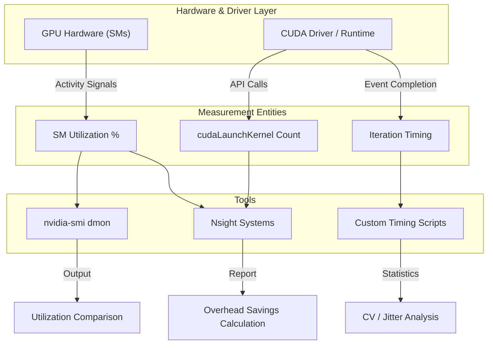
**Sources:** [docs/cuda-graph-basics/quantitative-benefits.md:36-40](), [docs/cuda-graph-basics/quantitative-benefits.md:87-91](), [docs/cuda-graph-basics/quantitative-benefits.md:108-110]()

## Profiling and Analysis Process

This diagram maps the natural language steps of performance analysis to the specific code-level entities and CLI tools provided by NVIDIA.

### Profiling to Quantification Mapping
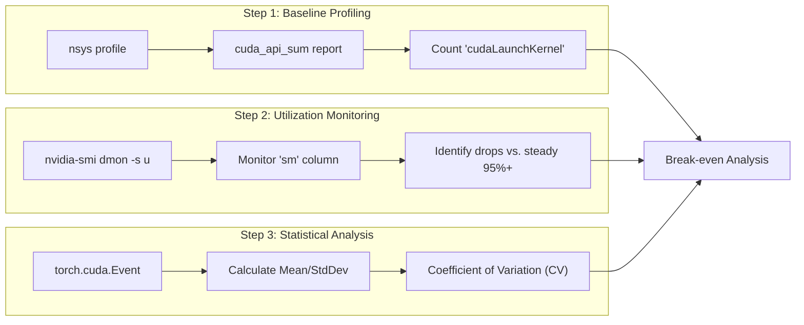
**Sources:** [docs/cuda-graph-basics/quantitative-benefits.md:38-39](), [docs/cuda-graph-basics/quantitative-benefits.md:81-89](), [docs/cuda-graph-basics/quantitative-benefits.md:110-111]()

---

# Page: PyTorch CUDA Graph Integration

# PyTorch CUDA Graph Integration

<details>
<summary>Relevant source files</summary>

The following files were used as context for generating this wiki page:

- [docs/torch-cuda-graph/introduction.md](docs/torch-cuda-graph/introduction.md)
- [docs/torch-cuda-graph/torch-integration.md](docs/torch-cuda-graph/torch-integration.md)

</details>


This section provides a high-level overview of how PyTorch bridges its dynamic, eager-execution design with the static requirements of CUDA Graphs. While PyTorch is optimized for flexibility and research, CUDA Graphs prioritize maximum performance by eliminating kernel launch overhead and enabling full asynchrony.

## Design Philosophy

The integration of CUDA Graphs into PyTorch is built on a "opt-in" performance model. Because PyTorch typically uses a dynamic computation graph, the framework provides specialized APIs that allow users to freeze specific sections of their workload into a static `cudaGraph_t` for repeated execution.

### Key Integration Principles
*   **Stream Capture Only**: PyTorch exclusively uses the stream capture method to create graphs, avoiding manual node-by-node construction [docs/torch-cuda-graph/torch-integration.md:27-29]().
*   **Memory Pool Isolation**: To prevent the PyTorch caching allocator from corrupting graph-managed memory, PyTorch uses a private memory pool for CUDA Graph allocations [docs/torch-cuda-graph/torch-integration.md:58-58]().
*   **Minimal API Surface**: PyTorch does not expose graph update APIs; if parameters like tensor shapes change, the graph must be recaptured [docs/torch-cuda-graph/torch-integration.md:30-31]().

### Responsibility Bridge
The following diagram illustrates how responsibilities are divided between the PyTorch framework and the developer to ensure a successful graph capture.

**Diagram: Responsibility Mapping**
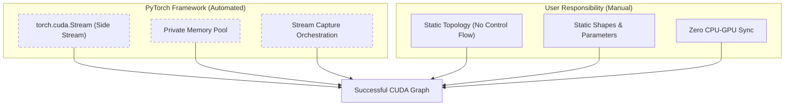
Sources: [docs/torch-cuda-graph/torch-integration.md:52-85]()

---

## PyTorch CUDA Graph APIs

PyTorch offers three distinct levels of API for interacting with CUDA Graphs, ranging from low-level handles to high-level wrappers that support autograd.

*   **`torch.cuda.CUDAGraph`**: A low-level class that wraps the underlying CUDA types (`cudaGraph_t` and `cudaGraphExec_t`) [docs/torch-cuda-graph/torch-integration.md:37-37]().
*   **`torch.cuda.graph()`**: A context manager used for manual stream capture. It manages side streams and capture states [docs/torch-cuda-graph/torch-integration.md:38-38]().
*   **`torch.cuda.make_graphed_callables()`**: The highest-level API. It is designed for modules and functions, handling warmup iterations and separately capturing forward and backward passes for autograd compatibility [docs/torch-cuda-graph/torch-integration.md:43-43]().

For detailed API usage, warmup requirements, and RNG management, see **[PyTorch CUDA Graph APIs](#3.1)**.

---

## Automatic and Framework-Specific Integrations

Beyond manual APIs, PyTorch and NVIDIA provide tools to automate graph capture for complex models and distributed training.

### Automatic Capture with `torch.compile`
The `torch.compile` feature includes a `reduce-overhead` mode that uses "CUDAGraph Trees." This system automatically partitions models into graphed segments and manages a shared memory pool to handle multiple execution paths without manual intervention.
For details, see **[Automatic CUDA Graphs with torch.compile](#3.2)**.

### Large-Scale Distributed Training
Frameworks like **Transformer Engine (TE)** and **Megatron-LM** provide specialized managers to handle the complexities of FP8 dynamic scaling and pipeline parallelism.
*   **Megatron-LM**: Uses `CudaGraphManager` for per-layer graphing and `FullCudaGraphWrapper` for capturing entire iterations [docs/torch-cuda-graph/introduction.md:31-31]().
*   **Transformer Engine**: Extends `make_graphed_callables` to support FP8 weight caching and GPU-controlled no-ops [docs/torch-cuda-graph/introduction.md:27-28]().

For details, see **[Transformer Engine and Megatron-LM CUDA Graph Support](#3.3)**.

---

## Developer Guides: Writing Compatible Code

To use CUDA Graphs effectively, PyTorch code must be "graph-safe." This involves two primary efforts: eliminating synchronizations and managing dynamic behaviors.

### Sync-Free Code and Dynamic Patterns
CUDA Graphs cannot capture operations that require CPU-GPU synchronization (e.g., `.item()`, `.tolist()`, or print statements). Furthermore, any dynamic control flow (Python `if/else`) or dynamic shapes must be converted into static equivalents or handled via workarounds like `torch.where()`.

**Diagram: Code Transformation Space**
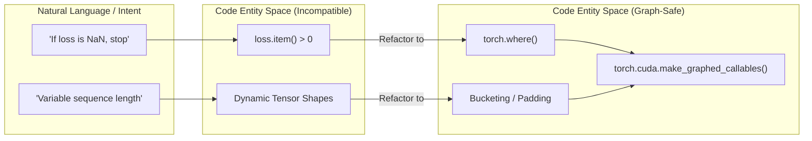
Sources: [docs/torch-cuda-graph/introduction.md:41-53](), [docs/torch-cuda-graph/torch-integration.md:62-70]()

*   For identifying and removing hidden syncs, see **[Writing Sync-Free Code](#3.4)**.
*   For techniques to handle dynamic shapes and control flow, see **[Handling Dynamic Patterns](#3.5)**.
*   For a systematic adoption strategy and pre-capture checklist, see **[Best Practices and Quick Checklist](#3.6)**.

---

# Page: PyTorch CUDA Graph APIs

# PyTorch CUDA Graph APIs

<details>
<summary>Relevant source files</summary>

The following files were used as context for generating this wiki page:

- [docs/torch-cuda-graph/torch-integration.md](docs/torch-cuda-graph/torch-integration.md)

</details>


This page provides a technical deep dive into the three primary APIs PyTorch provides for CUDA Graph integration. It details the division of responsibility between the framework and the user, the mandatory execution requirements like warmups, and the specialized management of RNG states and memory caches.

## API Overview and Design Philosophy

PyTorch integrates CUDA Graphs by bridging its dynamic, eager-execution nature with the static requirements of CUDA Graphs. The integration is built on three core principles:
1.  **Stream capture only**: PyTorch exclusively uses stream capture (wrapping `cudaStreamBeginCapture`/`cudaStreamEndCapture`) rather than explicit node-by-node graph construction [docs/torch-cuda-graph/torch-integration.md:27-29]().
2.  **No graph updates**: The framework does not expose CUDA's graph update APIs. If parameters or topology change, the graph must be recaptured [docs/torch-cuda-graph/torch-integration.md:30-30]().
3.  **Memory Pool Isolation**: PyTorch uses a private memory pool for CUDA Graph allocations to prevent the caching allocator from reusing addresses that must remain static for the graph's lifetime [docs/torch-cuda-graph/torch-integration.md:58-58]().

### The Three PyTorch APIs

| API | Level | Primary Use Case |
|:---|:---|:---|
| `torch.cuda.CUDAGraph` | Low-level | A Python class wrapping `cudaGraph_t` and `cudaGraphExec_t`. Used for direct replay control [docs/torch-cuda-graph/torch-integration.md:37-37](). |
| `torch.cuda.graph()` | Mid-level | A context manager that orchestrates stream capture and side-stream management [docs/torch-cuda-graph/torch-integration.md:38-38](). |
| `torch.cuda.make_graphed_callables()` | High-level | An autograd-aware wrapper that handles forward/backward passes and memory pool sharing [docs/torch-cuda-graph/torch-integration.md:43-43](). |

---

## Responsibility Sharing

While PyTorch automates the boilerplate of CUDA stream management, the user remains responsible for the integrity of the captured code.

### Mapping Framework Responsibility to Code Entities

The following diagram illustrates how PyTorch's internal entities manage the transition from Eager Space to Graph Space.

**Title: PyTorch CUDA Graph Orchestration Flow**
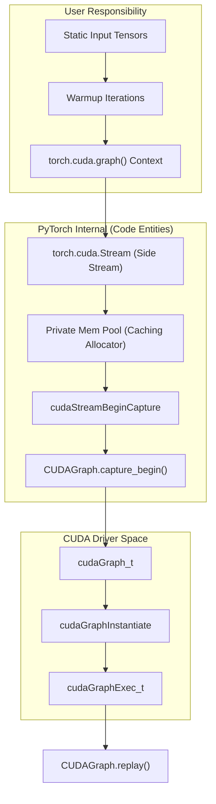
Sources: [docs/torch-cuda-graph/torch-integration.md:54-60](), [docs/torch-cuda-graph/torch-integration.md:91-107]()

### Responsibility Matrix

| Constraint | PyTorch Handles | User Responsible For |
|:---|:---|:---|
| **Stream Management** | Side stream setup and `wait_stream` [docs/torch-cuda-graph/torch-integration.md:56-57]() | Ensuring no external stream dependencies [docs/torch-cuda-graph/torch-integration.md:67-67]() |
| **Memory Addresses** | Internal allocations via private pool [docs/torch-cuda-graph/torch-integration.md:58-58]() | Fixed graph inputs; use `.copy_()` for data updates [docs/torch-cuda-graph/torch-integration.md:81-81]() |
| **Synchronization** | N/A | Eliminating CPU-GPU syncs (e.g., `.item()`, `.cpu()`) [docs/torch-cuda-graph/torch-integration.md:64-64]() |
| **Topology** | N/A | Ensuring a deterministic execution path [docs/torch-cuda-graph/torch-integration.md:65-65]() |

---

## Mandatory Requirements for Successful Capture

### 1. Warmup Iterations
Before capturing a graph, the workload must be run several times (typically 2-3 iterations) on the capture stream [docs/torch-cuda-graph/torch-integration.md:99-103](). This "warms up" the PyTorch caching allocator and internal frameworks (like cuDNN or MKLDNN), ensuring that memory addresses and internal state stabilize before they are "baked" into the graph [docs/torch-cuda-graph/torch-integration.md:102-103]().

### 2. RNG State Management
PyTorch's Random Number Generator (RNG) state (e.g., for Dropout) is normally managed on the CPU. During CUDA Graph replay, the CPU is bypassed. To ensure correct stochastic behavior, PyTorch must sync the RNG state to the GPU during capture so the graph can increment the seed/offset autonomously during replay [docs/torch-cuda-graph/torch-integration.md:120-125]().

### 3. AMP Cache Requirements
When using Automatic Mixed Precision (AMP), PyTorch maintains a cache for autocast types. This cache must be cleared or stabilized before capture to prevent the graph from capturing stale or invalid type-casting logic [docs/torch-cuda-graph/torch-integration.md:120-125]().

---

## High-Level API: `make_graphed_callables`

For modules requiring Autograd (training), `torch.cuda.make_graphed_callables()` is the preferred interface. It automates several complex tasks:
*   **Forward/Backward Separation**: It captures the forward pass and backward pass as distinct graphs, allowing Autograd to orchestrate them correctly [docs/torch-cuda-graph/torch-integration.md:43-43]().
*   **Memory Pool Sharing**: It allows multiple callables to share the same memory pool, reducing memory fragmentation [docs/torch-cuda-graph/torch-integration.md:43-43]().

**Title: make_graphed_callables Internal Structure**
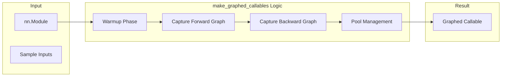
Sources: [docs/torch-cuda-graph/torch-integration.md:43-45]()

---

## DDP and Distributed Setup

Using CUDA Graphs with `DistributedDataParallel` (DDP) requires specific configurations due to the asynchronous nature of collective communications (NCCL).

1.  **Static Graph Requirement**: DDP must be configured with `static_graph=True` in the constructor [docs/torch-cuda-graph/torch-integration.md:130-135](). This informs DDP that the set of gradients involved in the all-reduce will not change between iterations.
2.  **No Find Unused Parameters**: The `find_unused_parameters` flag must be `False` [docs/torch-cuda-graph/torch-integration.md:130-135]().
3.  **Communication Overlap**: Because CUDA Graphs capture all kernels, the overlap between computation and communication (the "bucket" all-reduce) is fixed at capture time [docs/torch-cuda-graph/torch-integration.md:130-135]().

Sources: [docs/torch-cuda-graph/torch-integration.md:1-135]()

---

# Page: Automatic CUDA Graphs with torch.compile

# Automatic CUDA Graphs with torch.compile

<details>
<summary>Relevant source files</summary>

The following files were used as context for generating this wiki page:

- [docs/torch-cuda-graph/best-practices.md](docs/torch-cuda-graph/best-practices.md)
- [docs/torch-cuda-graph/torch-integration.md](docs/torch-cuda-graph/torch-integration.md)

</details>


This page details the automated integration of CUDA Graphs via `torch.compile`. While manual capture using `torch.cuda.CUDAGraph` or `torch.cuda.make_graphed_callables()` provides fine-grained control, `torch.compile` offers a "reduce-overhead" mode that automates graph management, partitioning, and memory handling through a system known as CUDAGraph Trees.

## Overview of `reduce-overhead` Mode

`torch.compile` is the primary entry point for PyTorch's compiler stack (Inductor). By setting the `mode` parameter to `"reduce-overhead"`, the compiler automatically attempts to wrap the generated kernels in CUDA Graphs [docs/torch-cuda-graph/best-practices.md:112-114]().

This mode addresses several manual capture pain points:
1.  **Automatic Partitioning**: It automatically identifies graph-compatible segments and breaks the graph at synchronization points or unsupported operations [docs/torch-cuda-graph/best-practices.md:121-123]().
2.  **Memory Management**: It integrates with the Inductor memory planner to ensure static addresses are maintained [docs/torch-cuda-graph/best-practices.md:125-127]().
3.  **Warmup Handling**: It manages the necessary warmup iterations required to stabilize the caching allocator before capture [docs/torch-cuda-graph/best-practices.md:129-131]().

### Usage Example
```python
import torch

model = MyModel().cuda()
# The "reduce-overhead" mode enables automatic CUDA Graphing
optimized_model = torch.compile(model, mode="reduce-overhead")

# First calls will trigger compilation and graph capture
output = optimized_model(input_data)
```
Sources: [docs/torch-cuda-graph/best-practices.md:112-131]()

## CUDAGraph Trees

CUDAGraph Trees represent the underlying implementation within `torch.compile` (specifically the Inductor backend) that manages multiple execution paths. In a dynamic environment like PyTorch, a single "compiled" function might encounter different conditions (e.g., varying input shapes or scalar values) that lead to different kernel sequences.

### Tree Structure and Smart Partitioning
Instead of a single monolithic graph, `torch.compile` maintains a tree of graphs. Each node in the tree represents a captured CUDA Graph. If a graph execution reaches a point where a dynamic branch occurs, the system can transition to a different branch in the tree or fall back to eager execution.

| Feature | Implementation Detail |
| :--- | :--- |
| **Shared Memory Pool** | All graphs in a tree share a common memory pool to minimize fragmentation [docs/torch-cuda-graph/best-practices.md:135-137](). |
| **Node Types** | Nodes can be "Graphed" (CUDA Graph) or "Eager" (standard kernel launches). |
| **Transitions** | Handled by the Inductor runtime to ensure zero-copy data passing between graphs. |

### Data Flow: Eager to CUDAGraph Tree
The following diagram illustrates how `torch.compile` transforms a standard PyTorch model into a CUDAGraph-enabled execution plan.

**Inductor Compilation Flow for CUDA Graphs**
```mermaid
graph TD
    A["torch.compile(mode='reduce-overhead')"] --> B["TorchDynamo Graph Capture"]
    B --> C["AOTAutograd (FX Graph)"]
    C --> D["Inductor Backend"]
    D --> E{"Is Region Graphable?"}
    E -- "Yes" --> F["Inductor CUDAGraph Tree Node"]
    E -- "No (Sync/Dynamic)" --> G["Eager Fallback Node"]
    F --> H["Private Mem Pool (CUDAGraph Tree)"]
    G --> I["Standard Caching Allocator"]
    H --> J["Replay Graph"]
    I --> K["Launch Kernels Individually"]
```
Sources: [docs/torch-cuda-graph/best-practices.md:112-131](), [docs/torch-cuda-graph/torch-integration.md:41-45]()

## Trade-offs: Automatic vs. Manual Capture

While `torch.compile` simplifies adoption, there are technical trade-offs compared to manual methods like `torch.cuda.make_graphed_callables()` or framework-specific managers like Megatron's `CudaGraphManager`.

### Performance and Flexibility Comparison

| Feature | `torch.compile` (Automatic) | Manual (`CUDAGraph` / `make_graphed_callables`) |
| :--- | :--- | :--- |
| **Ease of Use** | High: Single line of code. | Low: Requires manual warmup and input management. |
| **Capture Scope** | Granular: Automatically partitions graphs. | Coarse: Typically graphs entire modules/passes. |
| **Overhead** | Lower than Eager, but slightly higher than manual due to tree management. | Lowest: Direct replay of the entire sequence. |
| **Dynamic Shapes** | Limited support via multiple graphs in a tree. | Very limited: Usually requires manual bucketing [docs/torch-cuda-graph/best-practices.md:103-105](). |
| **Memory Efficiency** | High: Shared pool across tree nodes. | Variable: Depends on user implementation of `pool`. |

### System Mapping: Code Entities to Execution Logic
This diagram maps the high-level concepts to the specific code-level entities used in the PyTorch integration.

**Code Entity Mapping for Automatic CUDA Graphs**
```mermaid
graph LR
    subgraph "User Space"
        UC["torch.compile"]
    end

    subgraph "PyTorch Compiler Stack"
        ID["Inductor Backend"]
        CGT["CUDAGraphTree Manager"]
    end

    subgraph "CUDA Runtime Space"
        CGE["cudaGraphExec_t (Replay)"]
        MP["cudaMemPool_t (Shared)"]
    end

    UC --> ID
    ID --> CGT
    CGT -- "Manages" --> CGE
    CGT -- "Allocates from" --> MP
```
Sources: [docs/torch-cuda-graph/torch-integration.md:37-45](), [docs/torch-cuda-graph/best-practices.md:112-131]()

## Implementation Details

### Shared Memory Pool
To prevent Out-of-Memory (OOM) errors when using multiple graphs, `torch.compile` uses a shared memory pool. This is crucial because each CUDA Graph normally requires its own static memory assignments. By sharing a pool, the Inductor memory planner can overlap the memory used by different tree nodes that are known to be mutually exclusive in execution [docs/torch-cuda-graph/torch-integration.md:58-59]().

### Smart Partitioning
`torch.compile` monitors for "graph-breaking" operations during its analysis phase. These include:
*   **Data-dependent control flow**: `if tensor.item() > 0:`.
*   **CPU-GPU Synchronizations**: `.item()`, `.tolist()`, or explicit `torch.cuda.synchronize()`.
*   **Unsupported Operations**: Kernels that cannot be captured (e.g., certain custom extensions or legacy ops).

When these are encountered, Inductor ends the current graph, executes the breaking operation in eager mode, and attempts to start a new graph capture for the subsequent kernels [docs/torch-cuda-graph/best-practices.md:121-123]().

Sources: [docs/torch-cuda-graph/torch-integration.md:52-59](), [docs/torch-cuda-graph/best-practices.md:112-131]()

---

# Page: Transformer Engine and Megatron-LM CUDA Graph Support

# Transformer Engine and Megatron-LM CUDA Graph Support

<details>
<summary>Relevant source files</summary>

The following files were used as context for generating this wiki page:

- [docs/torch-cuda-graph/te-megatron-cuda-graphs.md](docs/torch-cuda-graph/te-megatron-cuda-graphs.md)

</details>


This section documents specialized CUDA Graph implementations optimized for large-scale distributed training. While PyTorch provides native APIs, Transformer Engine (TE) and Megatron-LM extend these to handle the unique complexities of FP8 precision and Pipeline Parallelism (PP).

## Overview

Transformer Engine and Megatron-LM provide three primary interfaces for CUDA Graph integration, ranging from manual per-callable wrappers to fully automatic iteration capture.

| Implementation | Scope | Key Features |
| :--- | :--- | :--- |
| **TE `make_graphed_callables`** | Per-layer/Callable | FP8 support, manual PP schedule handling. |
| **Megatron `CudaGraphManager`** | Per-layer/Module | Automatic graphing of transformer layers. |
| **Megatron `FullCudaGraphWrapper`** | Full Iteration | Captures entire training step (Fwd + Bwd + Opt). |

Sources: [docs/torch-cuda-graph/te-megatron-cuda-graphs.md:13-27]()

## Challenges with FP8 and Pipeline Parallelism

Specialized implementations are required to address specific bottlenecks in distributed training that standard PyTorch APIs do not natively manage.

### The FP8 Challenge
FP8 training introduces dynamic scaling and global buffer management that conflict with the static requirements of CUDA Graphs:
*   **Global Buffer Management**: TE uses global buffers for FP8 metadata (amax history, scales). In eager mode, these are dynamically resized. For CUDA Graphs, TE ensures these have static, persistent memory addresses [docs/torch-cuda-graph/te-megatron-cuda-graphs.md:43-45]().
*   **Dynamic Scaling**: Scaling factors must be updated globally via `reduce_and_update_fp8_tensors()` once per iteration. If captured inside per-layer graphs, this would cause redundant communication and incorrect scaling [docs/torch-cuda-graph/te-megatron-cuda-graphs.md:49-59]().
*   **Weight Caching**: FP8 requires expensive weight quantization and transposes. TE implements caching mechanisms to avoid re-quantizing weights across microbatches within a graph [docs/torch-cuda-graph/te-megatron-cuda-graphs.md:60-68]().

### The Pipeline Parallelism Challenge
Pipeline Parallelism (PP) executes microbatches in interleaved patterns (e.g., 1F1B).
*   **Replay Order**: Graphs sharing a memory pool must be replayed in the exact order they were captured. Any deviation leads to memory corruption where one microbatch overwrites another's buffers [docs/torch-cuda-graph/te-megatron-cuda-graphs.md:74-84]().

## Transformer Engine: `make_graphed_callables`

Transformer Engine provides a wrapper around PyTorch's `make_graphed_callables` specifically tuned for FP8 and interleaved schedules.

### Implementation Details
The TE implementation handles the FP8 state by ensuring that global scaling buffers are treated as static inputs to the graph. It also provides mechanisms to bypass FP8 scaling updates during graph replay, allowing the user to perform a single global update outside the graphed region.

### Data Flow for FP8 Graphed Callables
The following diagram illustrates how TE manages FP8 state during the capture and replay of a module.

**TE FP8 Graph Logic**
```mermaid
graph TD
    subgraph "Capture Phase"
        A["fp8_autocast context"] --> B["TE Module Forward"]
        B --> C["Capture Global Buffers (amax/scale)"]
        C --> D["Instantiate CUDA Graph"]
    end

    subgraph "Replay Phase (Per Microbatch)"
        E["Set Static Inputs"] --> F["Replay CUDA Graph"]
        F --> G["Use Cached FP8 Weights"]
    end

    subgraph "Iteration End"
        H["reduce_and_update_fp8_tensors"] --> I["Update Global Scaling State"]
    end

    G -.-> H
```
Sources: [docs/torch-cuda-graph/te-megatron-cuda-graphs.md:19-19](), [docs/torch-cuda-graph/te-megatron-cuda-graphs.md:49-53]()

## Megatron-LM: `CudaGraphManager`

The `CudaGraphManager` provides an automated way to graph individual transformer layers. It is designed to handle the complexity of Megatron's core transformer implementation.

### Key Features
*   **Automatic Layer Graphing**: Automatically identifies and wraps `MegatronModule` instances [megatron/core/transformer/cuda_graphs.py:953]().
*   **Microbatch Awareness**: Manages multiple graph instances if different microbatch sizes are used.
*   **Memory Pool Management**: Ensures that all layer graphs share a common `torch.cuda.graph_pool` to minimize memory fragmentation.

Sources: [docs/torch-cuda-graph/te-megatron-cuda-graphs.md:23-23](), [megatron/core/transformer/cuda_graphs.py:953]()

## Megatron-LM: `FullCudaGraphWrapper`

For maximum performance, `FullCudaGraphWrapper` captures the entire training iteration, including forward, backward, and optimizer updates.

### Workflow
1.  **Warmup**: Runs several eager iterations to stabilize memory and autotuning (e.g., cuDNN heuristics).
2.  **Capture**: Starts stream capture across the entire training loop for one iteration [megatron/core/full_cuda_graph.py:91]().
3.  **Replay**: Replays the single large graph for all subsequent iterations.

### System to Code Mapping: FullCudaGraphWrapper
This diagram maps the logical training components to the Megatron-LM code entities involved in full-iteration graphing.

**FullCudaGraphWrapper Architecture**
```mermaid
graph LR
    subgraph "User Code"
        TrainStep["training_step()"]
    end

    subgraph "Megatron Core"
        Wrapper["FullCudaGraphWrapper"]
        Manager["CudaGraphManager"]
        Model["MegatronModule"]
    end

    subgraph "PyTorch/CUDA"
        Graph["torch.cuda.CUDAGraph"]
        Pool["MemPool"]
    end

    TrainStep --> Wrapper
    Wrapper -->|"manages"| Graph
    Wrapper -->|"calls"| Model
    Manager -->|"provides pool"| Pool
    Graph -->|"uses"| Pool
```
Sources: [megatron/core/full_cuda_graph.py:91](), [megatron/core/transformer/cuda_graphs.py:953](), [docs/torch-cuda-graph/te-megatron-cuda-graphs.md:24-26]()

## Comparison of Approaches

| Feature | TE `make_graphed_callables` | Megatron `CudaGraphManager` | Megatron `FullCudaGraphWrapper` |
| :--- | :--- | :--- | :--- |
| **Granularity** | Manual (per function) | Automatic (per layer) | Full Iteration |
| **FP8 Support** | Native (TE-specific) | Via TE integration | Full Iteration Support |
| **PP Support** | Manual ordering | Automatic layer-wise | Captured in Graph |
| **Memory Overhead** | Low (shared pool) | Low (shared pool) | Higher (full iteration state) |
| **Complexity** | High (manual setup) | Low (config flag) | Medium (requires static shapes) |

Sources: [docs/torch-cuda-graph/te-megatron-cuda-graphs.md:13-33](), [docs/torch-cuda-graph/te-megatron-cuda-graphs.md:37-84]()

---

# Page: Writing Sync-Free Code

# Writing Sync-Free Code

<details>
<summary>Relevant source files</summary>

The following files were used as context for generating this wiki page:

- [docs/torch-cuda-graph/sync-free-code.md](docs/torch-cuda-graph/sync-free-code.md)

</details>


Writing sync-free code is a fundamental requirement for achieving high performance in GPU-accelerated applications and is a strict prerequisite for using CUDA Graphs in PyTorch. This page details how to identify, categorize, and eliminate host-device synchronizations to prepare codebases for graph capture.

## What is Sync-Free Code?

**Sync-free code** refers to a programming pattern where the CPU continuously queues work to the GPU without waiting for any individual GPU operation to complete [docs/torch-cuda-graph/sync-free-code.md:13-15](). In a typical asynchronous execution model, the CPU "launches" kernels and returns immediately to the next line of Python code, while the GPU processes those kernels in the background.

A synchronization occurs when the CPU is forced to wait (block) until the GPU reaches a certain state. This is problematic for two reasons:
1.  **Performance Stalls**: Synchronizations create "bubbles" where the GPU may become idle while waiting for the CPU to finish its next task after a sync [docs/torch-cuda-graph/sync-free-code.md:19-20]().
2.  **CUDA Graph Incompatibility**: CUDA Graph capture cannot include synchronization points. Any operation that triggers a sync during capture will cause the process to fail [docs/torch-cuda-graph/sync-free-code.md:20-21]().

### Low-Level Synchronization Mechanics

When PyTorch synchronizes, it invokes specific CUDA Driver APIs that block the CPU thread [docs/torch-cuda-graph/sync-free-code.md:22-28]():

| API | Behavior |
| :--- | :--- |
| `cuEventSynchronize` | CPU blocks until a specific event is signaled by the GPU. |
| `cuStreamSynchronize` | CPU blocks until all work in a specific stream is finished. |
| `cuCtxSynchronize` | CPU blocks until all work on the entire device (all streams) is finished. |

**Sources:** [docs/torch-cuda-graph/sync-free-code.md:13-28]()

## Categories of Synchronizations

Synchronizations are generally classified into two categories based on whether they are necessary for the program's logic.

### 1. False Dependencies (Avoidable)
These are synchronizations where the CPU does not actually need the result of a GPU operation to continue, but a sync is triggered anyway due to implementation choices [docs/torch-cuda-graph/sync-free-code.md:34-36]().

*   **Unconscious Behavior**: Debug prints, logging, or calling `.item()` on a tensor just to print its value [docs/torch-cuda-graph/sync-free-code.md:38-39]().
*   **Blocking Data Movement**: Using `.cuda()` instead of `.to('cuda', non_blocking=True)`, which forces the CPU to wait for the transfer to finish [docs/torch-cuda-graph/sync-free-code.md:43-44]().
*   **Implicit Transfers**: Moving data back and forth between CPU and GPU because the developer did not track which device the tensor resided on [docs/torch-cuda-graph/sync-free-code.md:42-43]().

### 2. True Dependencies (Requires Restructuring)
These occur when the CPU logic genuinely depends on a value calculated by the GPU [docs/torch-cuda-graph/sync-free-code.md:45-47]().

*   **Control Flow**: Using a GPU-calculated value in an `if` statement (e.g., checking if `loss < threshold`) [docs/torch-cuda-graph/sync-free-code.md:49-50]().
*   **Dynamic Allocation**: Creating a tensor whose size is determined by a GPU result, such as the output of `torch.nonzero()` or `torch.masked_select()` [docs/torch-cuda-graph/sync-free-code.md:53-54]().
*   **Host-Side Statistics**: Updating learning rates or saving checkpoints based on metrics computed on the GPU [docs/torch-cuda-graph/sync-free-code.md:54-55]().

**Sources:** [docs/torch-cuda-graph/sync-free-code.md:32-57]()

## Identifying Hidden Syncs

Before eliminating syncs, they must be located. Two primary tools are used for this purpose.

### PyTorch Sync Debug Mode
PyTorch provides a built-in mechanism to detect stream synchronizations. By calling `torch.cuda.set_sync_debug_mode()`, the framework will either warn or error when a sync occurs [docs/torch-cuda-graph/sync-free-code.md:62-75]().

```python
import torch
# 'warn' prints a stack trace; 'error' raises an exception
torch.cuda.set_sync_debug_mode('warn') 
```

### Nsight Systems Profiling
For a deeper analysis, Nsight Systems can visualize the timeline of CUDA API calls and correlate them with Python source code [docs/torch-cuda-graph/sync-free-code.md:81-94]().

**Sync Identification Workflow**
```mermaid
graph TD
    A["Start Profiling"] --> B["Run Code with nsys profile"]
    B --> C{"Check CUDA API Timeline"}
    C -- "Found cuStreamSynchronize" --> D["Inspect Call Stack Panel"]
    D --> E["Identify Python Source Line"]
    E --> F["Apply Sync-Free Alternative"]
    C -- "No Syncs Found" --> G["Ready for CUDA Graph Capture"]
```

**Sources:** [docs/torch-cuda-graph/sync-free-code.md:62-94]()

## Strategies for Elimination

### Code Patterns and Alternatives
The following table maps common syncing patterns to their sync-free counterparts:

| Syncing Pattern | Sync-Free Alternative | Reason |
| :--- | :--- | :--- |
| `val = tensor.item()` | Use `tensor` directly in GPU ops | `.item()` forces a host-side scalar conversion. |
| `x.to('cpu')` | `x.to('cpu', non_blocking=True)` | Allows CPU to continue while data moves. |
| `if x.sum() > 0:` | `torch.where()` or masking | Avoids host-side branching on GPU data. |
| `x[idx_cpu] = 0` | `x[idx_gpu] = zero_tensor` | Keeps indices and values on the device. |
| `x.type(torch.LongTensor)` | `x.to(torch.long)` | Avoids potential host-side type dispatching. |

### Architectural Mapping: Sync-Free Data Flow
This diagram illustrates the transition from a syncing execution model to a sync-free model suitable for CUDA Graphs.

**Execution Flow Comparison**
```mermaid
sequenceDiagram
    participant CPU as "Python (CPU)"
    participant GPU as "CUDA Device (GPU)"

    rect rgb(240, 240, 240)
    Note over CPU, GPU: Syncing Pattern (Standard PyTorch)
    CPU->>GPU: Launch Kernel A
    CPU->>GPU: Launch Kernel B
    CPU->>GPU: Data Transfer (Blocking)
    Note right of GPU: GPU Working...
    GPU-->>CPU: Transfer Complete (Sync)
    Note left of CPU: CPU Idle/Waiting
    CPU->>GPU: Launch Kernel C
    end

    rect rgb(220, 220, 220)
    Note over CPU, GPU: Sync-Free Pattern (Graph Ready)
    CPU->>GPU: Launch Kernel A
    CPU->>GPU: Launch Kernel B
    CPU->>GPU: Data Transfer (Non-blocking)
    CPU->>GPU: Launch Kernel C
    Note right of GPU: GPU processes queue continuously
    Note left of CPU: CPU never blocks; queues all work
    end
```

### Handling Dynamic Patterns
When true dependencies cannot be removed, developers must use specific workarounds:
1.  **Padding/Bucketing**: Use fixed-size tensors that are large enough for all expected inputs to avoid dynamic allocations [docs/torch-cuda-graph/sync-free-code.md:53-54]().
2.  **GPU-Side Logic**: Use `torch.where()` or `torch.clamp()` to implement conditional logic entirely within GPU kernels [docs/torch-cuda-graph/sync-free-code.md:56-57]().
3.  **Graph Splitting**: If a sync is unavoidable (e.g., a mid-iteration checkpoint), capture two separate graphs—one before the sync and one after [docs/torch-cuda-graph/sync-free-code.md:122-126]().

**Sources:** [docs/torch-cuda-graph/sync-free-code.md:96-126]()

---

# Page: Handling Dynamic Patterns

# Handling Dynamic Patterns

<details>
<summary>Relevant source files</summary>

The following files were used as context for generating this wiki page:

- [docs/torch-cuda-graph/handling-dynamic-patterns.md](docs/torch-cuda-graph/handling-dynamic-patterns.md)

</details>


This section provides practical patterns for handling common dynamic behaviors when adopting CUDA Graphs in PyTorch. CUDA Graphs traditionally require static execution patterns—the same sequence of operations with the same memory addresses every replay. While recent CUDA versions (12.3+) introduced conditional nodes, these are not yet exposed through PyTorch's Python APIs as of version 2.9 [docs/torch-cuda-graph/handling-dynamic-patterns.md:8-13]().

## Types of Dynamic Patterns

Dynamic patterns that are incompatible with standard CUDA Graph capture fall into four primary categories:

1.  **Dynamic Control Flow**: Conditional execution based on runtime GPU values requiring CPU checks [docs/torch-cuda-graph/handling-dynamic-patterns.md:19-19]().
2.  **Dynamic Tensors**: Tensors whose memory addresses change across iterations [docs/torch-cuda-graph/handling-dynamic-patterns.md:21-21]().
3.  **Dynamic Scalars**: Scalar values that change each iteration and must be passed to GPU operations [docs/torch-cuda-graph/handling-dynamic-patterns.md:23-23]().
4.  **Dynamic Shapes**: Input dimensions that vary across iterations, affecting kernel launches and memory allocation [docs/torch-cuda-graph/handling-dynamic-patterns.md:25-25]().

Sources: [docs/torch-cuda-graph/handling-dynamic-patterns.md:15-27]()

---

## Dynamic Control Flow

Dynamic control flow is problematic because checking GPU values in Python requires CPU-GPU synchronization (e.g., via `.item()` or `.is_nonzero()`), which breaks graph capture [docs/torch-cuda-graph/handling-dynamic-patterns.md:29-31]().

### Common Failure Patterns
*   **NaN/Inf Checks**: Checking if a loss is valid before calling `.backward()` [docs/torch-cuda-graph/handling-dynamic-patterns.md:44-55]().
*   **Gradient Clipping**: `clip_grad_norm_` internally synchronizes to check if the total norm exceeds the threshold [docs/torch-cuda-graph/handling-dynamic-patterns.md:57-76]().
*   **Conditional Optimizer Steps (AMP)**: `scaler.step()` checks for invalid gradients on the CPU [docs/torch-cuda-graph/handling-dynamic-patterns.md:78-98]().
*   **Early Exit/Adaptive Inference**: Routing inputs through different network paths based on confidence scores [docs/torch-cuda-graph/handling-dynamic-patterns.md:100-120]().

### Implementation Strategies
To resolve these, developers should use GPU-native alternatives that avoid synchronization:

| Strategy | Code Entity / Function | Description |
| :--- | :--- | :--- |
| **Masking** | `torch.where()` | Replace `if/else` with element-wise selection [docs/torch-cuda-graph/handling-dynamic-patterns.md:126-126](). |
| **Clamping** | `torch.clamp()` | Replace conditional bounds checking [docs/torch-cuda-graph/handling-dynamic-patterns.md:126-126](). |
| **Capturable Optimizers** | `capturable=True` | Use optimizer flags that implement no-op logic on GPU when gradients are invalid [docs/torch-cuda-graph/handling-dynamic-patterns.md:126-130](). |

#### Data Flow: Python vs. Capturable Control Flow

Title: Data Flow Comparison for Dynamic Control
```mermaid
graph TD
    subgraph "Standard Eager Path (Breaks Capture)"
        A["GPU Tensor"] -->|"item() / sync"| B["Python IF Statement"]
        B -->|"True"| C["Execute Path A"]
        B -->|"False"| D["Execute Path B"]
    end

    subgraph "Capturable Path (GPU-Native)"
        E["GPU Tensor"] --> F["torch.where() / Mask"]
        F --> G["GPU Execution (All paths computed or masked)"]
    end
```
Sources: [docs/torch-cuda-graph/handling-dynamic-patterns.md:29-130]()

---

## Dynamic Tensors and Scalars

CUDA Graphs record specific memory addresses. If a tensor is reallocated or its pointer changes, the graph will continue to use the old address, leading to stale data or crashes.

### Solutions
*   **In-place Updates**: Use `tensor.copy_()` to update the contents of a fixed memory buffer instead of reassigning the variable [docs/torch-cuda-graph/handling-dynamic-patterns.md:126-130]().
*   **Static Buffers**: Pre-allocate buffers for dynamic scalars and update them before graph replay.

Sources: [docs/torch-cuda-graph/handling-dynamic-patterns.md:21-24]()

---

## Dynamic Shapes

Dynamic shapes are the most complex pattern to handle because they change the grid/block dimensions of CUDA kernels and memory requirements.

### Workarounds
1.  **Padding**: Pad all inputs to a fixed maximum size. This allows a single graph to handle all inputs but may waste GPU cycles on "padding" computations [docs/torch-cuda-graph/handling-dynamic-patterns.md:25-27]().
2.  **Bucketing**: Group inputs into a few predefined "buckets" (e.g., sequence lengths 128, 256, 512). Capture one graph per bucket. This is used extensively in the RNN-T implementation [docs/torch-cuda-graph/handling-dynamic-patterns.md:25-27]().
3.  **Multiple Graph Captures**: For models with highly variable shapes, maintain a cache of captured graphs keyed by input shape.

#### System Mapping: Bucketing Logic

Title: Bucketing Implementation for Dynamic Shapes
```mermaid
graph LR
    Input["Input Shape (L)"] --> Selector{"Shape Selector"}
    Selector -->| "L <= 128" | G1["Graph_Bucket_128"]
    Selector -->| "128 < L <= 256" | G2["Graph_Bucket_256"]
    Selector -->| "L > 256" | Eager["Eager Execution / Fallback"]
    
    subgraph "Code Entities"
        G1["CUDAGraph Object 1"]
        G2["CUDAGraph Object 2"]
        Selector["Python Logic (Outside Graph)"]
    end
```
Sources: [docs/torch-cuda-graph/handling-dynamic-patterns.md:25-27](), [docs/torch-cuda-graph/handling-dynamic-patterns.md:130-130]()

---

## Summary of Practical Patterns

| Problem | Workaround | Implementation Detail |
| :--- | :--- | :--- |
| **Loss NaN Check** | `torch.where` | Multiply gradients by 0 if NaN is detected on GPU. |
| **Grad Clipping** | `capturable=True` | Use `torch.nn.utils.clip_grad_norm_` with capturable support (where available). |
| **Variable Length** | **Bucketing** | Pre-capture 4-8 graphs for common sequence lengths. |
| **Changing Scalars** | **Static Tensors** | Store scalars in 1-element tensors and update via `.copy_()`. |

Sources: [docs/torch-cuda-graph/handling-dynamic-patterns.md:15-130]()

---

# Page: Best Practices and Quick Checklist

# Best Practices and Quick Checklist

<details>
<summary>Relevant source files</summary>

The following files were used as context for generating this wiki page:

- [docs/torch-cuda-graph/best-practices.md](docs/torch-cuda-graph/best-practices.md)
- [docs/torch-cuda-graph/quick-checklist.md](docs/torch-cuda-graph/quick-checklist.md)

</details>


This page provides a systematic adoption strategy for integrating CUDA Graphs into PyTorch applications and a comprehensive pre-capture checklist to ensure code compatibility.

## Systematic Adoption Strategy

Adopting CUDA Graphs is most successful when following an incremental, data-driven approach. This minimizes debugging complexity and ensures effort is spent on regions with the highest performance ROI.

### 1. Quantify Benefits and Identify Targets
Before implementation, verify that the workload is CPU-bound. Low GPU utilization (<80%) and a high volume of small kernels (<50 μs) are primary indicators that CUDA Graphs will provide significant speedups [docs/torch-cuda-graph/best-practices.md:17-21]().

Use Nsight Systems to identify:
*   **Long gaps between kernels**: Indicates the GPU is idle while the CPU processes the next launch [docs/torch-cuda-graph/best-practices.md:25-27]().
*   **Low kernel row occupancy**: Sparse execution on the timeline [docs/torch-cuda-graph/best-practices.md:29-29]().

### 2. Incremental Capture Scope
Start with small, self-contained regions and expand outward. This allows for easier isolation of synchronization or dynamic pattern issues.

| Step | Scope | Description |
| :--- | :--- | :--- |
| **1** | **Single Module** | Graph one transformer layer or MLP block. Easiest to debug [docs/torch-cuda-graph/best-practices.md:49-49](). |
| **2** | **Multiple Layers** | Extend to 2-3 layers. Handle inter-layer ops like LayerNorm or residuals [docs/torch-cuda-graph/best-practices.md:51-51](). |
| **3** | **Full Forward** | Capture the entire forward pass. Exclude data loading and preprocessing [docs/torch-cuda-graph/best-practices.md:52-53](). |
| **4** | **Forward + Backward** | Use `torch.cuda.make_graphed_callables()` or separate `torch.cuda.graph()` contexts [docs/torch-cuda-graph/best-practices.md:55-55](). |
| **5** | **Full Iteration** | Include Optimizer, Grad Scaling, and Clipping. Requires sync-free optimizers [docs/torch-cuda-graph/best-practices.md:57-57](). |

### 3. Choose the Right API
Select the API based on the required level of abstraction and framework integration.

**API Selection Flow**
1.  **Megatron-LM**: Use `CudaGraphManager` (per-layer) or `FullCudaGraphWrapper` (full iteration) via `TransformerConfig` [docs/torch-cuda-graph/best-practices.md:90-94]().
2.  **Transformer Engine**: Use `te.make_graphed_callables` for FP8 and Pipeline Parallelism support [docs/torch-cuda-graph/best-practices.md:88-88]().
3.  **General PyTorch**: Use `torch.compile(mode="reduce-overhead")` for automatic handling or `torch.cuda.CUDAGraph` for manual control [docs/torch-cuda-graph/best-practices.md:98-102]().

**Sources:** [docs/torch-cuda-graph/best-practices.md:17-102]()

---

## Pre-Capture Quick Checklist

Use this checklist to verify that PyTorch code adheres to CUDA Graph constraints before attempting capture.

### Asynchronous Execution & Sync-Free Code
*   [ ] **No Host-Device Sync**: Remove `torch.cuda.synchronize()`, `.item()`, `.cpu()`, and data-dependent `if` statements [docs/torch-cuda-graph/quick-checklist.md:15-20]().
*   [ ] **No Default Stream**: Ensure DDP/FSDP and gradient tape operations execute on a side stream before capture to avoid conflicts [docs/torch-cuda-graph/quick-checklist.md:24-27]().
*   [ ] **No Event/Stream Queries**: Remove `stream.query()` or `event.query()`. Disable `pin_memory=True` in DataLoaders as it triggers hidden queries [docs/torch-cuda-graph/quick-checklist.md:30-35]().

### Static Graph Requirements
*   [ ] **Static Topology**: Replace dynamic `if/else` with `torch.where()`. Use sync-free `clip_grad_norm_` [docs/torch-cuda-graph/quick-checklist.md:40-43]().
*   [ ] **Static Memory Addresses**: Use `.copy_()` to update input tensors. Keep global tensors and host pointer arrays for Grouped GEMM alive [docs/torch-cuda-graph/quick-checklist.md:47-51]().
*   [ ] **Static Scalars**: Convert CPU scalars to GPU tensors and update via `.fill_()`. Use capturable optimizers like `APEX FusedAdam` [docs/torch-cuda-graph/quick-checklist.md:54-57]().
*   [ ] **RNG Management**: Register custom generators with `graph.register_generator_state()` and use graph-safe state APIs [docs/torch-cuda-graph/quick-checklist.md:58-61]().

### Memory & Stream Management
*   [ ] **Fork-Join Integrity**: Side streams must fork from and join back to the capture stream using `wait_stream()` [docs/torch-cuda-graph/quick-checklist.md:73-74]().
*   [ ] **Persistent Inputs**: Ensure CUDA input tensors are not freed before replay [docs/torch-cuda-graph/quick-checklist.md:87-89]().
*   [ ] **No Output Reuse**: Do not reuse output tensors across iterations without cloning, as the graph writes to the same memory addresses [docs/torch-cuda-graph/quick-checklist.md:92-93]().

**Sources:** [docs/torch-cuda-graph/quick-checklist.md:13-93]()

---

## Implementation Mapping

The following diagrams bridge the conceptual best practices to the specific code entities and APIs used in the dl-cuda-graph-doc repository.

### Adoption Strategy to Code Entities
This diagram maps the "Incremental Approach" to the specific classes and functions used in the codebase.

**Adoption Workflow Mapping**
```mermaid
graph TD
    subgraph "Phase 1: Analysis"
        A["nvidia-smi / Nsys"] -->|"Identify Bottleneck"| B["Check GPU Utilization"]
    end

    subgraph "Phase 2: Scoping"
        C["Single Module"] -->|"Manual Capture"| D["torch.cuda.CUDAGraph"]
        E["Layer-wise"] -->|"Megatron-LM"| F["CudaGraphManager"]
        G["Full Iteration"] -->|"Megatron-LM"| H["FullCudaGraphWrapper"]
    end

    subgraph "Phase 3: Integration"
        I["FP8 Support"] -->|"Transformer Engine"| J["te.make_graphed_callables"]
        K["Automatic"] -->|"PyTorch"| L["torch.compile(mode='reduce-overhead')"]
    end

    B --> C
    B --> E
    B --> G
```
**Sources:** [docs/torch-cuda-graph/best-practices.md:47-58](), [docs/torch-cuda-graph/best-practices.md:86-102]()

### Constraint Verification to Code Patterns
This diagram maps the "Quick Checklist" items to specific code patterns and troubleshooting categories.

**Checklist to Code Patterns**
```mermaid
graph LR
    subgraph "Checklist Item"
        SYNC["No Sync"]
        MEM["Static Memory"]
        RNG["RNG State"]
    end

    subgraph "Code Pattern / API"
        SYNC_CODE["Avoid .item(), .cpu()"]
        COPY_OP["tensor.copy_(new_data)"]
        GEN_REG["graph.register_generator_state()"]
    end

    subgraph "Troubleshooting Link"
        SYNC_ERR["Capture Failures: Sync"]
        MEM_ERR["Numerical Errors: Stale Addr"]
        RNG_ERR["Numerical Errors: RNG"]
    end

    SYNC --> SYNC_CODE
    SYNC_CODE --> SYNC_ERR
    
    MEM --> COPY_OP
    COPY_OP --> MEM_ERR
    
    RNG --> GEN_REG
    GEN_REG --> RNG_ERR
```
**Sources:** [docs/torch-cuda-graph/quick-checklist.md:15-22](), [docs/torch-cuda-graph/quick-checklist.md:49-49](), [docs/torch-cuda-graph/quick-checklist.md:60-60]()

---

# Page: Real-World Examples (MLPerf Training)

# Real-World Examples (MLPerf Training)

<details>
<summary>Relevant source files</summary>

The following files were used as context for generating this wiki page:

- [docs/examples/introduction.md](docs/examples/introduction.md)

</details>


This section provides a high-level overview of five real-world MLPerf Training benchmark implementations that utilize CUDA Graphs. These examples demonstrate how to integrate CUDA Graphs across diverse model architectures, distributed training strategies, and framework stacks—ranging from pure PyTorch to high-level libraries like Transformer Engine and Megatron-LM.

## Comparison of Implementations

The following table summarizes the technical characteristics of each implementation, highlighting the trade-offs between capture scope, software stack, and performance gains.

| Aspect | RNN-T | Stable Diffusion v2 | GPT-3 175B | Llama 2 70B LoRA | Llama 3.1 405B |
| :--- | :--- | :--- | :--- | :--- | :--- |
| **Software Stack** | Pure PyTorch + APEX | NeMo + Lightning | NeMo + Megatron + TE | Megatron-LM + TE | NeMo + Megatron + TE |
| **Capture Scope** | Partial (Networks) | Full Iteration | Partial (Per-layer) | Partial (Per-layer) | Full Iteration |
| **Mechanism** | Custom `graph()` | `CUDAGraphCallback` | TE `make_graphed_callables` | TE `CudaGraphManager` | `FullCudaGraphWrapper` |
| **Static Shapes** | ❌ Bucketing | ✅ Fixed | ✅ Fixed | ✅ Fixed | ✅ Fixed |
| **Distributed** | DDP | DDP | 3D (DP+TP+PP) | DP + TP + CP | 4D (DP+TP+PP+CP) |
| **Precision** | FP16 | FP16 | BF16 + FP8 | BF16 + FP8 + FP4 | BF16 + FP4 |
| **Max Speedup** | Significant | ~1.58× | 2.2% - 3.0% | Variable | 15-25% |

Sources: [docs/examples/introduction.md:63-78]()

## Implementation Mapping

The diagram below maps the Natural Language concepts of these benchmarks to the specific Code Entities used to implement them.

**System to Code Entity Mapping**
```mermaid
graph TD
    subgraph "Natural Language Space"
        A["Dynamic Shape Handling"]
        B["Full Iteration Capture"]
        C["Per-Layer Graphing"]
        D["FP8 Training"]
        E["Massive Scale Parallelism"]
    end

    subgraph "Code Entity Space"
        A1["Bucketing Logic"]
        B1["NeMo CUDAGraphCallback"]
        B2["FullCudaGraphWrapper"]
        C1["TE make_graphed_callables"]
        C2["CudaGraphManager"]
        D1["FP8 Weight Caching"]
        E1["4D Parallelism (DP+TP+PP+CP)"]
    end

    A --- A1
    B --- B1
    B --- B2
    C --- C1
    C --- C2
    D --- D1
    E --- E1

    style A1 stroke-dasharray: 5 5
    style B1 stroke-dasharray: 5 5
    style C1 stroke-dasharray: 5 5
```
Sources: [docs/examples/introduction.md:63-102]()

## Available Examples

### 🎤 RNN-T: Dynamic Shapes with Bucketing
The RNN-T (Recurrent Neural Network Transducer) example addresses the challenge of variable-length audio and text sequences. Because CUDA Graphs require static shapes, this implementation uses a **bucketing strategy** (4 buckets per network) and loop unrolling to minimize overhead while maintaining flexibility.
*   **Key Techniques:** 8 total graphs, async CPU-GPU pipeline, and greedy decoding with masks.
*   **For details, see [RNN-T: Dynamic Shapes with Bucketing](#4.1).**

### 🎨 Stable Diffusion v2: Full-Iteration Graphing
This example demonstrates capturing the entire training iteration—including the forward pass, backward pass, and optimizer step—within a single CUDA Graph. It leverages the NeMo `CUDAGraphCallback` and a "capturable" optimizer that uses a `noop` flag to handle conditional execution.
*   **Key Techniques:** Up to 1.58× speedup, PyTorch Lightning integration.
*   **For details, see [Stable Diffusion v2: Full-Iteration Graphing with PyTorch Lightning](#4.2).**

### 🧠 GPT-3 175B: Per-Layer Graphing with FP8
Large-scale models like GPT-3 often use Pipeline Parallelism (PP), which makes full-iteration capture difficult due to complex interleaved microbatch schedules. This implementation uses **per-layer graphing** via Transformer Engine (TE) and manages FP8 weight caching with GPU-controlled no-ops.
*   **Key Techniques:** `make_graphed_callables`, memory pool management across 3D parallelism.
*   **For details, see [GPT-3 175B: Per-Layer Graphing with FP8 and Pipeline Parallelism](#4.3).**

### 🦙 Llama 2 70B LoRA: Fine-Tuning with Per-Layer Graphing
This example focuses on Parameter-Efficient Fine-Tuning (PEFT) using LoRA adapters. It utilizes the `CudaGraphManager` for per-layer graphing and handles mixed-precision execution (FP8 and FP4).
*   **Key Techniques:** LoRA adapter integration, automated graphing for PP schedules.
*   **For details, see [Llama 2 70B LoRA: Fine-Tuning with Per-Layer Graphing](#4.4).**

### 🦙 Llama 3.1 405B: Full-Iteration Graphing at Massive Scale
The Llama 3.1 405B example represents the cutting edge of CUDA Graph integration in Megatron-LM. It uses the `FullCudaGraphWrapper` to capture training iterations at massive scale across 4D parallelism (Data, Tensor, Pipeline, and Context Parallelism).
*   **Key Techniques:** FP4 precision support, 15-25% performance gains at scale.
*   **For details, see [Llama 3.1 405B: Full-Iteration Graphing at Massive Scale](#4.5).**

## Summary of Learning Paths

The examples are categorized by their primary technical challenges to help you find the most relevant implementation for your project:

**Benchmark Decision Matrix**
```mermaid
graph LR
    Start["Start Here"] --> Dyn["Dynamic Shapes?"]
    Start --> Scale["Massive Scale?"]
    Start --> Ease["Ease of Use?"]

    Dyn -- "Yes" --> RNNT["RNN-T (Bucketing)"]
    Scale -- "Yes" --> Llama3["Llama 3.1 (4D Parallelism)"]
    Ease -- "PyTorch Lightning" --> SD["Stable Diffusion (Full Capture)"]
    Scale -- "FP8 + Pipeline" --> GPT3["GPT-3 (Per-Layer)"]
```
Sources: [docs/examples/introduction.md:108-114]()

---

# Page: RNN-T: Dynamic Shapes with Bucketing

# RNN-T: Dynamic Shapes with Bucketing

<details>
<summary>Relevant source files</summary>

The following files were used as context for generating this wiki page:

- [docs/examples/rnnt.md](docs/examples/rnnt.md)

</details>


This page documents the CUDA Graph implementation for the RNN-T (Recurrent Neural Network Transducer) speech recognition model, based on NVIDIA's MLPerf Training implementation. It focuses on solving the challenges of variable-length sequences and dynamic control flow using bucketing and mask-based transformations.

## Overview

RNN-T is a sequence-to-sequence architecture for end-to-end automatic speech recognition. It consists of three primary components: an **Encoder** (acoustic features), a **Prediction Network** (text history), and a **Joint Network** (combining both to produce output probabilities) [docs/examples/rnnt.md:13-21]().

The primary challenge for CUDA Graph adoption in RNN-T is the inherent dynamism of speech data:
1.  **Variable Sequence Lengths**: Audio and text sequences vary significantly across batches [docs/examples/rnnt.md:44-44]().
2.  **Dynamic Control Flow**: Evaluation uses greedy decoding, an iterative process where the number of steps depends on the generated tokens [docs/examples/rnnt.md:10-11]().

### System Architecture to Code Mapping

The following diagram maps the high-level RNN-T components to their specific implementations and graphing strategies in the codebase.

**RNN-T Architecture Mapping**
```mermaid
graph TD
    subgraph "Natural Language Space"
        A["Acoustic Input (Audio)"]
        B["Text History (Tokens)"]
        C["Greedy Decoding Loop"]
    end

    subgraph "Code Entity Space"
        direction TB
        Encoder["Encoder Network (LSTM)"]
        PredNet["Prediction Network (LSTM)"]
        Joint["Joint Network (Linear/ReLU)"]
        
        GraphFunc["rnnt/function.py: graph()"]
        Bucketing["rnnt/model.py: RNNT.encoder_graphs"]
        
        Encoder -.->|Graphed via| GraphFunc
        PredNet -.->|Graphed via| GraphFunc
        Joint -.->|Eager Mode| PyTorch
    end

    A --> Encoder
    B --> PredNet
    Encoder & PredNet --> Joint
    C -->|Loop Unrolling| GraphFunc
```
Sources: [docs/examples/rnnt.md:17-21](), [docs/examples/rnnt.md:82-88](), [docs/examples/rnnt.md:129-132]()

## Integration Approach: Partial Graphing

RNN-T applies "Partial Graphing," where only the computationally expensive, static-topology components are captured into CUDA Graphs, while dynamic metadata-dependent operations remain in eager mode.

### Training Scope
In training, the Encoder and Prediction networks are captured as separate forward and backward graphs [docs/examples/rnnt.md:62-67]().
*   **Graphed**: Recurrent LSTM operations (Encoder and Prediction networks).
*   **Eager**: Joint network, loss computation, and gradient scaling. These require dynamic metadata (e.g., `batch_offset`, `packed_batch`) that changes based on actual sequence lengths [docs/examples/rnnt.md:67-68]().

### Evaluation Scope
Evaluation defaults to `cg_unroll_pipeline` mode [docs/examples/rnnt.md:70-74]().
*   **Encoder**: Runs once per batch in eager mode.
*   **Decoding Loop**: The iterative prediction and joint network inference are captured as a single unrolled graph to minimize CPU-GPU synchronization during token generation [docs/examples/rnnt.md:70-74]().

Sources: [docs/examples/rnnt.md:60-75]()

## Handling Dynamic Shapes: Bucketing

Since CUDA Graphs require static input shapes and memory addresses, RNN-T uses a **bucketing strategy** to handle variable sequence lengths without padding every sequence to the global maximum, which would be computationally wasteful.

### Bucketing Implementation
The implementation defines 4 buckets for the Encoder and 4 buckets for the Prediction network, resulting in 8 total graph pairs (forward + backward) [docs/examples/rnnt.md:129-132]().

| Network | Number of Buckets | Logic |
| :--- | :--- | :--- |
| **Encoder** | 4 | Based on audio sequence length ($T$) [docs/examples/rnnt.md:130-131]() |
| **Prediction** | 4 | Based on text sequence length ($U$) [docs/examples/rnnt.md:131-132]() |

### Data Flow and Execution
1.  **Capture**: During the first few iterations, the model captures a graph for each bucket.
2.  **Dispatch**: For each batch, the implementation calculates the maximum sequence length and selects the smallest bucket that fits the data [docs/examples/rnnt.md:135-138]().
3.  **Execution**: Inputs are copied into the pre-allocated static buffers associated with that bucket's graph [docs/examples/rnnt.md:118-120]().

**Bucketing Selection Logic**
```mermaid
flowchart TD
    Input["Input Batch (T, U)"] --> MaxLen["Get Max Length in Batch"]
    MaxLen --> Select{"Select Bucket"}
    
    Select -->|len <= 512| B1["Bucket 1 (512)"]
    Select -->|512 < len <= 1024| B2["Bucket 2 (1024)"]
    Select -->|1024 < len <= 1536| B3["Bucket 3 (1536)"]
    Select -->|len > 1536| B4["Bucket 4 (Max)"]
    
    B1 & B2 & B3 & B4 --> Replay["Replay CUDAGraph for Selected Bucket"]
```
Sources: [docs/examples/rnnt.md:129-138]()

## Greedy Decoding with Masking

Evaluation involves a `while` loop that continues until all sequences in a batch have produced a "stop" token. This dynamic control flow is normally incompatible with CUDA Graphs.

### Mask-based Transformation
To graph this, the implementation transforms the dynamic loop into a fixed-length execution using **masking** [docs/examples/rnnt.md:144-148]():
1.  **Static Iterations**: The loop is unrolled for a fixed number of steps (e.g., 5 steps) [docs/examples/rnnt.md:74-74]().
2.  **Masking**: Operations for sequences that have already finished are "masked out" using `torch.where` or multiplication by zero, allowing the GPU to continue executing the graph kernels without changing the result for completed sequences [docs/examples/rnnt.md:144-148]().
3.  **Pipeline Unrolling**: By unrolling multiple decoding steps into a single graph, the implementation reduces the number of host-to-device launches and allows the CPU to stay ahead of the GPU [docs/examples/rnnt.md:74-74]().

Sources: [docs/examples/rnnt.md:10-11](), [docs/examples/rnnt.md:70-74](), [docs/examples/rnnt.md:144-148]()

## Custom Graph Wrapper

The RNN-T implementation utilizes a custom `graph()` function in `rnnt/function.py` instead of standard PyTorch APIs to provide granular control over memory pools and autograd integration [docs/examples/rnnt.md:82-88]().

### Key Functions
*   **`graph()`**: A wrapper that takes a module and sample arguments, performs a warmup, and captures both forward and backward graphs [docs/examples/rnnt.md:98-115]().
*   **Memory Management**: It uses `pool=fwd_graph.pool()` to ensure the backward graph shares the same memory pool as the forward graph, reducing overall memory footprint [docs/examples/rnnt.md:110-112]().
*   **`Graphed(torch.autograd.Function)`**: A custom autograd function where the `forward` and `backward` static methods handle the `replay()` of the respective CUDA Graphs [docs/examples/rnnt.md:116-120]().

Sources: [docs/examples/rnnt.md:88-120]()

---

# Page: Stable Diffusion v2: Full-Iteration Graphing with PyTorch Lightning

# Stable Diffusion v2: Full-Iteration Graphing with PyTorch Lightning

<details>
<summary>Relevant source files</summary>

The following files were used as context for generating this wiki page:

- [docs/examples/stable-diffusion-v2.md](docs/examples/stable-diffusion-v2.md)

</details>


This page documents the CUDA Graph optimization strategy for Stable Diffusion v2 (SDv2) as implemented in the NVIDIA MLPerf Training benchmarks (v3.1 through v5.0). The implementation demonstrates **full-iteration graphing**, which captures the entire training lifecycle—forward pass, backward pass, and optimizer update—into a single executable graph to eliminate CPU-GPU launch overhead.

## Overview

Stable Diffusion v2 is a latent diffusion model consisting of a Variational Autoencoder (VAE), a CLIP text encoder, and a UNet. In the MLPerf Training configuration, only the UNet (~865M parameters) is trained, while the VAE and CLIP components are frozen and used for offline preprocessing `[docs/examples/stable-diffusion-v2.md:22-49]()`.

The training process uses fixed-size tensors:
*   **Latent moments**: `bs × 8 × 64 × 64` `[docs/examples/stable-diffusion-v2.md:51-51]()`.
*   **Text embeddings**: `bs × 77 × 1024` `[docs/examples/stable-diffusion-v2.md:51-51]()`.

Because the shapes are static and the model components are fixed during training, SDv2 is an ideal candidate for aggressive CUDA Graph optimization.

## Full-Iteration Capture Scope

Unlike per-layer graphing, SDv2 utilizes a "Full Iteration" scope. This means the CUDA Graph is captured once and replayed for every training step, encompassing all operations between data loading and the next iteration's start.

### Graphed Components
The following operations are included within the single captured graph:
1.  **UNet Forward Propagation**: The core denoising logic.
2.  **Loss Computation**: Mean Squared Error (MSE) calculation.
3.  **Backward Pass**: Autograd engine execution.
4.  **Gradient Management**: Gradient scaling (for FP16/AMP) and gradient clipping `[docs/examples/stable-diffusion-v2.md:93-93]()`.
5.  **Optimizer Update**: `MegatronFusedAdam` execution.
6.  **Gradient Zeroing**: Preparing for the next iteration `[docs/examples/stable-diffusion-v2.md:93-93]()`.

### Non-Graphed Components
Operations that remain on the eager path (outside the graph) include:
*   **Data Loading**: Uses static buffers to feed the graph.
*   **LR Scheduling**: Handled via tensor-based logic outside the graph.
*   **Logging and Checkpointing**: Occur at specific intervals and are not part of the timing-critical path `[docs/examples/stable-diffusion-v2.md:94-94]()`.

**Sources:** `[docs/examples/stable-diffusion-v2.md:87-106]()`

## Implementation Architecture

The integration utilizes a specialized NeMo/PyTorch Lightning callback system to manage the graph lifecycle without modifying the core model code.

### Entity Relationship: Natural Language to Code
The following diagram maps the high-level training concepts to the specific code entities used in the SDv2 implementation.

**Diagram: SDv2 Code Entity Mapping**
```mermaid
graph TD
    subgraph "Training Lifecycle"
        A["Graph Management"] -- "manages" --> B["CUDAGraphCallback"]
        C["Capture Logic"] -- "implemented in" --> D["CUDAGraphContext"]
    end

    subgraph "Code Entities"
        B["CUDAGraphCallback"] -- "hooks into" --> E["on_train_batch_start"]
        D["CUDAGraphContext"] -- "uses" --> F["torch.cuda.CUDAGraph"]
        G["MegatronFusedAdam"] -- "enables" --> H["capturable=True"]
    end

    E -- "triggers capture on step N" --> D
    D -- "replays on step > N" --> F
    H -- "allows" --> D
```
**Sources:** `[docs/examples/stable-diffusion-v2.md:107-130]()`

### Data Flow and Capture Process
The implementation uses a `CUDAGraphCallback` to intercept the PyTorch Lightning training loop. The first few iterations are used for "warmup" to allow the autograd engine and allocator to stabilize before capture occurs.

**Diagram: Full-Iteration Data Flow**
```mermaid
sequenceDiagram
    participant Host as CPU (PyTorch Lightning)
    participant Device as GPU (CUDA Graph)
    participant Buffers as Static Input Buffers

    Note over Host, Device: Warmup Phase (Iterations 1-10)
    Host->>Device: Eager Execution (Forward + Backward + Opt)

    Note over Host, Device: Capture Phase (Iteration 11)
    Host->>Host: Create torch.cuda.CUDAGraph()
    Host->>Device: Start Capture
    Host->>Device: Forward + Backward + Opt
    Host->>Device: End Capture

    Note over Host, Device: Replay Phase (Iteration 12+)
    Host->>Buffers: Copy new Batch Data to Static Tensors
    Host->>Device: graph.replay()
    Device-->>Host: Sync (Optional/End of Step)
```
**Sources:** `[docs/examples/stable-diffusion-v2.md:107-140]()`

## Key Technical Components

### 1. NeMo CUDAGraphCallback
The `CUDAGraphCallback` automates the transition from eager execution to graphed execution. It handles:
*   **Warmup**: Executing a configurable number of eager steps to prime the CUDA memory allocator `[docs/examples/stable-diffusion-v2.md:107-120]()`.
*   **Memory Management**: Ensuring that the tensors used during capture are the same ones used during replay (address stability).
*   **RNG State**: Managing seed offsets to ensure stochasticity (like dropout or noise) remains correct across replays.

### 2. Capturable Optimizer
Standard PyTorch optimizers often contain host-side logic or dynamic branching that breaks CUDA Graph capture. The SDv2 implementation uses `MegatronFusedAdam` with the `capturable=True` flag.
*   **No-op Flag**: The optimizer is modified to support a "noop" flag. This allows the optimizer step to be captured into the graph even if it isn't executed every single step (e.g., during gradient accumulation), by effectively turning the kernels into no-ops when the flag is set `[docs/examples/stable-diffusion-v2.md:89-93]()`.

### 3. Static Input Buffers
To feed data into a captured graph, the memory addresses of the input tensors must remain constant. The implementation uses **Static Input Buffers**:
*   Data is loaded from the `DataLoader` into a temporary CPU tensor.
*   This data is then copied into a pre-allocated GPU tensor that was used during the graph capture phase `[docs/examples/stable-diffusion-v2.md:94-94]()`.

## Performance Impact

The transition from eager execution to full-iteration CUDA Graphs provides significant speedups by eliminating the "gaps" between kernels where the GPU would otherwise be idle waiting for the CPU to launch the next command.

| Metric | Eager Execution | CUDA Graph (Full) | Improvement |
| :--- | :--- | :--- | :--- |
| **Step Time (H100)** | Base | Optimized | ~1.58× Speedup |
| **CPU Utilization** | High (Launch bound) | Low (Management only) | Significant Reduction |
| **GPU Utilization** | Jittery | Solid/Flat | Max Throughput |

**Sources:** `[docs/examples/stable-diffusion-v2.md:10-10](), [docs/examples/stable-diffusion-v2.md:89-89]()`

## Summary of Constraints
For this implementation to function, the following conditions must be met:
1.  **Static Shapes**: Batch size and sequence lengths must not change between iterations `[docs/examples/stable-diffusion-v2.md:50-51]()`.
2.  **No Host Synchronization**: No `.item()` calls or `print(tensor)` operations can exist within the training step `[docs/examples/stable-diffusion-v2.md:95-95]()`.
3.  **Address Stability**: All model parameters and optimizer states must remain at fixed memory addresses `[docs/examples/stable-diffusion-v2.md:107-115]()`.

---

# Page: GPT-3 175B: Per-Layer Graphing with FP8 and Pipeline Parallelism

# GPT-3 175B: Per-Layer Graphing with FP8 and Pipeline Parallelism

<details>
<summary>Relevant source files</summary>

The following files were used as context for generating this wiki page:

- [docs/examples/gpt-3-175b.md](docs/examples/gpt-3-175b.md)

</details>


This page documents the CUDA Graph optimization strategy for GPT-3 175B training, based on NVIDIA's MLPerf Training v4.1 implementation. It details the use of Transformer Engine's `make_graphed_callables` for per-layer, per-microbatch graphing in a 3D-parallel environment (TP/PP/DP).

## Overview

GPT-3 175B consists of 96 transformer layers with 175 billion parameters [docs/examples/gpt-3-175b.md:15-20](). Training at this scale utilizes 3D parallelism to partition the model across thousands of GPUs [docs/examples/gpt-3-175b.md:28-28](). The implementation leverages **Transformer Engine (TE)** to handle compute-intensive operations in FP8 precision while using CUDA Graphs to eliminate kernel launch overhead in the transformer blocks [docs/examples/gpt-3-175b.md:40-42]().

### Technical Challenges
1.  **Pipeline Parallelism (PP) Complexity**: Ranks execute interleaved microbatch schedules, requiring graphs to handle non-linear execution ordering [docs/examples/gpt-3-175b.md:52-54]().
2.  **Graph Volume**: With 96 layers and multiple microbatches, a single GPU may manage over 1,500 graphs (96 layers × 8 microbatches × 2 for fwd/bwd) [docs/examples/gpt-3-175b.md:55-55]().
3.  **FP8 Coordination**: Global scaling factors must be synchronized across graphed layers [docs/examples/gpt-3-175b.md:56-56]().
4.  **Memory Constraints**: High-parameter models leave little headroom for graph memory overhead, requiring strict memory pool management [docs/examples/gpt-3-175b.md:57-57]().

**Sources:** [docs/examples/gpt-3-175b.md:15-59]()

---

## Integration Architecture: Per-Layer Graphing

The implementation uses **per-layer graphing**, where each transformer layer is captured as a separate CUDA graph for every microbatch it processes [docs/examples/gpt-3-175b.md:68-70]().

### Capture Scope
*   **Graphed**: Individual transformer layers (Self-attention and MLP), backward pass gradient computations, and FP8 quantization/dequantization operations [docs/examples/gpt-3-175b.md:72-77]().
*   **Eager Mode**: Embedding layers, Layer Normalization, Pipeline Parallel communication (`send`/`recv`), Data Parallel all-reduce, and the Optimizer step [docs/examples/gpt-3-175b.md:79-88]().

### Code Entity Mapping: TE and Megatron-LM
The following diagram illustrates how the natural language concept of "Per-Layer Graphing" maps to specific code entities in the Transformer Engine and Megatron-LM stack.

**Diagram: GPT-3 Per-Layer Graphing Entities**
```mermaid
graph TD
    subgraph "Megatron-LM / NeMo"
        M[ParallelTransformerLayer] --> |Wraps| TE[TransformerLayer]
        M --> |Calls| MC["make_graphed_callables()"]
    end

    subgraph "Transformer Engine (TE)"
        MC --> |Captures| FWD["_LayerForward"]
        MC --> |Captures| BWD["_LayerBackward"]
        MC --> |Manages| GC["GraphedCallable"]
    end

    subgraph "CUDA Graph Objects"
        GC --> |Instance 1| G1["Graph (Layer N, Microbatch 0)"]
        GC --> |Instance 2| G2["Graph (Layer N, Microbatch 1)"]
        GC --> |Shared| MP["CUDAGraph Memory Pool"]
    end

    style G1 stroke-dasharray: 5 5
    style G2 stroke-dasharray: 5 5
```
**Sources:** [docs/examples/gpt-3-175b.md:68-110](), [docs/examples/gpt-3-175b.md:144-162]()

---

## FP8 Weight Caching and GPU No-Ops

A critical optimization in GPT-3 175B is **FP8 weight caching** (`fp8_weight_caching=True`) [docs/examples/gpt-3-175b.md:77-77](). 

In a standard FP8 implementation, weights are re-quantized for every microbatch. To save compute, the implementation quantizes weights only during the first microbatch and caches them for subsequent microbatches in the same iteration [docs/examples/gpt-3-175b.md:77-77]().

### GPU-Controlled No-Ops
Because CUDA Graphs have a static topology, the quantization kernels cannot be "removed" from the graph for subsequent microbatches. Instead, the implementation uses **GPU-controlled no-ops**:
1.  A "skip flag" resides in GPU memory.
2.  The quantization kernel checks this flag.
3.  If the flag is set (microbatch > 0), the kernel exits immediately without performing work [docs/examples/gpt-3-175b.md:77-77]().

**Sources:** [docs/examples/gpt-3-175b.md:72-77]()

---

## Pipeline Parallelism and Memory Pool Management

GPT-3 175B uses an **interleaved pipeline schedule** to reduce the pipeline bubble [docs/examples/gpt-3-175b.md:42-42](). This creates a complex execution sequence where a single GPU rank may process Layer 1 (Microbatch 0), then Layer 10 (Microbatch 0), then Layer 1 (Microbatch 1), and so on.

### Memory Pool Sharing
To minimize memory footprint, all graphs for a single layer across different microbatches share the same **CUDA Graph Memory Pool** [docs/examples/gpt-3-175b.md:164-168](). 

### Strict Replay Ordering
Because multiple graphs share a memory pool, they must be replayed in the **exact same order** they were captured [docs/examples/gpt-3-175b.md:57-57](). If the replay order deviates from the capture order (e.g., due to a change in the pipeline schedule), the memory addresses assigned during capture may overlap incorrectly, leading to silent data corruption [docs/examples/gpt-3-175b.md:57-57]().

**Diagram: Memory Pool and Pipeline Interleaving**
```mermaid
sequenceDiagram
    participant GPU as GPU Rank (PP Stage)
    participant Pool as Shared Memory Pool
    participant G0 as Graph (Layer 1, MB 0)
    participant G1 as Graph (Layer 2, MB 0)
    
    Note over GPU, Pool: Capture Phase
    GPU->>Pool: Allocate Tensors for G0
    GPU->>G0: Capture
    GPU->>Pool: Allocate Tensors for G1
    GPU->>G1: Capture
    
    Note over GPU, Pool: Replay Phase (Must match Capture Order)
    GPU->>G0: Replay (Uses Pool Offset A)
    GPU->>G1: Replay (Uses Pool Offset B)
```

**Sources:** [docs/examples/gpt-3-175b.md:52-59](), [docs/examples/gpt-3-175b.md:164-170]()

---

## Implementation Summary Table

| Feature | Implementation Detail |
| :--- | :--- |
| **Graphing Tool** | Transformer Engine `make_graphed_callables` [docs/examples/gpt-3-175b.md:63-63]() |
| **Granularity** | Per-layer, per-microbatch [docs/examples/gpt-3-175b.md:70-70]() |
| **FP8 Support** | Weight caching with GPU-controlled no-ops [docs/examples/gpt-3-175b.md:77-77]() |
| **Parallelism** | TP=4, PP=6, DP (Scale up to 11,616 GPUs) [docs/examples/gpt-3-175b.md:104-104]() |
| **Memory Strategy** | Shared pool across microbatches for each layer [docs/examples/gpt-3-175b.md:164-168]() |
| **Execution** | Manual replay within the Megatron-LM pipeline engine [docs/examples/gpt-3-175b.md:54-54]() |

**Sources:** [docs/examples/gpt-3-175b.md:40-110]()

---

# Page: Llama 2 70B LoRA: Fine-Tuning with Per-Layer Graphing

# Llama 2 70B LoRA: Fine-Tuning with Per-Layer Graphing

<details>
<summary>Relevant source files</summary>

The following files were used as context for generating this wiki page:

- [docs/assets/lora-arch.png](docs/assets/lora-arch.png)
- [docs/examples/llama2-70b-lora.md](docs/examples/llama2-70b-lora.md)

</details>


This page documents the CUDA Graph implementation for Llama 2 70B LoRA fine-tuning as featured in the NVIDIA MLPerf Training v5.0 submission. The implementation utilizes a per-layer graphing strategy to manage the complexity of a 70-billion parameter model while integrating parameter-efficient fine-tuning (LoRA) and mixed-precision (FP8/BF16) execution.

## Overview

Llama 2 70B is a decoder-only transformer architecture consisting of 80 layers [docs/examples/llama2-70b-lora.md:15-15](). Fine-tuning this model at scale traditionally requires significant memory; however, this implementation uses **Low-Rank Adaptation (LoRA)** to freeze the base model weights and train only small adapter matrices (A and B) [docs/examples/llama2-70b-lora.md:17-17]().

The primary technical challenge for CUDA Graphs in this context is the integration of **FP8 precision** via Transformer Engine, which involves mutable scaling factors that must be managed as graph state, and the coordination of 80 distinct transformer layers [docs/examples/llama2-70b-lora.md:55-57]().

### LoRA Architecture
The following diagram illustrates the low-rank decomposition where the pre-trained weights $W$ remain frozen, and only the low-rank matrices $A$ and $B$ are updated during the backward pass.

**Figure: LoRA Low-Rank Decomposition**
```mermaid
graph LR
    subgraph "Transformer Layer"
        Input["Input X"] --> FrozenW["Frozen Weight (W)"]
        Input --> AdapterA["Trainable Matrix (A)"]
        AdapterA --> AdapterB["Trainable Matrix (B)"]
        
        FrozenW --> Sum["Sum (+)"]
        AdapterB --> Scaling["Scaling (alpha/r)"]
        Scaling --> Sum
        Sum --> Output["Output Y"]
    end

    style FrozenW stroke-dasharray: 5 5
```
Sources: [docs/examples/llama2-70b-lora.md:19-21](), [docs/assets/lora-arch.png:1-31]()

## Implementation: Megatron-Core CudaGraphManager

The implementation leverages the `CudaGraphManager` within **Megatron-Core** to perform automatic just-in-time (JIT) CUDA graph capture [docs/examples/llama2-70b-lora.md:61-61](). Unlike full-iteration graphing, this approach targets individual `TransformerLayer` instances [docs/examples/llama2-70b-lora.md:91-91]().

### Per-Layer Graphing Strategy
The `CudaGraphManager` employs a two-phase **record-then-capture** strategy to handle the execution flow:

1.  **Recording Phase (Warmup):** The manager monitors the execution sequence of each layer across all microbatches to identify the static topology [docs/examples/llama2-70b-lora.md:67-67]().
2.  **Capture Phase:** The manager creates separate CUDA graphs for every layer, for every microbatch, and for both forward and backward passes [docs/examples/llama2-70b-lora.md:68-68]().

For Llama 2 70B (80 layers) without pipeline parallelism, this results in $80 \text{ layers} \times 2 \text{ passes} = 160$ total graphs [docs/examples/llama2-70b-lora.md:68-68]().

### Data Flow and Code Entities
The following diagram maps the high-level fine-tuning components to the specific code entities responsible for the CUDA Graph lifecycle.

**Llama 2 LoRA Graphing Entity Map**
```mermaid
graph TD
    subgraph "PyTorch / NeMo Training Loop"
        McoreManager["megatron.core.CudaGraphManager"]
        TLayer["megatron.core.transformer.TransformerLayer"]
    end

    subgraph "Captured Scope (Inside Graph)"
        QKV_Proj["QKV Projection + LoRA"]
        Attn["Self-Attention (GQA)"]
        MLP["Feed-Forward Network (FFN)"]
        TE_Ops["Transformer Engine FP8 Ops"]
    end

    subgraph "Eager Scope (Outside Graph)"
        Embed["Embedding Layer"]
        Loss["Cross-Entropy Loss"]
        Opt["Optimizer Step"]
    end

    McoreManager -- "manages" --> TLayer
    TLayer -- "captures" --> QKV_Proj
    TLayer -- "captures" --> Attn
    TLayer -- "captures" --> MLP
    TLayer -- "handles" --> TE_Ops
    
    TLayer -. "communicates with" .-> Embed
    TLayer -. "communicates with" .-> Loss
```
Sources: [docs/examples/llama2-70b-lora.md:61-72](), [docs/examples/llama2-70b-lora.md:93-101]()

## Capture Scope and Precision

The per-layer capture ensures that compute-intensive components are accelerated while high-level orchestration remains flexible in eager mode.

### What is Captured
Each captured `TransformerLayer` graph includes:
*   **Input LayerNorm** [docs/examples/llama2-70b-lora.md:95-95]()
*   **Self-Attention:** QKV projections (including LoRA adapter matrices), Grouped-Query Attention (GQA) logic, and output projections [docs/examples/llama2-70b-lora.md:96-99]()
*   **Post-Attention LayerNorm** [docs/examples/llama2-70b-lora.md:100-100]()
*   **MLP/Feed-Forward Block:** Gated Linear Unit (GLU) and projections [docs/examples/llama2-70b-lora.md:101-101]()

### Precision and Memory
*   **Mixed Precision:** The model uses **BF16** as the base precision, with **FP8** (via Transformer Engine) used for compute-intensive linear layers [docs/examples/llama2-70b-lora.md:46-46]().
*   **Static Shapes:** A fixed sequence length of 8,192 tokens is used (no sequence packing), which is a prerequisite for successful CUDA Graph capture [docs/examples/llama2-70b-lora.md:47-47]().
*   **Parameter Efficiency:** LoRA reduces the trainable parameters to ~55M (0.08% of the 70B total), significantly lowering the memory footprint during the backward pass within the graph [docs/examples/llama2-70b-lora.md:17-17]().

## Configuration

To enable this implementation in the MLPerf benchmark environment, the following environment variables are utilized:

| Variable | Value | Description |
| :--- | :--- | :--- |
| `MCORE_CUDA_GRAPH` | `1` | Enables internal Megatron-Core `CudaGraphManager` [docs/examples/llama2-70b-lora.md:82-82]() |
| `LAYER_CUDA_GRAPH` | `0` | Disables external Transformer Engine `make_graphed_callables` [docs/examples/llama2-70b-lora.md:82-82]() |

The internal `CudaGraphManager` was preferred for the v5.0 submission due to its automatic handling of complex distributed patterns and simpler integration with Megatron-Core's `TransformerLayer` [docs/examples/llama2-70b-lora.md:86-86]().

Sources:
* [docs/examples/llama2-70b-lora.md:1-101]()
* [docs/assets/lora-arch.png:1-31]()

---

# Page: Llama 3.1 405B: Full-Iteration Graphing at Massive Scale

# Llama 3.1 405B: Full-Iteration Graphing at Massive Scale

<details>
<summary>Relevant source files</summary>

The following files were used as context for generating this wiki page:

- [docs/assets/pp-execution.png](docs/assets/pp-execution.png)
- [docs/examples/llama-31-405b.md](docs/examples/llama-31-405b.md)

</details>


This page documents the CUDA Graph implementation for Llama 3.1 405B training, based on the NVIDIA MLPerf Training v5.1 submission. It details the use of the Megatron-LM `FullCudaGraphWrapper` to capture entire training iterations—including forward and backward passes across multiple microbatches—into a single graph, even when using complex 4D parallelism (DP+TP+PP+CP).

## Overview

Llama 3.1 405B is a dense transformer-based autoregressive decoder-only model with 126 transformer blocks and 405 billion parameters `[docs/examples/llama-31-405b.md:13-24]()`. Training at this scale requires a sophisticated software stack (NeMo, Megatron-Core, PyTorch Lightning, and Transformer Engine) and massive 4D parallelism to partition the model across thousands of GPUs `[docs/examples/llama-31-405b.md:30-31]()`.

While traditional CUDA Graph implementations often focus on per-layer graphing, the Llama 3.1 405B implementation achieves **full-iteration graphing**. This approach captures the entire `forward_backward_func` as a single CUDA Graph, significantly reducing CPU overhead and rank-to-rank jitter in large-scale distributed environments `[docs/examples/llama-31-405b.md:80-82]()`.

**Sources:** `[docs/examples/llama-31-405b.md:13-82]()`

---

## Implementation: FullCudaGraphWrapper

The core of the implementation is the `FullCudaGraphWrapper` provided by Megatron-LM. This wrapper is designed to encapsulate the high-level training logic, including the pipeline parallelism schedule.

### 4D Parallelism and Execution
The model utilizes four dimensions of parallelism `[docs/examples/llama-31-405b.md:48-53]()`:
1.  **Tensor Parallelism (TP):** Intra-layer partitioning.
2.  **Pipeline Parallelism (PP):** Inter-layer partitioning across stages.
3.  **Context Parallelism (CP):** Sequence-length partitioning.
4.  **Data Parallelism (DP):** Sample-level partitioning.

### Pipeline Execution Diagram
The following diagram illustrates the execution flow of a single pipeline stage during a captured iteration. The `FullCudaGraphWrapper` captures the interleaved microbatches (1F1B or similar schedules) into a single static graph.

**Title: Pipeline Parallelism Execution Flow**
```mermaid
graph TD
    subgraph "FullCudaGraphWrapper (Capture/Replay)"
        A["Start Iteration"] --> B["Microbatch 1: Forward"]
        B --> C["Microbatch 2: Forward"]
        C --> D["... Interleaved 1F1B Schedule ..."]
        D --> E["Microbatch N: Backward"]
        E --> F["AllReduce Gradients (Static Addr)"]
        F --> G["End Iteration"]
    end

    subgraph "Parallelism Entities"
        TP["TensorParallel (TP)"]
        PP["PipelineParallel (PP)"]
        CP["ContextParallel (CP)"]
        DP["DataParallel (DP)"]
    end

    B -.-> TP
    B -.-> PP
    B -.-> CP
    F -.-> DP
```
**Sources:** `[docs/assets/pp-execution.png:1-29]()`, `[docs/examples/llama-31-405b.md:48-53]()`, `[docs/examples/llama-31-405b.md:80-85]()`

---

## Technical Details

### FP4 Precision and Transformer Engine
Llama 3.1 405B leverages **FP4 precision** for specific compute-intensive operations to maximize throughput on Blackwell (B200/GB200) architectures `[docs/examples/llama-31-405b.md:53-54]()`. The Transformer Engine (TE) manages the FP4/FP8 scaling factors. For CUDA Graph compatibility, these scaling factors and global buffers must reside in static memory locations that do not change between the capture and replay phases `[docs/examples/llama-31-405b.md:65-68]()`.

### Data Flow and Constraints
To enable full-iteration capture, the following conditions are met:
*   **Static Shapes:** Sequences are fixed at 8,192 tokens with no sequence packing `[docs/examples/llama-31-405b.md:53-53]()`.
*   **Memory Management:** Megatron-LM ensures that all workspace buffers and NCCL communication buffers are pre-allocated and reused, satisfying the CUDA Graph requirement for static memory addresses `[docs/examples/llama-31-405b.md:67-68]()`.
*   **Sync-Free Communication:** The pipeline schedule is orchestrated to avoid any CPU-side synchronization points during the forward and backward passes of all microbatches `[docs/examples/llama-31-405b.md:66-66]()`.

### Mapping Code Entities to System Components
This diagram maps the high-level parallelism concepts to the specific code entities in the Megatron-LM and NeMo stack.

**Title: Code-to-System Mapping for Llama 3.1 405B**
```mermaid
graph LR
    subgraph "Megatron-LM / NeMo Codebase"
        FCGW["FullCudaGraphWrapper"]
        MGC["Megatron-Core"]
        TE["TransformerEngine"]
        PL["PyTorch Lightning"]
    end

    subgraph "System Functionality"
        CAPTURE["Full-Iteration Capture"]
        DIST["4D Parallelism (TP/PP/CP/DP)"]
        PREC["FP4/FP8 Precision"]
        TRAIN["Training Loop Management"]
    end

    FCGW -- "Implements" --> CAPTURE
    MGC -- "Provides" --> DIST
    TE -- "Handles" --> PREC
    PL -- "Orchestrates" --> TRAIN
```
**Sources:** `[docs/examples/llama-31-405b.md:44-48]()`, `[docs/examples/llama-31-405b.md:76-77]()`, `[docs/examples/llama-31-405b.md:80-83]()`

---

## Performance Gains

The implementation of full-iteration graphing provides substantial performance improvements at the massive scale required for 405B parameter models:

| Metric | Improvement |
| :--- | :--- |
| **Throughput (Tokens/sec)** | 15-25% increase compared to eager execution |
| **CPU Overhead** | Near-zero during replay |
| **Jitter Reduction** | Significant reduction in rank-to-rank synchronization lag |
| **Scaling Efficiency** | Improved weak scaling across thousands of GPUs |

These gains are primarily attributed to the elimination of kernel launch overhead for the thousands of kernels executed per iteration and the removal of Python interpreter overhead during the critical path of the training step `[docs/examples/llama-31-405b.md:70-71]()`.

**Sources:** `[docs/examples/llama-31-405b.md:70-71]()`

---

# Page: Troubleshooting

# Troubleshooting

<details>
<summary>Relevant source files</summary>

The following files were used as context for generating this wiki page:

- [docs/troubleshooting/debugging-strategies.md](docs/troubleshooting/debugging-strategies.md)
- [docs/troubleshooting/introduction.md](docs/troubleshooting/introduction.md)

</details>


The use of CUDA Graphs in PyTorch introduces a fundamentally different execution model: operations are captured once and replayed as a fixed unit. This shift from eager execution to a capture-replay model means that issues which would be obvious in standard code—such as synchronization errors or dynamic shape changes—can manifest as silent numerical failures, memory corruption, or complex process hangs [docs/troubleshooting/introduction.md:13-15]().

This section provides a systematic taxonomy of failure modes and detailed strategies for diagnosing and resolving them.

## Failure Mode Taxonomy

Troubleshooting is categorized by the phase of execution and the nature of the symptom.

| Failure Mode | Symptoms | Phase | Difficulty |
|--------------|----------|----------------|------------|
| 🛠️ **[Debugging Strategies](#5.1)** | Any issue | All phases | N/A |
| 🚫 **[Capture Failures](#5.2)** | `RuntimeError` during capture | Capture phase | ⭐ Easy |
| 🔢 **[Numerical Errors](#5.3)** | Wrong results, NaN/Inf | Replay phase | ⭐⭐⭐ Hard |
| 💾 **[Memory Issues](#5.4)** | OOM, allocation errors | Capture/Replay | ⭐⭐ Medium |
| ⏳ **[Process Hang](#5.5)** | Freezes, no progress | Any phase | ⭐⭐⭐⭐ Very Hard |
| 📉 **[Performance Issues](#5.6)** | Slower than expected | Replay phase | ⭐⭐ Medium |

Sources: [docs/troubleshooting/introduction.md:68-75]()

## From Symptoms to Code Entities

The following diagram maps common symptoms to the specific PyTorch and CUDA entities involved in the troubleshooting process.

### Symptom-to-Entity Mapping
```mermaid
graph TD
    "Symptom" --> "Failure_Category"
    
    subgraph "Failure_Category"
        "RuntimeError_during_capture"["RuntimeError during capture"]
        "Silent_Numerical_Divergence"["Silent Numerical Divergence"]
        "Process_Freeze"["Process Freeze"]
    end

    "RuntimeError_during_capture" --> "torch_cuda_graph_context"["torch.cuda.graph() context"]
    "RuntimeError_during_capture" --> "Illegal_Sync_Ops"["Illegal Sync: .item(), .cpu()"]
    
    "Silent_Numerical_Divergence" --> "Tensor_Reassignment"["Tensor Reassignment: x = y"]
    "Silent_Numerical_Divergence" --> "RNG_State"["torch.Generator state"]
    
    "Process_Freeze" --> "NCCL_Watchdog"["NCCL Watchdog / Work"]
    "Process_Freeze" --> "CUDA_Stream_Wait"["cudaStreamWaitEvent"]

    style "torch_cuda_graph_context" stroke-dasharray: 5 5
```
Sources: [docs/troubleshooting/debugging-strategies.md:70-85](), [docs/troubleshooting/introduction.md:36-55]()

## Troubleshooting Sub-sections

### 5.1 Debugging Strategies
Before diving into specific errors, it is essential to establish a baseline in eager mode. This section covers systematic isolation techniques, such as binary searching through captured regions and progressive simplification of model features (e.g., disabling dropout or pipeline parallelism) [docs/troubleshooting/debugging-strategies.md:17-40](). It also details how to use `g.enable_debug_mode()` and `g.debug_dump()` to visualize the captured DAG [docs/troubleshooting/debugging-strategies.md:90-106]().

For details, see **[Debugging Strategies](debugging-strategies.md)**.

### 5.2 Capture Failures
Capture failures typically occur when the code violates CUDA Graph constraints during the recording phase. Common causes include illegal synchronizations (e.g., calling `.item()` on a tensor), memory allocations within the capture stream, or using the default stream which may conflict with background tasks like the NCCL watchdog [docs/troubleshooting/debugging-strategies.md:70-75]().

For details, see **[Capture Failures](capture-failures.md)**.

### 5.3 Numerical Errors
Numerical errors are "silent" failures where the graph executes without error but produces incorrect outputs or NaNs. These often stem from reassigning input tensors (which breaks the static memory address requirement) instead of using in-place operations like `.copy_()`, or failing to manage RNG states across graph replays [docs/troubleshooting/debugging-strategies.md:109-135]().

For details, see **[Numerical Errors](numerical-errors.md)**.

### 5.4 Memory Issues
CUDA Graphs require a private memory pool to ensure addresses remain static. This can lead to Out-of-Memory (OOM) errors during capture if the pool overhead is too high, or memory leaks if graph objects are not managed correctly. This section explores interactions between the PyTorch caching allocator and graph memory management [docs/troubleshooting/introduction.md:43-48]().

For details, see **[Memory Issues](memory-issues.md)**.

### 5.5 Process Hang
Hangs are the most difficult to debug and often involve distributed training. They can be caused by deadlocks between the CPU and GPU, such as when a graph replay waits for a NCCL operation that was never properly synchronized, or when a data-dependent infinite loop is captured into the graph topology [docs/troubleshooting/introduction.md:50-55]().

For details, see **[Process Hang](process-hang.md)**.

### 5.6 Performance Issues
If a CUDA Graph does not provide a speedup, the application may not be CPU-bound, or the overhead of managing many small graphs may outweigh the launch savings. This section covers profiling with Nsight Systems to identify bottlenecks and optimize graph granularity [docs/troubleshooting/introduction.md:57-62]().

For details, see **[Performance Issues](performance-issues.md)**.

### Debugging Workflow
```mermaid
flowchart TD
    "Start"["Start Troubleshooting"] --> "EagerCheck"{"Does Eager Mode work?"}
    "EagerCheck" -- "No" --> "FixEager"["Fix standard PyTorch bugs"]
    "EagerCheck" -- "Yes" --> "CapturePhase"{"Does Capture succeed?"}
    
    "CapturePhase" -- "No" --> "CaptureFailures"["See: Capture Failures"]
    "CapturePhase" -- "Yes" --> "ReplayPhase"{"Does Replay produce correct results?"}
    
    "ReplayPhase" -- "No" --> "NumericalErrors"["See: Numerical Errors"]
    "ReplayPhase" -- "Yes" --> "PerfCheck"{"Is performance improved?"}
    
    "PerfCheck" -- "No" --> "PerfIssues"["See: Performance Issues"]
    "PerfCheck" -- "Yes" --> "Success"["Success!"]

    style "FixEager" stroke-width:2px
```
Sources: [docs/troubleshooting/debugging-strategies.md:17-64]()

---

# Page: Debugging Strategies

# Debugging Strategies

<details>
<summary>Relevant source files</summary>

The following files were used as context for generating this wiki page:

- [docs/troubleshooting/debugging-strategies.md](docs/troubleshooting/debugging-strategies.md)

</details>


This section provides systematic approaches to debug CUDA graph issues in PyTorch applications. Debugging CUDA Graphs requires a shift in mindset because errors may occur during the **capture** phase (definition) or the **replay** phase (execution), each presenting distinct symptoms and root causes [docs/troubleshooting/debugging-strategies.md:8-15]().

## General Debugging Workflow

When encountering issues, follow this systematic multi-step strategy to isolate the failure point.

### 1. Baseline Validation (Eager Mode)
Always verify that the code executes correctly in eager mode before attempting to graph it [docs/troubleshooting/debugging-strategies.md:17-19](). If the model fails in eager execution, the issue is unrelated to CUDA Graphs. This step separates model-level logic bugs from graph-specific constraint violations [docs/troubleshooting/debugging-strategies.md:19-20]().

### 2. Isolation via Binary Search and Simplification
If eager mode works but the graphed version fails, isolate the problematic region using a binary search approach [docs/troubleshooting/debugging-strategies.md:21-25]().

*   **Binary Search**: Start by graphing the entire model. If it fails, graph only the first half, then the first quarter, until the smallest failing section is identified [docs/troubleshooting/debugging-strategies.md:27-30]().
*   **Progressive Simplification**: Gradually disable complex features to reach a "minimal failing example" [docs/troubleshooting/debugging-strategies.md:32-40]():
    1. Disable Pipeline Parallelism (PP).
    2. Set `model.eval()` to remove dropout.
    3. Temporarily remove random operations.
    4. Reduce the number of layers and input sizes.

### 3. Diagnostic Logging and Error Reporting
CUDA Graph capture failures often throw informative PyTorch error messages [docs/troubleshooting/debugging-strategies.md:42-44](). To improve the accuracy of these messages:
*   **Synchronous Launches**: Set `CUDA_LAUNCH_BLOCKING=1` to pinpoint the exact operation triggering the error [docs/troubleshooting/debugging-strategies.md:44-44]().
*   **Driver Logging**: Use `CUDA_LOG_FILE=stderr` to capture low-level CUDA driver diagnostics [docs/troubleshooting/debugging-strategies.md:46-50]().
*   **Advanced Diagnostics**: In CUDA 12.9+, use the CUDA Error Log Management APIs or `cuda-python` bindings to register callbacks for stack traces upon error [docs/troubleshooting/debugging-strategies.md:52-52]().

**Sources:** [docs/troubleshooting/debugging-strategies.md:17-52]()

## Inspection and Verification Techniques

### Graph Structure Visualization
For structural issues, PyTorch allows dumping the captured graph to disk for inspection [docs/troubleshooting/debugging-strategies.md:85-88](). This helps verify that all expected operations were captured and that memory addresses remain static [docs/troubleshooting/debugging-strategies.md:101-105]().

```python
# Enable debug mode and dump graph
g = torch.cuda.CUDAGraph()
g.enable_debug_mode() [docs/troubleshooting/debugging-strategies.md:92-92]()

with torch.cuda.graph(g):
    output = model(static_input)

# Dump graph for inspection
g.debug_dump("/tmp/graph_debug") [docs/troubleshooting/debugging-strategies.md:98-98]()
```

### Numerical Comparison Workflow
For "silent" failures where the graph runs but produces incorrect results (NaNs, Infs, or precision loss), use a systematic comparison against eager mode [docs/troubleshooting/debugging-strategies.md:107-110]().

| Step | Action | Code/Entity |
| :--- | :--- | :--- |
| **1** | **Enable Determinism** | `torch.use_deterministic_algorithms(True)` [docs/troubleshooting/debugging-strategies.md:111-111]() |
| **2** | **Fix Randomness** | `torch.manual_seed(42)` [docs/troubleshooting/debugging-strategies.md:111-111]() |
| **3** | **Capture activations** | Use global lists to store internal tensors for inspection [docs/troubleshooting/debugging-strategies.md:113-113]() |
| **4** | **Replay & Compare** | Use `torch.allclose()` to compare `eager_out` and `graph_out` [docs/troubleshooting/debugging-strategies.md:118-133]() |

**Sources:** [docs/troubleshooting/debugging-strategies.md:85-133]()

## Debugging Architecture: From Logic to Code

The following diagrams map the debugging workflow and the relationship between PyTorch entities and CUDA Graph debugging tools.

### Debugging Logic Flow
This diagram illustrates the decision tree for identifying the source of a CUDA Graph failure.

```mermaid
graph TD
    Start["Start Debugging"] --> EagerCheck{"Works in Eager Mode?"}
    EagerCheck -- "No" --> FixEager["Fix Standard PyTorch Bug"]
    EagerCheck -- "Yes" --> CaptureCheck{"Fails during Capture?"}
    
    CaptureCheck -- "Yes" --> SyncCheck["Check for CPU-GPU Syncs<br/>(.item, .cpu, synchronize)"]
    SyncCheck --> ConstraintCheck["Verify Static Constraints<br/>(Shapes, Allocations)"]
    
    CaptureCheck -- "No" --> ReplayCheck{"Fails during Replay?"}
    
    ReplayCheck -- "Numerical Error" --> DetMode["Enable Deterministic Mode<br/>torch.use_deterministic_algorithms"]
    DetMode --> Compare["Compare eager_out vs graph_out<br/>torch.allclose"]
    
    ReplayCheck -- "Hang/OOM" --> MemDump["Inspect Graph Structure<br/>CUDAGraph.debug_dump"]
    
    ConstraintCheck --> BinarySearch["Binary Search on Model Layers<br/>to isolate failing node"]
```
**Sources:** [docs/troubleshooting/debugging-strategies.md:15-40](), [docs/troubleshooting/debugging-strategies.md:107-133]()

### Code Entity Mapping
This diagram bridges the conceptual debugging strategies with the specific PyTorch and CUDA code entities used to implement them.

```mermaid
graph LR
    subgraph "PyTorch API Space"
        CG["torch.cuda.CUDAGraph"]
        GM["torch.cuda.graph context manager"]
        MC["make_graphed_callables"]
    end

    subgraph "Debugging Tools & Flags"
        CLB["CUDA_LAUNCH_BLOCKING=1"]
        DL["CUDA_LOG_FILE"]
        DD["CUDAGraph.debug_dump()"]
        EDM["CUDAGraph.enable_debug_mode()"]
    end

    subgraph "Failure Categories"
        CF["Capture Failures"]
        NE["Numerical Errors"]
        MI["Memory Issues"]
    end

    CG --> EDM
    EDM --> DD
    CLB -.-> CF
    DL -.-> CF
    DD -.-> MI
    DD -.-> NE
```
**Sources:** [docs/troubleshooting/debugging-strategies.md:44-52](), [docs/troubleshooting/debugging-strategies.md:58-62](), [docs/troubleshooting/debugging-strategies.md:91-98]()

## Debugging Checklist

Before escalating an issue, verify the following requirements:

*   **Execution Environment**:
    *   [ ] Does it work in eager mode? [docs/troubleshooting/debugging-strategies.md:141-141]()
    *   [ ] Is all CPU-only code (e.g., tokenizers) moved outside the capture region? [docs/troubleshooting/debugging-strategies.md:142-142]()
*   **Constraint Adherence**:
    *   [ ] Are there any hidden CPU-GPU syncs (`.item()`, `.cpu()`)? [docs/troubleshooting/debugging-strategies.md:143-143]()
    *   [ ] Is control flow deterministic (no data-dependent `if` statements)? [docs/troubleshooting/debugging-strategies.md:144-144]()
    *   [ ] Are all tensor shapes strictly static? [docs/troubleshooting/debugging-strategies.md:145-145]()
*   **Implementation Details**:
    *   [ ] Did you perform at least 3 warmup iterations? [docs/troubleshooting/debugging-strategies.md:146-146]()
    *   [ ] Are you using `.copy_()` for graph inputs instead of reassignment? [docs/troubleshooting/debugging-strategies.md:147-147]()
    *   [ ] For DDP: Are you using 11+ warmup iterations? [docs/troubleshooting/debugging-strategies.md:148-148]()
    *   [ ] For AMP: Is `cache_enabled=False` set? [docs/troubleshooting/debugging-strategies.md:149-149]()

**Sources:** [docs/troubleshooting/debugging-strategies.md:137-152]()

---

# Page: Capture Failures

# Capture Failures

<details>
<summary>Relevant source files</summary>

The following files were used as context for generating this wiki page:

- [docs/troubleshooting/capture-failures.md](docs/troubleshooting/capture-failures.md)

</details>


This section covers **explicit failures** that occur during CUDA graph capture—errors that prevent the graph from being created in the first place. [docs/troubleshooting/capture-failures.md:8-11]()

## Understanding Capture Failures

When you attempt to capture a CUDA graph, it records the sequence of CUDA operations launched during the capture scope. This recording process imposes strict requirements: operations must be deterministic, asynchronous, and execute on properly synchronized streams. Any violation of these requirements causes **capture to fail immediately** with an explicit error message. [docs/troubleshooting/capture-failures.md:13-15]()

These failures are easier to debug compared to silent failures (such as numerical errors) because the CUDA runtime provides clear error codes and PyTorch often gives helpful context. [docs/troubleshooting/capture-failures.md:17-17]()

### Why Capture Fails

PyTorch CUDA graphs record a fixed sequence of GPU operations for replay. This design creates several strict requirements: [docs/troubleshooting/capture-failures.md:19-22]()

1.  **No CPU-GPU synchronization**: Graphs capture GPU work only. Operations like `.item()` or `.cpu()` that block the CPU cannot be captured. [docs/troubleshooting/capture-failures.md:23-23]()
2.  **Proper stream dependencies**: All streams used during capture must form a tree branching from the capture stream. [docs/troubleshooting/capture-failures.md:25-25]()
3.  **No forbidden operations**: Certain CUDA operations, such as querying event status from other threads, are incompatible. [docs/troubleshooting/capture-failures.md:27-27]()
4.  **Avoid default stream**: The default stream (stream 0) has implicit synchronization behavior that makes it incompatible with graphs. [docs/troubleshooting/capture-failures.md:29-29]()

### Common Error Codes

| Error Code | Name | Meaning |
| :--- | :--- | :--- |
| 900 | `cudaErrorStreamCaptureUnsupported` | Forbidden operation during capture |
| 901 | `cudaErrorStreamCaptureInvalidated` | Capture interrupted by external work or thread |
| 904 | `cudaErrorStreamCaptureUnjoined` | Stream didn't rejoin before capture ended |
| 905 | `cudaErrorStreamCaptureIsolation` | Captured stream depends on uncaptured work |
| 906 | `cudaErrorStreamCaptureImplicit` | Operation would create forbidden dependency on default stream |

[docs/troubleshooting/capture-failures.md:31-42]()

**Sources:** [docs/troubleshooting/capture-failures.md:8-42]()

---

## Synchronization Failures

CPU-GPU synchronization is one of the most frequent causes of capture failure. Any operation that blocks the CPU waiting for GPU results will fail because the CPU is merely recording operations, not executing them. [docs/troubleshooting/capture-failures.md:47-57]()

### Host-Device Sync: Forbidden Operations
**Error**: `cudaErrorStreamCaptureUnsupported (900)`

**Common culprits and alternatives**:
*   **`.item()`**: Use `torch.where()` for GPU-side conditionals or keep as a tensor. [docs/troubleshooting/capture-failures.md:81-88]()
*   **`.cpu()`**: Use `.to('cpu', non_blocking=True)` outside the graph scope. [docs/troubleshooting/capture-failures.md:84-84]()
*   **`print(tensor)`**: Log values after graph replay. [docs/troubleshooting/capture-failures.md:85-85]()

**Detection**: Use `torch.cuda.set_sync_debug_mode(1)` to warn or `(2)` to error on synchronizations during development. [docs/troubleshooting/capture-failures.md:112-118]()

**Sources:** [docs/troubleshooting/capture-failures.md:47-121]()

---

## Memory Allocation and Deallocation

Memory operations like `cudaMalloc` and `cudaFree` have varying support. PyTorch's caching allocator implements special handling to work around these restrictions. [docs/troubleshooting/capture-failures.md:125-127]()

### Device Memory Handling
While `cudaMalloc` is generally restricted, PyTorch wraps these calls in a relaxed capture mode internally. [docs/troubleshooting/capture-failures.md:131-133]()
*   **`cudaMalloc`**: Allowed via PyTorch's internal wrapper.
*   **`cudaFree`**: Intentionally skipped during capture. PyTorch's allocator checks `is_capturing` and makes `empty_cache()` a safe no-op. [docs/troubleshooting/capture-failures.md:133-133]()

### Pinned Memory Allocation
**Error**: `cudaErrorStreamCaptureUnsupported (900)`
**Cause**: `cudaHostAlloc` (pinned memory) is strictly forbidden during capture. [docs/troubleshooting/capture-failures.md:175-177]()
**Solution**: Pre-allocate all pinned memory buffers before starting the capture. [docs/troubleshooting/capture-failures.md:195-197]()

**Sources:** [docs/troubleshooting/capture-failures.md:125-201]()

---

## Stream and Event Failures

### Stream Fork-Join Violations
**Error**: `cudaErrorStreamCaptureUnjoined (904)`
**Cause**: A stream was forked (via `s1.wait_stream(s_capture)`) but did not rejoin the capture stream before the capture ended. [docs/troubleshooting/capture-failures.md:214-216]()

### Default Stream Conflicts
**Error**: `cudaErrorStreamCaptureImplicit (906)`
**Cause**: Using the legacy default stream (Stream 0) during capture. This often happens in:
*   **DDP/FSDP**: Collective operations might default to stream 0. [docs/troubleshooting/capture-failures.md:310-312]()
*   **Gradient Tape**: PyTorch's autograd engine might use the default stream for certain overhead tasks. [docs/troubleshooting/capture-failures.md:314-315]()

### Capture-to-Code Mapping: Stream Lifecycle

The following diagram illustrates the relationship between PyTorch stream entities and the CUDA driver's capture state.

**Stream Capture Logic**
```mermaid
graph TD
    A["torch.cuda.graph(graph_obj)"] -- "sets" --> B["Capture Status: Active"]
    B --> C{"Operation Stream?"}
    C -- "Explicit Stream" --> D["Record into Graph"]
    C -- "Default Stream (0)" --> E["Throw cudaErrorStreamCaptureImplicit (906)"]
    D --> F{"End of Context?"}
    F -- "Unjoined Fork" --> G["Throw cudaErrorStreamCaptureUnjoined (904)"]
    F -- "All Joined" --> H["cudaGraphInstantiate()"]
```
**Sources:** [docs/troubleshooting/capture-failures.md:214-230](), [docs/troubleshooting/capture-failures.md:300-320]()

---

## Forbidden Operations

### Background Thread Queries
**Error**: `cudaErrorStreamCaptureInvalidated (901)`
**Cause**: This occurs when a background thread (like a monitoring thread or a NCCL watchdog) queries the status of a stream or event currently being captured. [docs/troubleshooting/capture-failures.md:330-335]()

### NCCL Watchdog Conflicts
The NCCL watchdog thread periodically checks the health of GPU operations. If this check occurs during an active capture, it can invalidate the capture. [docs/troubleshooting/capture-failures.md:360-362]()
**Workaround**: Disable the NCCL watchdog during the capture phase using `NCCL_ASYNC_ERROR_HANDLING=0` or by ensuring the watchdog doesn't query the specific capture stream. [docs/troubleshooting/capture-failures.md:370-375]()

### Code Entity Relationship: Forbidden Interactions

This diagram maps high-level background processes to the specific CUDA error codes they trigger.

**Background Process Interference**
```mermaid
graph LR
    subgraph "Main Thread"
        Capture["torch.cuda.graph_pool_handle"]
        Op["CUDA Kernel Launch"]
    end
    subgraph "Background Thread"
        Watchdog["NCCL Watchdog / Health Check"]
        Query["cudaEventQuery / cudaStreamQuery"]
    end
    Capture -.-> Op
    Watchdog --> Query
    Query -- "Interrupts" --> Op
    Op -- "Results in" --> Err["cudaErrorStreamCaptureInvalidated (901)"]
```
**Sources:** [docs/troubleshooting/capture-failures.md:330-350](), [docs/troubleshooting/capture-failures.md:360-380]()

---

## Summary of Workarounds

| Failure Category | Primary Solution |
| :--- | :--- |
| **Synchronization** | Use `torch.cuda.set_sync_debug_mode(2)` to find and remove `.item()` calls. |
| **Pinned Memory** | Move `tensor.pin_memory()` calls outside the `torch.cuda.graph` context. |
| **Stream Fork/Join** | Ensure `s_capture.wait_stream(s_forked)` is called before exiting the context. |
| **Default Stream** | Wrap all code in `with torch.cuda.stream(explicit_stream):`. |
| **NCCL Watchdog** | Temporarily disable async error handling during the capture warmup phase. |

**Sources:** [docs/troubleshooting/capture-failures.md:385-410]()

---

# Page: Numerical Errors

# Numerical Errors

<details>
<summary>Relevant source files</summary>

The following files were used as context for generating this wiki page:

- [docs/troubleshooting/numerical-errors.md](docs/troubleshooting/numerical-errors.md)

</details>


Numerical errors represent one of the most significant challenges when implementing CUDA Graphs in PyTorch. Unlike capture failures, which result in immediate runtime exceptions, numerical errors often manifest as "silent failures"—the code executes to completion, but produces incorrect results, NaN/Inf values, or numerical drift [docs/troubleshooting/numerical-errors.md:6-15]().

## Understanding Numerical Errors

Numerical errors are inherently difficult to debug because CUDA Graphs are static and GPU-only, whereas standard PyTorch code is dynamic and involves CPU-side logic [docs/troubleshooting/numerical-errors.md:27-27](). During graph replay, all CPU code within the captured region is skipped, meaning intermediate states cannot be inspected with standard debuggers or print statements [docs/troubleshooting/numerical-errors.md:25-25]().

### Failure Categories
| Category | Description |
| :--- | :--- |
| **Dynamic Behavior** | Control flow, dynamic tensors, or shapes that change across iterations but are "frozen" during capture [docs/troubleshooting/numerical-errors.md:33-33](). |
| **Race Conditions** | Modifying pinned memory on the CPU while the GPU is still reading from it [docs/troubleshooting/numerical-errors.md:34-34](). |
| **Tensor Reassignment** | Tensors freed or reassigned before replay, leading to stale memory references [docs/troubleshooting/numerical-errors.md:35-35](). |
| **Output Overwriting** | Graph outputs overwritten on each replay, corrupting accumulated results like gradients [docs/troubleshooting/numerical-errors.md:36-36](). |
| **Eliminated CPU Logic** | Host-side state mutations (e.g., counters) that are skipped during replay [docs/troubleshooting/numerical-errors.md:37-37](). |
| **Library Unawareness** | Libraries or hooks that are not stream-aware and fail to record operations in the graph [docs/troubleshooting/numerical-errors.md:38-38](). |

**Sources:** [docs/troubleshooting/numerical-errors.md:13-41]()

---

## Dynamic Behavior: Frozen Execution Paths

The fundamental constraint of CUDA Graphs is that they capture a single execution path. If the logic depends on a Python conditional (`if/else`), only the branch taken during the capture phase is recorded [docs/troubleshooting/numerical-errors.md:49-54]().

### The "Frozen Branch" Problem
If a graph is captured while a condition is `True`, every subsequent replay will execute that specific set of kernels, even if the condition logically evaluates to `False` on the CPU [docs/troubleshooting/numerical-errors.md:55-82]().

### Solution: GPU-Side Selection
To fix this, developers must eliminate Python-side control flow by executing all possible branches and selecting the result using GPU-side operations like `torch.where()`. The condition must be stored in a GPU tensor so that it can be updated between replays [docs/troubleshooting/numerical-errors.md:99-113]().

### Data Flow: Eager vs. Graphed Control Flow

The following diagram illustrates how dynamic control flow becomes static within a CUDA Graph.

**Control Flow Capture Mechanism**
```mermaid
graph TD
    subgraph "Eager Execution (Dynamic)"
        A["CPU Logic: if (idx % 2 == 0)"] -- "True" --> B["Launch Kernel: Add"]
        A -- "False" --> C["Launch Kernel: Sub"]
    end

    subgraph "CUDA Graph Replay (Static)"
        D["Replay Call"] --> E["GPU Kernel: Sub"]
        style E stroke-dasharray: 5 5
        note["Note: Branch choice was fixed during capture (idx=3)"]
    end

    B -.-> F["Correct Result"]
    C -.-> F
    E --> G["Incorrect Result (if idx is even)"]
```
**Sources:** [docs/troubleshooting/numerical-errors.md:49-95]()

---

## Tensor Management and Reassignment

A common source of "Wrong Results" is the reassignment of tensors between the capture phase and the replay phase. CUDA Graphs record the **memory addresses** of tensors, not the Python object references [docs/troubleshooting/numerical-errors.md:35-35]().

### Tensor Reassignment vs. In-place Copy
If a tensor used during capture is later reassigned (e.g., `x = new_tensor`), the graph still points to the old memory address. Subsequent updates to `x` will not be seen by the graph replay [docs/troubleshooting/numerical-errors.md:35-35]().

**Corrective Action:** Use in-place operations like `x.copy_(new_data)` or `x.fill_(value)` to update the contents of the memory address that the graph has already recorded [docs/troubleshooting/numerical-errors.md:121-121]().

### Uninitialized Memory
If a graph is captured before tensors are properly initialized, the kernels may record operations on garbage memory. This is particularly prevalent when using `torch.empty()` without a subsequent initialization before the `torch.cuda.graph()` context manager [docs/troubleshooting/numerical-errors.md:33-41]().

---

## Gradient Accumulation and Output Reuse

In training loops, CUDA Graphs can cause issues with gradient accumulation. Because the graph writes to the same output memory locations every time it is replayed, it can overwrite existing data rather than accumulating it [docs/troubleshooting/numerical-errors.md:36-36]().

### Implementation Mapping: Code to Numerical Behavior

The following diagram maps specific code patterns to their resulting numerical failure modes in a CUDA Graph context.

**Code-to-Numerical Error Mapping**
```mermaid
graph LR
    subgraph "Code Entities"
        C1["torch.cuda.graph(graph_obj)"]
        C2["python_var = x + 1"]
        C3["x = torch.randn(...)"]
        C4["loss.backward()"]
    end

    subgraph "Numerical Failure Mode"
        F1["Frozen CPU Logic"]
        F2["Stale Memory Address"]
        F3["Gradient Overwrite"]
    end

    C1 -->|"Captures only GPU kernels"| F1
    C2 -->|"CPU addition skipped in replay"| F1
    C3 -->|"Changes pointer, graph uses old addr"| F2
    C4 -->|"Overwrites static grad buffers"| F3

    style F1 stroke-width:2px
    style F2 stroke-width:2px
    style F3 stroke-width:2px
```
**Sources:** [docs/troubleshooting/numerical-errors.md:27-39](), [docs/troubleshooting/numerical-errors.md:49-54]()

---

## RNG State and Library Awareness

### Random Number Generation (RNG)
Standard PyTorch RNG calls may not behave as expected within a graph. If the RNG state is managed on the CPU, the graph might capture a single "random" sequence and repeat it identically on every replay, leading to a lack of stochasticity in training [docs/troubleshooting/numerical-errors.md:23-23](). Developers should use graph-compatible RNG utilities provided by `torch.cuda` to ensure the GPU-side state is updated.

### Library Stream Awareness
Some third-party libraries or custom CUDA extensions might not be "stream-aware." If a library launches kernels on a different stream than the one being captured, those operations will be missing from the graph entirely, leading to missing data or uninitialized outputs [docs/troubleshooting/numerical-errors.md:38-38]().

**Sources:** [docs/troubleshooting/numerical-errors.md:23-41]()

---

# Page: Memory Issues

# Memory Issues

<details>
<summary>Relevant source files</summary>

The following files were used as context for generating this wiki page:

- [docs/troubleshooting/memory-issues.md](docs/troubleshooting/memory-issues.md)

</details>


This section covers memory-related issues when using CUDA graphs, specifically illegal memory access, segmentation faults, and out-of-memory (OOM) errors. These problems often arise from the fundamental difference between PyTorch's dynamic memory management and CUDA's static graph execution model [docs/troubleshooting/memory-issues.md:8-11]().

## Illegal Memory Access and Segmentation Faults

**Symptoms**: Illegal memory access errors, segmentation faults, or corrupted outputs during graph replay [docs/troubleshooting/memory-issues.md:17]().

**Technical Root Cause**: CUDA graphs capture absolute memory addresses during the capture phase. During replay, the graph executes operations using these exact addresses. If the underlying tensors have been deallocated or moved, the graph accesses invalid memory [docs/troubleshooting/memory-issues.md:19-21]().

### Common Failure Scenarios

| Scenario | Description | Result |
| :--- | :--- | :--- |
| **Input Out of Scope** | A tensor created inside a function is garbage-collected after the function returns, but the graph still references its address [docs/troubleshooting/memory-issues.md:23](). | Illegal Memory Access / Segfault |
| **Tensor Reassignment** | Using `x = new_tensor` instead of `x.copy_(new_tensor)` changes the pointer. The graph continues to point to the old (freed) address [docs/troubleshooting/memory-issues.md:24](). | Corrupted Output / Segfault |
| **CPU Tensor Cleanup** | A host-to-device (H2D) copy is captured, but the source CPU tensor is garbage-collected before the graph is replayed [docs/troubleshooting/memory-issues.md:25](). | Illegal Memory Access |

**Resolution**:
1.  **Persistence**: Ensure all tensors used as graph inputs remain alive for the entire lifetime of the graph object [docs/troubleshooting/memory-issues.md:35]().
2.  **In-place Updates**: Update tensor contents using `.copy_()` or `.fill_()` to maintain static memory addresses [docs/troubleshooting/memory-issues.md:36]().
3.  **Storage**: Store input/output tensors in a persistent class or module to prevent garbage collection [docs/troubleshooting/memory-issues.md:37]().

Sources: [docs/troubleshooting/memory-issues.md:15-38]()

---

## PyTorch Caching Allocator and Memory Pools

PyTorch manages GPU memory through a caching allocator to avoid the overhead of frequent `cudaMalloc` and `cudaFree` calls [docs/troubleshooting/memory-issues.md:43-48]().

### Memory Statistics Definitions
*   **Reserved**: Total memory obtained from CUDA via `cudaMalloc` (the "working set") [docs/troubleshooting/memory-issues.md:54]().
*   **Allocated**: Memory currently assigned to active tensors [docs/troubleshooting/memory-issues.md:55]().
*   **Active**: Memory for tensors still in use, including those whose deallocation is deferred (e.g., via `record_stream()`) [docs/troubleshooting/memory-issues.md:56]().
*   **Inactive Split**: Fragmented memory within a reserved block that cannot be returned to the system because part of the block is still allocated [docs/troubleshooting/memory-issues.md:57]().

### Pool and Stream Isolation
The allocator organizes memory into **pools** (Global vs. Private Graph Pools). Blocks are further isolated by the **stream** they were allocated on. A block freed on `Stream A` cannot satisfy an allocation on `Stream B` until a synchronization event occurs [docs/troubleshooting/memory-issues.md:50]().

**Allocator Interaction Diagram**
The following diagram illustrates how the `CUDACachingAllocator` interacts with CUDA Graph private pools.

```mermaid
graph TD
    subgraph "PyTorch Caching Allocator"
        GlobalPool["Global Memory Pool"]
        PrivatePool["Private Graph Pool"]
    end

    subgraph "Memory Operations"
        get_free_block["get_free_block()"]
        cudaMalloc["cudaMalloc()"]
    end

    subgraph "Graph Lifecycle"
        Capture["Stream Capture Phase"]
        Replay["Graph Replay Phase"]
    end

    Capture -->|"Requests Memory"| get_free_block
    get_free_block -->|"Search"| PrivatePool
    PrivatePool -->|"Miss"| GlobalPool
    GlobalPool -->|"Miss"| cudaMalloc
    
    Replay -->|"Uses Fixed Addresses"| PrivatePool
```
Sources: [docs/troubleshooting/memory-issues.md:43-58]()

---

## Memory Pool Management with Multiple Graphs

When capturing multiple graphs, managing how they share memory is critical to avoiding OOM errors. By default, every capture creates a new private pool, which can lead to massive memory overhead [docs/troubleshooting/memory-issues.md:112-116]().

### Sharing Memory Pools
To minimize overhead, you can pass a `pool` handle from one graph to another. This allows the second graph to reuse the memory addresses reserved by the first graph [docs/troubleshooting/memory-issues.md:118-125]().

**Implementation via `torch.cuda.make_graphed_callables`**:
The high-level API handles pool sharing automatically for sequential modules.

```python
# Example of sharing pools manually
g1 = torch.cuda.CUDAGraph()
with torch.cuda.graph(g1):
    static_out1 = model1(static_in1)

g2 = torch.cuda.CUDAGraph()
# Reuse g1's pool for g2
with torch.cuda.graph(g2, pool=g1.pool()):
    static_out2 = model2(static_out1)
```

### The "Double Memory" Problem
During the capture phase, the allocator cannot reuse memory that was already allocated in the global pool. This means that for the duration of the capture, you effectively need enough memory for both the eager-mode tensors and the graph-managed tensors [docs/troubleshooting/memory-issues.md:108-110]().

Sources: [docs/troubleshooting/memory-issues.md:103-125]()

---

## Expandable Segments and NCCL Interaction

PyTorch 2.0+ introduced `expandable_segments` to reduce memory fragmentation. This feature uses virtual memory mapping to allow segments to grow without requiring contiguous physical memory [docs/troubleshooting/memory-issues.md:130-135]().

### NCCL Buffer Registration Issues
NCCL (NVIDIA Collective Communications Library) requires memory buffers to be registered for efficient DMA transfers. 
*   **Conflict**: When `expandable_segments` is enabled, the underlying physical memory addresses can change or be non-contiguous in a way that interferes with NCCL's registration cache [docs/troubleshooting/memory-issues.md:138-142]().
*   **Symptom**: OOM errors or hangs during distributed training (DDP/FSDP) when CUDA Graphs are used in conjunction with NCCL operations [docs/troubleshooting/memory-issues.md:144]().

**Code Entity Relationship: Memory and Communication**

```mermaid
graph LR
    subgraph "Memory Management"
        ExpSeg["expandable_segments"]
        CUDAPool["CUDACachingAllocator::DevicePool"]
    end

    subgraph "Communication"
        NCCL["NCCL Communication"]
        RegCache["Registration Cache"]
    end

    subgraph "CUDA Graph"
        Capture["Stream Capture"]
    end

    ExpSeg -->|"Manages"| CUDAPool
    Capture -->|"Freezes Addresses"| CUDAPool
    CUDAPool -->|"Provides Buffers"| NCCL
    NCCL -->|"Registers"| RegCache
    
    ExpSeg -.->|"Potential Conflict"| RegCache
```

**Workaround**:
If encountering OOMs during multi-GPU graph capture, disable expandable segments:
`export PYTORCH_CUDA_ALLOC_CONF=expandable_segments:False` [docs/troubleshooting/memory-issues.md:148]().

Sources: [docs/troubleshooting/memory-issues.md:130-148]()

---

## Troubleshooting Memory Leaks

Memory leaks in CUDA Graphs usually stem from the graph object holding references to tensors indefinitely [docs/troubleshooting/memory-issues.md:152]().

### Identifying Leaks
1.  **Graph Object Lifetime**: If `torch.cuda.CUDAGraph` objects are created in a loop without being deleted, the private memory pools associated with them will never be freed [docs/troubleshooting/memory-issues.md:155]().
2.  **Stale Tensors**: Tensors captured in the graph's `static_inputs` or `static_outputs` are kept alive as long as the graph object exists [docs/troubleshooting/memory-issues.md:158]().

### Best Practices for Cleanup
*   **Resetting Graphs**: Use `graph.reset()` to clear the captured nodes and associated references [docs/troubleshooting/memory-issues.md:162]().
*   **Explicit Deletion**: Use `del graph` and call `torch.cuda.empty_cache()` if you need to reclaim memory from a private pool immediately [docs/troubleshooting/memory-issues.md:165]().

Sources: [docs/troubleshooting/memory-issues.md:152-168]()

---

# Page: Process Hang

# Process Hang

<details>
<summary>Relevant source files</summary>

The following files were used as context for generating this wiki page:

- [docs/troubleshooting/process-hang.md](docs/troubleshooting/process-hang.md)

</details>


This section covers debugging hanging or stuck processes when using CUDA graphs. Process hangs typically occur during teardown due to resource dependency conflicts or during execution due to captured infinite loops or synchronization deadlocks.

## NCCL Communicator Destruction with Active CUDA Graphs

A common hang occurs during program exit or when calling `destroy_process_group()`. This is often caused by a violation of the required destruction order between NCCL communicators and CUDA graph objects.

### Symptom and Mechanism

**Symptom**: The process hangs indefinitely at the end of a script or during `torch.distributed.destroy_process_group()` [docs/troubleshooting/process-hang.md:17-17]().

**Mechanism**: Starting from NCCL 2.26, the communicator destruction logic implementation in `src/init.cc` polls until all CUDA graphs referencing that specific communicator are destroyed [docs/troubleshooting/process-hang.md:21-29](). This polling prevents the "use-after-free" scenario where a CUDA graph might attempt to launch a kernel on a communicator that has already been finalized.

### Destruction Order Conflict

In PyTorch, both `torch.cuda.CUDAGraph` objects and NCCL communicators (managed by `ProcessGroupNCCL`) are subject to Python's garbage collection. There is no native guarantee that the graph will be collected before the communicator. If the communicator's destruction is triggered while a graph still holds a persistent reference to it, the NCCL internal loop will block forever [docs/troubleshooting/process-hang.md:31-33]().

The following diagram illustrates the lifecycle conflict between the Python Garbage Collector and the NCCL Watchdog:

**NCCL-Graph Destruction Deadlock**

```mermaid
sequenceDiagram
    participant PY as "Python GC / Finalizer"
    participant NCCL as "NCCL Communicator (comm)"
    participant CG as "torch.cuda.CUDAGraph"

    Note over PY, CG: Program Exiting or destroy_process_group()
    PY->>NCCL: Call ncclCommDestroy()
    activate NCCL
    Note right of NCCL: poll comm->localPersistentRefs
    
    loop While refs != 0
        NCCL->>NCCL: ncclCommPollCallbacks(waitSome=true)
        Note over NCCL: HANGS HERE
    end

    Note over CG: Graph still alive in global scope
    PY--x CG: Cannot reach CG finalizer because NCCL is blocking thread
```

Sources: [docs/troubleshooting/process-hang.md:21-33]()

### Common Triggers

1.  **Direct Reference**: A graph object exists in the local scope and `destroy_process_group()` is called explicitly [docs/troubleshooting/process-hang.md:35-60]().
2.  **Global/Class Attributes**: Graphs stored as class attributes or global variables survive the function scope and are often cleaned up by Python *after* the distributed process group has been torn down [docs/troubleshooting/process-hang.md:62-94]().
3.  **Distributed Wrappers**: Operations captured inside `DistributedDataParallel` (DDP) or `FullyShardedDataParallel` (FSDP) hooks can keep references to NCCL communicators within the graph [docs/troubleshooting/process-hang.md:96-99]().

### Solutions

| Solution | Implementation | Description |
| :--- | :--- | :--- |
| **Explicit Deletion** | `del graph` or `graph.reset()` | Manually release the graph object before calling `destroy_process_group()` [docs/troubleshooting/process-hang.md:103-114](). |
| **atexit Handler** | `atexit.register(cleanup_fn)` | Register a cleanup function to reset all global/cached graphs before Python finalizes modules [docs/troubleshooting/process-hang.md:116-135](). |

Sources: [docs/troubleshooting/process-hang.md:103-135]()

## Distributed Training Hangs

Hangs in distributed environments often stem from rank-to-rank synchronization issues captured within a graph.

### Cross-Rank Synchronization Issues
When using CUDA graphs with collective operations (e.g., `all_reduce`), every rank must replay the graph. If one rank skips a replay or enters a different execution path (due to dynamic control flow not captured in the graph), other ranks will hang waiting for the collective to complete.

### Async Error Handling
If `TORCH_NCCL_ASYNC_ERROR_HANDLING` is enabled, a failure on one rank may attempt to abort the communicator. However, if other ranks are currently replaying a CUDA graph that utilizes that communicator, the interaction between the async error handler and the graph replay can lead to a hard process hang instead of a clean error report.

## Debugging Implementation

When a process is stuck, the primary goal is to determine if the hang is in the Python interpreter, the CUDA driver, or the NCCL synchronization loop.

**Process Hang Debugging Workflow**

```mermaid
graph TD
    A["Identify Hang"] --> B{"Attach GDB"}
    B --> C["gdb -p <pid>"]
    C --> D["Check Native Stack"]
    D --> E{"Is in NCCL?"}
    E -- "Yes" --> F["Check ncclCommPollCallbacks"]
    E -- "No" --> G{"Is in Python?"}
    G -- "Yes" --> H["py-bt (Python Stack)"]
    G -- "No" --> I["Check CUDA Driver/Kernel"]

    subgraph "Code Entities"
        F --- F1["ncclCommPollCallbacks() in src/init.cc"]
        H --- H1["torch.cuda.CUDAGraph.replay()"]
        H1 --- H2["torch.distributed.destroy_process_group()"]
    end
```

### Using GDB with Python Symbols
To inspect the state of a hanging process, use GDB with Python debug symbols to bridge the gap between native C++ frames and Python code [docs/troubleshooting/process-hang.md:139-140]().

1.  **Attach to process**: `gdb -p <process_id>` [docs/troubleshooting/process-hang.md:146]().
2.  **Get Python trace**: Inside GDB, use `py-bt` to see exactly which Python line triggered the hang [docs/troubleshooting/process-hang.md:149-150]().
3.  **Inspect Native stack**: Use `bt` to see if the process is stuck in `ncclCommPollCallbacks` or a CUDA synchronization primitive [docs/troubleshooting/process-hang.md:152-152]().

Sources: [docs/troubleshooting/process-hang.md:137-152]()

---

# Page: Performance Issues

# Performance Issues

<details>
<summary>Relevant source files</summary>

The following files were used as context for generating this wiki page:

- [docs/troubleshooting/performance-issues.md](docs/troubleshooting/performance-issues.md)

</details>


CUDA Graphs are designed to eliminate CPU-side kernel launch overhead, but their effectiveness depends heavily on the workload characteristics and the integration strategy. This page details common scenarios where CUDA Graphs may fail to deliver expected speedups, how to diagnose these bottlenecks using profiling tools, and how to optimize implementation for maximum performance.

## Introduction

CUDA Graphs primarily benefit **CPU-bound** workloads. If a workload is already GPU-bound, or if the graphed portion does not cover the actual bottleneck, users may see minimal improvement or even performance regression [docs/troubleshooting/performance-issues.md:13-18](). 

Performance issues typically stem from five main causes:
1. **Workload Nature**: The application is not CPU-bound or the wrong range was graphed [docs/troubleshooting/performance-issues.md:29-29]().
2. **Graph Fragmentation**: Too many small graphs resulting from graph breaks [docs/troubleshooting/performance-issues.md:30-30]().
3. **Copy Overhead**: High latency in copying data into static input tensors [docs/troubleshooting/performance-issues.md:31-31]().
4. **Communication Gaps**: Deferred gradient hooks in `make_graphed_callables` preventing overlap [docs/troubleshooting/performance-issues.md:32-32]().
5. **Hardware Limits**: Excessive CUDA streams causing channel serialization [docs/troubleshooting/performance-issues.md:33-33]().

## Debugging Strategy: Nsight Systems Comparison

The primary diagnostic method is comparing **Nsight Systems** profiles with and without CUDA Graphs enabled [docs/troubleshooting/performance-issues.md:21-21]().

| Profiling Mode | Command/Flag | Purpose |
| :--- | :--- | :--- |
| **Baseline** | `nsys profile -o baseline python train.py` | Establish non-graphed performance [docs/troubleshooting/performance-issues.md:21-21](). |
| **Graph Trace** | `--cuda-graph-trace` | Specifically trace graph activities [docs/troubleshooting/performance-issues.md:23-23](). |
| **Granularity: graph** | Default | Low overhead; traces the graph as a single unit [docs/troubleshooting/performance-issues.md:23-23](). |
| **Granularity: node** | Optional | High overhead; traces individual nodes within the graph [docs/troubleshooting/performance-issues.md:23-23](). |

**Sources:** [docs/troubleshooting/performance-issues.md:21-24]()

## Bottleneck Identification

### 1. Not CPU-Bound or Wrong Range
CUDA Graphs eliminate the time the CPU spends processing kernel launches. If the GPU is already fully utilized (>95%), there is no "gap" for CUDA Graphs to fill [docs/troubleshooting/performance-issues.md:41-43]().

**Diagnosis with Nsight Systems:**
*   **Not CPU-bound**: GPU utilization is high (>95%) in both baseline and graphed runs. The CPU timeline shows kernel launches completing far ahead of GPU execution [docs/troubleshooting/performance-issues.md:50-50]().
*   **Wrong Capture Range**: GPU utilization remains low, and the timeline shows significant idle regions *outside* the `cudaGraphLaunch` events [docs/troubleshooting/performance-issues.md:51-51]().

### 2. Too Many Small CUDA Graphs
When using `torch.compile(mode="reduce-overhead")`, the framework may encounter "Graph Breaks." A graph break occurs when `torch.compile` meets code it cannot trace, such as data-dependent control flow or `.item()` calls [docs/troubleshooting/performance-issues.md:63-67]().

**Example of Fragmentation:**
[docs/troubleshooting/performance-issues.md:81-102]()
```python
@torch.compile(mode="reduce-overhead")
def forward(x):
    x = layer1(x)
    print(x.sum().item())  # Graph break! .item() syncs GPU
    x = layer2(x)
    if x.sum() > 0:        # Graph break! Data-dependent control flow
        x = layer3(x)
    return x
```

**Identification and Fix:**
*   **Log Breaks**: Run with `TORCH_LOGS=graph_breaks python train.py` [docs/troubleshooting/performance-issues.md:74-75]().
*   **Fix**: Remove `.item()` calls and use `torch.where()` instead of Python `if` statements to keep the computation within a single graph [docs/troubleshooting/performance-issues.md:106-106]().

### 3. Input Tensor Copy Overhead
CUDA Graphs require static memory addresses. If you must copy new data into these static buffers before every replay, the copy time might exceed the savings from reduced launch overhead [docs/troubleshooting/performance-issues.md:112-112]().

**Fix**: Use `copy_()` into pre-allocated tensors that were used during the capture phase [docs/troubleshooting/performance-issues.md:112-112]().

### 4. Communication Overlap Issues
When using `torch.cuda.make_graphed_callables()`, autograd hooks (like DDP AllReduce) are deferred until the graph finishes execution. This prevents the overlap of computation and communication [docs/troubleshooting/performance-issues.md:32-32]().

**Sources:** [docs/troubleshooting/performance-issues.md:25-112]()

## Technical Implementation and Data Flow

The following diagrams illustrate how performance issues manifest in the interaction between the PyTorch runtime and the CUDA Driver.

### Diagram: CPU-Bound vs GPU-Bound Execution
This diagram bridges the concept of "bottlenecks" to the timeline of `cudaLaunchKernel` calls.

```mermaid
graph TD
    subgraph "CPU_Bound_Scenario"
        A["Python/PyTorch Code"] -- "Slow Launch" --> B["cudaLaunchKernel"]
        B -- "Idle Gap" --> C["cudaLaunchKernel"]
        D["GPU Timeline"] --- E["Kernel 1"]
        E --- F["(Gap: CPU is Bottleneck)"]
        F --- G["Kernel 2"]
    end

    subgraph "GPU_Bound_Scenario"
        H["Python/PyTorch Code"] -- "Fast Launch" --> I["cudaLaunchKernel"]
        I --> J["cudaLaunchKernel"]
        K["GPU Timeline"] --- L["Kernel 1 (Long)"]
        L --- M["Kernel 2 (Long)"]
        M --- N["(No Gap: GPU is Bottleneck)"]
    end
    
    style F stroke-dasharray: 5 5
```
**Sources:** [docs/troubleshooting/performance-issues.md:41-44](), [docs/troubleshooting/performance-issues.md:55-58]()

### Diagram: Graph Fragmentation and Runtime Entities
This diagram maps `torch.compile` entities to the resulting CUDA Graph structure.

```mermaid
graph LR
    subgraph "TorchDynamo_Tracing"
        A["User Code"] --> B["torch.compile()"]
        B --> C{"Graph Break?"}
    end

    subgraph "Inductor_Partitioning"
        C -- "Yes" --> D["Compiled Region 1"]
        C -- "Yes" --> E["Compiled Region 2"]
    end

    subgraph "CUDA_Runtime"
        D --> F["cudaGraphLaunch (Small)"]
        E --> G["cudaGraphLaunch (Small)"]
        F -- "Overhead" --> H["Gap"]
        H --> G
    end

    subgraph "Optimized_Path"
        I["Single Large Graph"] --> J["cudaGraphLaunch (Single)"]
    end
```
**Sources:** [docs/troubleshooting/performance-issues.md:63-68](), [docs/troubleshooting/performance-issues.md:77-78]()

## Optimization Checklist

To ensure maximum performance, verify the following:

1.  **Check GPU Metrics**: Use `nvidia-smi dmon -s u` or `nsys profile --gpu-metrics-devices=all`. If utilization is already near 100%, graphs will provide little benefit [docs/troubleshooting/performance-issues.md:55-55]().
2.  **Minimize Streams**: Avoid using too many concurrent CUDA streams within a graph, as this can lead to hardware channel serialization [docs/troubleshooting/performance-issues.md:33-33]().
3.  **Manual Graphing**: For complex scenarios where `torch.compile` creates too many fragments, use the low-level `torch.cuda.graph()` API to manually define a wider capture range [docs/troubleshooting/performance-issues.md:108-108]().
4.  **Profile Granularity**: When profiling, start with `graph` granularity to avoid the high overhead of `node` granularity [docs/troubleshooting/performance-issues.md:23-23]().

**Sources:** [docs/troubleshooting/performance-issues.md:23-23](), [docs/troubleshooting/performance-issues.md:33-33](), [docs/troubleshooting/performance-issues.md:55-55](), [docs/troubleshooting/performance-issues.md:108-108]()

---

# Page: Documentation Infrastructure

# Documentation Infrastructure

<details>
<summary>Relevant source files</summary>

The following files were used as context for generating this wiki page:

- [CONTRIBUTING.md](CONTRIBUTING.md)
- [docs/conf.py](docs/conf.py)
- [pyproject.toml](pyproject.toml)

</details>


The `dl-cuda-graph-doc` repository utilizes a modern Python-based documentation stack to deliver a high-performance, versioned, and visually rich technical guide. The system is built on Sphinx and optimized for Markdown-first authoring using the MyST-Parser. This infrastructure ensures that complex technical concepts—such as CUDA Graph lifecycles and distributed training patterns—can be documented using interactive components like Mermaid diagrams and grid layouts.

### System Architecture Overview

The documentation system bridges standard Python development tools with specialized Sphinx extensions to create a static site hosted via GitHub Pages or similar platforms.

**Documentation Stack and Code Entities**

```mermaid
graph TD
    subgraph "Input Layer (Markdown Space)"
        MD["Markdown Files (.md)"]
        ASSETS["Assets (images/svg)"]
        CONF["docs/conf.py"]
        VERSIONS["docs/versions.json"]
    end

    subgraph "Processing Layer (Sphinx Engine)"
        SPHINX["Sphinx-Build"]
        MYST["myst_parser"]
        MERMAID["sphinxcontrib.mermaid"]
        DESIGN["sphinx_design"]
    end

    subgraph "Output Layer (HTML Space)"
        HTML["Static HTML Site"]
        THEME["nvidia_sphinx_theme"]
        SWITCHER["Version Switcher"]
    end

    MD --> MYST
    CONF --> SPHINX
    MYST --> SPHINX
    MERMAID --> SPHINX
    DESIGN --> SPHINX
    SPHINX --> HTML
    THEME --> HTML
    VERSIONS --> SWITCHER
```
**Sources:** [docs/conf.py:20-25](), [docs/conf.py:53-55](), [CONTRIBUTING.md:32-43]()

---

### [Sphinx Build System and Configuration](#6.1)

The core of the documentation is managed by `docs/conf.py`, which defines the extensions, theme, and metadata for the project. The system is configured to support a "Markdown-first" workflow, allowing developers to write documentation without learning reStructuredText.

*   **Extensions**: The build uses `myst_parser` for Markdown support, `sphinx_copybutton` for code snippets, `sphinx_design` for layout components (cards/grids), and `sphinxcontrib.mermaid` for architectural diagrams [docs/conf.py:20-25]().
*   **Theme**: It employs the `nvidia_sphinx_theme` to provide a consistent visual identity [docs/conf.py:53]().
*   **Versioning**: Version control is handled through a combination of the `release` variable in `conf.py` and a `docs/versions.json` file that feeds the UI's version switcher [docs/conf.py:15](), [docs/conf.py:63-66]().
*   **Static Assets**: Images and supplementary files are stored in `docs/assets/` and mapped via `html_static_path` [docs/conf.py:70]().

For a deep dive into extension settings and versioning logic, see **[Sphinx Build System and Configuration](#6.1)**.

**Sources:** [docs/conf.py:9-74](), [pyproject.toml:16-25]()

---

### [Local Development and Contributing](#6.2)

The repository provides a streamlined developer experience using `uv` for dependency management and a dedicated serving script for live previews.

**Development Workflow and Tools**

```mermaid
graph LR
    subgraph "CLI Tools"
        UV["uv sync"]
        SERVE["scripts/sphinx-serve.sh"]
        AUTO["sphinx-autobuild"]
    end

    subgraph "Authoring Standards"
        ADMON["Admonitions (:::note)"]
        CARDS["Grid Cards (:::{grid})"]
        MMD["Mermaid (```mermaid)"]
    end

    UV --> SERVE
    SERVE --> AUTO
    AUTO --> ADMON
    AUTO --> CARDS
    AUTO --> MMD
```
**Sources:** [CONTRIBUTING.md:48-65](), [CONTRIBUTING.md:91-101]()

*   **Environment Management**: Dependencies are defined in `pyproject.toml` under the `docs` group and managed via `uv` [pyproject.toml:16-25]().
*   **Live Preview**: Contributors can use `./scripts/sphinx-serve.sh` to launch a local server with hot-reloading at `http://127.0.0.1:8000` [CONTRIBUTING.md:50-57]().
*   **Authoring Syntax**: The project enforces specific Markdown standards, including the use of `colon_fence` for admonitions (Notes, Tips, Warnings) and `grid-item-card` for landing page navigation [docs/conf.py:32-37](), [CONTRIBUTING.md:103-127]().
*   **Contribution Pipeline**: The workflow follows a standard Fork-and-PR model with specific requirements for `toctree` updates in `docs/index.md` [CONTRIBUTING.md:69-82]().

For detailed setup instructions and Markdown syntax references, see **[Local Development and Contributing](#6.2)**.

**Sources:** [CONTRIBUTING.md:6-136](), [pyproject.toml:1-30]()

---

# Page: Sphinx Build System and Configuration

# Sphinx Build System and Configuration

<details>
<summary>Relevant source files</summary>

The following files were used as context for generating this wiki page:

- [docs/assets/.gitkeep](docs/assets/.gitkeep)
- [docs/conf.py](docs/conf.py)
- [docs/project.json](docs/project.json)
- [docs/versions.json](docs/versions.json)
- [pyproject.toml](pyproject.toml)

</details>


This page documents the technical infrastructure used to build and render the CUDA Graph Best Practice documentation. The system leverages Sphinx as the core engine, utilizing a suite of extensions to support modern Markdown authoring, interactive diagrams, and NVIDIA-branded styling.

## Build Pipeline Architecture

The documentation build process transforms Markdown source files into a structured HTML website. The pipeline integrates several third-party extensions into the Sphinx lifecycle to handle specialized content like Mermaid diagrams and UI components.

### Build Component Relationship

The following diagram illustrates how configuration files and extensions interact within the Sphinx build environment.

**Documentation Build Flow**

```mermaid
graph TD
    subgraph "Source Space"
        MD["Markdown Files (.md)"]
        CONF["docs/conf.py"]
        PROJ["docs/project.json"]
        VERS["docs/versions.json"]
        ASSETS["docs/assets/"]
    end

    subgraph "Sphinx Engine [Code Entity Space]"
        SPHINX["Sphinx Builder"]
        MYST["myst_parser"]
        MERMAID["sphinxcontrib.mermaid"]
        DESIGN["sphinx_design"]
        COPY["sphinx_copybutton"]
    end

    subgraph "Output Space"
        HTML["Static HTML Site"]
        V_SWITCH["Version Switcher"]
    end

    CONF -->|"Configures"| SPHINX
    MD -->|"Parsed by"| MYST
    MYST -->|"Triggers"| MERMAID
    MYST -->|"Triggers"| DESIGN
    SPHINX -->|"Aggregates"| HTML
    ASSETS -->|"Copied to"| HTML
    PROJ -->|"Copied to"| HTML
    VERS -->|"Copied to"| HTML
    VERS -->|"Populates"| V_SWITCH
```

**Sources:** [docs/conf.py:20-25](), [docs/conf.py:70-73](), [pyproject.toml:17-25]()

---

## Core Configuration (`conf.py`)

The `docs/conf.py` file serves as the central authority for the build system, defining project metadata, enabled extensions, and theme-specific behavior.

### Project Metadata
The documentation identifies as "CUDA Graph Best Practice for PyTorch" [docs/conf.py:12-14](). The `release` variable is set to `"latest"` by default [docs/conf.py:15](), which is used by the version switcher to identify the current build context.

### Enabled Extensions
The system relies on four primary extensions to extend standard Sphinx functionality:

| Extension | Purpose | Reference |
| :--- | :--- | :--- |
| `myst_parser` | Enables Markdown support with advanced syntax (MyST). | [docs/conf.py:21]() |
| `sphinx_copybutton` | Adds a "copy" icon to code blocks for easy snippet extraction. | [docs/conf.py:22]() |
| `sphinx_design` | Provides responsive grid layouts, cards, and tabs. | [docs/conf.py:23]() |
| `sphinxcontrib.mermaid` | Renders Mermaid.js diagrams directly from code blocks. | [docs/conf.py:24]() |

### Markdown Processing (MyST-Parser)
To support rich technical documentation, `myst_enable_extensions` activates specific syntax features:
*   **`colon_fence`**: Allows using `:::` for admonitions (Notes, Warnings) [docs/conf.py:33]().
*   **`deflist`**: Supports standard term-definition lists [docs/conf.py:34]().
*   **`fieldlist`**: Used for metadata in `sphinx_design` cards [docs/conf.py:35]().
*   **`tasklist`**: Enables GitHub-style checkboxes [docs/conf.py:36]().
*   **`myst_heading_anchors`**: Automatically generates HTML anchors for headers up to level 5, facilitating deep linking [docs/conf.py:38]().

**Sources:** [docs/conf.py:20-45](), [pyproject.toml:17-25]()

---

## Visual Theme and Assets

The documentation uses the `nvidia_sphinx_theme` to ensure visual consistency with NVIDIA's technical ecosystem [docs/conf.py:53]().

### Theme Configuration
The `html_theme_options` dictionary configures the site header and navigation:
*   **GitHub Link**: Adds a link to the repository using FontAwesome icons [docs/conf.py:56-62]().
*   **Version Switcher**: Configures the UI component that allows users to jump between different versions of the documentation. It points to `../versions.json` relative to the build root [docs/conf.py:63-67]().

### Static Assets
Static content is managed through specific directory mappings:
*   **`docs/assets/`**: Referenced in Markdown as `assets/image.png`. This folder is registered in `html_static_path` [docs/conf.py:70](), [docs/assets/.gitkeep:1-2]().
*   **Extra Files**: `project.json` and `versions.json` are included in the build output via `html_extra_path` to ensure the version switcher can find them at runtime [docs/conf.py:73]().

**Sources:** [docs/conf.py:53-74](), [docs/assets/.gitkeep:1-2]()

---

## Versioning and Metadata Files

The build system uses two JSON files to manage deployment state and version navigation.

### `docs/versions.json`
This file controls the dropdown menu in the documentation UI. It maps version names to their respective URLs.
*   **`preferred`**: Boolean indicating the default version [docs/versions.json:3]().
*   **`version`**: The display name in the dropdown (e.g., `"latest"`) [docs/versions.json:4]().
*   **`url`**: The relative path to that version's documentation root [docs/versions.json:5]().

### `docs/project.json`
A machine-readable file containing basic project identity, used by the theme to verify the project name and version during the build process [docs/project.json:1]().

**Sources:** [docs/versions.json:1-8](), [docs/project.json:1]()

---

## Dependency Management

Dependencies are managed via `pyproject.toml` using the `dependency-groups` feature. This ensures that all developers and CI/CD pipelines use consistent versions of the Sphinx toolchain.

**Code Entity Space: Dependency Mapping**

```mermaid
graph LR
    subgraph "pyproject.toml [dependency-groups.docs]"
        S_CORE["sphinx>=7.0.0"]
        S_AUTO["sphinx-autobuild"]
        S_COPY["sphinx-copybutton"]
        S_DES["sphinx-design"]
        S_MER["sphinxcontrib-mermaid"]
        S_MYST["myst-parser"]
        S_THM["nvidia-sphinx-theme"]
    end

    S_CORE -->|"Core Engine"| SPHINX_RUN["sphinx-build"]
    S_AUTO -->|"Dev Server"| SPHINX_AUTO["sphinx-autobuild"]
    S_MYST -->|"Markdown"| MYST_PARSE["myst_parser"]
    S_THM -->|"Styling"| NV_THEME["nvidia_sphinx_theme"]
```

**Sources:** [pyproject.toml:16-25]()

---

# Page: Local Development and Contributing

# Local Development and Contributing

<details>
<summary>Relevant source files</summary>

The following files were used as context for generating this wiki page:

- [.gitignore](.gitignore)
- [CONTRIBUTING.md](CONTRIBUTING.md)
- [docs/contributing.md](docs/contributing.md)
- [scripts/sphinx-serve.sh](scripts/sphinx-serve.sh)

</details>


This page details the development workflow for the `dl-cuda-graph-doc` repository. It covers the setup of the Sphinx-based documentation environment, authoring standards using MyST Markdown, and the process for contributing and releasing new versions of the guide.

## Development Environment Setup

The documentation project uses `uv` as its primary package manager and environment orchestrator to manage Python dependencies defined in `pyproject.toml`.

### Automated Setup and Live Preview
The most efficient way to develop locally is using the provided `sphinx-serve.sh` script. This script automates dependency installation and starts a live-reloading web server.

1.  **Run the serve script**: `[scripts/sphinx-serve.sh:1-24]()`
    *   It checks for the existence of `uv`. If missing, it installs it via the official Astral installer `[scripts/sphinx-serve.sh:11-15]()`.
    *   It runs `uv sync --group docs` to synchronize the local environment with the documentation-specific dependency group `[scripts/sphinx-serve.sh:18-18]()`.
    *   It launches `sphinx-autobuild`, which watches the `docs/` directory for changes and serves the result at `http://127.0.0.1:8000` `[scripts/sphinx-serve.sh:23-23]()`.

### Manual Commands
For users who prefer granular control, the following `uv` commands can be used:

| Action | Command |
| :--- | :--- |
| **Install Dependencies** | `uv sync --group docs` |
| **One-time Build** | `uv run --group docs sphinx-build docs docs/_build/html` |
| **Start Live Server** | `uv run --group docs sphinx-autobuild docs docs/_build/html --open-browser` |

**Sources:** `[CONTRIBUTING.md:61-65]()`, `[scripts/sphinx-serve.sh:10-24]()`

## Documentation Structure

The repository is organized to separate documentation source files from configuration and assets.

### File Organization
*   **`docs/`**: Contains all `.md` source files `[CONTRIBUTING.md:34-34]()`.
*   **`docs/conf.py`**: The central Sphinx configuration file `[CONTRIBUTING.md:35-35]()`.
*   **`docs/assets/`**: Storage for images, diagrams, and other static files `[CONTRIBUTING.md:41-41]()`.
*   **`docs/versions.json`**: Configuration for the documentation version switcher `[CONTRIBUTING.md:42-42]()`.
*   **`docs/project.json`**: Metadata describing the documentation project `[CONTRIBUTING.md:43-43]()`.

### Local Development Flow
The following diagram illustrates the transformation from Markdown source to a locally hosted preview.

**Local Documentation Build Pipeline**
```mermaid
graph TD
    subgraph "Source_Space"
        A["docs/*.md"]
        B["docs/conf.py"]
        C["docs/assets/"]
    end

    subgraph "Tool_Space"
        D["uv_sync"]
        E["sphinx-autobuild"]
    end

    subgraph "Output_Space"
        F["docs/_build/html/"]
        G["Local_Web_Server_:8000"]
    end

    A --> E
    B --> E
    C --> E
    D -.->|"installs deps"| E
    E --> F
    F --> G
```
**Sources:** `[CONTRIBUTING.md:32-43]()`, `[scripts/sphinx-serve.sh:18-23]()`

## Authoring Standards

This project uses **MyST (Markedly Structured Text)**, which allows for advanced Sphinx features within standard Markdown files.

### Markdown Reference
The following components are standardized across the documentation:

| Feature | Syntax / Directive | Use Case |
| :--- | :--- | :--- |
| **Admonitions** | `:::{note}`, `:::{tip}`, `:::{warning}` | Highlighting important notes, tips, or hazards `[CONTRIBUTING.md:95-95]()`. |
| **Grid Cards** | `::::{grid}` and `:::{grid-item-card}` | Creating landing pages or feature overviews `[CONTRIBUTING.md:101-101]()`. |
| **Mermaid** | ` ```mermaid ` | Technical diagrams and flowcharts `[CONTRIBUTING.md:100-100]()`. |
| **Code Blocks** | ` ```python ` | Syntax-highlighted code examples `[CONTRIBUTING.md:96-96]()`. |

### Adding New Pages
To add a new page to the documentation:
1.  Create the file (e.g., `docs/section/page.md`) `[CONTRIBUTING.md:71-71]()`.
2.  Register the file in the `toctree` (Table of Contents tree) within `docs/index.md` to ensure it appears in the navigation sidebar `[CONTRIBUTING.md:72-80]()`.

**Sources:** `[CONTRIBUTING.md:69-101]()`

## Contribution Workflow

We welcome contributions via GitHub Pull Requests.

### Process for Contributors
1.  **Fork and Branch**: Create a feature branch from your fork `[CONTRIBUTING.md:23-24]()`.
2.  **Implementation**: Follow the content guidelines: be concise, use practical examples, and use the latest PyTorch APIs `[CONTRIBUTING.md:84-89]()`.
3.  **Local Verification**: Ensure the documentation builds without errors using `./scripts/sphinx-serve.sh` `[CONTRIBUTING.md:82-82]()`.
4.  **Submission**: Submit a PR with a descriptive title and link any relevant issues `[CONTRIBUTING.md:130-133]()`.

### Repository Integrity
The `.gitignore` file is configured to prevent build artifacts and environment files from being committed:
*   `docs/_build/` is ignored to keep the repository clean of generated HTML `[.gitignore:2-2]()`.
*   Python artifacts (`__pycache__`, `.pyc`) and environment folders (`venv/`, `env/`, `.Python`) are excluded `[.gitignore:5-12]()`.

**Sources:** `[CONTRIBUTING.md:21-27]()`, `[CONTRIBUTING.md:129-136]()`, `[.gitignore:1-12]()`

## Versioning and Release Process

Maintainers manage the lifecycle of the documentation through explicit versioning.

### Release Steps
When a new version (e.g., `v1.0`) is ready for release, the following entities must be updated:

1.  **`docs/conf.py`**: Update the `release` variable to the target version string `[CONTRIBUTING.md:149-152]()`.
2.  **`docs/versions.json`**: Add the new version entry to the JSON array. This controls the version switcher in the UI.
    *   The `preferred` flag indicates the version that should be shown by default `[CONTRIBUTING.md:141-147]()`.

**Version Configuration Mapping**
```mermaid
graph LR
    subgraph "Code_Entities"
        CP["docs/conf.py"]
        VJ["docs/versions.json"]
    end

    subgraph "System_State"
        RV["release_variable"]
        VS["version_switcher_UI"]
    end

    CP -->|"defines"| RV
    VJ -->|"populates"| VS

    subgraph "Release_Action"
        U["Update_Version"]
    end

    U --> CP
    U --> VJ
```
**Sources:** `[CONTRIBUTING.md:139-154]()`

---

# Page: Glossary

# Glossary

<details>
<summary>Relevant source files</summary>

The following files were used as context for generating this wiki page:

- [THIRD-PARTY-NOTICES.md](THIRD-PARTY-NOTICES.md)
- [docs/assets/lora-arch.png](docs/assets/lora-arch.png)
- [docs/assets/pp-execution.png](docs/assets/pp-execution.png)
- [docs/conf.py](docs/conf.py)
- [docs/cuda-graph-basics/constraints.md](docs/cuda-graph-basics/constraints.md)
- [docs/cuda-graph-basics/cuda-graph.md](docs/cuda-graph-basics/cuda-graph.md)
- [docs/cuda-graph-basics/introduction.md](docs/cuda-graph-basics/introduction.md)
- [docs/examples/introduction.md](docs/examples/introduction.md)
- [docs/torch-cuda-graph/handling-dynamic-patterns.md](docs/torch-cuda-graph/handling-dynamic-patterns.md)
- [docs/torch-cuda-graph/sync-free-code.md](docs/torch-cuda-graph/sync-free-code.md)
- [docs/torch-cuda-graph/te-megatron-cuda-graphs.md](docs/torch-cuda-graph/te-megatron-cuda-graphs.md)
- [docs/torch-cuda-graph/torch-integration.md](docs/torch-cuda-graph/torch-integration.md)

</details>


This page provides definitions for codebase-specific terms, CUDA/GPU jargon, framework abbreviations, and domain concepts used throughout the `dl-cuda-graph-doc` project. It serves as a technical reference for onboarding engineers to understand the implementation details and data flow of CUDA Graph integration in PyTorch.

## Core Concepts & CUDA Jargon

| Term | Definition | Reference |
|:---|:---|:---|
| **CUDA Graph** | A directed acyclic graph (DAG) of GPU operations (nodes) and their dependencies (edges) launched as a single unit to reduce CPU overhead. | [docs/cuda-graph-basics/cuda-graph.md:13-18]() |
| **Launch Overhead** | The cumulative time spent by the CPU/Driver preparing a kernel for execution (Language transitions, runtime processing, driver operations). | [docs/cuda-graph-basics/introduction.md:29-56]() |
| **Stream Capture** | A mechanism to record operations issued to a CUDA stream into a graph object instead of executing them immediately. | [docs/torch-cuda-graph/torch-integration.md:27-32]() |
| **Instantiation** | The phase where a defined graph is validated and transformed into an executable graph (`cudaGraphExec_t`), pre-allocating resources. | [docs/cuda-graph-basics/cuda-graph.md:39-40]() |
| **Static Topology** | The requirement that the set of nodes and their connectivity in a graph cannot change after instantiation. | [docs/cuda-graph-basics/constraints.md:43-46]() |
| **Sync-Free Code** | Code that avoids blocking the CPU to wait for GPU results (e.g., avoiding `.item()` or `cudaDeviceSynchronize`). | [docs/torch-cuda-graph/sync-free-code.md:13-16]() |

**Sources:** [docs/cuda-graph-basics/introduction.md:29-56](), [docs/cuda-graph-basics/cuda-graph.md:13-40](), [docs/cuda-graph-basics/constraints.md:43-46](), [docs/torch-cuda-graph/sync-free-code.md:13-16](), [docs/torch-cuda-graph/torch-integration.md:27-32]()

---

## PyTorch Integration Entities

### Code Entity Space: APIs and Classes
The following diagram bridges the natural language concepts of "Graphing" to the specific classes and functions implemented in PyTorch and this documentation.

**Diagram: PyTorch CUDA Graph Entity Mapping**
```mermaid
graph TD
    subgraph "Natural Language Space"
        A["Manual Capture"]
        B["High-level Wrapper"]
        C["Automatic Optimization"]
    end

    subgraph "Code Entity Space"
        A --> D["torch.cuda.CUDAGraph"]
        A --> E["torch.cuda.graph()"]
        B --> F["torch.cuda.make_graphed_callables()"]
        C --> G["torch.compile(mode='reduce-overhead')"]
    end

    D --> H["cudaGraph_t / cudaGraphExec_t"]
    E --> I["Context Manager"]
    F --> J["Autograd-compatible Wrappers"]
    G --> K["CUDAGraph Trees"]
```
**Sources:** [docs/torch-cuda-graph/torch-integration.md:33-45](), [docs/conf.py:20-25]()

### Memory Management
*   **Private Memory Pool**: PyTorch uses a dedicated memory pool for CUDA Graph allocations to ensure memory addresses remain stable during replay. [docs/torch-cuda-graph/torch-integration.md:58-59]()
*   **Warmup**: The process of running several "eager" iterations before capture to stabilize the caching allocator and ensure all necessary kernels are loaded. [docs/torch-cuda-graph/torch-integration.md:99-103]()

---

## Domain Specific Terms (ML & Distributed)

### Precision and Quantization
*   **FP8 (8-bit Floating Point)**: A low-precision format used in modern GPUs (H100+) for training. It requires global buffer management for "amax" (maximum absolute value) history and scaling factors. [docs/torch-cuda-graph/te-megatron-cuda-graphs.md:41-42]()
*   **FP4**: An even lower precision format used in Llama 3.1 405B benchmarks for maximum throughput. [docs/examples/introduction.md:74-75]()
*   **Dynamic Scaling**: The process of updating FP8 scale factors based on runtime values. This is a "true dependency" that often breaks graph capture. [docs/torch-cuda-graph/te-megatron-cuda-graphs.md:47-53]()

### Distributed Parallelism (3D Parallelism)
*   **TP (Tensor Parallelism)**: Splitting individual layers across multiple GPUs.
*   **PP (Pipeline Parallelism)**: Splitting model layers across stages, processing microbatches in an interleaved schedule. [docs/torch-cuda-graph/te-megatron-cuda-graphs.md:70-74]()
*   **DP (Data Parallelism)**: Distributing data across multiple GPU ranks, usually involving `NCCL` all-reduce operations. [docs/examples/introduction.md:73-74]()

**Diagram: Distributed Training Graph Integration**
```mermaid
graph LR
    subgraph "Megatron-LM Entities"
        M1["CudaGraphManager"]
        M2["FullCudaGraphWrapper"]
    end

    subgraph "Transformer Engine Entities"
        T1["te.pytorch.graph.make_graphed_callables"]
    end

    M1 -->|"Per-Layer"| P["Pipeline Parallelism"]
    T1 -->|"FP8 Support"| F["FP8 Global Buffers"]
    M2 -->|"Full Iteration"| S["Massive Scale (Llama 3.1)"]
```
**Sources:** [docs/torch-cuda-graph/te-megatron-cuda-graphs.md:13-27](), [docs/examples/introduction.md:63-78]()

---

## Dynamic Pattern Handling

*   **Bucketing**: A strategy for handling dynamic shapes (e.g., in RNN-T) by creating multiple graphs for different sequence length ranges. [docs/examples/introduction.md:76-77]()
*   **Conditional Nodes**: A CUDA 12.3+ feature allowing GPU-side branching (IF/WHILE) within a graph. Currently not exposed in PyTorch 2.x Python APIs. [docs/cuda-graph-basics/constraints.md:48-50]()
*   **Capturable Optimizer**: An optimizer implementation (like `DistributedFusedLAMB`) that uses a "noop" flag to conditionally skip updates without CPU-GPU synchronization. [docs/examples/introduction.md:76-77]()

**Sources:** [docs/cuda-graph-basics/constraints.md:48-50](), [docs/examples/introduction.md:76-77](), [docs/torch-cuda-graph/handling-dynamic-patterns.md:13-15]()

---

## Troubleshooting Taxonomy

| Category | Description | Key Indicators |
|:---|:---|:---|
| **Capture Failure** | Errors occurring during `cudaStreamEndCapture`. | `CUDA_ERROR_STREAM_CAPTURE_UNSUPPORTED` [docs/cuda-graph-basics/constraints.md:28-29]() |
| **Numerical Error** | Graph runs but produces wrong results or NaNs. | Often caused by "Replay Order Mismatch" in shared memory pools. [docs/torch-cuda-graph/te-megatron-cuda-graphs.md:82-83]() |
| **Process Hang** | The application stops responding during replay. | Often due to NCCL watchdog conflicts or invalid syncs. |
| **Silent Failure** | The graph executes but uses stale parameters (e.g., a Python scalar changed but the graph used the captured value). | No error raised, but output is incorrect. [docs/cuda-graph-basics/constraints.md:82-85]() |

**Sources:** [docs/cuda-graph-basics/constraints.md:82-85](), [docs/torch-cuda-graph/te-megatron-cuda-graphs.md:82-83]()

---

## Documentation Infrastructure

*   **Sphinx**: The documentation generator used for this project. [docs/conf.py:4-7]()
*   **MyST-Parser**: Enables writing documentation in Markdown with support for advanced features like admonitions (`:::`) and tables. [docs/conf.py:20-21](), [docs/conf.py:32-37]()
*   **nvidia-sphinx-theme**: The visual theme used for the HTML output. [docs/conf.py:53-54]()
*   **Mermaid**: The diagramming language used for all technical flowcharts in this wiki. [docs/conf.py:24-25]()

**Sources:** [docs/conf.py:4-54](), [THIRD-PARTY-NOTICES.md:7-15]()