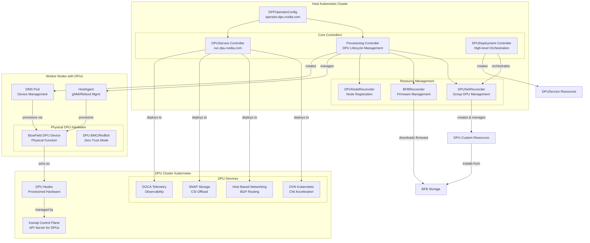

<!-- source: DeepWiki mcp.deepwiki.com · repo NVIDIA/doca-platform · page 1 DOCA Platform Framework Overview · fetched 2026-10-26 -->

# DOCA Platform Framework Overview

Relevant source files

The following files were used as context for generating this wiki page:

- [api/operator/v1alpha1/componentconfig_types.go](api/operator/v1alpha1/componentconfig_types.go)
- [api/operator/v1alpha1/dpfoperatorconfig_types.go](api/operator/v1alpha1/dpfoperatorconfig_types.go)
- [api/operator/v1alpha1/zz_generated.deepcopy.go](api/operator/v1alpha1/zz_generated.deepcopy.go)
- [cmd/provisioning/main.go](cmd/provisioning/main.go)
- [config/operator-crds/operator.dpu.nvidia.com_dpfoperatorconfigs.yaml](config/operator-crds/operator.dpu.nvidia.com_dpfoperatorconfigs.yaml)
- [deploy/charts/dpf-operator/templates/crds/apiextensions.k8s.io_v1_customresourcedefinition_dpfoperatorconfigs.operator.dpu.nvidia.com.yaml](deploy/charts/dpf-operator/templates/crds/apiextensions.k8s.io_v1_customresourcedefinition_dpfoperatorconfigs.operator.dpu.nvidia.com.yaml)
- [deploy/helmfiles/hooks/apply-dashboards.sh](deploy/helmfiles/hooks/apply-dashboards.sh)
- [deploy/helmfiles/hooks/apply-prometheus-rules.sh](deploy/helmfiles/hooks/apply-prometheus-rules.sh)
- [deploy/helmfiles/monitoring.yaml](deploy/helmfiles/monitoring.yaml)
- [deploy/helmfiles/prereqs.yaml](deploy/helmfiles/prereqs.yaml)
- [deploy/helmfiles/values/argo-cd.yaml](deploy/helmfiles/values/argo-cd.yaml)
- [deploy/helmfiles/values/kamaji.yaml](deploy/helmfiles/values/kamaji.yaml)
- [deploy/helmfiles/values/kube-prometheus-stack.yaml](deploy/helmfiles/values/kube-prometheus-stack.yaml)
- [deploy/helmfiles/values/loki.yaml](deploy/helmfiles/values/loki.yaml)
- [docs/public/developer-guides/api/api.md](docs/public/developer-guides/api/api.md)
- [docs/public/developer-guides/api/dpfoperatorconfig.md](docs/public/developer-guides/api/dpfoperatorconfig.md)
- [docs/public/getting-started/helm-prerequisites.md](docs/public/getting-started/helm-prerequisites.md)
- [docs/public/platform-support.md](docs/public/platform-support.md)
- [docs/public/user-guides/host-trusted/use-cases/hbn-ovnk-snap/README.md](docs/public/user-guides/host-trusted/use-cases/hbn-ovnk-snap/README.md)
- [docs/public/user-guides/host-trusted/use-cases/hbn-ovnk/README.md](docs/public/user-guides/host-trusted/use-cases/hbn-ovnk/README.md)
- [docs/public/user-guides/host-trusted/use-cases/hbn-snap/README.md](docs/public/user-guides/host-trusted/use-cases/hbn-snap/README.md)
- [docs/public/user-guides/host-trusted/use-cases/hbn/README.md](docs/public/user-guides/host-trusted/use-cases/hbn/README.md)
- [docs/public/user-guides/host-trusted/use-cases/ovnk/README.md](docs/public/user-guides/host-trusted/use-cases/ovnk/README.md)
- [docs/public/user-guides/host-trusted/use-cases/passthrough/README.md](docs/public/user-guides/host-trusted/use-cases/passthrough/README.md)
- [docs/public/user-guides/zero-trust/use-cases/hbn-snap/README.md](docs/public/user-guides/zero-trust/use-cases/hbn-snap/README.md)
- [docs/public/user-guides/zero-trust/use-cases/hbn/README.md](docs/public/user-guides/zero-trust/use-cases/hbn/README.md)
- [docs/public/user-guides/zero-trust/use-cases/passthrough/README.md](docs/public/user-guides/zero-trust/use-cases/passthrough/README.md)
- [docs/public/user-guides/zero-trust/use-cases/vpc/README.md](docs/public/user-guides/zero-trust/use-cases/vpc/README.md)
- [internal/operator/inventory/dpu_provisioning_controller_manifests.go](internal/operator/inventory/dpu_provisioning_controller_manifests.go)
- [internal/operator/inventory/dpu_provisioning_controller_manifests_test.go](internal/operator/inventory/dpu_provisioning_controller_manifests_test.go)
- [internal/operator/inventory/variables.go](internal/operator/inventory/variables.go)
- [internal/provisioning/controllers/dpu/util/options.go](internal/provisioning/controllers/dpu/util/options.go)
- [test/apivalidation/operator_validation_test.go](test/apivalidation/operator_validation_test.go)

The DOCA Platform Framework (DPF) is a Kubernetes-native system for provisioning and orchestrating NVIDIA BlueField DPUs in data center environments. It implements a control plane / data plane separation model where the host cluster manages DPU lifecycle while DPUs run their own managed Kubernetes clusters.

## System Architecture

DPF operates across three distinct planes:

**Management Plane**: The host Kubernetes cluster where administrators apply DPF custom resources such as `DPUDeployment`, `DPUSet`, and `BFB` [docs/public/developer-guides/api/api.md:10-12]().

**Control Plane**: DPF controllers running in the host cluster that reconcile desired state and coordinate provisioning operations.

**Data Plane**: Physical DPU hardware and their managed Kubernetes clusters that run networking and storage services.

### High-Level System Architecture

Sources:
- [cmd/provisioning/main.go:34-44]()
- [api/operator/v1alpha1/componentconfig_types.go:37-89]()
- [docs/public/developer-guides/api/api.md:7-13]()

## Control Plane vs Data Plane Separation

DPF implements strict separation between management/control operations and data plane acceleration:

**Control Plane (Host Cluster)**:
- `DPFOperatorConfig` CRD for system configuration [config/operator-crds/operator.dpu.nvidia.com_dpfoperatorconfigs.yaml:12-31]().
- Controllers that reconcile DPU state (Provisioning, DPUService, DPUDeployment).
- `DPUSet` for grouping and managing multiple DPUs [docs/public/developer-guides/api/api.md:10]().
- `BFB` (BlueField Bundle) firmware management via `BFBRegistry` [api/operator/v1alpha1/componentconfig_types.go:87-89]().
- `HostAgent` for node-level operations [cmd/provisioning/main.go:141-142]().

**Data Plane (DPU Hardware)**:
- OVS bridges (br-sfc, br-dpu, br-ovn, br-hbn) for packet processing [docs/public/user-guides/host-trusted/use-cases/hbn-ovnk/README.md:9-11]().
- SR-IOV virtual functions (VFs) for host connectivity [docs/public/user-guides/host-trusted/use-cases/hbn-ovnk/README.md:71-78]().
- Managed Kubernetes clusters via Kamaji [docs/public/getting-started/helm-prerequisites.md:29-30]().
- Service pods (OVN, HBN, SNAP, Telemetry).

### Control Plane vs Data Plane Workflow

```mermaid
graph LR
    subgraph "Management Plane"
        direction TB
        User["Cluster Admin"] -->|kubectl apply| K8sAPI["Host K8s API Server"]
        K8sAPI --> CRDs["Custom Resources<br/>DPUDeployment<br/>DPUSet<br/>DPUFlavor<br/>BFB"]
    end
    
    subgraph "Control Plane (Host Cluster)"
        direction TB
        Controllers["DPF Controllers<br/>Reconciliation Loops"]
        
        subgraph "Orchestration Layer"
            DPUDep["DPUDeployment<br/>svc.dpu.nvidia.com"]
            DPUSetCtrl["DPUSetReconciler<br/>provisioning.dpu.nvidia.com"]
        end
        
        subgraph "Execution Layer"
            HostAgentDS["HostAgent DaemonSet<br/>Per-node Operations"]
            BFBReg["BFB Registry<br/>Firmware Distribution"]
        end
        
        CRDs -->|watch| Controllers
        Controllers --> DPUDep
        Controllers --> DPUSetCtrl
        DPUSetCtrl --> HostAgentDS
        DPUSetCtrl --> BFBReg
    end
    
    subgraph "Data Plane (DPU Hardware)"
        direction TB
        
        subgraph "DPU Cluster"
            DPUAPIServer["DPU K8s API Server<br/>Kamaji Managed"]
            SvcPods["Service Pods<br/>OVN/HBN/Storage/etc"]
        end
        
        subgraph "Hardware Acceleration"
            OVS["OVS-DPDK<br/>br-sfc, br-ovn, br-hbn"]
            DPDK["DPDK Datapath<br/>Physical Ports"]
            SR_IOV["SR-IOV VFs<br/>Host Connection"]
        end
        
        DPUAPIServer --> SvcPods
        SvcPods --> OVS
        OVS --> DPDK
        OVS --> SR_IOV
    end
    
    subgraph "Workload Plane (Host Pods)"
        WorkerPods["Application Pods<br/>On Worker Nodes"]
        WorkerPods -->|VF Attachment| SR_IOV
    end
    
    HostAgentDS -.->|provisions| DPU["Physical DPU Hardware"]
    DPU -.->|boots as| DPUAPIServer
    BFBReg -.->|serves firmware| HostAgentDS
    
    DPUDep -.->|creates ArgoCD Apps| SvcPods
```

Sources:
- [internal/operator/inventory/variables.go:49-82]()
- [docs/public/user-guides/host-trusted/use-cases/hbn-ovnk/README.md:163-171]()
- [api/operator/v1alpha1/componentconfig_types.go:124-128]()

## DPU Provisioning Workflow

The provisioning system manages the complete lifecycle of DPU hardware from discovery through ready state. The workflow involves multiple phases coordinated by the `ProvisioningController` and the `HostAgent`.

### Provisioning Phases

The DPU resource moves through several phases during its lifecycle:
- `Initializing`: First phase after creation.
- `Pending`: Waiting for BFB readiness.
- `OS Installing`: Provisioning through gNOI or Redfish [api/operator/v1alpha1/componentconfig_types.go:83-85]().
- `DPU Config`: DPU agent configuring the device.
- `Ready`: DPU is fully operational.

### DPU Operational Health

DPF monitors runtime health through several mechanisms:
- `NodeSRIOVDevicePlugin`: Manages host-side SR-IOV resources [docs/public/developer-guides/api/api.md:100-104]().
- `Monitoring`: Includes `kube-state-metrics`, `node-problem-detector`, and `openTelemetryCollector` [docs/public/developer-guides/api/dpfoperatorconfig.md:141-172]().

Sources:
- [api/operator/v1alpha1/componentconfig_types.go:91-97]()
- [cmd/provisioning/main.go:83-94]()
- [docs/public/developer-guides/api/dpfoperatorconfig.md:143-156]()

## Component Architecture

The DPF system is composed of several key components that work together to manage DPU resources:

| Component Type | Component Name | Purpose |
|---------------|----------------|----------|
| Core | DPF Operator | Central controller managing all components via `DPFOperatorConfig` [config/operator-crds/operator.dpu.nvidia.com_dpfoperatorconfigs.yaml:31-33]() |
| Core | DPU Service Controller | Manages DPU service lifecycle and ArgoCD integration [docs/public/getting-started/helm-prerequisites.md:26]() |
| Core | Provisioning Controller | Handles DPU provisioning and firmware updates [api/operator/v1alpha1/componentconfig_types.go:37-40]() |
| Networking | SRIOV Device Plugin | SR-IOV device management for host VF resources [docs/public/developer-guides/api/api.md:26-30]() |
| Networking | OVN-Kubernetes | Primary CNI acceleration [docs/public/user-guides/host-trusted/use-cases/hbn-ovnk/README.md:9]() |
| Networking | HBN | Host Based Networking (BGP/EVPN) [docs/public/user-guides/host-trusted/use-cases/hbn-ovnk/README.md:9]() |
| Storage | SNAP | Storage acceleration (NVMe/VirtioFS) [docs/public/user-guides/zero-trust/use-cases/hbn-snap/README.md:12-14]() |
| Cluster | Kamaji | Managed Kubernetes control planes for DPUs [docs/public/getting-started/helm-prerequisites.md:29-30]() |

For details, see:
- [Architecture and Key Components](#1.1)
- [Build and Release System](#1.2)

Sources:
- [docs/public/platform-support.md:18-43]()
- [docs/public/developer-guides/api/api.md:7-13]()
- [internal/operator/inventory/variables.go:49-82]()

---

