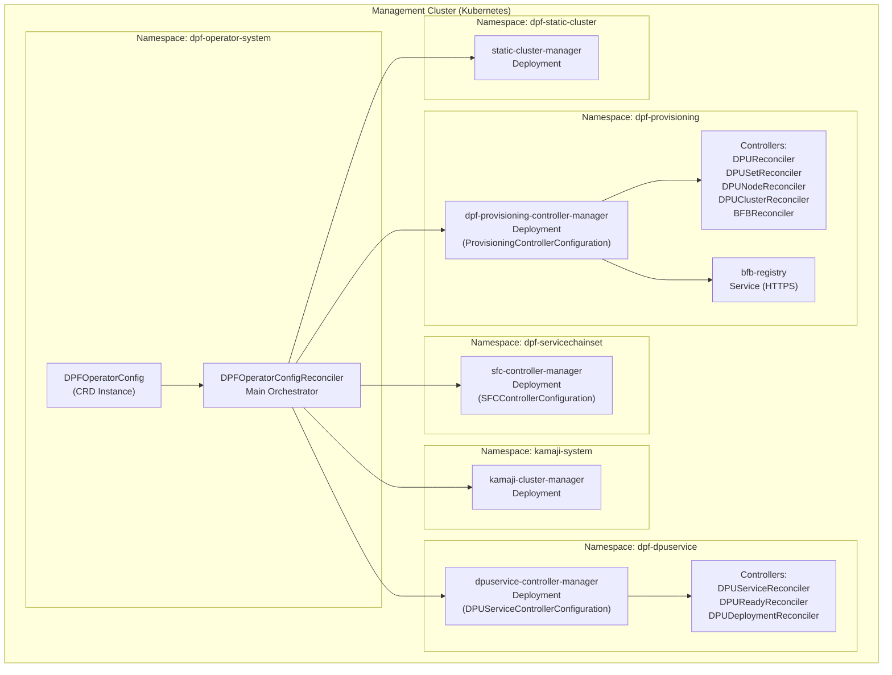
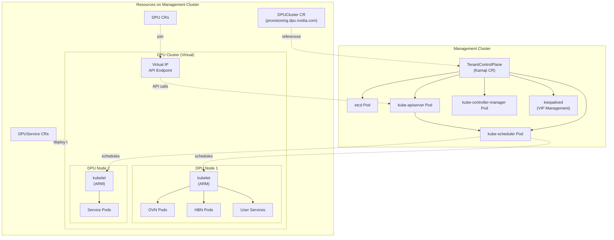
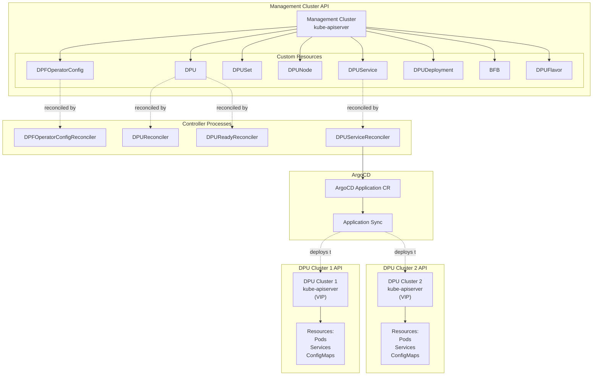
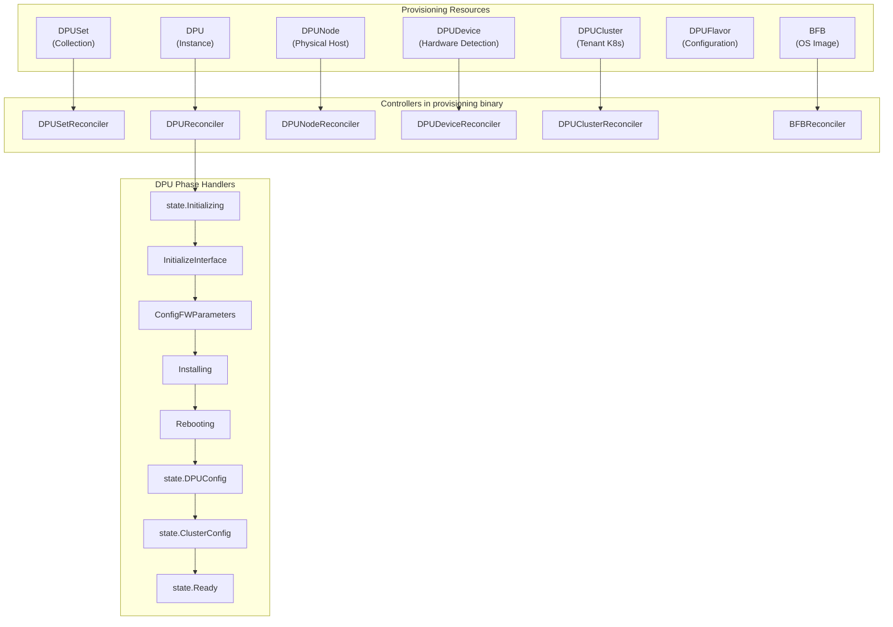
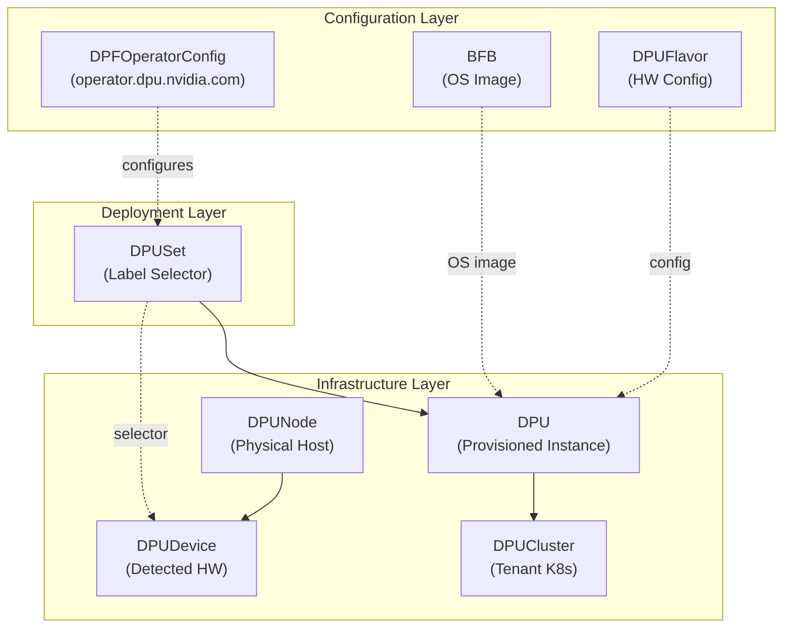
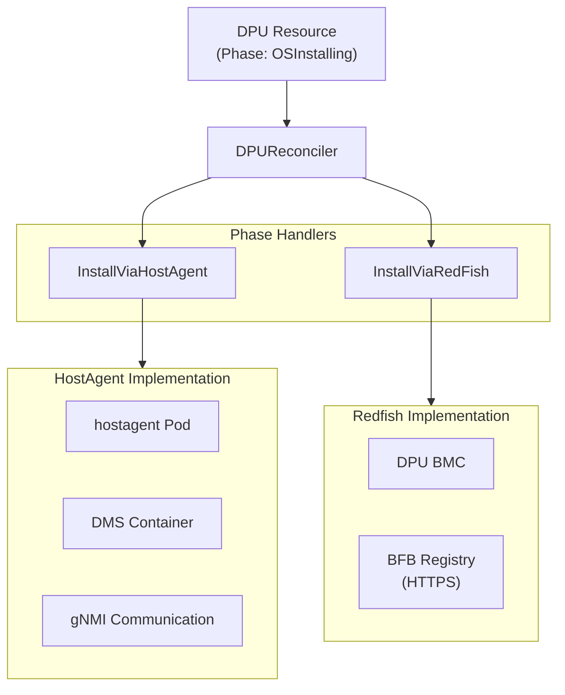

<!-- source: DeepWiki mcp.deepwiki.com · repo NVIDIA/doca-platform · page 1.1 Architecture and Key Components · fetched 2026-10-26 -->

# Architecture and Key Components

Relevant source files

The following files were used as context for generating this wiki page:

- [api/operator/v1alpha1/componentconfig_common.go](api/operator/v1alpha1/componentconfig_common.go)
- [api/operator/v1alpha1/componentconfig_types.go](api/operator/v1alpha1/componentconfig_types.go)
- [api/operator/v1alpha1/dpfoperatorconfig_types.go](api/operator/v1alpha1/dpfoperatorconfig_types.go)
- [api/operator/v1alpha1/zz_generated.deepcopy.go](api/operator/v1alpha1/zz_generated.deepcopy.go)
- [cmd/provisioning/main.go](cmd/provisioning/main.go)
- [config/operator-crds/operator.dpu.nvidia.com_dpfoperatorconfigs.yaml](config/operator-crds/operator.dpu.nvidia.com_dpfoperatorconfigs.yaml)
- [config/provisioning/rbac/role.yaml](config/provisioning/rbac/role.yaml)
- [config/provisioning/webhook/manifests.yaml](config/provisioning/webhook/manifests.yaml)
- [deploy/charts/dpf-operator/templates/crds/apiextensions.k8s.io_v1_customresourcedefinition_dpfoperatorconfigs.operator.dpu.nvidia.com.yaml](deploy/charts/dpf-operator/templates/crds/apiextensions.k8s.io_v1_customresourcedefinition_dpfoperatorconfigs.operator.dpu.nvidia.com.yaml)
- [deploy/charts/dpf-operator/templates/role.yaml](deploy/charts/dpf-operator/templates/role.yaml)
- [deploy/charts/dpu-networking/Chart.lock](deploy/charts/dpu-networking/Chart.lock)
- [deploy/charts/dpu-networking/Chart.yaml](deploy/charts/dpu-networking/Chart.yaml)
- [deploy/charts/dpu-networking/README.md](deploy/charts/dpu-networking/README.md)
- [deploy/charts/dpu-networking/values.yaml](deploy/charts/dpu-networking/values.yaml)
- [docs/public/developer-guides/api/api.md](docs/public/developer-guides/api/api.md)
- [docs/public/developer-guides/api/dpfoperatorconfig.md](docs/public/developer-guides/api/dpfoperatorconfig.md)
- [internal/operator/controllers/dpfoperatorconfig_controller.go](internal/operator/controllers/dpfoperatorconfig_controller.go)
- [internal/operator/controllers/dpfoperatorconfig_controller_test.go](internal/operator/controllers/dpfoperatorconfig_controller_test.go)
- [internal/operator/controllers/object_schema_validation_test.go](internal/operator/controllers/object_schema_validation_test.go)
- [internal/operator/inventory/component_versions.go](internal/operator/inventory/component_versions.go)
- [internal/operator/inventory/dpu_provisioning_controller_manifests.go](internal/operator/inventory/dpu_provisioning_controller_manifests.go)
- [internal/operator/inventory/dpu_provisioning_controller_manifests_test.go](internal/operator/inventory/dpu_provisioning_controller_manifests_test.go)
- [internal/operator/inventory/from_dpu_service_manifests.go](internal/operator/inventory/from_dpu_service_manifests.go)
- [internal/operator/inventory/inventory.go](internal/operator/inventory/inventory.go)
- [internal/operator/inventory/manifests/provisioning-controller.yaml](internal/operator/inventory/manifests/provisioning-controller.yaml)
- [internal/operator/inventory/variables.go](internal/operator/inventory/variables.go)
- [internal/provisioning/bfbregistry/bfb_registry_creator.go](internal/provisioning/bfbregistry/bfb_registry_creator.go)
- [internal/provisioning/bfbregistry/bfb_registry_creator_test.go](internal/provisioning/bfbregistry/bfb_registry_creator_test.go)
- [internal/provisioning/controllers/dpu/dpu_controller.go](internal/provisioning/controllers/dpu/dpu_controller.go)
- [internal/provisioning/controllers/dpu/util/options.go](internal/provisioning/controllers/dpu/util/options.go)
- [internal/provisioning/webhooks/dpudiscovery_webhook.go](internal/provisioning/webhooks/dpudiscovery_webhook.go)
- [internal/provisioning/webhooks/dpudiscovery_webhook_test.go](internal/provisioning/webhooks/dpudiscovery_webhook_test.go)
- [internal/provisioning/webhooks/suite_test.go](internal/provisioning/webhooks/suite_test.go)
- [test/apivalidation/operator_validation_test.go](test/apivalidation/operator_validation_test.go)

## Purpose and Scope

This document describes the multi-layer architecture of the DOCA Platform Framework (DPF), including the management cluster components, DPU cluster structure, control plane hierarchy, and the core controllers that orchestrate DPU lifecycle management and service deployment. It focuses on how the major system components are organized and how they interact with each other.

For details on the build and release pipeline, see [Build and Release System](#1.2). For specific controller implementations, see [DPF Operator](#2), [Provisioning System](#3), [Service Deployment System](#4), and [Networking Components](#5).

---

## Multi-Layer System Architecture

The DPF system operates across three distinct layers: the **Management Cluster**, **DPU Clusters**, and the **Host Infrastructure**. The management cluster runs all operator controllers and orchestrates the entire platform, while DPU clusters provide isolated Kubernetes environments for running services on DPU nodes.

### Management Cluster

**Sources:** [cmd/provisioning/main.go:27-46](), [api/operator/v1alpha1/componentconfig_types.go:37-147](), [internal/operator/inventory/variables.go:37-123]()

The management cluster hosts all DPF operator components:

| Component | Namespace | Deployment | Primary Controllers |
|-----------|-----------|------------|-------------------|
| DPF Operator | `dpf-operator-system` | `dpf-operator-controller-manager` | `DPFOperatorConfigReconciler` |
| Provisioning Controller | `dpf-provisioning` | `dpf-provisioning-controller-manager` | `DPUReconciler`, `DPUSetReconciler`, `DPUNodeReconciler` |
| DPUService Controller | `dpf-dpuservice` | `dpuservice-controller-manager` | `DPUServiceReconciler`, `DPUReadyReconciler` |
| SFC Controller | `dpf-servicechainset` | `sfc-controller-manager` | Service chain management |
| Cluster Managers | `kamaji-system`, `dpf-static-cluster` | Kamaji/Static managers | Tenant cluster lifecycle |

**Sources:** [internal/operator/inventory/variables.go:37-123](), [api/operator/v1alpha1/componentconfig_types.go:37-147]()

---

## DPU Cluster Architecture

Each tenant receives an isolated Kubernetes cluster running on DPU nodes. The control plane components run as pods in the management cluster (via Kamaji), while workloads execute on DPU ARM processors.

**Sources:** [cmd/provisioning/main.go:39](), [docs/public/developer-guides/api/api.md:10-13]()

The `DPUCluster` resource in the `provisioning.dpu.nvidia.com` API group represents a tenant's Kubernetes cluster. It provides the endpoint for DPUs to join after OS installation.

---

## Control Plane Hierarchy

**Sources:** [docs/public/developer-guides/api/api.md:9-13](), [cmd/provisioning/main.go:34-43]()

The control plane is hierarchical:
1. **Management Cluster API** - Hosts all DPF CRDs and controller logic.
2. **DPU Cluster APIs** - Independent Kubernetes control planes for each tenant.
3. **ArgoCD** - Bridges the two, deploying applications from management cluster to DPU clusters.

---

## Core Controllers and Their Responsibilities

### DPFOperatorConfigReconciler

The central orchestrator that manages the entire DPF system lifecycle. It reads the `DPFOperatorConfig` and deploys sub-components like the provisioning controller and service controllers.

**Sources:** [internal/operator/controllers/dpfoperatorconfig_controller.go:76-84](), [config/operator-crds/operator.dpu.nvidia.com_dpfoperatorconfigs.yaml:31-32]()

### DPU Provisioning Controllers

Located in namespace `dpf-provisioning`, these controllers manage DPU hardware lifecycle.

**Sources:** [cmd/provisioning/main.go:31-44](), [internal/provisioning/controllers/dpu/dpu_controller.go:83-125]()

Key controllers in the provisioning binary:
- **`DPUReconciler`**: Main state machine for DPU lifecycle [internal/provisioning/controllers/dpu/dpu_controller.go:65-69]().
- **`DPUSetReconciler`**: Manages collections of DPUs [cmd/provisioning/main.go:44]().
- **`DPUNodeReconciler`**: Manages physical host nodes and maintenance states [cmd/provisioning/main.go:41]().
- **`DPUClusterReconciler`**: Orchestrates DPU cluster lifecycle [cmd/provisioning/main.go:39]().

The `DPU` resource uses a phase-based state machine mapped in the reconciler [internal/provisioning/controllers/dpu/dpu_controller.go:83-96]():

| Phase | Description |
|-------|-------------|
| `DPUInitializing` | Initial phase after DPU creation |
| `DPUInitializeInterface` | Setting up Redfish or gNOI/DMS interface |
| `DPUConfigFWParameters` | Manipulating firmware and checking versions |
| `DPUOSInstalling` | Provisioning the DPU with a BFB image |
| `DPURebooting` | Host or DPU rebooting during installation |
| `DPUConfig` | DPU agent applying configurations |
| `DPUClusterConfig` | Node joining the tenant Kubernetes cluster |
| `DPUReady` | DPU is fully operational |

---

## Resource Dependency Model

The DPF system organizes resources into layers: Configuration, Deployment, and Infrastructure.

**Sources:** [cmd/provisioning/main.go:31-44](), [docs/public/developer-guides/api/api.md:10-13]()

Key resource relationships:

- **`DPUSet`** matches **`DPUDevice`** resources via label selectors and creates corresponding **`DPU`** resources.
- **`DPU`** references a **`BFB`** for the OS image and a **`DPUFlavor`** for configuration profiles.
- **`DPUDevice`** is linked to a **`DPUNode`** representing the physical host.

---

## Installation Interface Architecture

The provisioning controller supports multiple interfaces for installing the OS on DPUs:

**Sources:** [api/operator/v1alpha1/componentconfig_types.go:83-85](), [internal/provisioning/controllers/dpu/dpu_controller.go:97-125](), [internal/provisioning/bfbregistry/bfb_registry_creator.go:49-51]()

The DPF system selects the interface based on the `DPFOperatorConfig` or `DPUSet` configuration:
- **`InstallViaHostAgent`**: Uses a host-side agent and DMS (Deployment Management Service) container communicating via gNMI [internal/provisioning/controllers/dpu/dpu_controller.go:98-103]().
- **`InstallViaRedFish`**: Communicates directly with the DPU BMC using the Redfish protocol [internal/provisioning/controllers/dpu/dpu_controller.go:104-110]().
- **`BFB Registry`**: An HTTPS service serving BFB images to the DPUs during installation [internal/provisioning/bfbregistry/bfb_registry_creator.go:49-51]().

---

## High Availability and Leader Election

Controllers support high availability through standard Kubernetes leader election:

- **Leader Election**: Enabled via the `--leader-elect` flag in the controller manager [cmd/provisioning/main.go:153-155]().
- **Replicas**: Configurable in `DPFOperatorConfig` for components like the provisioning controller, which defaults to 2 replicas [internal/operator/inventory/variables.go:129]().

**Sources:** [cmd/provisioning/main.go:153-155](), [internal/operator/inventory/variables.go:128-130]()

---

