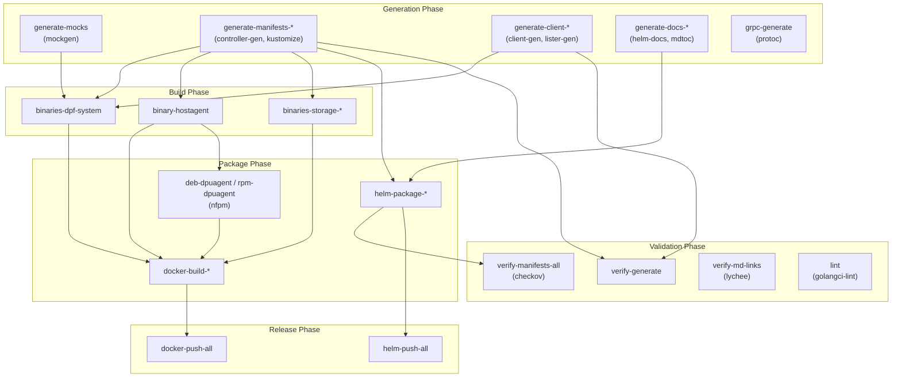
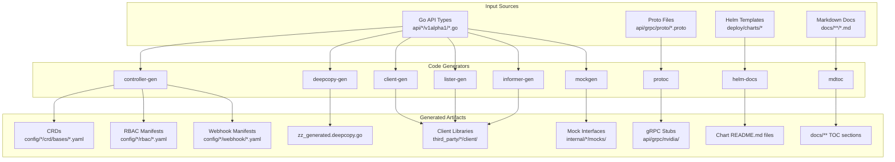
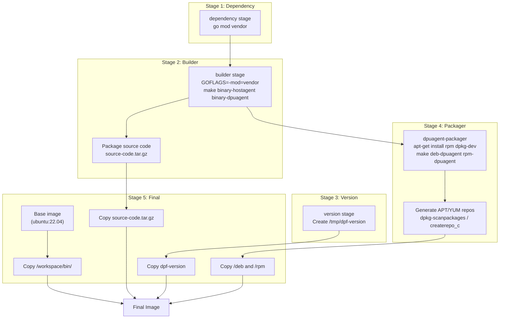

<!-- source: DeepWiki mcp.deepwiki.com · repo NVIDIA/doca-platform · page 1.2 Build and Release System · fetched 2026-10-26 -->

# Build and Release System

<details>
<summary>Relevant source files</summary>

The following files were used as context for generating this wiki page:

- [.checkov.yaml](.checkov.yaml)
- [.gitignore](.gitignore)
- [Dockerfile](Dockerfile)
- [Dockerfile.bfb-registry](Dockerfile.bfb-registry)
- [Dockerfile.cni-installer](Dockerfile.cni-installer)
- [Dockerfile.dpf-system](Dockerfile.dpf-system)
- [Dockerfile.hostdriver](Dockerfile.hostdriver)
- [Dockerfile.keepalived](Dockerfile.keepalived)
- [Dockerfile.storage-host](Dockerfile.storage-host)
- [Dockerfile.storage-system](Dockerfile.storage-system)
- [Makefile](Makefile)
- [cmd/cniinstaller/main.go](cmd/cniinstaller/main.go)
- [config/dpuservice/manager/manager.yaml](config/dpuservice/manager/manager.yaml)
- [config/kamaji-cluster-manager/manager/manager.yaml](config/kamaji-cluster-manager/manager/manager.yaml)
- [config/kamaji-cluster-manager/rbac/role.yaml](config/kamaji-cluster-manager/rbac/role.yaml)
- [config/provisioning/manager/manager.yaml](config/provisioning/manager/manager.yaml)
- [config/static-cluster-manager/manager/manager.yaml](config/static-cluster-manager/manager/manager.yaml)
- [config/static-cluster-manager/rbac/role.yaml](config/static-cluster-manager/rbac/role.yaml)
- [deploy/charts/dpf-operator/templates/deployment.yaml](deploy/charts/dpf-operator/templates/deployment.yaml)
- [deploy/charts/dpu-networking/charts/cni-installer/README.md](deploy/charts/dpu-networking/charts/cni-installer/README.md)
- [deploy/charts/dpu-networking/charts/cni-installer/values.yaml](deploy/charts/dpu-networking/charts/cni-installer/values.yaml)
- [deploy/charts/dpu-networking/charts/kata-containers/README.md](deploy/charts/dpu-networking/charts/kata-containers/README.md)
- [deploy/charts/dpu-networking/charts/kata-containers/values.yaml](deploy/charts/dpu-networking/charts/kata-containers/values.yaml)
- [docs/public/advanced-configuration/dpuservices/kata-containers.md](docs/public/advanced-configuration/dpuservices/kata-containers.md)
- [dpuservices/dummydpuservice/chart/README.md](dpuservices/dummydpuservice/chart/README.md)
- [dpuservices/dummydpuservice/chart/templates/daemonset.yaml](dpuservices/dummydpuservice/chart/templates/daemonset.yaml)
- [dpuservices/dummydpuservice/chart/values.yaml](dpuservices/dummydpuservice/chart/values.yaml)
- [go.mod](go.mod)
- [go.sum](go.sum)
- [hack/scripts/validate-manifest-checkov.sh](hack/scripts/validate-manifest-checkov.sh)
- [hack/tools/dpfdev/go.mod](hack/tools/dpfdev/go.mod)
- [hack/tools/dpfdev/go.sum](hack/tools/dpfdev/go.sum)
- [hack/tools/tools.mk](hack/tools/tools.mk)
- [internal/clustermanager/controller/dpucluster_controller.go](internal/clustermanager/controller/dpucluster_controller.go)
- [internal/clustermanager/controller/dpucluster_controller_test.go](internal/clustermanager/controller/dpucluster_controller_test.go)
- [internal/clustermanager/kamaji/handler.go](internal/clustermanager/kamaji/handler.go)
- [internal/clustermanager/kamaji/handler_test.go](internal/clustermanager/kamaji/handler_test.go)
- [internal/clustermanager/kamaji/suite_test.go](internal/clustermanager/kamaji/suite_test.go)
- [internal/cniinstaller/cniinstaller.go](internal/cniinstaller/cniinstaller.go)
- [internal/cniinstaller/cniinstaller_suite_test.go](internal/cniinstaller/cniinstaller_suite_test.go)
- [internal/cniinstaller/cniinstaller_test.go](internal/cniinstaller/cniinstaller_test.go)
- [internal/operator/inventory/manifests/kamaji-cluster-manager.yaml](internal/operator/inventory/manifests/kamaji-cluster-manager.yaml)
- [internal/operator/inventory/manifests/static-cluster-manager.yaml](internal/operator/inventory/manifests/static-cluster-manager.yaml)
- [internal/release/defaults.go](internal/release/defaults.go)
- [internal/release/defaults_test.go](internal/release/defaults_test.go)
- [internal/release/manifests/defaults.yaml](internal/release/manifests/defaults.yaml)
- [internal/release/templates/defaults.yaml.tmpl](internal/release/templates/defaults.yaml.tmpl)

</details>


This document describes the Makefile-based build orchestration system that compiles binaries, generates manifests, builds multi-architecture container images, packages Helm charts, and releases artifacts for the DOCA Platform Framework (DPF).

## Overview

The DPF build system is a Makefile-based orchestration framework that automates the generation, compilation, validation, and packaging of all system components. The system is organized around a primary `Makefile` [Makefile:1-106]() that includes modular tool definitions from `hack/tools/tools.mk` [hack/tools/tools.mk:1-136]().

**Key Build Phases:**
- **Code Generation**: Kubernetes manifests (CRDs, RBAC), Go client libraries, gRPC stubs, and test mocks [Makefile:226-229]().
- **Binary Compilation**: Multi-architecture Go binaries (amd64 for host, arm64 for DPU) [Dockerfile.hostdriver:23-47]().
- **Container Image Building**: Multi-stage Dockerfiles with build-time caching and source code packaging [Dockerfile.dpf-system:1-67]().
- **Security Validation**: Checkov-based manifest scanning with configurable security policies [.checkov.yaml:1-13]().
- **Helm Chart Packaging**: Templated charts with environment variable substitution and documentation generation [Makefile:924-934]().
- **Release Coordination**: Versioned artifact publishing to container and Helm registries [Makefile:143-148]().

The build system supports both local development workflows and CI/CD pipelines, with extensive caching to minimize rebuild times.

Sources: [Makefile:1-106](), [hack/tools/tools.mk:1-136]()

## Build System Architecture

The build system consists of layered targets that feed into each other. The `make generate` target produces source code and manifests, which are then compiled into binaries by `make binary-*` targets, packaged into container images by `make docker-build-*` targets, validated by `make verify-*` targets, and finally released by `make release`.

Title: Build System Target Dependencies


Sources: [Makefile:226-229](), [Makefile:242-243](), [Makefile:467-492](), [Makefile:630-633](), [Dockerfile.hostdriver:62-79]()

## Code Generation Pipeline

The `make generate` target orchestrates multiple code generation tools that produce Kubernetes manifests, Go client libraries, and API documentation.

Title: Code Generation Dependencies


### Manifest Generation Targets

The `controller-gen` tool generates Kubernetes manifests from Go struct tags and comments:

| Target | Purpose | Output |
|--------|---------|--------|
| `generate-manifests-operator` | DPF Operator CRDs and RBAC | `config/operator-crds/` [Makefile:242-243]() |
| `generate-manifests-provisioning` | Provisioning controller manifests | `config/provisioning/crd/bases/` [Makefile:246-261]() |
| `generate-manifests-dpuservice` | DPUService controller manifests | `config/dpuservice/crd/bases/` [Makefile:270-283]() |

Sources: [Makefile:242-243](), [Makefile:246-261](), [Makefile:270-283]()

## Container Image Builds

The build system produces container images using multi-stage Dockerfiles with BuildKit caching. Images are tagged with `$REGISTRY/$IMAGE:$TAG` and support multi-architecture builds via `docker buildx`.

### Image Variants

| Image | Dockerfile | Purpose | Architectures |
|-------|------------|---------|---------------|
| `dpf-system` | [Dockerfile.dpf-system]() | Operator, provisioning, and DPUService controllers | amd64, arm64 |
| `hostdriver` | [Dockerfile.hostdriver]() | Host agent, DMS server, and DPU Agent packages | amd64, arm64 |
| `bfb-registry` | [Dockerfile.bfb-registry]() | Serves BFB images and PLDM unpacking | amd64, arm64 |
| `cni-installer` | [Dockerfile.cni-installer]() | Installs CNI binaries to DPUs | arm64 |

### Multi-Stage Build Architecture

All Dockerfiles follow a consistent multi-stage pattern to optimize caching and reduce final image size.

Title: Multi-Stage Docker Build Flow (Host Driver Example)


The `Dockerfile.hostdriver` demonstrates the complexity of the release system, incorporating binary compilation [Dockerfile.hostdriver:23-47](), package creation via `nfpm` [Dockerfile.hostdriver:62-79](), and repository metadata generation [Dockerfile.hostdriver:85-91]().

Sources: [Dockerfile.hostdriver:5-188](), [Dockerfile.bfb-registry:1-189](), [Dockerfile.cni-installer:1-105]()

### Source Code Packaging

All images include source code archives for compliance and debugging. Go source code is packaged by finding all `.go` files and creating a tarball:

```dockerfile
RUN mkdir src && \
    find . -name '*.go' -not -path "./hack/*" -not -path "./.gocache/*" \
    -exec cp --parents \{\}  src/ \; && \
    tar -czf source-code.tar.gz src
```

Sources: [Dockerfile.hostdriver:49-52](), [Dockerfile.bfb-registry:143-147](), [Dockerfile.cni-installer:31-36]()

## Security Validation with Checkov

The build system integrates Checkov [hack/tools/tools.mk:98]() for static analysis of Kubernetes manifests. Validation runs as part of the `verify-manifests-all` target.

### Checkov Configuration

The [.checkov.yaml]() file defines required checks and per-chart exclusions.

```yaml
checks:
- CKV_K8S_8   # Liveness Probe Should be Configured
- CKV_K8S_9   # Readiness Probe Should be Configured
- CKV_K8S_11  # CPU limits should be set
- CKV_K8S_13  # Memory limits should be set
- CKV_K8S_29  # Apply security context to your pods
- CKV_K8S_40  # Containers should run as a high UID
```

Sources: [.checkov.yaml:1-13]()

### Exclusions and Justifications

Exclusions are used to handle cases where components require specific privileges (e.g., networking controllers or CNI installers):

| Chart | Resource | Check | Justification |
|-------|----------|-------|---------------|
| `dpu-networking-flannel` | `DaemonSet.kube-flannel-ds` | CKV_K8S_29 | Flannel requires high privileges [.checkov.yaml:31-33]() |
| `dpu-networking-cni-installer` | `DaemonSet.release-name` | CKV_K8S_40 | Needs to run as root to install binaries [.checkov.yaml:120-122]() |
| `dpu-networking-kata-containers` | `DaemonSet.kata-deploy` | CKV_K8S_29 | Privileged access for binary installation [.checkov.yaml:143-146]() |

Sources: [.checkov.yaml:14-147]()

## Helm Chart Packaging

Helm charts are the primary distribution mechanism for the DPF Operator and its sub-components.

### Chart Structure

The `dpf-operator` chart [deploy/charts/dpf-operator/Chart.yaml]() manages the main controller deployment.

Key configuration values in `values.yaml` include:
- `controllerManager.image`: Overrides for the operator image.
- `kamajiEtcdDefrag`: Configures the etcd maintenance job for multi-tenant clusters.
- `kubeStateMetricsCRDMetrics`: Enables metrics collection for DPF CRDs.

### Automated Documentation

The `helm-docs` tool [hack/tools/tools.mk:119]() is used to generate README files from `values.yaml` comments. The generated documentation provides a clear reference for users.

Sources: [hack/tools/tools.mk:119](), [deploy/charts/dpu-networking/charts/kata-containers/values.yaml:1-10](), [deploy/charts/dpu-networking/charts/cni-installer/values.yaml:1-10]()

## Validation Tooling: dpfdev

The `dpfdev` tool [hack/tools/dpfdev/go.mod:1-17]() provides specialized validation capabilities, including `checkov` report analysis and internal testing.

Sources: [hack/tools/dpfdev/go.mod:1-17](), [hack/tools/dpfdev/go.sum:1-81]()

---

