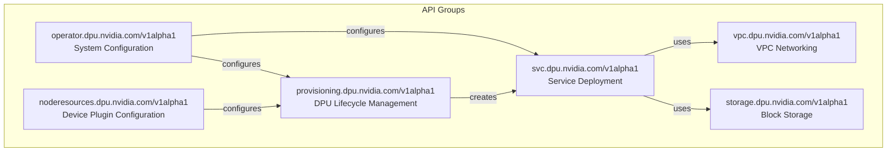
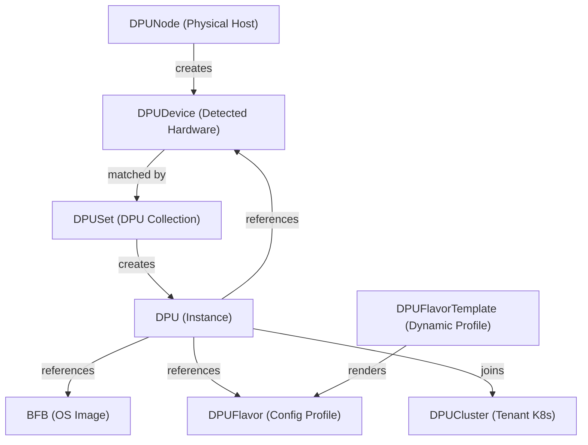
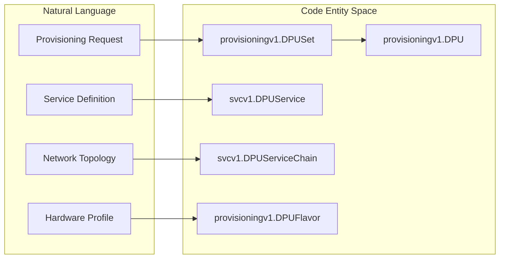

<!-- source: DeepWiki mcp.deepwiki.com · repo NVIDIA/doca-platform · page 10 API Reference · fetched 2026-10-26 -->

# API Reference

Relevant source files

The following files were used as context for generating this wiki page:

- [api/operator/v1alpha1/componentconfig_types.go](api/operator/v1alpha1/componentconfig_types.go)
- [api/operator/v1alpha1/dpfoperatorconfig_types.go](api/operator/v1alpha1/dpfoperatorconfig_types.go)
- [api/operator/v1alpha1/zz_generated.deepcopy.go](api/operator/v1alpha1/zz_generated.deepcopy.go)
- [api/provisioning/v1alpha1/dpu_types.go](api/provisioning/v1alpha1/dpu_types.go)
- [api/provisioning/v1alpha1/dpudevice_types.go](api/provisioning/v1alpha1/dpudevice_types.go)
- [api/provisioning/v1alpha1/zz_generated.deepcopy.go](api/provisioning/v1alpha1/zz_generated.deepcopy.go)
- [cmd/provisioning/main.go](cmd/provisioning/main.go)
- [config/operator-crds/operator.dpu.nvidia.com_dpfoperatorconfigs.yaml](config/operator-crds/operator.dpu.nvidia.com_dpfoperatorconfigs.yaml)
- [config/provisioning/crd/bases/provisioning.dpu.nvidia.com_dpudevices.yaml](config/provisioning/crd/bases/provisioning.dpu.nvidia.com_dpudevices.yaml)
- [config/provisioning/crd/bases/provisioning.dpu.nvidia.com_dpus.yaml](config/provisioning/crd/bases/provisioning.dpu.nvidia.com_dpus.yaml)
- [deploy/charts/dpf-operator/templates/crds/apiextensions.k8s.io_v1_customresourcedefinition_dpfoperatorconfigs.operator.dpu.nvidia.com.yaml](deploy/charts/dpf-operator/templates/crds/apiextensions.k8s.io_v1_customresourcedefinition_dpfoperatorconfigs.operator.dpu.nvidia.com.yaml)
- [deploy/charts/dpf-operator/templates/crds/apiextensions.k8s.io_v1_customresourcedefinition_dpudevices.provisioning.dpu.nvidia.com.yaml](deploy/charts/dpf-operator/templates/crds/apiextensions.k8s.io_v1_customresourcedefinition_dpudevices.provisioning.dpu.nvidia.com.yaml)
- [deploy/charts/dpf-operator/templates/crds/apiextensions.k8s.io_v1_customresourcedefinition_dpus.provisioning.dpu.nvidia.com.yaml](deploy/charts/dpf-operator/templates/crds/apiextensions.k8s.io_v1_customresourcedefinition_dpus.provisioning.dpu.nvidia.com.yaml)
- [docs/public/developer-guides/api/api.md](docs/public/developer-guides/api/api.md)
- [docs/public/developer-guides/api/dpfoperatorconfig.md](docs/public/developer-guides/api/dpfoperatorconfig.md)
- [internal/operator/inventory/dpu_provisioning_controller_manifests.go](internal/operator/inventory/dpu_provisioning_controller_manifests.go)
- [internal/operator/inventory/dpu_provisioning_controller_manifests_test.go](internal/operator/inventory/dpu_provisioning_controller_manifests_test.go)
- [internal/operator/inventory/variables.go](internal/operator/inventory/variables.go)
- [internal/provisioning/controllers/dpu/util/options.go](internal/provisioning/controllers/dpu/util/options.go)
- [test/apivalidation/operator_validation_test.go](test/apivalidation/operator_validation_test.go)

This document provides a comprehensive reference for all Custom Resource Definitions (CRDs) in the DOCA Platform Framework. It is organized by API group and includes field-level documentation, validation rules, and relationships between resources.

For architectural context on how these APIs are used in the system, see [Architecture and Key Components](#1.1). For specific deployment workflows, see [Provisioning System](#3) and [Service Deployment System](#4).

---

## API Groups Overview

The DOCA Platform Framework defines six API groups, each serving a specific domain within the system:

**Sources:** [docs/public/developer-guides/api/api.md:7-14]()

---

## API Group Organization

| API Group | Purpose | Primary Resources | Page Reference |
|-----------|---------|-------------------|----------------|
| `operator.dpu.nvidia.com/v1alpha1` | System-wide configuration and component management | `DPFOperatorConfig` | [operator.dpu.nvidia.com API Group](#10.1) |
| `provisioning.dpu.nvidia.com/v1alpha1` | DPU hardware provisioning and lifecycle | `DPU`, `DPUSet`, `DPUNode`, `DPUDevice`, `BFB`, `DPUFlavor`, `DPUFlavorTemplate` | [provisioning.dpu.nvidia.com API Group](#10.2) |
| `svc.dpu.nvidia.com/v1alpha1` | Service deployment and networking primitives | `DPUDeployment`, `DPUService`, `DPUServiceChain`, `DPUServiceInterface` | [svc.dpu.nvidia.com API Group](#10.3) |
| `vpc.dpu.nvidia.com/v1alpha1` | VPC-based network isolation | `DPUVPC`, `DPUVirtualNetwork` | [vpc.dpu.nvidia.com API Group](#10.4) |
| `storage.dpu.nvidia.com/v1alpha1` | SNAP block storage configuration | `SNAPStorage` | N/A |
| `noderesources.dpu.nvidia.com/v1alpha1` | Per-node SR-IOV device plugin configuration | `NodeSRIOVDevicePluginConfig` | [operator.dpu.nvidia.com API Group](#10.1) |

**Sources:** [docs/public/developer-guides/api/api.md:7-13]()

---

## 10.1 operator.dpu.nvidia.com API Group

### Purpose
The `operator.dpu.nvidia.com/v1alpha1` API group provides the primary configuration interface for the DPF Operator. It controls system-wide settings, component enablement, and resource allocation for all DPF subsystems. For details, see [operator.dpu.nvidia.com API Group](#10.1).

### Key Resources

#### DPFOperatorConfig
The central configuration resource for the entire DPF system. A single `DPFOperatorConfig` instance controls all system components including the `ProvisioningController` and `DPUServiceController`. It supports fine-grained component toggles and resource overrides via `Variables` struct.

**Sources:** [api/operator/v1alpha1/componentconfig_types.go:37-51](), [internal/operator/inventory/variables.go:37-82](), [docs/public/developer-guides/api/dpfoperatorconfig.md:9-14]()

#### NodeSRIOVDevicePluginConfig
Defines how Virtual Functions (VFs) and Scalable Functions (SFs) are exposed as extended resources on specific nodes. It is part of the `noderesources.dpu.nvidia.com` group but managed by the operator's lifecycle logic.

**Sources:** [docs/public/developer-guides/api/api.md:100-104](), [internal/operator/inventory/variables.go:119-123]()

---

## 10.2 provisioning.dpu.nvidia.com API Group

### Purpose
The `provisioning.dpu.nvidia.com/v1alpha1` API group defines resources for managing DPU hardware lifecycle, including discovery, OS installation, configuration, and cluster membership. For details, see [provisioning.dpu.nvidia.com API Group](#10.2).

### Resource Relationships

#### Key Resources
- **DPU**: Represents a single DPU instance. Its status tracks a complex state machine (e.g., `Initializing`, `OS Installing`, `DPU Config`) defined by `DPUPhase`. [api/provisioning/v1alpha1/dpu_types.go:41-95]()
- **DPUSet**: Manages a collection of DPUs selected by `dpuDeviceSelector`, enabling batch operations and rolling updates. [api/provisioning/v1alpha1/dpuset_types.go:29-82]()
- **DPUFlavor**: Defines hardware configuration profiles applied during DPU provisioning, such as `nvconfig` parameters and `ovsConfiguration`. [api/provisioning/v1alpha1/dpuflavor_types.go:1-50]()
- **BlueFieldSoftware**: Manages firmware bundles and PLDM-based updates for BF4 devices. [cmd/provisioning/main.go:32]()

**Sources:** [api/provisioning/v1alpha1/dpu_types.go:26-114](), [api/provisioning/v1alpha1/dpuset_types.go:28-162](), [cmd/provisioning/main.go:28-45]()

---

## 10.3 svc.dpu.nvidia.com API Group

### Purpose
The `svc.dpu.nvidia.com/v1alpha1` API group defines resources for deploying services to DPU clusters, configuring service networking, and managing service chains. For details, see [svc.dpu.nvidia.com API Group](#10.3).

#### Key Resources
- **DPUDeployment**: Orchestrates the deployment of services to DPU clusters with version management and dependency validation.
- **DPUServiceInterface**: Defines network interfaces for services, supporting multiple types such as `physical`, `pf`, `vf`, and `service`. [docs/public/developer-guides/api/api.md:12]()
- **DPUServiceChain**: Defines OVS bridge topology connecting service interfaces to steer traffic. [docs/public/developer-guides/api/api.md:12]()

**Sources:** [docs/public/developer-guides/api/api.md:12](), [internal/operator/inventory/variables.go:116-118]()

---

## 10.4 vpc.dpu.nvidia.com API Group

### Purpose
The `vpc.dpu.nvidia.com/v1alpha1` API group provides VPC-based network isolation for multi-tenant DPU deployments using OVN. For details, see [vpc.dpu.nvidia.com API Group](#10.4).

#### Key Resources
- **DPUVPC**: Defines a Virtual Private Cloud for network isolation.
- **DPUVirtualNetwork**: Defines a subnet within a VPC, specifying IP ranges and VLAN parameters.

**Sources:** [docs/public/developer-guides/api/api.md:13]()

---

## Common Patterns

### Condition Management
All status-bearing resources use Kubernetes standard `Condition` types. Resources like `DPU` implement extensive condition tracking for operational readiness (e.g., `NodeProblemsReady`, `KubeletReady`).

**Sources:** [api/provisioning/v1alpha1/dpu_types.go:131-150](), [docs/public/developer-guides/api/api.md:167]()

### Resource Mapping Diagram
The following diagram bridges the natural language resource names to their internal code entity representations used in the controllers.

**Sources:** [api/provisioning/v1alpha1/dpuset_types.go:29](), [api/provisioning/v1alpha1/dpu_types.go:28](), [api/provisioning/v1alpha1/dpuflavor_types.go:25]()

---

