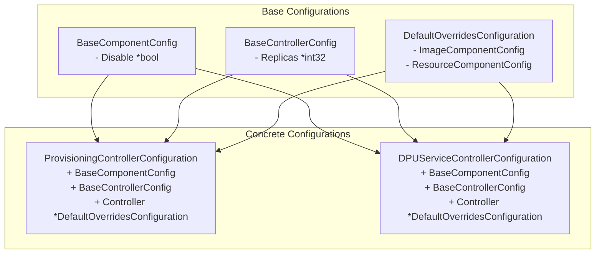
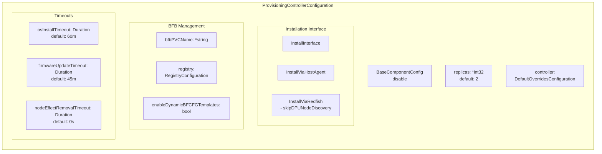
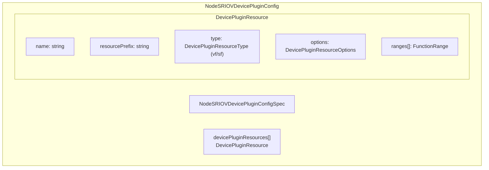
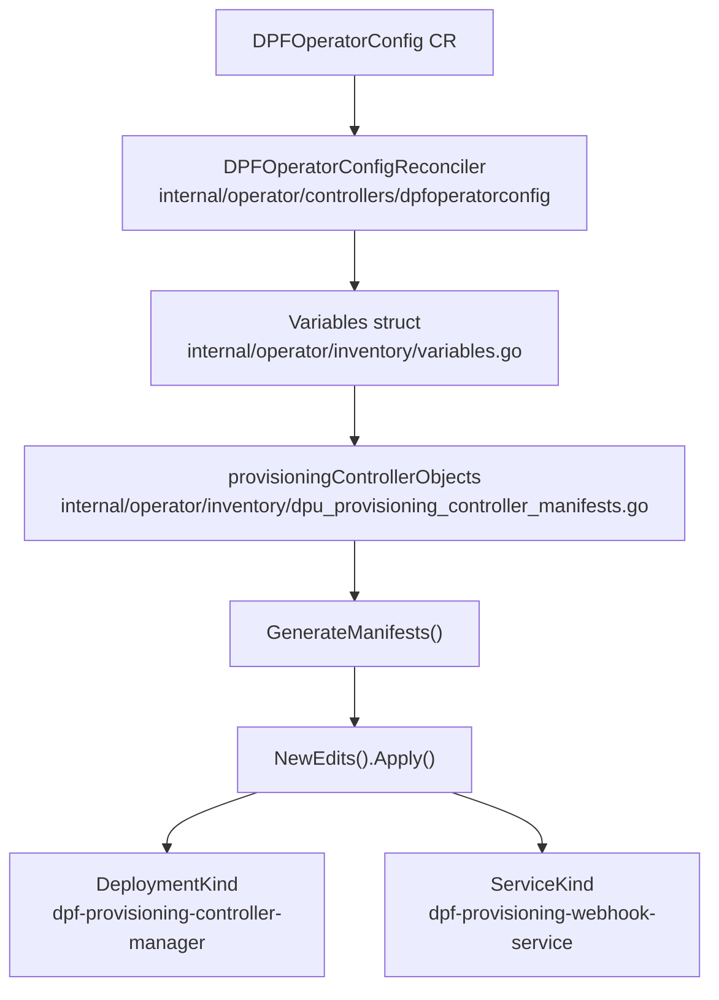

<!-- source: DeepWiki mcp.deepwiki.com · repo NVIDIA/doca-platform · page 10.1 operator.dpu.nvidia.com API Group · fetched 2026-10-26 -->

# operator.dpu.nvidia.com API Group

Relevant source files

The following files were used as context for generating this wiki page:

- [api/noderesources/v1alpha1/nodesriovdevicepluginconfig_types.go](api/noderesources/v1alpha1/nodesriovdevicepluginconfig_types.go)
- [api/noderesources/v1alpha1/zz_generated.deepcopy.go](api/noderesources/v1alpha1/zz_generated.deepcopy.go)
- [api/operator/v1alpha1/componentconfig_types.go](api/operator/v1alpha1/componentconfig_types.go)
- [api/operator/v1alpha1/dpfoperatorconfig_types.go](api/operator/v1alpha1/dpfoperatorconfig_types.go)
- [api/operator/v1alpha1/zz_generated.deepcopy.go](api/operator/v1alpha1/zz_generated.deepcopy.go)
- [cmd/provisioning/main.go](cmd/provisioning/main.go)
- [config/nodesriovdeviceplugin/crd/bases/noderesources.dpu.nvidia.com_nodesriovdevicepluginconfigs.yaml](config/nodesriovdeviceplugin/crd/bases/noderesources.dpu.nvidia.com_nodesriovdevicepluginconfigs.yaml)
- [config/operator-crds/operator.dpu.nvidia.com_dpfoperatorconfigs.yaml](config/operator-crds/operator.dpu.nvidia.com_dpfoperatorconfigs.yaml)
- [deploy/charts/dpf-operator/templates/crds/apiextensions.k8s.io_v1_customresourcedefinition_dpfoperatorconfigs.operator.dpu.nvidia.com.yaml](deploy/charts/dpf-operator/templates/crds/apiextensions.k8s.io_v1_customresourcedefinition_dpfoperatorconfigs.operator.dpu.nvidia.com.yaml)
- [deploy/charts/dpf-operator/templates/crds/apiextensions.k8s.io_v1_customresourcedefinition_nodesriovdevicepluginconfigs.noderesources.dpu.nvidia.com.yaml](deploy/charts/dpf-operator/templates/crds/apiextensions.k8s.io_v1_customresourcedefinition_nodesriovdevicepluginconfigs.noderesources.dpu.nvidia.com.yaml)
- [docs/public/developer-guides/api/api.md](docs/public/developer-guides/api/api.md)
- [docs/public/developer-guides/api/dpfoperatorconfig.md](docs/public/developer-guides/api/dpfoperatorconfig.md)
- [internal/nodesriovdeviceplugin/common/validate.go](internal/nodesriovdeviceplugin/common/validate.go)
- [internal/nodesriovdeviceplugin/common/validate_test.go](internal/nodesriovdeviceplugin/common/validate_test.go)
- [internal/nodesriovdeviceplugin/controllers/node_controller.go](internal/nodesriovdeviceplugin/controllers/node_controller.go)
- [internal/nodesriovdeviceplugin/controllers/node_controller_test.go](internal/nodesriovdeviceplugin/controllers/node_controller_test.go)
- [internal/nodesriovdeviceplugin/controllers/pod_test.go](internal/nodesriovdeviceplugin/controllers/pod_test.go)
- [internal/nodesriovdeviceplugin/webhooks/nodesriovdevicepluginconfig_webhook.go](internal/nodesriovdeviceplugin/webhooks/nodesriovdevicepluginconfig_webhook.go)
- [internal/nodesriovdeviceplugin/webhooks/nodesriovdevicepluginconfig_webhook_test.go](internal/nodesriovdeviceplugin/webhooks/nodesriovdevicepluginconfig_webhook_test.go)
- [internal/operator/inventory/dpu_provisioning_controller_manifests.go](internal/operator/inventory/dpu_provisioning_controller_manifests.go)
- [internal/operator/inventory/dpu_provisioning_controller_manifests_test.go](internal/operator/inventory/dpu_provisioning_controller_manifests_test.go)
- [internal/operator/inventory/variables.go](internal/operator/inventory/variables.go)
- [internal/provisioning/controllers/dpu/util/options.go](internal/provisioning/controllers/dpu/util/options.go)
- [test/apivalidation/operator_validation_test.go](test/apivalidation/operator_validation_test.go)

## Purpose and Scope

This document describes the Custom Resource Definitions (CRDs) in the `operator.dpu.nvidia.com` API group, which contains resources for configuring the DPF Operator itself. These CRDs control the deployment and behavior of all DPF system components running in the management cluster.

For information about DPU provisioning resources, see [provisioning.dpu.nvidia.com API Group](). For service deployment resources, see [svc.dpu.nvidia.com API Group](). For VPC networking resources, see [vpc.dpu.nvidia.com API Group]().

**Sources:** [api/operator/v1alpha1/dpfoperatorconfig_types.go:1-25](), [docs/public/developer-guides/api/dpfoperatorconfig.md:7-12]()

## API Group Resources

The `operator.dpu.nvidia.com/v1alpha1` API group contains two primary resources:

| Resource | Purpose | Scope |
|----------|---------|-------|
| `DPFOperatorConfig` | Central configuration for all DPF Operator system components | Namespaced |
| `NodeSRIOVDevicePluginConfig` | Per-node SRIOV device plugin configuration | Namespaced |

**Sources:** [config/operator-crds/operator.dpu.nvidia.com_dpfoperatorconfigs.yaml:8-16](), [deploy/charts/dpf-operator/templates/crds/apiextensions.k8s.io_v1_customresourcedefinition_dpfoperatorconfigs.operator.dpu.nvidia.com.yaml:10-18]()

## DPFOperatorConfig Resource

### Overview

`DPFOperatorConfig` is the Schema for the dpfoperatorconfigs API and serves as the central configuration resource for the entire DPF Operator system. A single `DPFOperatorConfig` instance controls the deployment and configuration of all system controllers, networking components, and monitoring resources.

Title: DPFOperatorConfig Structure Overview

```mermaid
graph TB
    DPFOpConfig["DPFOperatorConfig<br/>(operator.dpu.nvidia.com/v1alpha1)"]
    
    subgraph "Core Configuration"
        Overrides["Overrides<br/>Advanced Settings"]
        Networking["Networking<br/>MTU Configuration"]
        ImagePullSecrets["ImagePullSecrets<br/>Registry Credentials"]
        Monitoring["MonitoringConfiguration"]
        DeploymentMode["DeploymentMode<br/>zero-trust/host-trusted"]
    end
    
    subgraph "Controller Components"
        ProvisioningCtrl["ProvisioningControllerConfiguration"]
        DPUSvcCtrl["DPUServiceControllerConfiguration"]
        ServiceSetCtrl["ServiceSetControllerConfiguration"]
        SFCCtrl["SFCControllerConfiguration"]
        KamajiMgr["KamajiClusterManagerConfiguration"]
        StaticMgr["StaticClusterManagerConfiguration"]
        NodeSRIOVCtrl["NodeSRIOVDevicePluginControllerConfiguration"]
    end
    
    subgraph "Networking Components"
        DPUDetector["DPUDetectorConfiguration"]
        Multus["MultusConfiguration"]
        SRIOVPlugin["SRIOVDevicePluginConfiguration"]
        Flannel["FlannelConfiguration"]
        OVSCNI["OVSCNIConfiguration"]
        NVIPAM["NVIPAMConfiguration"]
        CNIInstaller["CNIInstallerConfiguration"]
    end
    
    subgraph "Monitoring Components"
        KubeStateMetrics["KubeStateMetricsConfiguration"]
        NodeProblemDetector["NodeProblemDetectorConfiguration"]
        OTelCollector["OpenTelemetryCollectorConfiguration"]
    end
    
    DPFOpConfig --> Overrides
    DPFOpConfig --> Networking
    DPFOpConfig --> ImagePullSecrets
    DPFOpConfig --> Monitoring
    DPFOpConfig --> DeploymentMode
    
    DPFOpConfig --> ProvisioningCtrl
    DPFOpConfig --> DPUSvcCtrl
    DPFOpConfig --> ServiceSetCtrl
    DPFOpConfig --> SFCCtrl
    DPFOpConfig --> KamajiMgr
    DPFOpConfig --> StaticMgr
    DPFOpConfig --> NodeSRIOVCtrl
    
    DPFOpConfig --> DPUDetector
    DPFOpConfig --> Multus
    DPFOpConfig --> SRIOVPlugin
    DPFOpConfig --> Flannel
    DPFOpConfig --> OVSCNI
    DPFOpConfig --> NVIPAM
    DPFOpConfig --> CNIInstaller
    
    Monitoring --> KubeStateMetrics
    Monitoring --> NodeProblemDetector
    Monitoring --> OTelCollector
```

**Sources:** [api/operator/v1alpha1/dpfoperatorconfig_types.go:134-194](), [config/operator-crds/operator.dpu.nvidia.com_dpfoperatorconfigs.yaml:50-140]()

### Spec Fields

#### Core Configuration

The `DPFOperatorConfigSpec` defines the top-level configuration structure:

| Field | Type | Description | Default |
|-------|------|-------------|---------|
| `deploymentMode` | `string` | Selects `zero-trust` vs `host-trusted` alignment. | Required |
| `overrides` | `*Overrides` | Advanced settings that impact recommended behavior. | `nil` |
| `networking` | `*Networking` | MTU configuration for management and high-speed networks. | `{controlPlaneMTU: 1500}` |
| `monitoring` | `*MonitoringConfiguration` | Configuration for monitoring resources. | `nil` |
| `imagePullSecrets` | `[]string` | Secret names for pulling images for DPF components. | `[]` |

**Sources:** [api/operator/v1alpha1/dpfoperatorconfig_types.go:134-149](), [config/operator-crds/operator.dpu.nvidia.com_dpfoperatorconfigs.yaml:126-133]()

#### Component Configurations

Each system component can be configured through dedicated configuration objects:

**Controller Components:**

| Field | Type | Component Name |
|-------|------|----------------|
| `provisioningController` | `*ProvisioningControllerConfiguration` | `dpf-provisioning-controller-manager` |
| `dpuServiceController` | `*DPUServiceControllerConfiguration` | `dpuservice-controller` |
| `serviceSetController` | `*ServiceSetControllerConfiguration` | `servicechainset-controller` |
| `sfcController` | `*SFCControllerConfiguration` | `sfc-controller` |
| `kamajiClusterManager` | `*KamajiClusterManagerConfiguration` | `kamaji-cluster-manager` |
| `staticClusterManager` | `*StaticClusterManagerConfiguration` | `static-cluster-manager` |
| `nodeSRIOVDevicePluginController` | `*NodeSRIOVDevicePluginControllerConfiguration` | `nodesriovdeviceplugin-controller` |

**Sources:** [api/operator/v1alpha1/dpfoperatorconfig_types.go:150-194](), [internal/operator/inventory/dpu_provisioning_controller_manifests.go:41-42]()

### Component Configuration Patterns

All component configurations share common base structures for consistency:

Title: Component Configuration Type Hierarchy

**Sources:** [api/operator/v1alpha1/componentconfig_types.go:27-50](), [api/operator/v1alpha1/zz_generated.deepcopy.go:55-104]()

#### DefaultOverridesConfiguration

Container-level configuration for images and resources:

| Field | Type | Description |
|-------|------|-------------|
| `image` | `string` | Reference to a container image. |
| `resources` | `*ResourceRequirements` | CPU and memory requests/limits. |

**Sources:** [api/operator/v1alpha1/componentconfig_types.go:27-30](), [config/operator-crds/operator.dpu.nvidia.com_dpfoperatorconfigs.yaml:71-125]()

### ProvisioningControllerConfiguration

Configuration specific to the Provisioning Controller, which manages DPU lifecycle:

Title: ProvisioningControllerConfiguration Details

**Key Configuration Fields:**

| Field | Type | Description | Default |
|-------|------|-------------|---------|
| `maxDPUParallelInstallations` | `*int32` | Max concurrent DPU installations. | `50` |
| `osInstallTimeout` | `*metav1.Duration` | Max time for OS installation in zero-trust. | `60m` |
| `firmwareUpdateTimeout` | `*metav1.Duration` | Max time for BF4 firmware update. | `45m` |
| `nodeEffectRemovalTimeout` | `*metav1.Duration` | Max time for Node Effect Removal phase. | `0s` |
| `osInstallRetries` | `int32` | Max retryable OS installation attempts. | `2` |

**Sources:** [api/operator/v1alpha1/componentconfig_types.go:35-145](), [cmd/provisioning/main.go:80-91](), [internal/provisioning/controllers/dpu/util/options.go:35-41]()

### NetworkingConfiguration

The `Networking` configuration controls MTU settings for DPU network interfaces:

| Field | Type | Description | Default | Validation |
|-------|------|-------------|---------|------------|
| `controlPlaneMTU` | `*int` | MTU for management network. | `1500` | 1280-9216 |
| `highSpeedMTU` | `*int` | MTU for high-speed interface. | `1500` | 1280-9216 |
| `dpuNodeOOBBridgeName` | `*string` | OOB bridge name on host-trusted nodes. | `br-dpu` | Max 15 chars |

**Sources:** [api/operator/v1alpha1/dpfoperatorconfig_types.go:141-175](), [docs/public/developer-guides/api/dpfoperatorconfig.md:98-102]()

### Overrides System

The `Overrides` struct exposes advanced configuration fields for customization beyond recommended defaults:

| Field | Type | Description | Default |
|-------|------|-------------|---------|
| `paused` | `*bool` | Disables all reconciliation when set to true. | `false` |
| `dpuCNIBinPath` | `*string` | Path for CNI binaries on DPU. | `/opt/cni/bin` |
| `dpuCNIConfigPath` | `*string` | Path for CNI config files on DPU. | `/etc/cni/net.d/` |
| `kubernetesAPIServerVIP` | `*string` | VIP for direct Kubernetes API access. | `nil` |
| `argoCDNamespace` | `*string` | Namespace where ArgoCD is deployed. | Config Namespace |

**Sources:** [api/operator/v1alpha1/dpfoperatorconfig_types.go:51-138](), [internal/operator/inventory/variables.go:34-41]()

### Status Conditions

The `DPFOperatorConfigStatus` tracks reconciliation progress through multiple conditions:

| Condition | Purpose |
|-----------|---------|
| `Ready` | Overall readiness of the DPF Operator system. |
| `PreUpgradeValidationReady` | Validation passed for upgrades from previous versions. |
| `ImagePullSecretsReconciled` | All specified imagePullSecrets exist. |
| `SystemComponentsReconciled` | Manifests successfully applied to cluster. |
| `SystemComponentsReady` | All deployed components are running and healthy. |

**Sources:** [api/operator/v1alpha1/dpfoperatorconfig_types.go:26-41](), [docs/public/developer-guides/api/dpfoperatorconfig.md:50-57]()

## NodeSRIOVDevicePluginConfig Resource

### Overview

`NodeSRIOVDevicePluginConfig` (API group `noderesources.dpu.nvidia.com/v1alpha1`) configures per-node SR-IOV device plugin pods. This is distinct from the global `SRIOVDevicePluginConfiguration` in the operator config.

Title: NodeSRIOVDevicePlugin Configuration Model

**Key Fields:**

| Field | Type | Description |
|-------|------|-------------|
| `name` | `string` | Resource name (e.g., `pods_vf`, `ovnk_mgmt_vf`). |
| `type` | `string` | Type of function: `vf` (Virtual Function) or `sf` (Scalable Function). |
| `ranges` | `[]FunctionRange` | Indices of functions on a specific `pfIndex`. |
| `options.isRdma` | `bool` | Enable RDMA for the resource. |
| `options.needVhostNet` | `bool` | Mounts `/dev/vhost-net` and `/dev/net/tun`. |

**Sources:** [docs/public/developer-guides/api/api.md:26-100](), [docs/public/developer-guides/api/api.md:138-154]()

## Configuration Flow to Runtime

The following diagram associates code entities with the manifest generation pipeline:

Title: Configuration to Manifest Generation Flow

**Key Implementation Details:**

1. **Variables Initialization**: `newDefaultVariables()` sets system defaults like `DPUCNIBinPath` and default component images. It also defines the `DisableSystemComponents` map which defaults several components like `StaticClusterManager` to `true` (disabled).
   - [internal/operator/inventory/variables.go:37-82]()
2. **Manifest Parsing**: `provisioningControllerObjects.Parse()` validates that the embedded manifests contain a valid Deployment for `DPFProvisioningControllerName`.
   - [internal/operator/inventory/dpu_provisioning_controller_manifests.go:76-140]()
3. **Dynamic Edits**: `dpfProvisioningDeploymentEdit()` modifies the deployment at runtime to inject variables like `DMSTimeout` and `InstallInterface`.
   - [internal/operator/inventory/dpu_provisioning_controller_manifests.go:176-185]()
4. **API Validation**: The `ProvisioningControllerConfiguration` and `DPUServiceControllerConfiguration` structs use CEL validation rules to ensure `image` (deprecated) and `controller.image` are mutually exclusive.
   - [api/operator/v1alpha1/componentconfig_types.go:34-35]()
5. **NodeSRIOV Defaults**: The `NodeSRIOVDevicePluginControllerVariables` sets the default resource prefix to `nvidia.com`.
   - [internal/operator/inventory/variables.go:119-123]()

**Sources:** [internal/operator/inventory/variables.go:31-143](), [internal/operator/inventory/dpu_provisioning_controller_manifests.go:40-185](), [api/operator/v1alpha1/componentconfig_types.go:32-50](), [test/apivalidation/operator_validation_test.go:51-140]()

---

