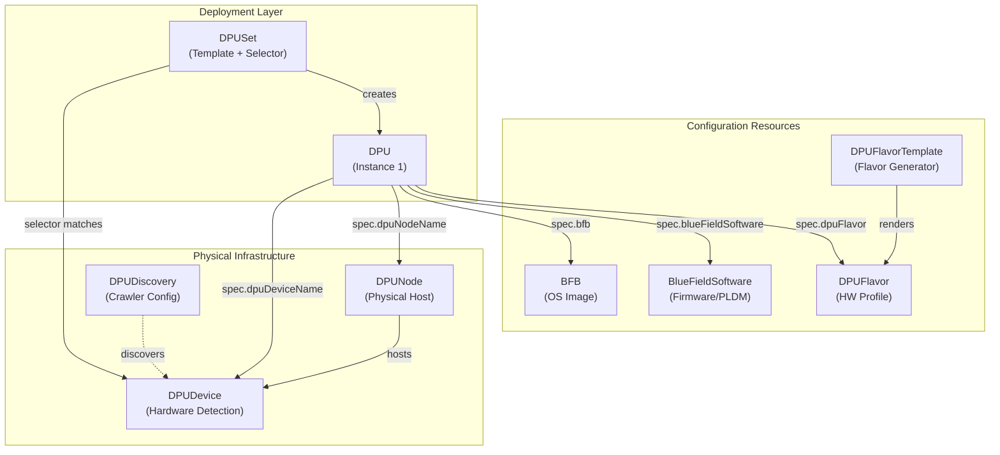
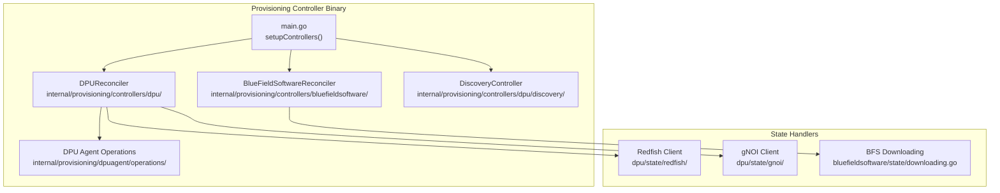

<!-- source: DeepWiki mcp.deepwiki.com · repo NVIDIA/doca-platform · page 10.2 provisioning.dpu.nvidia.com API Group · fetched 2026-10-26 -->

# provisioning.dpu.nvidia.com API Group

Relevant source files

The following files were used as context for generating this wiki page:

- [.golangci-kal.yml](.golangci-kal.yml)
- [api/dpuservice/v1alpha1/dpuserviceconfiguration_types.go](api/dpuservice/v1alpha1/dpuserviceconfiguration_types.go)
- [api/provisioning/v1alpha1/bfb_types.go](api/provisioning/v1alpha1/bfb_types.go)
- [api/provisioning/v1alpha1/bluefield_types.go](api/provisioning/v1alpha1/bluefield_types.go)
- [api/provisioning/v1alpha1/dpu_types.go](api/provisioning/v1alpha1/dpu_types.go)
- [api/provisioning/v1alpha1/dpucluster_types.go](api/provisioning/v1alpha1/dpucluster_types.go)
- [api/provisioning/v1alpha1/dpudevice_types.go](api/provisioning/v1alpha1/dpudevice_types.go)
- [api/provisioning/v1alpha1/dpudiscovery_types.go](api/provisioning/v1alpha1/dpudiscovery_types.go)
- [api/provisioning/v1alpha1/dpuflavor_types.go](api/provisioning/v1alpha1/dpuflavor_types.go)
- [api/provisioning/v1alpha1/zz_generated.deepcopy.go](api/provisioning/v1alpha1/zz_generated.deepcopy.go)
- [config/dpuservice/crd/bases/svc.dpu.nvidia.com_dpuserviceconfigurations.yaml](config/dpuservice/crd/bases/svc.dpu.nvidia.com_dpuserviceconfigurations.yaml)
- [config/provisioning/crd/bases/provisioning.dpu.nvidia.com_bfbs.yaml](config/provisioning/crd/bases/provisioning.dpu.nvidia.com_bfbs.yaml)
- [config/provisioning/crd/bases/provisioning.dpu.nvidia.com_bluefieldsoftwares.yaml](config/provisioning/crd/bases/provisioning.dpu.nvidia.com_bluefieldsoftwares.yaml)
- [config/provisioning/crd/bases/provisioning.dpu.nvidia.com_dpuclusters.yaml](config/provisioning/crd/bases/provisioning.dpu.nvidia.com_dpuclusters.yaml)
- [config/provisioning/crd/bases/provisioning.dpu.nvidia.com_dpudevices.yaml](config/provisioning/crd/bases/provisioning.dpu.nvidia.com_dpudevices.yaml)
- [config/provisioning/crd/bases/provisioning.dpu.nvidia.com_dpudiscoveries.yaml](config/provisioning/crd/bases/provisioning.dpu.nvidia.com_dpudiscoveries.yaml)
- [config/provisioning/crd/bases/provisioning.dpu.nvidia.com_dpuflavors.yaml](config/provisioning/crd/bases/provisioning.dpu.nvidia.com_dpuflavors.yaml)
- [config/provisioning/crd/bases/provisioning.dpu.nvidia.com_dpus.yaml](config/provisioning/crd/bases/provisioning.dpu.nvidia.com_dpus.yaml)
- [crdify.yaml](crdify.yaml)
- [deploy/charts/dpf-operator/templates/crds/apiextensions.k8s.io_v1_customresourcedefinition_bfbs.provisioning.dpu.nvidia.com.yaml](deploy/charts/dpf-operator/templates/crds/apiextensions.k8s.io_v1_customresourcedefinition_bfbs.provisioning.dpu.nvidia.com.yaml)
- [deploy/charts/dpf-operator/templates/crds/apiextensions.k8s.io_v1_customresourcedefinition_bluefieldsoftwares.provisioning.dpu.nvidia.com.yaml](deploy/charts/dpf-operator/templates/crds/apiextensions.k8s.io_v1_customresourcedefinition_bluefieldsoftwares.provisioning.dpu.nvidia.com.yaml)
- [deploy/charts/dpf-operator/templates/crds/apiextensions.k8s.io_v1_customresourcedefinition_dpuclusters.provisioning.dpu.nvidia.com.yaml](deploy/charts/dpf-operator/templates/crds/apiextensions.k8s.io_v1_customresourcedefinition_dpuclusters.provisioning.dpu.nvidia.com.yaml)
- [deploy/charts/dpf-operator/templates/crds/apiextensions.k8s.io_v1_customresourcedefinition_dpudevices.provisioning.dpu.nvidia.com.yaml](deploy/charts/dpf-operator/templates/crds/apiextensions.k8s.io_v1_customresourcedefinition_dpudevices.provisioning.dpu.nvidia.com.yaml)
- [deploy/charts/dpf-operator/templates/crds/apiextensions.k8s.io_v1_customresourcedefinition_dpudiscoveries.provisioning.dpu.nvidia.com.yaml](deploy/charts/dpf-operator/templates/crds/apiextensions.k8s.io_v1_customresourcedefinition_dpudiscoveries.provisioning.dpu.nvidia.com.yaml)
- [deploy/charts/dpf-operator/templates/crds/apiextensions.k8s.io_v1_customresourcedefinition_dpuflavors.provisioning.dpu.nvidia.com.yaml](deploy/charts/dpf-operator/templates/crds/apiextensions.k8s.io_v1_customresourcedefinition_dpuflavors.provisioning.dpu.nvidia.com.yaml)
- [deploy/charts/dpf-operator/templates/crds/apiextensions.k8s.io_v1_customresourcedefinition_dpus.provisioning.dpu.nvidia.com.yaml](deploy/charts/dpf-operator/templates/crds/apiextensions.k8s.io_v1_customresourcedefinition_dpus.provisioning.dpu.nvidia.com.yaml)
- [deploy/charts/dpf-operator/templates/crds/apiextensions.k8s.io_v1_customresourcedefinition_dpuserviceconfigurations.svc.dpu.nvidia.com.yaml](deploy/charts/dpf-operator/templates/crds/apiextensions.k8s.io_v1_customresourcedefinition_dpuserviceconfigurations.svc.dpu.nvidia.com.yaml)
- [docs/public/developer-guides/api/dpuflavor.md](docs/public/developer-guides/api/dpuflavor.md)
- [internal/provisioning/controllers/bluefieldsoftware/state/deleting.go](internal/provisioning/controllers/bluefieldsoftware/state/deleting.go)
- [internal/provisioning/controllers/bluefieldsoftware/state/downloading.go](internal/provisioning/controllers/bluefieldsoftware/state/downloading.go)
- [internal/provisioning/controllers/bluefieldsoftware/state/downloading_test.go](internal/provisioning/controllers/bluefieldsoftware/state/downloading_test.go)
- [internal/provisioning/controllers/bluefieldsoftware/state/error.go](internal/provisioning/controllers/bluefieldsoftware/state/error.go)
- [internal/provisioning/controllers/bluefieldsoftware/state/error_test.go](internal/provisioning/controllers/bluefieldsoftware/state/error_test.go)
- [internal/provisioning/controllers/bluefieldsoftware/state/extracting.go](internal/provisioning/controllers/bluefieldsoftware/state/extracting.go)
- [internal/provisioning/controllers/bluefieldsoftware/state/extracting_test.go](internal/provisioning/controllers/bluefieldsoftware/state/extracting_test.go)
- [internal/provisioning/controllers/bluefieldsoftware/state/ready.go](internal/provisioning/controllers/bluefieldsoftware/state/ready.go)
- [internal/provisioning/controllers/bluefieldsoftware/util/task.go](internal/provisioning/controllers/bluefieldsoftware/util/task.go)
- [internal/provisioning/controllers/bluefieldsoftware/util/task_test.go](internal/provisioning/controllers/bluefieldsoftware/util/task_test.go)
- [internal/provisioning/controllers/bluefieldsoftware_controller_test.go](internal/provisioning/controllers/bluefieldsoftware_controller_test.go)
- [internal/provisioning/controllers/discovery_controller_test.go](internal/provisioning/controllers/discovery_controller_test.go)
- [internal/provisioning/controllers/dpu/discovery/crawler.go](internal/provisioning/controllers/dpu/discovery/crawler.go)
- [internal/provisioning/controllers/dpu/discovery/discovery_controller.go](internal/provisioning/controllers/dpu/discovery/discovery_controller.go)
- [internal/provisioning/controllers/dpu/state/redfish/client/error_test.go](internal/provisioning/controllers/dpu/state/redfish/client/error_test.go)
- [internal/provisioning/dpuagent/operations/nvconfig/nvconfig.go](internal/provisioning/dpuagent/operations/nvconfig/nvconfig.go)
- [internal/provisioning/dpuagent/operations/nvconfig/nvconfig_test.go](internal/provisioning/dpuagent/operations/nvconfig/nvconfig_test.go)
- [internal/provisioning/dpuagent/operations/nvconfig/resolve_test.go](internal/provisioning/dpuagent/operations/nvconfig/resolve_test.go)
- [internal/provisioning/webhooks/bfb_types_test.go](internal/provisioning/webhooks/bfb_types_test.go)
- [internal/provisioning/webhooks/dpuflavor_webhook.go](internal/provisioning/webhooks/dpuflavor_webhook.go)
- [internal/provisioning/webhooks/dpuflavor_webhook_test.go](internal/provisioning/webhooks/dpuflavor_webhook_test.go)
- [test/apivalidation/provisioning_api_validation_test.go](test/apivalidation/provisioning_api_validation_test.go)

## Purpose and Scope

The `provisioning.dpu.nvidia.com` API group provides Kubernetes Custom Resource Definitions (CRDs) for managing the complete lifecycle of DPU (Data Processing Unit) hardware within a Kubernetes cluster. This API group enables automated discovery, provisioning, configuration, and cluster membership management for NVIDIA BlueField DPUs.

This document covers the resource types, their relationships, lifecycle phases, and field-level specifications. For information about the DPF Operator configuration that manages these controllers, see [operator.dpu.nvidia.com API Group](). For service deployment resources that run on provisioned DPUs, see [svc.dpu.nvidia.com API Group]().

---

## Resource Overview

The provisioning API group consists of primary resource types organized into three layers:

### Infrastructure Discovery Layer
- **DPUNode**: Physical host server containing one or more DPUs. [api/provisioning/v1alpha1/dpunode_types.go:27-28]()
- **DPUDevice**: Detected DPU hardware with firmware information and BMC connectivity. [api/provisioning/v1alpha1/dpudevice_types.go:30]()
- **DPUDiscovery**: Configuration for the crawler that discovers DPUs via BMC/Redfish. [api/provisioning/v1alpha1/dpudiscovery_types.go:28]()
- **DPUNodeMaintenance**: Coordinates node-level maintenance operations. [api/provisioning/v1alpha1/dpunodemaintenance_types.go:27]()

### Provisioning Configuration Layer
- **BFB**: BlueField Bundle containing DPU OS image. [api/provisioning/v1alpha1/bfb_types.go:27]()
- **BlueFieldSoftware**: Additional firmware (PLDM) and software components. [api/provisioning/v1alpha1/bluefield_types.go:27]()
- **DPUFlavor**: Hardware configuration profile (SR-IOV, GRUB, OVS, NVConfig). [api/provisioning/v1alpha1/dpuflavor_types.go:27]()
- **DPUFlavorTemplate**: Go-template based flavor generation for per-DPU values. [api/provisioning/v1alpha1/dpuflavortemplate_types.go:28]()

### Deployment Management Layer
- **DPUSet**: Template-based DPU collection with rolling update support. [api/provisioning/v1alpha1/dpuset_types.go:27]()
- **DPU**: Individual DPU instance with full lifecycle management. [api/provisioning/v1alpha1/dpu_types.go:28]()

Sources: [api/provisioning/v1alpha1/]()

---

## Resource Relationship Architecture

**Key Relationships:**
- `DPUNode` represents the physical host and contains a list of `DPURef` in its spec. [api/provisioning/v1alpha1/dpunode_types.go:53-56]()
- `DPUSet` uses label selectors to match `DPUDevices` and create `DPU` instances. [api/provisioning/v1alpha1/dpuset_types.go:48-51]()
- `DPU` references `BFB` for OS image, `DPUFlavor` for hardware configuration, and `DPUCluster` for Kubernetes membership. [api/provisioning/v1alpha1/dpu_types.go:220-278]()
- `DPUFlavorTemplate` allows rendering `DPUFlavor` resources using values from `DPUDevice.spec.values`. [api/provisioning/v1alpha1/dpuflavortemplate_types.go:36-42]()

Sources: [api/provisioning/v1alpha1/dpu_types.go](), [api/provisioning/v1alpha1/dpuset_types.go](), [api/provisioning/v1alpha1/dpunode_types.go](), [api/provisioning/v1alpha1/dpuflavortemplate_types.go]()

---

## Controller Architecture

**Controller Roles:**
- `DPUReconciler`: Orchestrates the state machine for individual DPUs. [api/provisioning/v1alpha1/dpu_types.go:41-95]()
- `BlueFieldSoftwareReconciler`: Manages the lifecycle of firmware bundles, including downloading and extracting PLDM packages. [api/provisioning/v1alpha1/bluefield_types.go:51-62]()
- `DiscoveryController`: Implements the `Crawler` logic to scan network ranges for DPU BMCs. [internal/provisioning/controllers/dpu/discovery/discovery_controller.go]()
- `ConfigureNVConfig`: An agent-side operation that applies `mlxconfig` settings. [internal/provisioning/dpuagent/operations/nvconfig/nvconfig.go]()

Sources: [internal/provisioning/controllers/](), [internal/provisioning/dpuagent/operations/nvconfig/nvconfig.go]()

---

## DPU Resource

The `DPU` resource represents an individual DPU instance and is the central resource in the provisioning lifecycle.

### DPU Lifecycle Phases

The DPU transitions through various phases defined by `DPUPhase`. [api/provisioning/v1alpha1/dpu_types.go:48-95]()

| Phase | Description |
|-------|-------------|
| `Initializing` | First phase after DPU creation. |
| `Node Effect` | Controller handles node effect (taint/drain) provided by user. |
| `Update Firmware` | Updates DPU firmware for BlueField4 using PLDM bundles. [api/provisioning/v1alpha1/dpu_types.go:66]() |
| `Config FW Parameters` | Manipulates DPU firmware (e.g., set DPU mode). [api/provisioning/v1alpha1/dpu_types.go:70]() |
| `Prepare BFB` | Preparing BFB and `bf.cfg` for installation. [api/provisioning/v1alpha1/dpu_types.go:64]() |
| `OS Installing` | Provisioning through DMS gNOI or Redfish interface. [api/provisioning/v1alpha1/dpu_types.go:74]() |
| `DPU Config` | DPU agent applies `mlxconfig`, `ovs`, and `sysctl` settings. [api/provisioning/v1alpha1/dpu_types.go:68]() |
| `Service Readiness` | Waits for critical service pods to be ready. [api/provisioning/v1alpha1/dpu_types.go:82]() |
| `Ready` | DPU is fully operational. [api/provisioning/v1alpha1/dpu_types.go:86]() |

Sources: [api/provisioning/v1alpha1/dpu_types.go:48-95]()

---

## DPUFlavor Configuration Profile

`DPUFlavor` defines the desired hardware and OS configuration. It is immutable once created. [api/provisioning/v1alpha1/dpuflavor_types.go:34-35]()

### Spec Reference
- **NVConfig**: Firmware parameters applied via `mlxconfig`. Supports port-specific (`p0`, `p1`) or wildcard (`*`) targets. [api/provisioning/v1alpha1/dpuflavor_types.go:42-53]()
- **Grub**: Kernel boot parameters set in `GRUB_CMDLINE_LINUX`. [api/provisioning/v1alpha1/dpuflavor_types.go:36-38]()
- **OVS**: Open vSwitch bridge and port configuration. [api/provisioning/v1alpha1/dpuflavor_types.go:54-56]()
- **ConfigFiles**: Custom files materialized via `cloud-init` or `dpu-agent`. [api/provisioning/v1alpha1/dpuflavor_types.go:60-62]()
- **ScalableFunctions**: Configures SFs, specifically `dma` types for BlueField-4 socket-direct systems. [api/provisioning/v1alpha1/dpuflavor_types.go:106-113]()

### NVConfig Force Mechanism
Some firmware parameters are hidden until enabling parameters (like `ADVANCED_PCI_SETTINGS`) are active. The `force: true` field in `NVConfig` allows `mlxconfig` to skip the deferral filter and apply hidden parameters in a single boot cycle. [docs/public/developer-guides/api/dpuflavor.md:142-156]()

Sources: [api/provisioning/v1alpha1/dpuflavor_types.go](), [docs/public/developer-guides/api/dpuflavor.md]()

---

## BlueFieldSoftware (BFS)

`BlueFieldSoftware` manages the complex firmware bundles required for BlueField DPUs, particularly for BF4.

### Firmware Bundle Management
- **PldmFwBundle**: A map of PSID to PLDM firmware bundle URLs. Keys are matched case-insensitively against the DPU's PSID. [api/provisioning/v1alpha1/bluefield_types.go:97-103]()
- **OsIso**: Points to the OS ISO used for installation via Virtual Media (Redfish). [api/provisioning/v1alpha1/bluefield_types.go:92-95]()
- **Downloading State**: The controller uses a `DownloadingTaskMap` to track asynchronous downloads and implements retries with a `maxDownloadRetries` limit of 3. [internal/provisioning/controllers/bluefieldsoftware/state/downloading.go:43-53]()

Sources: [api/provisioning/v1alpha1/bluefield_types.go](), [internal/provisioning/controllers/bluefieldsoftware/state/downloading.go]()

---

## DPUDevice and Identity

`DPUDevice` represents the physical hardware identity and BMC management.

### Identity and Security
- **SPIFFE Identity**: For zero-trust environments, `DPUDevice` manages a `SPIFFEDeregistrationFinalizer` to ensure identity cleanup before hardware re-provisioning. [api/provisioning/v1alpha1/dpudevice_types.go:43-47]()
- **BMC MTLS**: Manages BMC server certificates and CA trust bundles. Rotation can be triggered via the `RotateBMCServerCertificateAnnotation`. [api/provisioning/v1alpha1/dpudevice_types.go:49-56]()
- **Discovery**: `DPUDevice` resources are typically created by the `DPUDiscovery` crawler which probes IP ranges for Redfish-capable BMCs. [api/provisioning/v1alpha1/dpudiscovery_types.go:30-40]()

Sources: [api/provisioning/v1alpha1/dpudevice_types.go](), [api/provisioning/v1alpha1/dpudiscovery_types.go]()

---

