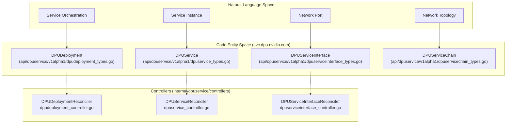
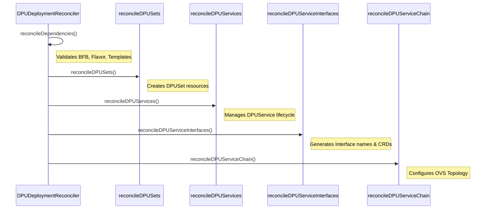

<!-- source: DeepWiki mcp.deepwiki.com · repo NVIDIA/doca-platform · page 10.3 svc.dpu.nvidia.com API Group · fetched 2026-10-26 -->

# svc.dpu.nvidia.com API Group

<details>
<summary>Relevant source files</summary>

The following files were used as context for generating this wiki page:

- [api/dpuservice/v1alpha1/dpudeployment_types.go](api/dpuservice/v1alpha1/dpudeployment_types.go)
- [api/dpuservice/v1alpha1/dpuservice_credential_request_types.go](api/dpuservice/v1alpha1/dpuservice_credential_request_types.go)
- [api/dpuservice/v1alpha1/dpuservicenad_types.go](api/dpuservice/v1alpha1/dpuservicenad_types.go)
- [api/dpuservice/v1alpha1/serviceinterface_types.go](api/dpuservice/v1alpha1/serviceinterface_types.go)
- [api/dpuservice/v1alpha1/zz_generated.deepcopy.go](api/dpuservice/v1alpha1/zz_generated.deepcopy.go)
- [config/dpuservice/crd/bases/svc.dpu.nvidia.com_dpudeployments.yaml](config/dpuservice/crd/bases/svc.dpu.nvidia.com_dpudeployments.yaml)
- [config/dpuservice/crd/bases/svc.dpu.nvidia.com_dpuservicecredentialrequests.yaml](config/dpuservice/crd/bases/svc.dpu.nvidia.com_dpuservicecredentialrequests.yaml)
- [config/dpuservice/crd/bases/svc.dpu.nvidia.com_dpuserviceinterfaces.yaml](config/dpuservice/crd/bases/svc.dpu.nvidia.com_dpuserviceinterfaces.yaml)
- [config/dpuservice/crd/bases/svc.dpu.nvidia.com_dpuservicenads.yaml](config/dpuservice/crd/bases/svc.dpu.nvidia.com_dpuservicenads.yaml)
- [config/dpuservice/crd/bases/svc.dpu.nvidia.com_serviceinterfaces.yaml](config/dpuservice/crd/bases/svc.dpu.nvidia.com_serviceinterfaces.yaml)
- [config/dpuservice/crd/bases/svc.dpu.nvidia.com_serviceinterfacesets.yaml](config/dpuservice/crd/bases/svc.dpu.nvidia.com_serviceinterfacesets.yaml)
- [deploy/charts/dpf-operator/templates/crds/apiextensions.k8s.io_v1_customresourcedefinition_dpudeployments.svc.dpu.nvidia.com.yaml](deploy/charts/dpf-operator/templates/crds/apiextensions.k8s.io_v1_customresourcedefinition_dpudeployments.svc.dpu.nvidia.com.yaml)
- [deploy/charts/dpf-operator/templates/crds/apiextensions.k8s.io_v1_customresourcedefinition_dpuservicecredentialrequests.svc.dpu.nvidia.com.yaml](deploy/charts/dpf-operator/templates/crds/apiextensions.k8s.io_v1_customresourcedefinition_dpuservicecredentialrequests.svc.dpu.nvidia.com.yaml)
- [deploy/charts/dpf-operator/templates/crds/apiextensions.k8s.io_v1_customresourcedefinition_dpuserviceinterfaces.svc.dpu.nvidia.com.yaml](deploy/charts/dpf-operator/templates/crds/apiextensions.k8s.io_v1_customresourcedefinition_dpuserviceinterfaces.svc.dpu.nvidia.com.yaml)
- [deploy/charts/dpf-operator/templates/crds/apiextensions.k8s.io_v1_customresourcedefinition_dpuservicenads.svc.dpu.nvidia.com.yaml](deploy/charts/dpf-operator/templates/crds/apiextensions.k8s.io_v1_customresourcedefinition_dpuservicenads.svc.dpu.nvidia.com.yaml)
- [deploy/charts/dpu-networking/charts/servicechainset-controller/README.md](deploy/charts/dpu-networking/charts/servicechainset-controller/README.md)
- [deploy/charts/dpu-networking/charts/servicechainset-controller/templates/_helpers.tpl](deploy/charts/dpu-networking/charts/servicechainset-controller/templates/_helpers.tpl)
- [deploy/charts/dpu-networking/charts/servicechainset-controller/templates/crds/svc.dpu.nvidia.com_serviceinterfaces.yaml](deploy/charts/dpu-networking/charts/servicechainset-controller/templates/crds/svc.dpu.nvidia.com_serviceinterfaces.yaml)
- [deploy/charts/dpu-networking/charts/servicechainset-controller/templates/crds/svc.dpu.nvidia.com_serviceinterfacesets.yaml](deploy/charts/dpu-networking/charts/servicechainset-controller/templates/crds/svc.dpu.nvidia.com_serviceinterfacesets.yaml)
- [deploy/charts/dpu-networking/charts/servicechainset-controller/templates/deployment.yaml](deploy/charts/dpu-networking/charts/servicechainset-controller/templates/deployment.yaml)
- [deploy/charts/dpu-networking/charts/servicechainset-controller/templates/serviceaccount.yaml](deploy/charts/dpu-networking/charts/servicechainset-controller/templates/serviceaccount.yaml)
- [deploy/charts/dpu-networking/charts/servicechainset-controller/values.yaml](deploy/charts/dpu-networking/charts/servicechainset-controller/values.yaml)
- [deploy/charts/dpu-networking/charts/sfc-controller/templates/crds/svc.dpu.nvidia.com_serviceinterfaces.yaml](deploy/charts/dpu-networking/charts/sfc-controller/templates/crds/svc.dpu.nvidia.com_serviceinterfaces.yaml)
- [docs/public/developer-guides/api/dpuservicechain.md](docs/public/developer-guides/api/dpuservicechain.md)
- [docs/public/developer-guides/api/dpuserviceipam.md](docs/public/developer-guides/api/dpuserviceipam.md)
- [hack/tools/dpfdev/cmd/crdify.go](hack/tools/dpfdev/cmd/crdify.go)
- [hack/tools/dpfdev/cmd/crdify_test.go](hack/tools/dpfdev/cmd/crdify_test.go)
- [hack/tools/dpfdev/cmd/test/crdify_base.yaml](hack/tools/dpfdev/cmd/test/crdify_base.yaml)
- [internal/dpuservice/controllers/dpudeployment_controller.go](internal/dpuservice/controllers/dpudeployment_controller.go)
- [internal/dpuservice/controllers/dpudeployment_controller_dpuservice.go](internal/dpuservice/controllers/dpudeployment_controller_dpuservice.go)
- [internal/dpuservice/controllers/dpudeployment_controller_dpuservicechain.go](internal/dpuservice/controllers/dpudeployment_controller_dpuservicechain.go)
- [internal/dpuservice/controllers/dpudeployment_controller_dpuserviceinterface.go](internal/dpuservice/controllers/dpudeployment_controller_dpuserviceinterface.go)
- [internal/dpuservice/controllers/dpudeployment_controller_test.go](internal/dpuservice/controllers/dpudeployment_controller_test.go)
- [internal/dpuservice/controllers/dpuservice_credential_request_controller.go](internal/dpuservice/controllers/dpuservice_credential_request_controller.go)
- [internal/dpuservice/controllers/dpuservice_credential_request_controller_test.go](internal/dpuservice/controllers/dpuservice_credential_request_controller_test.go)
- [internal/dpuservicechain/controllers/dpuserviceipam_controller.go](internal/dpuservicechain/controllers/dpuserviceipam_controller.go)
- [internal/dpuservicechain/controllers/dpuserviceipam_controller_test.go](internal/dpuservicechain/controllers/dpuserviceipam_controller_test.go)
- [internal/dpuservicechain/controllers/dpuserviceipam_ipamallocator.go](internal/dpuservicechain/controllers/dpuserviceipam_ipamallocator.go)
- [internal/dpuservicechain/controllers/dpuserviceipam_ipamallocator_benchmark_test.go](internal/dpuservicechain/controllers/dpuserviceipam_ipamallocator_benchmark_test.go)
- [internal/dpuservicechain/controllers/dpuserviceipam_ipamallocator_test.go](internal/dpuservicechain/controllers/dpuserviceipam_ipamallocator_test.go)
- [internal/dpuservicechain/controllers/dpuservicenad_controller.go](internal/dpuservicechain/controllers/dpuservicenad_controller.go)
- [internal/dpuservicechain/controllers/dpuservicenad_controller_test.go](internal/dpuservicechain/controllers/dpuservicenad_controller_test.go)
- [internal/dpuservicechain/utils/iputils/iprange.go](internal/dpuservicechain/utils/iputils/iprange.go)
- [internal/dpuservicechain/utils/iputils/iprange_test.go](internal/dpuservicechain/utils/iputils/iprange_test.go)
- [internal/dpuservicechain/utils/iputils/iputils_suite_test.go](internal/dpuservicechain/utils/iputils/iputils_suite_test.go)
- [internal/dpuservicechain/webhooks/dpuserviceipam_webhook.go](internal/dpuservicechain/webhooks/dpuserviceipam_webhook.go)
- [internal/dpuservicechain/webhooks/dpuserviceipam_webhook_test.go](internal/dpuservicechain/webhooks/dpuserviceipam_webhook_test.go)
- [test/apivalidation/dpuservice_api_validation_test.go](test/apivalidation/dpuservice_api_validation_test.go)
- [test/apivalidation/dpuservicenad_api_validation_test.go](test/apivalidation/dpuservicenad_api_validation_test.go)

</details>


This page documents the Custom Resource Definitions (CRDs) in the `svc.dpu.nvidia.com/v1alpha1` API group. These resources define the service deployment and networking model for DPU-based infrastructure, enabling declarative management of workloads running on DPU clusters.

The API group provides resources for:
- **Service Deployment**: `DPUDeployment`, `DPUService`, `DPUServiceTemplate`, `DPUServiceConfiguration`
- **Network Configuration**: `DPUServiceInterface`, `DPUServiceChain`, `DPUServiceIPAM`, `DPUServiceNAD`
- **Credential Management**: `DPUServiceCredentialRequest`

## API Group Overview

The `svc.dpu.nvidia.com` API group implements a layered architecture for service deployment on DPUs. It bridges high-level user intent with low-level DPU provisioning and networking configuration.

### System Architecture and Code Entity Mapping

The following diagram maps high-level system components to their corresponding code entities and reconciliation logic.

**Diagram 1: Natural Language to Code Entity Mapping**

**Sources**: [api/dpuservice/v1alpha1/dpudeployment_types.go:102-108](), [internal/dpuservice/controllers/dpudeployment_controller.go:96-100]()

## Resource Hierarchy and Ownership

The ownership model follows Kubernetes controller patterns with garbage collection. The `DPUDeployment` acts as the root object for a set of services.

| Resource | Owned By | Finalizer |
|----------|----------|-----------|
| `DPUDeployment` | User | `dpu.nvidia.com/dpudeployment` |
| `DPUService` | `DPUDeployment` | N/A |
| `DPUServiceInterface` | `DPUDeployment` | N/A |
| `DPUServiceChain` | `DPUDeployment` | N/A |
| `DPUSet` | `DPUDeployment` | N/A |
| `DPUServiceIPAM` | User / DPF | `dpu.nvidia.com/dpuserviceipam` |
| `DPUServiceNAD` | `DPUServiceInterface` | N/A |

**Sources**: [api/dpuservice/v1alpha1/dpudeployment_types.go:31-34](), [internal/dpuservice/controllers/dpudeployment_controller.go:120-124](), [internal/dpuservicechain/controllers/dpuserviceipam_controller.go:131-135]()

## DPUDeployment

`DPUDeployment` describes a set of `DPUServices` and a `DPUServiceChain` that run on a set of DPUs with a given `BFB` (or `BlueFieldSoftware`) and `DPUFlavor` [api/dpuservice/v1alpha1/dpudeployment_types.go:92-93]().

### Reconciliation Flow

The `DPUDeploymentReconciler` implements a multi-phase reconciliation process. It watches for changes in dependencies like `BFB`, `DPUFlavor`, and `DPUServiceTemplates` [internal/dpuservice/controllers/dpudeployment_controller.go:110-125]().

**Diagram 2: DPUDeployment Reconciliation Logic**

**Sources**: [internal/dpuservice/controllers/dpudeployment_controller.go:110-125](), [internal/dpuservice/controllers/dpudeployment_controller_dpuservice.go:62-69](), [internal/dpuservice/controllers/dpudeployment_controller_dpuserviceinterface.go:47-56](), [internal/dpuservice/controllers/dpudeployment_controller_dpuservicechain.go:40-44]()

### Disruptive vs Non-Disruptive Updates
The controller distinguishes between changes that require a maintenance window and those that do not.
- **Disruptive Changes**: Changes to BFB, DPUFlavor, or significant service configuration changes [internal/dpuservice/controllers/dpudeployment_controller_dpuservice.go:144-160]().
- **Handling**: The controller generates a new revision with a random 5-character suffix (e.g., `-abcde`) and triggers a rolling update or maintenance mode if `applyNodeEffect` is true [internal/dpuservice/controllers/dpudeployment_controller.go:66-67](), [api/dpuservice/v1alpha1/dpudeployment_types.go:150-158]().

## DPUService

`DPUService` represents an instance of a service workload. It is created by `DPUDeployment` and is consumed by the DPU Service Controller to deploy Helm charts via ArgoCD.

### Key Spec Fields
- `ServiceID`: A digest representing the version of the service.
- `Interfaces`: A list of interface templates the service requires.
- `HelmChart`: Reference to the chart source (OCI or HTTPS).

**Sources**: [api/dpuservice/v1alpha1/dpudeployment_controller_dpuservice.go:127-140](), [internal/dpuservice/controllers/dpudeployment_controller_dpuservice.go:111-125]()

## DPUServiceInterface and DPUServiceChain

These resources manage the networking topology on the DPU.

### DPUServiceInterface
Defines a logical network port. Supported types include:
- `Physical`: Maps to a physical uplink port.
- `PF` / `VF`: SR-IOV functions.
- `Service`: Connects to another service's interface.
- `Patch`: Direct OVS patch port between components.

**Sources**: [docs/public/developer-guides/api/dpuservicechain.md:59-130](), [test/apivalidation/dpuservice_api_validation_test.go:61-68]()

### DPUServiceChain
Defines a sequence of connections between interfaces, effectively building a "service chain" on the OVS bridge. It uses `switches` to define connectivity [api/dpuservice/v1alpha1/dpudeployment_types.go:137-148]().

**Diagram 3: Service Chain Topology Flow**
```mermaid
graph LR
    subgraph "DPUServiceChain"
        Switch1["Switch 0<br/>(DPUDeploymentSwitch)"]
        Switch2["Switch 1<br/>(DPUDeploymentSwitch)"]
    end

    Uplink["Physical Port (p0)"]
    SvcIf1["Service Interface (eth1)"]
    SvcIf2["Service Interface (eth2)"]
    Host["Host Interface (pf0hpf)"]

    Uplink --- Switch1
    Switch1 --- SvcIf1
    SvcIf2 --- Switch2
    Switch2 --- Host

    Note over SvcIf1, SvcIf2: Internal Service Logic
```
**Sources**: [docs/public/developer-guides/api/dpuservicechain.md:158-187](), [api/dpuservice/v1alpha1/dpudeployment_types.go:137-148]()

## Networking Support: IPAM and NAD

### DPUServiceIPAM
`DPUServiceIPAM` manages IP allocation for service interfaces. The `DPUServiceIPAMReconciler` syncs IP pools and allocations across multiple DPU clusters [internal/dpuservicechain/controllers/dpuserviceipam_controller.go:61-67]().
- **IPFamilies**: Supports IPv4 and IPv6 explicitly via `requiredIPFamilies` [docs/public/developer-guides/api/dpuservicechain.md:217-233]().
- **Allocation Modes**: Supports `subnet` and `network` modes [docs/public/developer-guides/api/dpuservicechain.md:238-240]().

### DPUServiceNAD
`DPUServiceNAD` generates `NetworkAttachmentDefinition` (NAD) objects used by Multus CNI to attach DPU services to specific OVS bridges or physical ports.

**Sources**: [internal/dpuservicechain/controllers/dpuserviceipam_controller.go:82-85](), [internal/dpuservicechain/controllers/dpuservicenad_controller.go:1-30]()

## API Validation

The group includes extensive API validation rules to ensure configuration consistency:
- **Name Lengths**: `DPUDeployment` names are limited to 20 characters [api/dpuservice/v1alpha1/dpudeployment_types.go:101](). Service names are limited to 28 characters [api/dpuservice/v1alpha1/dpudeployment_types.go:119]().
- **Interface Constraints**: `InterfaceName` in service definitions must be between 1 and 15 characters [test/apivalidation/dpuservice_api_validation_test.go:78-83]().
- **Immutability**: Certain fields like `VirtualNetwork` in a `ServiceInterface` (for VF/PF types) are immutable once created [test/apivalidation/dpuservice_api_validation_test.go:109-122]().

**Sources**: [api/dpuservice/v1alpha1/dpudeployment_types.go:101-119](), [test/apivalidation/dpuservice_api_validation_test.go:50-130]()

---

