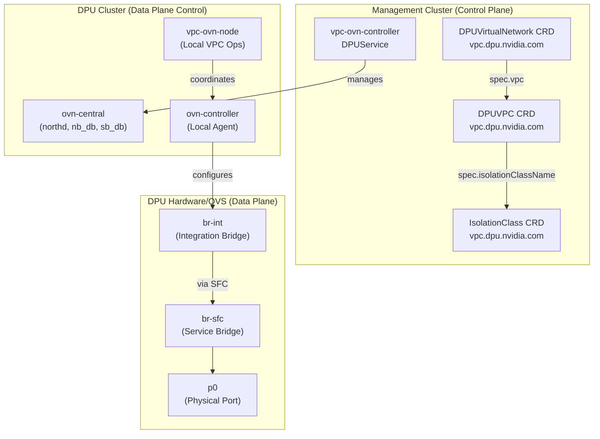
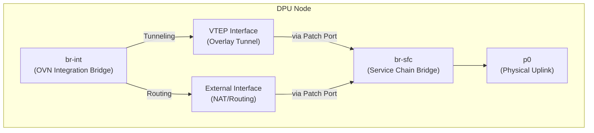

<!-- source: DeepWiki mcp.deepwiki.com · repo NVIDIA/doca-platform · page 10.4 vpc.dpu.nvidia.com API Group · fetched 2026-10-26 -->

# vpc.dpu.nvidia.com API Group

<details>
<summary>Relevant source files</summary>

The following files were used as context for generating this wiki page:

- [docs/public/advanced-configuration/dpuservices/ovnvpc/README.md](docs/public/advanced-configuration/dpuservices/ovnvpc/README.md)
- [docs/public/advanced-configuration/dpuservices/ovnvpc/examples/reference-isolationclass.yaml](docs/public/advanced-configuration/dpuservices/ovnvpc/examples/reference-isolationclass.yaml)
- [docs/public/user-guides/zero-trust/use-cases/vpc/manifests/04.2-vpc-ovn-dpudeployment/dpuserviceconfig-vpc-ovn-node.yaml](docs/public/user-guides/zero-trust/use-cases/vpc/manifests/04.2-vpc-ovn-dpudeployment/dpuserviceconfig-vpc-ovn-node.yaml)
- [docs/public/user-guides/zero-trust/use-cases/vpc/manifests/05-vpc-resources/ovn-isolation-class.yaml](docs/public/user-guides/zero-trust/use-cases/vpc/manifests/05-vpc-resources/ovn-isolation-class.yaml)
- [test/e2e/config-provisioning-snap.yaml](test/e2e/config-provisioning-snap.yaml)
- [test/e2e/config-provisioning-zt-physical-bf4-weave.yaml](test/e2e/config-provisioning-zt-physical-bf4-weave.yaml)
- [test/e2e/servicefunctionchain.go](test/e2e/servicefunctionchain.go)
- [test/e2e/vpcovn.go](test/e2e/vpcovn.go)
- [test/e2e/vpcovn_test.go](test/e2e/vpcovn_test.go)
- [test/e2e/weave.go](test/e2e/weave.go)
- [test/e2e/weave_physical.go](test/e2e/weave_physical.go)
- [test/e2e/weave_physical_test.go](test/e2e/weave_physical_test.go)
- [test/e2e/weave_test.go](test/e2e/weave_test.go)
- [test/objects/application/vpc/dpuservice-vpc-ovn-node.yaml](test/objects/application/vpc/dpuservice-vpc-ovn-node.yaml)
- [test/utils/dpuservice/dpuservice.go](test/utils/dpuservice/dpuservice.go)
- [test/utils/netshoot/netshoot.go](test/utils/netshoot/netshoot.go)
- [test/utils/vpc/ovn/ovnutils.go](test/utils/vpc/ovn/ovnutils.go)

</details>


## Purpose and Scope

This page documents the Custom Resource Definitions (CRDs) in the `vpc.dpu.nvidia.com/v1alpha1` API group. These resources provide Virtual Private Cloud (VPC) networking capabilities on DPU infrastructure, enabling multi-tenant network isolation and traffic policy management.

The VPC API group defines resources for:
- Creating isolated virtual networks (VPCs) on DPU clusters.
- Managing virtual networks within VPCs.
- Defining isolation parameters via `IsolationClass`.
- Enforcing tenant-based network isolation via node labels.
- Configuring inter-VPC and intra-VPC traffic policies.

The VPC OVN service is currently considered **tech preview** and enables host-to-host or pod-to-pod communication through an isolated, hardware-accelerated OVN-based overlay [docs/public/advanced-configuration/dpuservices/ovnvpc/README.md:5-12]().

---

## API Group Overview

The `vpc.dpu.nvidia.com` API group is part of the DOCA Platform Framework's networking subsystem. It implements VPC-style networking on top of OVN running on DPU clusters, providing network isolation boundaries for multi-tenant deployments.

### System Architecture and Code Entities

The VPC OVN service follows a distributed control plane model where Kubernetes CRDs in the Management Cluster are translated into OVN configurations by specialized controllers.

**Diagram: VPC Natural Language to Code Entity Space**


**Sources:** [docs/public/advanced-configuration/dpuservices/ovnvpc/README.md:33-63](), [test/e2e/vpcovn.go:71-76]()

---

## Resource Types

### IsolationClass

**Kind:** `IsolationClass`  
**API Version:** `vpc.dpu.nvidia.com/v1alpha1`  

An `IsolationClass` defines the implementation-specific parameters used by the VPC provisioner. It allows the decoupling of the VPC definition from the underlying SDN implementation (e.g., OVN) [docs/public/advanced-configuration/dpuservices/ovnvpc/README.md:121-127]().

| Parameter | Description |
|-----------|-------------|
| `provisioner` | The provisioner type, typically `ovn.vpc.dpu.nvidia.com` [docs/public/advanced-configuration/dpuservices/ovnvpc/README.md:139]() |
| `ovn-nb-endpoint` | The OVN Northbound database endpoint (e.g., `tcp:10.1.1.100:30041`) [docs/public/advanced-configuration/dpuservices/ovnvpc/README.md:144]() |
| `ovn-sb-endpoint` | The OVN Southbound database endpoint (e.g., `tcp:10.1.1.100:30048`) [docs/public/advanced-configuration/dpuservices/ovnvpc/README.md:148]() |

**Sources:** [docs/public/advanced-configuration/dpuservices/ovnvpc/README.md:121-151](), [docs/public/user-guides/zero-trust/use-cases/vpc/manifests/05-vpc-resources/ovn-isolation-class.yaml:2-10]()

---

### DPUVPC

**Kind:** `DPUVPC`  
**API Version:** `vpc.dpu.nvidia.com/v1alpha1`  

The `DPUVPC` resource represents a Virtual Private Cloud isolation boundary for a specific tenant. 

- **Tenant Ownership:** Defined via `spec.tenant` [docs/public/advanced-configuration/dpuservices/ovnvpc/README.md:177]().
- **Node Selection:** Uses `spec.nodeSelector` to determine which DPU nodes participate in the VPC [docs/public/advanced-configuration/dpuservices/ovnvpc/README.md:180]().
- **Inter-Network Access:** A boolean `spec.interNetworkAccess` that controls whether different `DPUVirtualNetworks` within the same VPC can route traffic to each other [docs/public/advanced-configuration/dpuservices/ovnvpc/README.md:186]().

**Sources:** [docs/public/advanced-configuration/dpuservices/ovnvpc/README.md:157-188](), [test/e2e/vpcovn.go:173-177]()

---

### DPUVirtualNetwork

**Kind:** `DPUVirtualNetwork`  
**API Version:** `vpc.dpu.nvidia.com/v1alpha1`  

The `DPUVirtualNetwork` resource defines a logical Layer 2/3 segment within a VPC. It supports:
- **Subnetting:** Defining IPv4 ranges for the segment [test/e2e/vpcovn_test.go:165-166]().
- **External Routing:** Optional NAT/masquerading for external connectivity [docs/public/advanced-configuration/dpuservices/ovnvpc/README.md:198]().
- **DHCP:** Automated IP allocation for ports attached to the network [docs/public/advanced-configuration/dpuservices/ovnvpc/README.md:197]().

**Sources:** [docs/public/advanced-configuration/dpuservices/ovnvpc/README.md:193-199](), [test/e2e/vpcovn.go:185-189]()

---

## VPC Network Implementation

### OVS Bridge Topology
The VPC OVN implementation utilizes a multi-bridge architecture on the DPU to separate overlay traffic from the physical underlay and service chains.

**Diagram: DPU VPC Bridge and Port Flow**


**Sources:** [docs/public/advanced-configuration/dpuservices/ovnvpc/README.md:95-110](), [test/utils/vpc/ovn/ovnutils.go:65-73]()

### Service Chain Integration
The VPC OVN functionality is delivered via a `DPUServiceChain` (typically named `vpc-ovn-vtep-ext-to-p0`) that links the OVN components to the physical network [test/utils/vpc/ovn/ovnutils.go:73]().

The required DPU Services include:
- `ovn-central` [test/utils/vpc/ovn/ovnutils.go:49]()
- `ovn-controller` [test/utils/vpc/ovn/ovnutils.go:50]()
- `vpc-ovn-controller` [test/utils/vpc/ovn/ovnutils.go:51]()
- `vpc-ovn-node` [test/utils/vpc/ovn/ovnutils.go:52]()

---

## E2E Testing and Validation

The VPC API group is validated using a comprehensive E2E suite that simulates multi-tenant environments.

### Key Validation Scenarios
1. **Single Network Traffic:** Validates connectivity between pods on the same virtual network across different nodes [test/e2e/vpcovn_test.go:181-192]().
2. **Multi-Tenant Isolation:** Creates two VPCs for different tenants ("foo" and "bar") and ensures that traffic is strictly isolated [test/e2e/vpcovn_test.go:159-160]().
3. **DHCP and MTU:** Verifies that pods receive IPs via the VPC DHCP service and that the MTU is correctly set (typically 9000 for VFs) [test/utils/vpc/ovn/ovnutils.go:46](), [test/e2e/vpcovn_test.go:141-147]().

### Netshoot Utility
The framework uses the `netshoot` package to execute network commands within test pods. It includes parsers for `iperf3` and `ib_write_bw` to validate throughput and RDMA performance [test/utils/netshoot/netshoot.go:64-126]().

```go
// Example: Creating a VPC-attached NAD for a test pod
nadName := CreateDPUIntergrationBridgeNetworkAttachmentDefinition(ctx, dpuClient, namespace, labels)
```
**Sources:** [test/utils/vpc/ovn/ovnutils.go:119-154](), [test/e2e/vpcovn_test.go:213-231]()

---

## Deployment Prerequisites

1. **IPAM Pools:** `DPUServiceIPAM` resources must be configured for the VTEP (tunnel) network and the Gateway network [test/e2e/vpcovn.go:93-111]().
   - VTEP Subnet: `20.0.0.0/16` [test/utils/vpc/ovn/ovnutils.go:38]()
   - Gateway Subnet: `40.0.0.0/16` [test/utils/vpc/ovn/ovnutils.go:41]()
2. **Node Labeling:** Nodes must be labeled with tenant identifiers (e.g., `ovn.vpc.dpu.nvidia.com/tenant=foo`) to participate in a specific `DPUVPC` [test/utils/vpc/ovn/ovnutils.go:56]().
3. **Service Interfaces:** Physical interfaces (p0) and OVN patch ports must be defined as `DPUServiceInterface` objects [test/e2e/vpcovn.go:124-132]().

**Sources:** [test/e2e/vpcovn.go:93-132](), [test/utils/vpc/ovn/ovnutils.go:33-78]()

---

