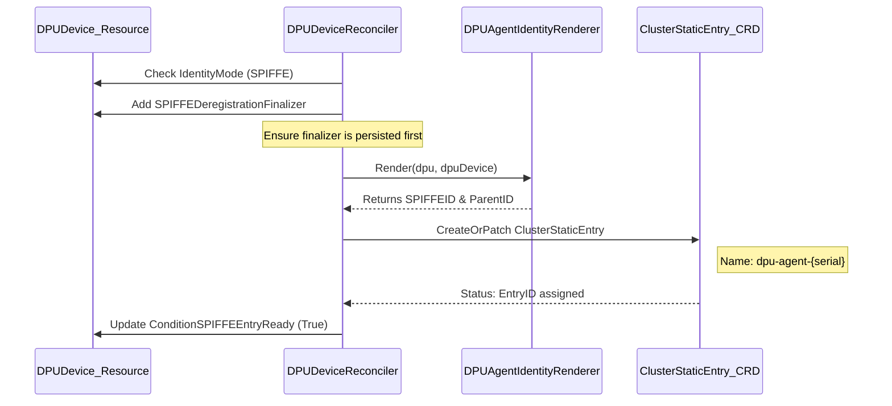
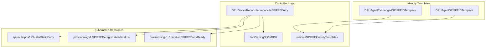

<!-- source: DeepWiki mcp.deepwiki.com · repo NVIDIA/doca-platform · page 11.1 SPIFFE/SPIRE Identity Framework · fetched 2026-10-26 -->

# SPIFFE/SPIRE Identity Framework

Relevant source files

The following files were used as context for generating this wiki page:

- [deploy/charts/dpu-networking/charts/spiffe-csi-driver/Chart.yaml](deploy/charts/dpu-networking/charts/spiffe-csi-driver/Chart.yaml)
- [deploy/charts/dpu-networking/charts/spiffe-csi-driver/README.md](deploy/charts/dpu-networking/charts/spiffe-csi-driver/README.md)
- [deploy/charts/dpu-networking/charts/spiffe-csi-driver/templates/_helpers.tpl](deploy/charts/dpu-networking/charts/spiffe-csi-driver/templates/_helpers.tpl)
- [deploy/charts/dpu-networking/charts/spiffe-csi-driver/templates/csidriver.yaml](deploy/charts/dpu-networking/charts/spiffe-csi-driver/templates/csidriver.yaml)
- [deploy/charts/dpu-networking/charts/spiffe-csi-driver/templates/daemonset.yaml](deploy/charts/dpu-networking/charts/spiffe-csi-driver/templates/daemonset.yaml)
- [deploy/charts/dpu-networking/charts/spiffe-csi-driver/templates/serviceaccount.yaml](deploy/charts/dpu-networking/charts/spiffe-csi-driver/templates/serviceaccount.yaml)
- [deploy/charts/dpu-networking/charts/spiffe-csi-driver/values.yaml](deploy/charts/dpu-networking/charts/spiffe-csi-driver/values.yaml)
- [internal/operator/controllers/spiffe_validation_test.go](internal/operator/controllers/spiffe_validation_test.go)
- [internal/provisioning/controllers/dpu/state/prepare_bfb_subject_test.go](internal/provisioning/controllers/dpu/state/prepare_bfb_subject_test.go)
- [internal/provisioning/controllers/dpudevice/dpudevice_spiffe_envtest_test.go](internal/provisioning/controllers/dpudevice/dpudevice_spiffe_envtest_test.go)
- [internal/provisioning/controllers/dpudevice/spiffe_entry.go](internal/provisioning/controllers/dpudevice/spiffe_entry.go)
- [internal/provisioning/controllers/dpudevice/spiffe_entry_test.go](internal/provisioning/controllers/dpudevice/spiffe_entry_test.go)

The DOCA Platform Framework (DPF) utilizes the SPIFFE (Secure Production Identity Framework for Everyone) and SPIRE (the SPIFFE Runtime Environment) to provide secure, cryptographically verifiable identities to DPU agents and services. This framework enables zero-trust authentication between the management cluster and DPUs, ensuring that only authorized workloads can interact with the control plane.

## Framework Overview

The framework manages the end-to-end lifecycle of a DPU's identity, starting from the initial hardware discovery and serial number validation through to runtime certificate rotation.

Key components of the identity framework include:
- **Trust Domain**: The identity namespace (e.g., `cluster.local`) that defines the scope of the SPIFFE IDs.
- **SPIFFE ID**: A structured URI (e.g., `spiffe://cluster.local/dpu/<serial-number>`) that uniquely identifies a DPU.
- **SVID (SPIFFE Verifiable Identity Document)**: The X.509 certificate used by the DPU agent to prove its identity.
- **ClusterStaticEntry**: A SPIRE custom resource used by the `DPUDeviceReconciler` to pre-register DPUs based on their hardware serial numbers [internal/provisioning/controllers/dpudevice/spiffe_entry.go:132-132]().

## Identity Lifecycle and Provisioning

The identity of a DPU is anchored to its physical hardware. During the provisioning process, the system validates the DPU's serial number before granting a SPIFFE identity.

### 1. Hardware Identity Extraction
The system relies on the `SerialNumber` field of the `DPUDevice` resource to form the identity [internal/provisioning/controllers/dpudevice/spiffe_entry.go:87-87](). This serial number is validated against a supported charset and length to ensure it can form a valid SPIFFE URI [internal/provisioning/controllers/dpudevice/spiffe_entry.go:91-100]().

### 2. SPIRE Registration via ClusterStaticEntry
For DPUs operating in SPIFFE mode, the `DPUDeviceReconciler` creates a `ClusterStaticEntry` (CSE). This entry acts as a manual registration in the SPIRE server.

- **Naming Convention**: CSE names are derived from the serial number using `dpuAgentClusterStaticEntryName` [internal/provisioning/controllers/dpudevice/spiffe_entry.go:91-91]().
- **Finalizer Guard**: To prevent leaking stale identities in SPIRE, the controller adds the `SPIFFEDeregistrationFinalizer` to the `DPUDevice` before creating the CSE [internal/provisioning/controllers/dpudevice/spiffe_entry.go:127-130]().
- **Selectors**: The default selector is `unix:uid:0`, which is later hardened with specific path and SHA256 selectors [internal/provisioning/controllers/dpudevice/spiffe_entry.go:46-50]().

### 3. Identity Rendering
The `spire.DPUAgentIdentityRenderer` uses Go templates defined in the `DPFOperatorConfig` to generate the final SPIFFE IDs [internal/provisioning/controllers/dpudevice/spiffe_entry.go:102-110]().

| Template Field | Purpose |
| :--- | :--- |
| `DPUAgentSPIFFEIDTemplate` | The primary ID within the SPIRE trust domain [api/operator/v1alpha1/componentconfig_types.go:174-174]() |
| `DPUAgentExchangedSPIFFEIDTemplate` | The ID used for authentication across trust boundaries [api/operator/v1alpha1/componentconfig_types.go:176-176]() |

## Provisioning Identity Flow

The following diagram illustrates how the `DPUDeviceReconciler` manages the transition from a physical device record to a registered SPIRE identity.

**DPU Identity Registration Flow**

Sources: [internal/provisioning/controllers/dpudevice/spiffe_entry.go:65-155](), [internal/provisioning/controllers/dpudevice/spiffe_entry.go:127-130]()

## RBAC and Authentication

In SPIFFE mode, Kubernetes RBAC subjects shift from traditional service accounts to SPIFFE IDs.

- **Subject Mapping**: The `dpuAgentRoleBindingSubject` function returns the literal SPIFFE ID URI for SPIFFE-enabled DPUs, rather than the `da-<dpu-name>` username used in bootstrap-token mode [internal/provisioning/controllers/dpu/state/prepare_bfb_subject_test.go:85-89]().
- **Token Skipping**: When a DPU uses SPIFFE identity, the provisioning system skips the generation of Kubernetes bootstrap tokens [internal/provisioning/controllers/dpu/state/prepare_bfb_subject_test.go:156-162]().

## Code Entity Map: SPIFFE Management

This diagram bridges the high-level identity concepts to the specific Go types and constants used in the implementation.

**Identity Logic to Code Mapping**

Sources: [internal/provisioning/controllers/dpudevice/spiffe_entry.go:70-73](), [internal/provisioning/controllers/dpudevice/spiffe_entry.go:127-128](), [internal/operator/controllers/spiffe_validation_test.go:25-33]()

## Runtime Identity Mounting

To allow DPU services to consume the identity, the `spiffe-csi-driver` is deployed as a DaemonSet on the DPUs.

- **CSI Driver**: `csi.spiffe.io` [deploy/charts/dpu-networking/charts/spiffe-csi-driver/templates/csidriver.yaml:6-6]().
- **Socket Path**: The driver mounts the host SPIRE agent socket from `/run/spire` into workload pods [deploy/charts/dpu-networking/charts/spiffe-csi-driver/templates/daemonset.yaml:112-112]().
- **Workload API**: Pods interact with the Workload API via the socket provided by the CSI driver to retrieve their SVIDs [deploy/charts/dpu-networking/charts/spiffe-csi-driver/templates/daemonset.yaml:42-43]().

### Configuration Summary

| Feature | Configuration Path |
| :--- | :--- |
| Trust Domain | `Spec.Security.SPIFFE.SPIRETrustDomain` [internal/operator/controllers/spiffe_validation_test.go:30-30]() |
| SPIRE Server | `Spec.Security.SPIFFE.SPIREServerAddress` [internal/provisioning/controllers/dpudevice/dpudevice_spiffe_envtest_test.go:138-138]() |
| Controller Class | `Spec.Security.SPIFFE.SPIREControllerManagerClassName` [internal/provisioning/controllers/dpudevice/spiffe_entry.go:89-89]() |

Sources:
- [internal/provisioning/controllers/dpudevice/spiffe_entry.go:46-155]()
- [internal/provisioning/controllers/dpu/state/prepare_bfb_subject_test.go:41-179]()
- [deploy/charts/dpu-networking/charts/spiffe-csi-driver/templates/daemonset.yaml:37-125]()
- [internal/operator/controllers/spiffe_validation_test.go:25-82]()

---

