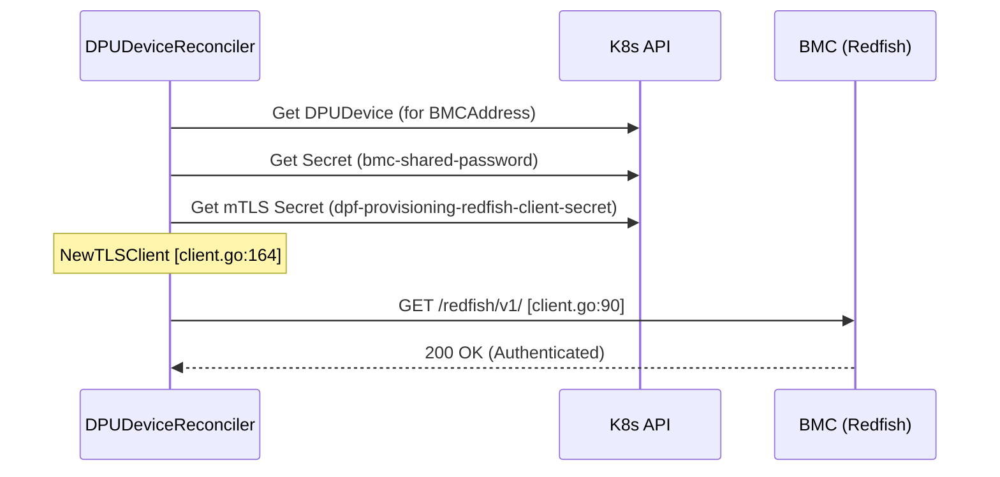
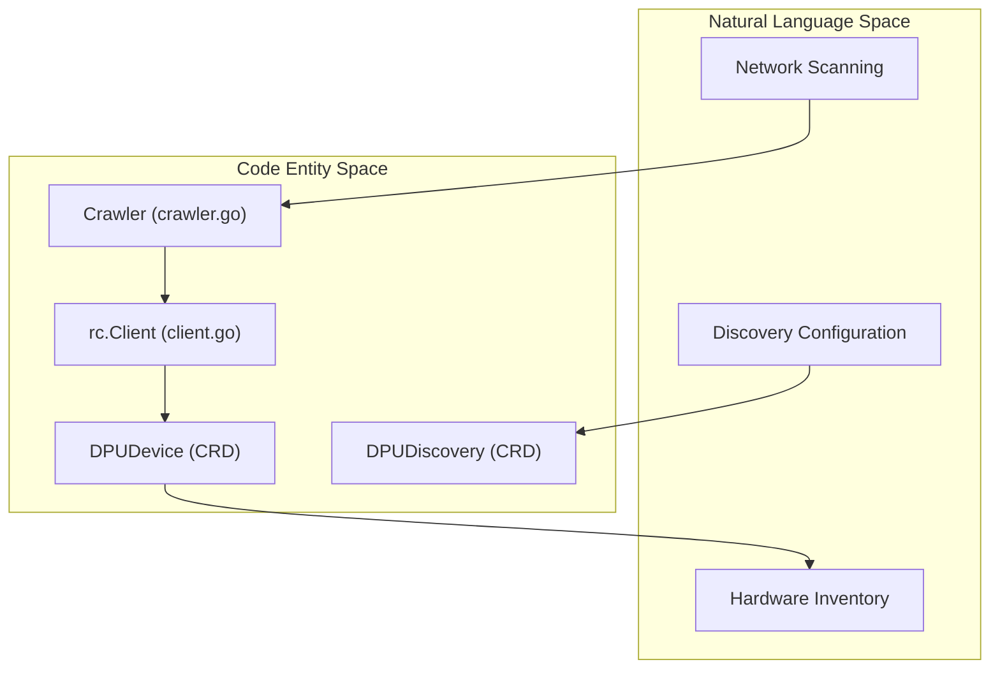
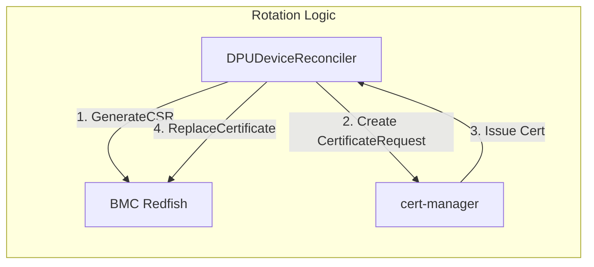

<!-- source: DeepWiki mcp.deepwiki.com · repo NVIDIA/doca-platform · page 11.2 BMC Credential Management and DPU Discovery · fetched 2026-10-26 -->

# BMC Credential Management and DPU Discovery

Relevant source files

The following files were used as context for generating this wiki page:

- [api/provisioning/v1alpha1/dpudiscovery_types.go](api/provisioning/v1alpha1/dpudiscovery_types.go)
- [config/provisioning/crd/bases/provisioning.dpu.nvidia.com_dpudiscoveries.yaml](config/provisioning/crd/bases/provisioning.dpu.nvidia.com_dpudiscoveries.yaml)
- [deploy/charts/dpf-operator/templates/crds/apiextensions.k8s.io_v1_customresourcedefinition_dpudiscoveries.provisioning.dpu.nvidia.com.yaml](deploy/charts/dpf-operator/templates/crds/apiextensions.k8s.io_v1_customresourcedefinition_dpudiscoveries.provisioning.dpu.nvidia.com.yaml)
- [docs/public/advanced-configuration/host-installation-for-non-k8s-env/non-k8s-host-installation.md](docs/public/advanced-configuration/host-installation-for-non-k8s-env/non-k8s-host-installation.md)
- [docs/public/advanced-configuration/multi-dpu-ovnk-hbn.md](docs/public/advanced-configuration/multi-dpu-ovnk-hbn.md)
- [docs/public/advanced-configuration/per-dpu-bmc-credentials.md](docs/public/advanced-configuration/per-dpu-bmc-credentials.md)
- [docs/public/release-notes/README.md](docs/public/release-notes/README.md)
- [docs/public/release-notes/v25.10.0.md](docs/public/release-notes/v25.10.0.md)
- [docs/public/release-notes/v25.10.1.md](docs/public/release-notes/v25.10.1.md)
- [docs/public/release-notes/v26.4.0.md](docs/public/release-notes/v26.4.0.md)
- [docs/public/release-notes/v26.4.1.md](docs/public/release-notes/v26.4.1.md)
- [internal/provisioning/controllers/discovery_controller_test.go](internal/provisioning/controllers/discovery_controller_test.go)
- [internal/provisioning/controllers/dpu/discovery/crawler.go](internal/provisioning/controllers/dpu/discovery/crawler.go)
- [internal/provisioning/controllers/dpu/discovery/discovery_controller.go](internal/provisioning/controllers/dpu/discovery/discovery_controller.go)
- [internal/provisioning/controllers/dpu/state/rebooting_test.go](internal/provisioning/controllers/dpu/state/rebooting_test.go)
- [internal/provisioning/controllers/dpu/state/redfish/client/client.go](internal/provisioning/controllers/dpu/state/redfish/client/client.go)
- [internal/provisioning/controllers/dpu/state/redfish/client/error_test.go](internal/provisioning/controllers/dpu/state/redfish/client/error_test.go)
- [internal/provisioning/controllers/dpu/state/redfish/diag/diag.go](internal/provisioning/controllers/dpu/state/redfish/diag/diag.go)
- [internal/provisioning/controllers/dpu/state/redfish/diag/diag_test.go](internal/provisioning/controllers/dpu/state/redfish/diag/diag_test.go)
- [internal/provisioning/controllers/dpu/state/redfish/firmware_update.go](internal/provisioning/controllers/dpu/state/redfish/firmware_update.go)
- [internal/provisioning/controllers/dpu/state/redfish/firmware_update_test.go](internal/provisioning/controllers/dpu/state/redfish/firmware_update_test.go)
- [internal/provisioning/controllers/dpu/state/redfish/installing.go](internal/provisioning/controllers/dpu/state/redfish/installing.go)
- [internal/provisioning/controllers/dpu/state/redfish/installing_test.go](internal/provisioning/controllers/dpu/state/redfish/installing_test.go)
- [internal/provisioning/controllers/dpu/state/redfish/mock/redfish.go](internal/provisioning/controllers/dpu/state/redfish/mock/redfish.go)
- [internal/provisioning/controllers/dpu/state/redfish/mock/redfish_test.go](internal/provisioning/controllers/dpu/state/redfish/mock/redfish_test.go)
- [internal/provisioning/controllers/dpu/util/reboot_helpers.go](internal/provisioning/controllers/dpu/util/reboot_helpers.go)
- [internal/provisioning/controllers/dpudevice/dpudevice_controller.go](internal/provisioning/controllers/dpudevice/dpudevice_controller.go)
- [internal/provisioning/controllers/dpudevice/dpudevice_controller_test.go](internal/provisioning/controllers/dpudevice/dpudevice_controller_test.go)
- [internal/provisioning/controllers/dpunode/util/option.go](internal/provisioning/controllers/dpunode/util/option.go)
- [internal/provisioning/controllers/node_controller_test.go](internal/provisioning/controllers/node_controller_test.go)
- [internal/provisioning/controllers/util/dms/util.go](internal/provisioning/controllers/util/dms/util.go)

This page details the mechanisms for managing Baseboard Management Controller (BMC) credentials and the automated discovery of DPU devices within the DOCA Platform Framework (DPF). DPF provides flexible credential resolution, supporting both shared cluster-wide passwords and unique per-DPU secrets, alongside a discovery crawler for automated inventory management.

## BMC Credential Management

DPF interacts with the DPU BMC via Redfish to perform low-level provisioning tasks such as firmware updates and OS installation. Accessing these interfaces requires authenticated credentials.

### Credential Resolution Logic
The system resolves credentials using a hierarchical lookup strategy:
1.  **Per-DPU Secret**: The controller first checks for a secret specific to the DPU device.
2.  **Shared Password**: If no specific secret is found, the system falls back to a shared cluster-wide secret named `bmc-shared-password` [internal/provisioning/controllers/dpu/state/redfish/client/client.go:126-127]().
3.  **Default Credentials**: If no secrets are provided, it defaults to the standard factory password `0penBmc` [internal/provisioning/controllers/dpu/state/redfish/client/client.go:128]().

### Secret Schema and Users
Credential requirements differ by hardware generation:
*   **BlueField-3**: Uses the `root` user [internal/provisioning/controllers/dpu/state/redfish/client/client.go:121]().
*   **BlueField-4**: Uses the `admin` user [internal/provisioning/controllers/dpu/state/redfish/client/client.go:122]().
*   **Service Account**: BlueField-4 also supports an SSH-only `service` account whose password can be managed via Redfish [internal/provisioning/controllers/dpu/state/redfish/client/client.go:125]().

Secrets must contain a `password` key [internal/provisioning/controllers/dpu/state/redfish/client/client.go:127](). For advanced security, DPF supports mTLS for Redfish communication using certificates stored in `dpf-provisioning-redfish-client-secret` (or `...-bf4` for BlueField-4) [internal/provisioning/controllers/dpu/state/redfish/client/client.go:116-117]().

### Implementation: Redfish Client Creation
The `rc.NewTLSClient` function initializes the connection to the BMC. It retrieves the necessary secrets from the Kubernetes API and configures a `resty.Client` with the appropriate TLS settings and basic authentication.

*Sources: [internal/provisioning/controllers/dpu/state/redfish/client/client.go:116-164](), [internal/provisioning/controllers/dpu/state/redfish/installing.go:88-92](), [internal/provisioning/controllers/dpudevice/dpudevice_controller.go:102-107]()*

---

## DPU Discovery

The DPU Discovery system automates the registration of physical DPUs into the management cluster. It utilizes a "Crawler" pattern to scan network ranges or specific host interfaces to identify available hardware.

### The Discovery Crawler
The `Crawler` is a background process that:
1.  Scans configured IP ranges or subnets.
2.  Attempts to identify DPUs by querying Redfish endpoints.
3.  Extracts hardware metadata such as Serial Number, PSID, and Model [internal/provisioning/controllers/dpu/state/redfish/mock/redfish.go:39-43]().
4.  Creates or updates `DPUDevice` Custom Resources (CRs) based on the findings.

### Data Flow: Discovery to Registration
When a device is discovered, the `DiscoveryController` reconciles the `DPUDiscovery` CRD. It maps the physical attributes found by the crawler to the `DPUDevice` specification.

| Code Entity | Role |
| :--- | :--- |
| `DPUDiscovery` CRD | Configuration for the discovery process (subnets, scan frequency) [api/provisioning/v1alpha1/dpudiscovery_types.go](). |
| `Crawler` | Logic for network scanning and Redfish probing [internal/provisioning/controllers/dpu/discovery/crawler.go](). |
| `DPUDevice` CRD | The resulting inventory object representing a physical DPU [internal/provisioning/controllers/dpudevice/dpudevice_controller.go](). |

*Sources: [api/provisioning/v1alpha1/dpudiscovery_types.go](), [internal/provisioning/controllers/dpu/discovery/crawler.go](), [internal/provisioning/controllers/dpu/discovery/discovery_controller.go]()*

---

## BMC Certificate Rotation and Reset Behavior

### BMC Factory Reset
DPF supports resetting the BMC to defaults via the `APIFactoryResetBMC` endpoint [internal/provisioning/controllers/dpu/state/redfish/client/client.go:69](). Post-reset, BlueField BMCs typically require a password change before allowing access to most Redfish resources, returning a `PasswordChangeRequired` error [internal/provisioning/controllers/dpu/state/redfish/mock/redfish.go:107-110]().

### Server Certificate Rotation
The `DPUDeviceReconciler` manages the rotation of the BMC's mTLS server certificate. It integrates with `cert-manager` to request new certificates:
1.  It generates a CSR using the `APIGenerateCSR` endpoint [internal/provisioning/controllers/dpu/state/redfish/client/client.go:83]().
2.  It creates a `CertificateRequest` CR in Kubernetes [internal/provisioning/controllers/dpudevice/dpudevice_controller.go:125-134]().
3.  Once issued, it replaces the certificate on the BMC using `APIReplaceCert` [internal/provisioning/controllers/dpu/state/redfish/client/client.go:77]().

### mTLS and Trust Bundles
The provisioning controller mounts a CA trust bundle from the `dpf-ca-trust-bundle` ConfigMap [internal/provisioning/controllers/dpu/state/redfish/client/client.go:106-107](). This bundle is used to verify the BMC's server certificate during Redfish communication [internal/provisioning/controllers/dpudevice/dpudevice_controller_test.go:71-79]().

*Sources: [internal/provisioning/controllers/dpudevice/dpudevice_controller.go:78-95](), [internal/provisioning/controllers/dpu/state/redfish/client/client.go:75-84](), [internal/provisioning/controllers/dpudevice/dpudevice_controller_test.go:88-103]()*

---

## Technical Reference

### Key API Endpoints Used
*   **Password Management**: `redfish/v1/AccountService/Accounts/{USER}` [internal/provisioning/controllers/dpu/state/redfish/client/client.go:49]().
*   **Factory Reset**: `redfish/v1/Managers/{MANAGER_ID}/Actions/Manager.ResetToDefaults` [internal/provisioning/controllers/dpu/state/redfish/client/client.go:69]().
*   **Certificate Replacement**: `redfish/v1/CertificateService/Actions/CertificateService.ReplaceCertificate` [internal/provisioning/controllers/dpu/state/redfish/client/client.go:77]().
*   **Task Monitoring**: `redfish/v1/TaskService/Tasks` [internal/provisioning/controllers/dpu/state/redfish/client/client.go:65]().

### Configuration Summary Table
| Parameter | Default Value | Secret Name |
| :--- | :--- | :--- |
| Shared Password | `0penBmc` | `bmc-shared-password` |
| mTLS Client Cert (BF3) | N/A | `dpf-provisioning-redfish-client-secret` |
| mTLS Client Cert (BF4) | N/A | `dpf-provisioning-redfish-client-secret-bf4` |
| BF3 User | `root` | N/A |
| BF4 User | `admin` | N/A |
| CA Trust Bundle | N/A | `dpf-ca-trust-bundle` |

*Sources: [internal/provisioning/controllers/dpu/state/redfish/client/client.go:106-128](), [internal/provisioning/controllers/dpudevice/dpudevice_controller.go:92-94]()*

---

