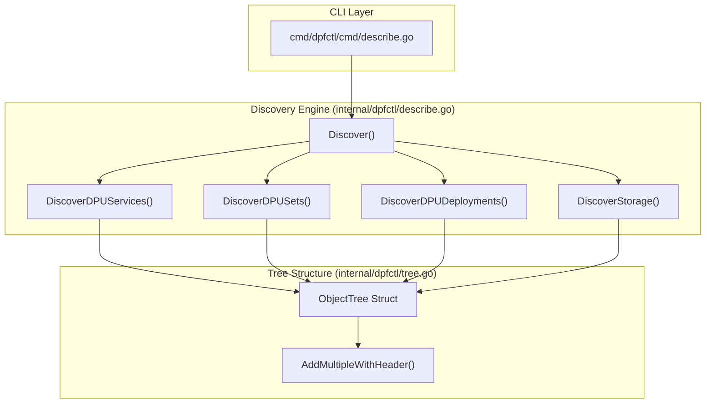
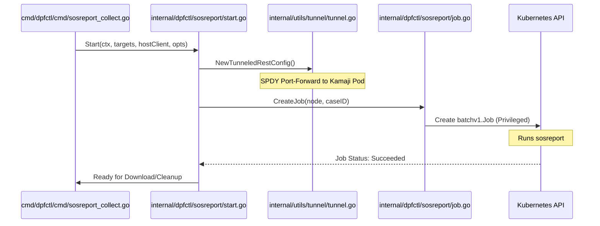

<!-- source: DeepWiki mcp.deepwiki.com · repo NVIDIA/doca-platform · page 11.3 dpfctl Diagnostic Tooling · fetched 2026-10-26 -->

# dpfctl Diagnostic Tooling

Relevant source files

The following files were used as context for generating this wiki page:

- [cmd/dpfctl/cmd/describe.go](cmd/dpfctl/cmd/describe.go)
- [cmd/dpfctl/cmd/describe_all.go](cmd/dpfctl/cmd/describe_all.go)
- [cmd/dpfctl/cmd/dump.go](cmd/dpfctl/cmd/dump.go)
- [cmd/dpfctl/cmd/dump_bmc.go](cmd/dpfctl/cmd/dump_bmc.go)
- [cmd/dpfctl/cmd/sosreport.go](cmd/dpfctl/cmd/sosreport.go)
- [cmd/dpfctl/cmd/sosreport_cleanup.go](cmd/dpfctl/cmd/sosreport_cleanup.go)
- [cmd/dpfctl/cmd/sosreport_collect.go](cmd/dpfctl/cmd/sosreport_collect.go)
- [cmd/dpfctl/cmd/sosreport_download.go](cmd/dpfctl/cmd/sosreport_download.go)
- [cmd/dpfctl/cmd/sosreport_start.go](cmd/dpfctl/cmd/sosreport_start.go)
- [cmd/dpfctl/cmd/sosreport_status.go](cmd/dpfctl/cmd/sosreport_status.go)
- [docs/public/advanced-configuration/dpuflavortemplate-per-dpu-config.md](docs/public/advanced-configuration/dpuflavortemplate-per-dpu-config.md)
- [docs/public/developer-guides/api/README.md](docs/public/developer-guides/api/README.md)
- [docs/public/developer-guides/api/dpudevice.md](docs/public/developer-guides/api/dpudevice.md)
- [docs/public/developer-guides/api/dpudiscovery.md](docs/public/developer-guides/api/dpudiscovery.md)
- [docs/public/developer-guides/api/dpuserviceinterface.md](docs/public/developer-guides/api/dpuserviceinterface.md)
- [docs/public/operational-readiness/troubleshooting/dpfctl/describe.md](docs/public/operational-readiness/troubleshooting/dpfctl/describe.md)
- [docs/public/operational-readiness/troubleshooting/dpfctl/dump.md](docs/public/operational-readiness/troubleshooting/dpfctl/dump.md)
- [internal/dpfctl/bmcdump/artifacts.go](internal/dpfctl/bmcdump/artifacts.go)
- [internal/dpfctl/bmcdump/collect.go](internal/dpfctl/bmcdump/collect.go)
- [internal/dpfctl/bmcdump/collect_test.go](internal/dpfctl/bmcdump/collect_test.go)
- [internal/dpfctl/bmcdump/constants.go](internal/dpfctl/bmcdump/constants.go)
- [internal/dpfctl/bmcdump/discover.go](internal/dpfctl/bmcdump/discover.go)
- [internal/dpfctl/bmcdump/redfish.go](internal/dpfctl/bmcdump/redfish.go)
- [internal/dpfctl/bmcdump/redfish_test.go](internal/dpfctl/bmcdump/redfish_test.go)
- [internal/dpfctl/describe.go](internal/dpfctl/describe.go)
- [internal/dpfctl/describe_test.go](internal/dpfctl/describe_test.go)
- [internal/dpfctl/describe_util.go](internal/dpfctl/describe_util.go)
- [internal/dpfctl/sosreport/cluster.go](internal/dpfctl/sosreport/cluster.go)
- [internal/dpfctl/sosreport/download.go](internal/dpfctl/sosreport/download.go)
- [internal/dpfctl/sosreport/job.go](internal/dpfctl/sosreport/job.go)
- [internal/dpfctl/sosreport/job_test.go](internal/dpfctl/sosreport/job_test.go)
- [internal/dpfctl/sosreport/start.go](internal/dpfctl/sosreport/start.go)
- [internal/dpfctl/sosreport/start_test.go](internal/dpfctl/sosreport/start_test.go)
- [internal/dpfctl/sosreport/status.go](internal/dpfctl/sosreport/status.go)
- [internal/dpfctl/sosreport/wait.go](internal/dpfctl/sosreport/wait.go)
- [internal/dpfctl/sosreport/wait_test.go](internal/dpfctl/sosreport/wait_test.go)
- [internal/dpfctl/suite_test.go](internal/dpfctl/suite_test.go)
- [internal/dpfctl/tree.go](internal/dpfctl/tree.go)
- [internal/operator/controllers/object_schema_validation.go](internal/operator/controllers/object_schema_validation.go)
- [internal/operator/controllers/suite_test.go](internal/operator/controllers/suite_test.go)
- [internal/utils/tunnel/tunnel.go](internal/utils/tunnel/tunnel.go)
- [pkg/conditions/conditions.go](pkg/conditions/conditions.go)

The `dpfctl` CLI tool provides diagnostic and management capabilities for the DOCA Platform Framework (DPF). It allows administrators to visualize the state of DPF resources, collect comprehensive system logs (SOS reports) from host and DPU clusters, perform BMC diagnostic dumps, and render configuration templates.

## Describe Command and Resource Tree

The `dpfctl describe` command provides a structured view of the DPF resource hierarchy. It traverses the relationships between various Custom Resources (CRs) to build an `ObjectTree` that represents the operational state of the platform [cmd/dpfctl/cmd/describe.go:85-90]().

### Implementation and Data Flow

The `describe` command implementation is split between the CLI entry point and the internal discovery logic.

1.  **CLI Entry Point**: `cmd/dpfctl/cmd/describe.go` handles flag parsing and initializes the discovery process. It uses the Kubernetes discovery API to determine which DPF resource kinds are installed on the cluster [cmd/dpfctl/cmd/describe.go:103-131]().
2.  **Discovery Engine**: `internal/dpfctl/describe.go` contains the `Discover` function, which acts as the orchestrator [internal/dpfctl/describe.go:89-130](). It iterates through a `funcMap` of discovery functions (e.g., `DiscoverDPUServices`, `DiscoverDPUSets`, `DiscoverStorage`) to populate the `ObjectTree` [internal/dpfctl/describe.go:60-87]().
3.  **Tree Construction**: The `ObjectTree` struct (defined in `internal/dpfctl/tree.go`) maintains the relationships between objects using UIDs and ownership maps [internal/dpfctl/tree.go:69-75]().

### Resource Tree Logic

The tree construction uses several mechanisms to provide a readable output:
*   **Virtual Objects**: Used to group resources logically (e.g., "System Components" or "DPUs") even if no single CR represents that group [internal/dpfctl/describe.go:191-193]().
*   **Grouping**: Sibling objects with identical `Ready` condition status, reason, and severity are grouped to reduce noise [internal/dpfctl/tree.go:172-203]().
*   **Condition Reporting**: The tool extracts conditions from the `status` field of resources. It specifically highlights the `Ready` condition but can be configured via `--show-conditions` to display all conditions [cmd/dpfctl/cmd/describe.go:136-137]().

### Resource Discovery Diagram

This diagram illustrates how `dpfctl` maps Kubernetes API resources to the visual hierarchy.

**Resource Discovery Flow**

Sources: [cmd/dpfctl/cmd/describe.go:85-131](), [internal/dpfctl/describe.go:60-130](), [internal/dpfctl/tree.go:69-107]()

## SOS Report Collection

The `sosreport` subcommand automates the collection of diagnostic data using the `sosreport` tool. It orchestrates Kubernetes `Jobs` across the management (host) cluster and tenant DPU clusters [internal/dpfctl/sosreport/start.go:118-139]().

### Architecture and Multi-Cluster Support

The tool supports targets via the `--cluster` flag: `host`, `dpu`, or `all` [internal/dpfctl/sosreport/start.go:62-64]().

*   **Host Cluster**: Jobs are created directly on the management cluster nodes.
*   **DPU Clusters**: Since DPU clusters (managed by Kamaji) may not be directly reachable, `dpfctl` utilizes a tunneling mechanism (`internal/utils/tunnel`) to establish a connection to the DPU control plane and deploy the diagnostic Jobs [internal/dpfctl/sosreport/cluster.go:83-121](). The tunnel verifies apiserver reachability via `/version` before proceeding [internal/utils/tunnel/tunnel.go:130-157]().

### Job Lifecycle

The collection process follows a multi-stage pipeline:
1.  **Start**: Validates options (Namespace, Image, NFS settings, etc.) and creates a `batchv1.Job` on each target node [internal/dpfctl/sosreport/start.go:159-186]().
2.  **Execution**: The Job runs a privileged container that executes `sosreport`.
3.  **Wait**: `dpfctl` polls for Job completion, reporting init container failures such as `CrashLoopBackOff` or `OOMKilled` [internal/dpfctl/sosreport/wait.go:42-94]().
4.  **Output Modes**:
    *   **Local**: The Job keeps the pod alive after `sosreport` finishes, allowing `dpfctl` to download results.
    *   **NFS**: The Job mounts an NFS volume and copies the report directly to the server [internal/dpfctl/sosreport/start.go:38-42]().
5.  **Cleanup**: Deletes temporary Kubernetes resources (Jobs, Secrets) after completion [internal/dpfctl/sosreport/start.go:125-132]().

### SOS Report Implementation Diagram

**SOS Report Execution Flow**

Sources: [internal/dpfctl/sosreport/start.go:118-139](), [internal/dpfctl/sosreport/cluster.go:83-121](), [internal/utils/tunnel/tunnel.go:98-136]()

## BMC Diagnostic Dump

The `dpfctl dump-bmc` command allows for the collection of Redfish-based diagnostic dumps from DPU BMCs [cmd/dpfctl/cmd/dump_bmc.go]().

### Implementation Details
*   **Discovery**: The tool can target specific `DPUDevices` or discover all devices in the `dpf-operator-system` namespace [internal/dpfctl/bmcdump/constants.go:23]().
*   **Redfish Tasks**: It triggers `LogService.CollectDiagnosticData` actions for both `Manager` and `OEM` (CPUDiagnosticsData) types [internal/dpfctl/bmcdump/constants.go:37-48]().
*   **Credentials**: It automatically resolves BMC credentials by checking per-device secrets or the `bmc-shared-password` secret [internal/dpfctl/bmcdump/constants.go:32]().
*   **Artifacts**: Dumps are downloaded as `.tar.zst` archives from the BMC's Redfish URI once the asynchronous tasks complete [internal/dpfctl/bmcdump/constants.go:50-52]().

Sources: [internal/dpfctl/bmcdump/constants.go:21-60](), [cmd/dpfctl/cmd/dump_bmc.go]()

## Flavor Template Rendering

The `dpfctl flavor-template render` command is a utility for testing `DPUFlavorTemplate` resources. It allows developers to preview how a template will render into a `DPUFlavor` for a specific `DPUDevice` without applying the changes to the cluster.

*   **Inputs**: Requires a `DPUFlavorTemplate` and a `DPUDevice`.
*   **Logic**: It uses the `spec.values` from the `DPUDevice` to populate the Go templates defined in the `DPUFlavorTemplate`.
*   **Use Case**: Validating complex conditional logic in templates (e.g., SR-IOV configuration based on device revisions).

Sources: [docs/public/advanced-configuration/dpuflavortemplate-per-dpu-config.md]()

## Condition Reporting

The framework uses a standardized condition system defined in `pkg/conditions/conditions.go` [pkg/conditions/conditions.go:17-46](). `dpfctl` leverages this to provide a unified health status.

### Key Condition Types
| Type | Description |
| :--- | :--- |
| `Ready` | The aggregate status of the resource [pkg/conditions/conditions.go:45](). |
| `XXXReady` | Readiness of a specific sub-component (e.g., `BFBReady`). |
| `XXXReconciled` | Indicates if the reconciliation loop successfully applied changes [pkg/conditions/conditions.go:38-41](). |

### Severity and Reasons
When a resource is not ready, `dpfctl` displays the reason based on a severity hierarchy:
1.  `AwaitingDeletion` (Highest) [pkg/conditions/conditions.go:178]()
2.  `Failure` [pkg/conditions/conditions.go:179]()
3.  `Retrying` / `Pending` [pkg/conditions/conditions.go:180-181]()

The `SetSummary` function in the conditions package is responsible for aggregating these sub-conditions into the top-level `Ready` condition, which `dpfctl describe` then parses for display [pkg/conditions/conditions.go:140-173]().

Sources: [pkg/conditions/conditions.go:29-64](), [pkg/conditions/conditions.go:140-183](), [internal/dpfctl/tree.go:111-140]()

---

