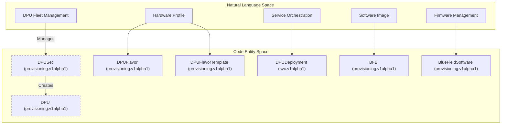
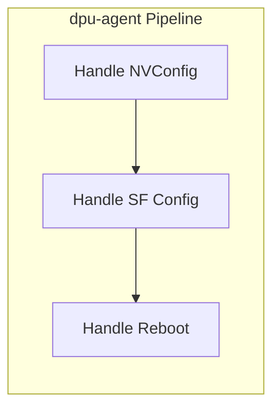

<!-- source: DeepWiki mcp.deepwiki.com · repo NVIDIA/doca-platform · page 12 Glossary · fetched 2026-10-26 -->

# Glossary

<details>
<summary>Relevant source files</summary>

The following files were used as context for generating this wiki page:

- [api/operator/v1alpha1/componentconfig_types.go](api/operator/v1alpha1/componentconfig_types.go)
- [api/operator/v1alpha1/dpfoperatorconfig_types.go](api/operator/v1alpha1/dpfoperatorconfig_types.go)
- [api/operator/v1alpha1/zz_generated.deepcopy.go](api/operator/v1alpha1/zz_generated.deepcopy.go)
- [api/provisioning/v1alpha1/dpu_types.go](api/provisioning/v1alpha1/dpu_types.go)
- [api/provisioning/v1alpha1/dpudevice_types.go](api/provisioning/v1alpha1/dpudevice_types.go)
- [api/provisioning/v1alpha1/dpuflavor_types.go](api/provisioning/v1alpha1/dpuflavor_types.go)
- [api/provisioning/v1alpha1/zz_generated.deepcopy.go](api/provisioning/v1alpha1/zz_generated.deepcopy.go)
- [cmd/dpuagent/main.go](cmd/dpuagent/main.go)
- [cmd/provisioning/main.go](cmd/provisioning/main.go)
- [config/operator-crds/operator.dpu.nvidia.com_dpfoperatorconfigs.yaml](config/operator-crds/operator.dpu.nvidia.com_dpfoperatorconfigs.yaml)
- [config/provisioning/crd/bases/provisioning.dpu.nvidia.com_dpudevices.yaml](config/provisioning/crd/bases/provisioning.dpu.nvidia.com_dpudevices.yaml)
- [config/provisioning/crd/bases/provisioning.dpu.nvidia.com_dpuflavors.yaml](config/provisioning/crd/bases/provisioning.dpu.nvidia.com_dpuflavors.yaml)
- [config/provisioning/crd/bases/provisioning.dpu.nvidia.com_dpus.yaml](config/provisioning/crd/bases/provisioning.dpu.nvidia.com_dpus.yaml)
- [deploy/charts/dpf-operator/templates/crds/apiextensions.k8s.io_v1_customresourcedefinition_dpfoperatorconfigs.operator.dpu.nvidia.com.yaml](deploy/charts/dpf-operator/templates/crds/apiextensions.k8s.io_v1_customresourcedefinition_dpfoperatorconfigs.operator.dpu.nvidia.com.yaml)
- [deploy/charts/dpf-operator/templates/crds/apiextensions.k8s.io_v1_customresourcedefinition_dpudevices.provisioning.dpu.nvidia.com.yaml](deploy/charts/dpf-operator/templates/crds/apiextensions.k8s.io_v1_customresourcedefinition_dpudevices.provisioning.dpu.nvidia.com.yaml)
- [deploy/charts/dpf-operator/templates/crds/apiextensions.k8s.io_v1_customresourcedefinition_dpuflavors.provisioning.dpu.nvidia.com.yaml](deploy/charts/dpf-operator/templates/crds/apiextensions.k8s.io_v1_customresourcedefinition_dpuflavors.provisioning.dpu.nvidia.com.yaml)
- [deploy/charts/dpf-operator/templates/crds/apiextensions.k8s.io_v1_customresourcedefinition_dpus.provisioning.dpu.nvidia.com.yaml](deploy/charts/dpf-operator/templates/crds/apiextensions.k8s.io_v1_customresourcedefinition_dpus.provisioning.dpu.nvidia.com.yaml)
- [docs/public/developer-guides/api/api.md](docs/public/developer-guides/api/api.md)
- [docs/public/developer-guides/api/dpfoperatorconfig.md](docs/public/developer-guides/api/dpfoperatorconfig.md)
- [docs/public/developer-guides/api/dpuflavor.md](docs/public/developer-guides/api/dpuflavor.md)
- [docs/public/user-guides/host-trusted/use-cases/hbn-ovnk-snap/README.md](docs/public/user-guides/host-trusted/use-cases/hbn-ovnk-snap/README.md)
- [docs/public/user-guides/host-trusted/use-cases/hbn-ovnk/README.md](docs/public/user-guides/host-trusted/use-cases/hbn-ovnk/README.md)
- [docs/public/user-guides/host-trusted/use-cases/hbn-snap/README.md](docs/public/user-guides/host-trusted/use-cases/hbn-snap/README.md)
- [docs/public/user-guides/host-trusted/use-cases/hbn/README.md](docs/public/user-guides/host-trusted/use-cases/hbn/README.md)
- [docs/public/user-guides/host-trusted/use-cases/ovnk/README.md](docs/public/user-guides/host-trusted/use-cases/ovnk/README.md)
- [docs/public/user-guides/host-trusted/use-cases/passthrough/README.md](docs/public/user-guides/host-trusted/use-cases/passthrough/README.md)
- [docs/public/user-guides/zero-trust/use-cases/hbn-snap/README.md](docs/public/user-guides/zero-trust/use-cases/hbn-snap/README.md)
- [docs/public/user-guides/zero-trust/use-cases/hbn/README.md](docs/public/user-guides/zero-trust/use-cases/hbn/README.md)
- [docs/public/user-guides/zero-trust/use-cases/passthrough/README.md](docs/public/user-guides/zero-trust/use-cases/passthrough/README.md)
- [docs/public/user-guides/zero-trust/use-cases/vpc/README.md](docs/public/user-guides/zero-trust/use-cases/vpc/README.md)
- [dpuservices/storage/chart/README.md](dpuservices/storage/chart/README.md)
- [dpuservices/storage/chart/templates/_validate.tpl](dpuservices/storage/chart/templates/_validate.tpl)
- [dpuservices/storage/chart/templates/dpu_block-storage-vendor-dpu-plugin.yaml](dpuservices/storage/chart/templates/dpu_block-storage-vendor-dpu-plugin.yaml)
- [dpuservices/storage/chart/templates/dpu_doca-snap.yaml](dpuservices/storage/chart/templates/dpu_doca-snap.yaml)
- [dpuservices/storage/chart/templates/dpu_fs-storage-vendor-dpu-plugin.yaml](dpuservices/storage/chart/templates/dpu_fs-storage-vendor-dpu-plugin.yaml)
- [dpuservices/storage/chart/templates/dpu_nfs-storage-vendor-dpu-plugin.yaml](dpuservices/storage/chart/templates/dpu_nfs-storage-vendor-dpu-plugin.yaml)
- [dpuservices/storage/chart/templates/dpu_snap-node-driver.yaml](dpuservices/storage/chart/templates/dpu_snap-node-driver.yaml)
- [dpuservices/storage/chart/templates/host_snap-csi-plugin.yaml](dpuservices/storage/chart/templates/host_snap-csi-plugin.yaml)
- [dpuservices/storage/chart/templates/host_snap-host-controller.yaml](dpuservices/storage/chart/templates/host_snap-host-controller.yaml)
- [dpuservices/storage/chart/values.yaml](dpuservices/storage/chart/values.yaml)
- [dpuservices/storage/chart/values.yaml.tmpl](dpuservices/storage/chart/values.yaml.tmpl)
- [internal/operator/inventory/dpu_provisioning_controller_manifests.go](internal/operator/inventory/dpu_provisioning_controller_manifests.go)
- [internal/operator/inventory/dpu_provisioning_controller_manifests_test.go](internal/operator/inventory/dpu_provisioning_controller_manifests_test.go)
- [internal/operator/inventory/variables.go](internal/operator/inventory/variables.go)
- [internal/provisioning/controllers/dpu/util/options.go](internal/provisioning/controllers/dpu/util/options.go)
- [internal/provisioning/dpuagent/dpuagent.go](internal/provisioning/dpuagent/dpuagent.go)
- [internal/provisioning/dpuagent/dpuagent_test.go](internal/provisioning/dpuagent/dpuagent_test.go)
- [internal/provisioning/dpuagent/operations/nicprovisioning/nicprovisioning.go](internal/provisioning/dpuagent/operations/nicprovisioning/nicprovisioning.go)
- [internal/provisioning/dpuagent/operations/nicprovisioning/nicprovisioning_test.go](internal/provisioning/dpuagent/operations/nicprovisioning/nicprovisioning_test.go)
- [internal/provisioning/dpuagent/operations/nvconfig/nvconfig.go](internal/provisioning/dpuagent/operations/nvconfig/nvconfig.go)
- [internal/provisioning/dpuagent/operations/nvconfig/nvconfig_test.go](internal/provisioning/dpuagent/operations/nvconfig/nvconfig_test.go)
- [internal/provisioning/dpuagent/operations/nvconfig/resolve_test.go](internal/provisioning/dpuagent/operations/nvconfig/resolve_test.go)
- [internal/provisioning/dpuagent/operations/reboot/reboot.go](internal/provisioning/dpuagent/operations/reboot/reboot.go)
- [internal/provisioning/dpuagent/operations/reboot/reboot_test.go](internal/provisioning/dpuagent/operations/reboot/reboot_test.go)
- [internal/provisioning/dpuagent/operations/sfconfig/dma.go](internal/provisioning/dpuagent/operations/sfconfig/dma.go)
- [internal/provisioning/dpuagent/operations/sfconfig/sfconfig.go](internal/provisioning/dpuagent/operations/sfconfig/sfconfig.go)
- [internal/provisioning/dpuagent/operations/sfconfig/sfconfig_test.go](internal/provisioning/dpuagent/operations/sfconfig/sfconfig_test.go)
- [internal/provisioning/dpuagent/operations/type.go](internal/provisioning/dpuagent/operations/type.go)
- [internal/provisioning/webhooks/dpuflavor_webhook.go](internal/provisioning/webhooks/dpuflavor_webhook.go)
- [internal/provisioning/webhooks/dpuflavor_webhook_test.go](internal/provisioning/webhooks/dpuflavor_webhook_test.go)
- [internal/storage/snap/storage-vendor-dpu-plugin/nfs-storage-vendor-dpu-plugin/storage_vendor_dpu_grpc.go](internal/storage/snap/storage-vendor-dpu-plugin/nfs-storage-vendor-dpu-plugin/storage_vendor_dpu_grpc.go)
- [test/apivalidation/operator_validation_test.go](test/apivalidation/operator_validation_test.go)
- [test/apivalidation/provisioning_api_validation_test.go](test/apivalidation/provisioning_api_validation_test.go)
- [test/objects/infrastructure/dpuflavor-physical-bf4.yaml](test/objects/infrastructure/dpuflavor-physical-bf4.yaml)

</details>


This page provides definitions for codebase-specific terms, domain concepts, and technical jargon used within the DOCA Platform Framework (DPF). It serves as a reference for onboarding engineers to map high-level concepts to specific code entities and implementation details as of v26.10.0.

## Core Domain Concepts

### BlueField Bundle (BFB)
The BFB is a binary package containing the operating system, firmware, and drivers for the BlueField DPU. In DPF, it is managed as a Custom Resource (CR) that tracks the image's location and version.
*   **Implementation**: Defined by the `BFB` struct in [api/provisioning/v1alpha1/zz_generated.deepcopy.go:190-196]().
*   **Usage**: Linked in `DPUSet` or `DPU` specs to specify the target software version [docs/public/developer-guides/api/api.md:138-140]().

### DPU Flavor
A profile that defines the hardware and system configuration for a DPU, including `nvconfig` settings, OVS bridge topologies, and host network interface configurations.
*   **Code Entity**: `DPUFlavor` [api/provisioning/v1alpha1/dpu_types.go:162-164]().
*   **DPUFlavorTemplate**: A template mechanism that allows per-DPU flavor rendering using Go templates and values from `DPUDevice.spec.values` [api/provisioning/v1alpha1/dpu_types.go:105-106]().

### Node Effect
A mechanism used to manage the lifecycle of a host node during disruptive DPU operations (like reboots or firmware updates). This includes taints, drains, or custom labels applied to the physical host.
*   **Code Entity**: `Action` struct [api/provisioning/v1alpha1/zz_generated.deepcopy.go:32-71]().
*   **Phases**: `DPUNodeEffect` and `DPUNodeEffectRemoval` [api/provisioning/v1alpha1/dpu_types.go:59-60](), [api/provisioning/v1alpha1/dpu_types.go:83-84]().

---

## Code Entity Space Mapping

The following diagram bridges natural language concepts to the specific Go types and CRDs found in the codebase.

**Concept to Code Mapping**

Sources: [api/provisioning/v1alpha1/dpu_types.go:26-32](), [api/provisioning/v1alpha1/zz_generated.deepcopy.go:190-196](), [docs/public/developer-guides/api/api.md:12-13](), [api/provisioning/v1alpha1/dpu_types.go:65-66]().

---

## Abbreviations and Jargon

| Term | Full Name | Definition | Code Reference |
| :--- | :--- | :--- | :--- |
| **DMS** | DPU Management Service | A service (often in a pod) used to communicate with DPUs via gNOI/gNMI. | [api/provisioning/v1alpha1/dpu_types.go:72-74]() |
| **HBN** | Host Based Networking | DOCA service for EVPN/BGP networking offloaded to DPU. | [docs/public/user-guides/host-trusted/use-cases/hbn-ovnk/README.md:9-9]() |
| **SNAP** | Storage, Network, Acceleration, Processing | DOCA service for NVMe/virtio-blk emulation. | [docs/public/user-guides/host-trusted/use-cases/hbn-snap/README.md:1-5]() |
| **VTEP** | VXLAN Tunnel End Point | The IP used for OVN-Kubernetes overlay encapsulation. | [docs/public/user-guides/host-trusted/use-cases/ovnk/README.md:99-103]() |
| **NVConfig** | NVIDIA Configuration | Hardware-level parameters stored in DPU non-volatile memory. | [api/provisioning/v1alpha1/dpu_types.go:30-33]() |
| **BFCFG** | BlueField Configuration | A template file (`bf.cfg`) used to configure the DPU OS during installation. | [api/operator/v1alpha1/componentconfig_types.go:53-60]() |

---

## Technical Data Flow: DPU Provisioning Phases

The DPU lifecycle moves through a series of phases defined in the `DPUPhase` enum. The `DPU` controller manages the transition between these states based on the installation interface (Redfish, gNOI, etc.).

**DPU State Machine Flow**
```mermaid
stateDiagram-v2
    [*] --> "Initializing" : [api/provisioning/v1alpha1/dpu_types.go:57-58]()
    "Initializing" --> "Node Effect" : Apply Taints/Drains
    "Node Effect" --> "Initialize Interface" : Setup DMS/Redfish [api/provisioning/v1alpha1/dpu_types.go:71-72]()
    "Initialize Interface" --> "Update Firmware" : BF4 PLDM Update [api/provisioning/v1alpha1/dpu_types.go:65-66]()
    "Update Firmware" --> "OS Installing" : BFB Transfer via gNOI/Redfish [api/provisioning/v1alpha1/dpu_types.go:73-74]()
    "OS Installing" --> "DPU Config" : In-band Agent NVConfig/SF [api/provisioning/v1alpha1/dpu_types.go:67-68]()
    "DPU Config" --> "Ready" : [api/provisioning/v1alpha1/dpu_types.go:85-86]()
    "Ready" --> "Error" : On Failure [api/provisioning/v1alpha1/dpu_types.go:87-88]()
```
Sources: [api/provisioning/v1alpha1/dpu_types.go:47-95](), [cmd/provisioning/main.go:34-44]().

---

## DPU Agent Operations

The `dpu-agent` runs on the DPU ARM subsystem and performs sequential hardware configuration steps.

**Agent Operation Sequence**

Sources: [internal/provisioning/dpuagent/operations/reboot/reboot.go:111-113](), [internal/provisioning/dpuagent/operations/nvconfig/nvconfig.go:1-5](), [internal/provisioning/dpuagent/operations/sfconfig/sfconfig.go:1-5]().

### Reboot Methods
The agent discovers the required reboot type based on `mlxconfig` and `mlxfwreset` requirements:
*   **PowerCycle**: Required for critical NVConfig changes like `INTERNAL_CPU_MODEL` [internal/provisioning/dpuagent/operations/reboot/reboot.go:80-88]().
*   **FirmwareReset**: A faster reset that avoids a full host power cycle [internal/provisioning/dpuagent/operations/reboot/reboot.go:169-170]().
*   **NoAction**: No reset required [internal/provisioning/dpuagent/operations/reboot/reboot.go:177-178]().

---

## Operational Health Terminology

DPF distinguishes between **Provisioning Conditions** (lifecycle) and **Operational Conditions** (runtime health).

### Operational Conditions
Exposed in `status.operationalConditions` to track the health of a DPU that is already "Ready".
*   **OperationalReady**: Summary condition for overall health [api/provisioning/v1alpha1/dpu_types.go:135-136]().
*   **NodeProblemsReady**: Reports issues from `node-problem-detector` [api/provisioning/v1alpha1/dpu_types.go:137-138]().
*   **DPUServiceInterfacesReady**: Indicates if service chains and OVS ports are correctly configured [api/provisioning/v1alpha1/dpu_types.go:141-142]().

### Identity & Security
*   **SPIFFE/SPIRE**: Used for zero-trust workload identity for DPU Agents. The DPF operator manages `ClusterStaticEntry` for DPU identification [cmd/provisioning/main.go:102-104]().
*   **SpiffeStatus**: Tracks the identity issuance state in the DPU status [api/provisioning/v1alpha1/zz_generated.deepcopy.go:167-171]().

---

## Networking Terms

### SR-IOV Device Plugin
A DPF-managed component that exposes DPU-backed Virtual Functions (VFs) or Scalable Functions (SFs) to the host Kubernetes scheduler.
*   **Code Entity**: `NodeSRIOVDevicePluginConfig` [docs/public/developer-guides/api/api.md:100-104]().
*   **Key Field**: `devicePluginResources` defines the function ranges and types [docs/public/developer-guides/api/api.md:151-151]().

### OVN-Kubernetes (OVNK) Acceleration
The primary CNI used in DPF, which offloads logical flow processing to the DPU hardware via OVS.
*   **Bridge Topology**: Typically involves `br-int`, `br-ex`, and DPF-specific bridges like `br-sfc`.
*   **Interface Naming**: Host-side interfaces often use a `_if` suffix in HBN/OVNK configurations [docs/public/user-guides/host-trusted/use-cases/hbn-ovnk/README.md:9-9]().

Sources: [docs/public/developer-guides/api/api.md:39-43](), [api/provisioning/v1alpha1/dpu_types.go:131-145](), [api/operator/v1alpha1/componentconfig_types.go:160-165]().