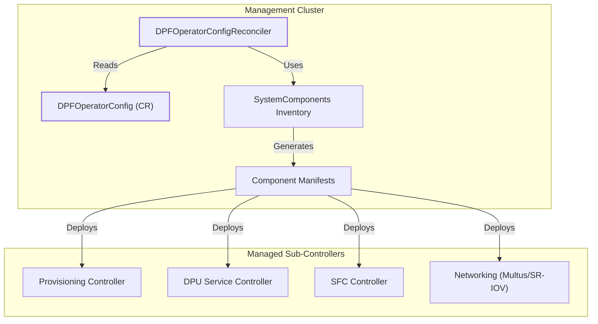
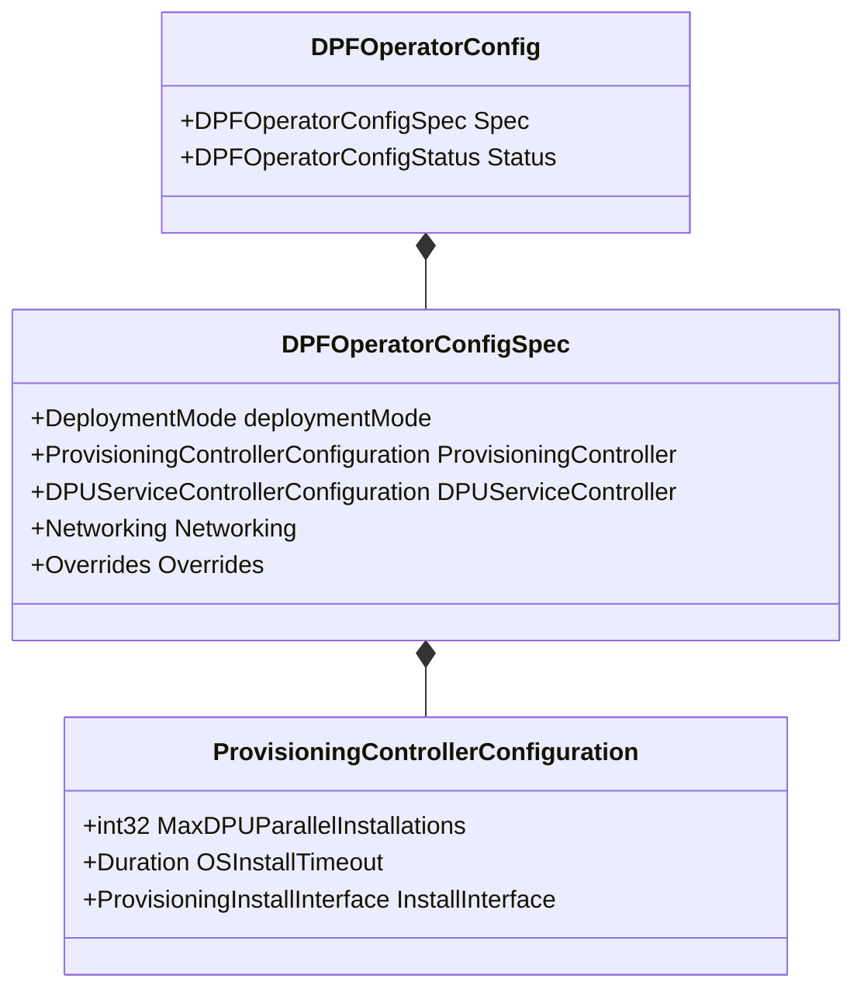

<!-- source: DeepWiki mcp.deepwiki.com · repo NVIDIA/doca-platform · page 2 DPF Operator · fetched 2026-10-26 -->

# DPF Operator

Relevant source files

The following files were used as context for generating this wiki page:

- [api/operator/v1alpha1/componentconfig_types.go](api/operator/v1alpha1/componentconfig_types.go)
- [api/operator/v1alpha1/dpfoperatorconfig_types.go](api/operator/v1alpha1/dpfoperatorconfig_types.go)
- [api/operator/v1alpha1/zz_generated.deepcopy.go](api/operator/v1alpha1/zz_generated.deepcopy.go)
- [cmd/provisioning/main.go](cmd/provisioning/main.go)
- [config/operator-crds/operator.dpu.nvidia.com_dpfoperatorconfigs.yaml](config/operator-crds/operator.dpu.nvidia.com_dpfoperatorconfigs.yaml)
- [config/provisioning/rbac/role.yaml](config/provisioning/rbac/role.yaml)
- [config/provisioning/webhook/manifests.yaml](config/provisioning/webhook/manifests.yaml)
- [deploy/charts/dpf-operator/templates/crds/apiextensions.k8s.io_v1_customresourcedefinition_dpfoperatorconfigs.operator.dpu.nvidia.com.yaml](deploy/charts/dpf-operator/templates/crds/apiextensions.k8s.io_v1_customresourcedefinition_dpfoperatorconfigs.operator.dpu.nvidia.com.yaml)
- [deploy/charts/dpf-operator/templates/role.yaml](deploy/charts/dpf-operator/templates/role.yaml)
- [docs/public/developer-guides/api/api.md](docs/public/developer-guides/api/api.md)
- [docs/public/developer-guides/api/dpfoperatorconfig.md](docs/public/developer-guides/api/dpfoperatorconfig.md)
- [internal/operator/controllers/dpfoperatorconfig_controller.go](internal/operator/controllers/dpfoperatorconfig_controller.go)
- [internal/operator/controllers/dpfoperatorconfig_controller_test.go](internal/operator/controllers/dpfoperatorconfig_controller_test.go)
- [internal/operator/controllers/object_schema_validation_test.go](internal/operator/controllers/object_schema_validation_test.go)
- [internal/operator/inventory/dpu_provisioning_controller_manifests.go](internal/operator/inventory/dpu_provisioning_controller_manifests.go)
- [internal/operator/inventory/dpu_provisioning_controller_manifests_test.go](internal/operator/inventory/dpu_provisioning_controller_manifests_test.go)
- [internal/operator/inventory/manifests/provisioning-controller.yaml](internal/operator/inventory/manifests/provisioning-controller.yaml)
- [internal/operator/inventory/variables.go](internal/operator/inventory/variables.go)
- [internal/provisioning/bfbregistry/bfb_registry_creator.go](internal/provisioning/bfbregistry/bfb_registry_creator.go)
- [internal/provisioning/bfbregistry/bfb_registry_creator_test.go](internal/provisioning/bfbregistry/bfb_registry_creator_test.go)
- [internal/provisioning/controllers/dpu/dpu_controller.go](internal/provisioning/controllers/dpu/dpu_controller.go)
- [internal/provisioning/controllers/dpu/util/options.go](internal/provisioning/controllers/dpu/util/options.go)
- [internal/provisioning/webhooks/dpudiscovery_webhook.go](internal/provisioning/webhooks/dpudiscovery_webhook.go)
- [internal/provisioning/webhooks/dpudiscovery_webhook_test.go](internal/provisioning/webhooks/dpudiscovery_webhook_test.go)
- [internal/provisioning/webhooks/suite_test.go](internal/provisioning/webhooks/suite_test.go)
- [test/apivalidation/operator_validation_test.go](test/apivalidation/operator_validation_test.go)

The DPF (DOCA Platform Framework) Operator is the central controller component responsible for managing and orchestrating the DOCA Platform Framework system in Kubernetes environments. It handles the lifecycle and configuration of all DPF components through a declarative configuration model defined by the `DPFOperatorConfig` Custom Resource Definition (CRD) [api/operator/v1alpha1/dpfoperatorconfig_types.go:171-177]().

The operator acts as a "manager of managers," deploying and configuring sub-controllers like the `ProvisioningController` and `DPUServiceController` based on the desired state specified in the singleton `DPFOperatorConfig` resource [internal/operator/controllers/dpfoperatorconfig_controller.go:76-84]().

## Architecture Overview

The DPF Operator reconciles the system state by translating the `DPFOperatorConfig` into a set of internal `Variables` used to generate and apply Kubernetes manifests for all system components [internal/operator/inventory/variables.go:37-82]().

### System Component Relationships

Sources: [internal/operator/controllers/dpfoperatorconfig_controller.go:76-84](), [internal/operator/inventory/variables.go:37-82](), [internal/operator/inventory/manifests/provisioning-controller.yaml:1-365]()

## Configuration Model

The operator uses a hierarchical configuration structure. The `DPFOperatorConfigSpec` allows for global settings (like `deploymentMode`) and granular per-component overrides [api/operator/v1alpha1/dpfoperatorconfig_types.go:230-282]().

### Configuration Classes

Sources: [api/operator/v1alpha1/dpfoperatorconfig_types.go:230-282](), [api/operator/v1alpha1/componentconfig_types.go:37-51]()

## Sub-Topics

### DPFOperatorConfig CRD
The `DPFOperatorConfig` is the primary API for the DPF system. It defines the `deploymentMode` (e.g., `zero-trust` vs `host-trusted`) which dictates how the entire framework, including provisioning and networking, is configured [api/operator/v1alpha1/dpfoperatorconfig_types.go:232-239](). It also manages global image pull secrets and monitoring configurations for components like `KubeStateMetrics` and `NodeProblemDetector` [api/operator/v1alpha1/dpfoperatorconfig_types.go:242-256]().

For details, see [DPFOperatorConfig CRD](#2.1).

### Operator Controller Architecture
The `DPFOperatorConfigReconciler` implements the reconciliation logic. It uses an internal `inventory` package to manage embedded manifests for various components [internal/operator/controllers/dpfoperatorconfig_controller.go:76-84](). The reconciler populates a `Variables` struct from the CRD spec, including defaults for CIDRs and OVS paths, and passes it to component generators to produce the final system state [internal/operator/inventory/variables.go:32-130]().

For details, see [Operator Controller Architecture](#2.2).

## Key Responsibilities

| Responsibility | Description | Code Reference |
| :--- | :--- | :--- |
| **Manifest Generation** | Translates high-level config into Deployment, Service, and RBAC objects. | [internal/operator/inventory/manifests/provisioning-controller.yaml:1-365]() |
| **Status Aggregation** | Summarizes the health of all sub-components into the `DPFOperatorConfig` status. | [api/operator/v1alpha1/dpfoperatorconfig_types.go:284-300]() |
| **RBAC Orchestration** | Manages `ClusterRoles` and `ClusterRoleBindings` for all DPF sub-controllers. | [deploy/charts/dpf-operator/templates/role.yaml:1-406]() |
| **BFB Registry Lifecycle** | Manages the `BFBRegistryRunnable` which ensures the BFB server is active for provisioning. | [internal/provisioning/bfbregistry/bfb_registry_creator.go:82-91]() |

## System Status Conditions

The operator tracks the system state using specific `ConditionTypes` in the status field [api/operator/v1alpha1/dpfoperatorconfig_types.go:284-300]():
- `Ready`: Indicates if the entire DPF platform is operational.
- `SystemComponentsReconciled`: Confirms all sub-controller manifests have been applied to the cluster.
- `SystemComponentsReady`: Confirms all sub-controller pods (Provisioning, Service, etc.) are running and healthy.

Sources: [api/operator/v1alpha1/dpfoperatorconfig_types.go:284-300](), [internal/operator/controllers/dpfoperatorconfig_controller.go:97-126]()

---

