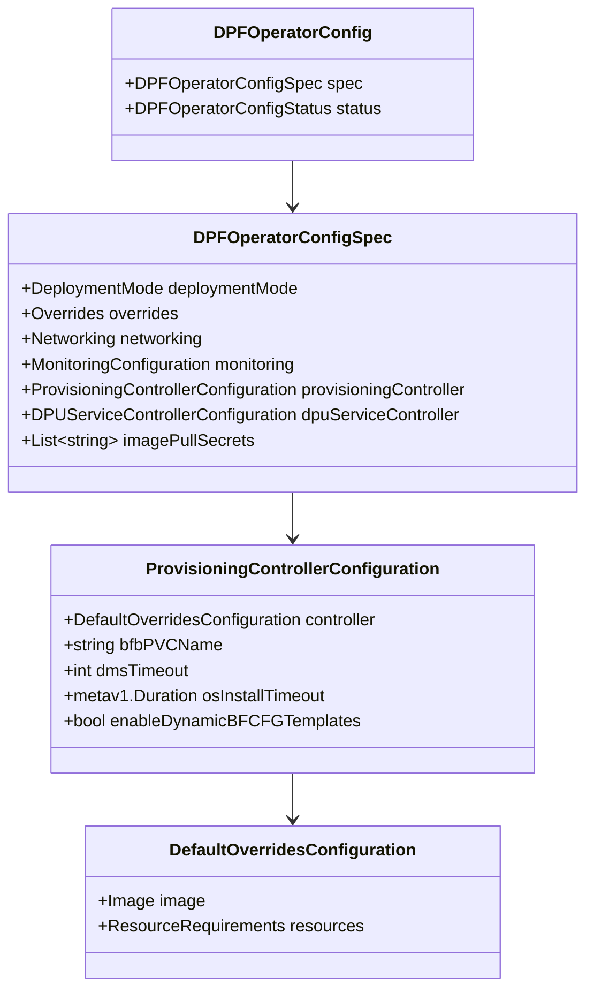
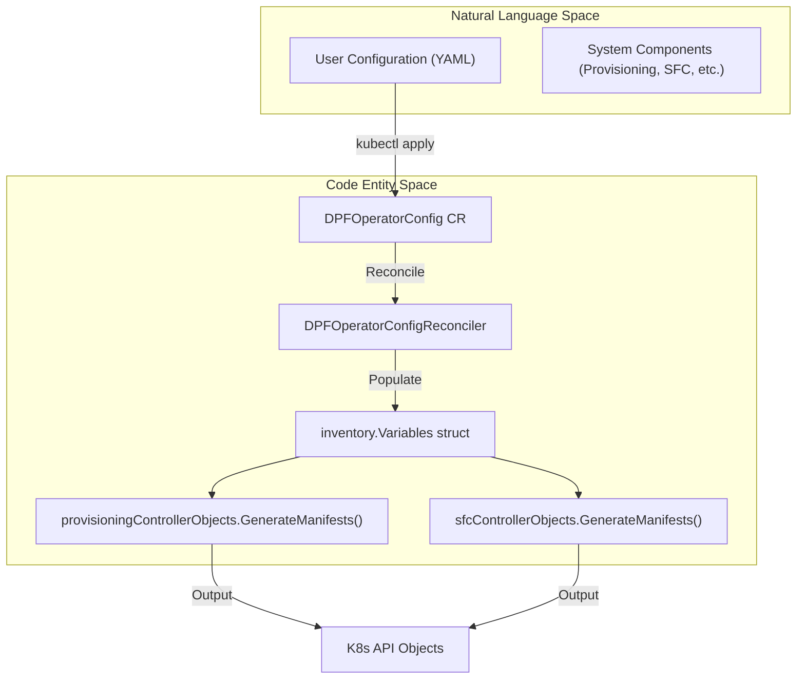

<!-- source: DeepWiki mcp.deepwiki.com · repo NVIDIA/doca-platform · page 2.1 DPFOperatorConfig CRD · fetched 2026-10-26 -->

# DPFOperatorConfig CRD

<details>
<summary>Relevant source files</summary>

The following files were used as context for generating this wiki page:

- [api/operator/v1alpha1/componentconfig_types.go](api/operator/v1alpha1/componentconfig_types.go)
- [api/operator/v1alpha1/componentconfig_types_test.go](api/operator/v1alpha1/componentconfig_types_test.go)
- [api/operator/v1alpha1/dpfoperatorconfig_types.go](api/operator/v1alpha1/dpfoperatorconfig_types.go)
- [api/operator/v1alpha1/zz_generated.deepcopy.go](api/operator/v1alpha1/zz_generated.deepcopy.go)
- [cmd/provisioning/main.go](cmd/provisioning/main.go)
- [config/dpuservice/certmanager/certificate.yaml](config/dpuservice/certmanager/certificate.yaml)
- [config/nodesriovdeviceplugin/certmanager/certificate.yaml](config/nodesriovdeviceplugin/certmanager/certificate.yaml)
- [config/operator-crds/operator.dpu.nvidia.com_dpfoperatorconfigs.yaml](config/operator-crds/operator.dpu.nvidia.com_dpfoperatorconfigs.yaml)
- [config/provisioning/certmanager/certificate.yaml](config/provisioning/certmanager/certificate.yaml)
- [deploy/charts/dpf-operator/README.md](deploy/charts/dpf-operator/README.md)
- [deploy/charts/dpf-operator/templates/certificate-authority.yaml](deploy/charts/dpf-operator/templates/certificate-authority.yaml)
- [deploy/charts/dpf-operator/templates/crds/apiextensions.k8s.io_v1_customresourcedefinition_dpfoperatorconfigs.operator.dpu.nvidia.com.yaml](deploy/charts/dpf-operator/templates/crds/apiextensions.k8s.io_v1_customresourcedefinition_dpfoperatorconfigs.operator.dpu.nvidia.com.yaml)
- [deploy/charts/dpf-operator/templates/kamaji-etcd-defrag-cronjob.yaml](deploy/charts/dpf-operator/templates/kamaji-etcd-defrag-cronjob.yaml)
- [deploy/charts/dpf-operator/values.yaml](deploy/charts/dpf-operator/values.yaml)
- [docs/public/advanced-configuration/external-certificate-authority.md](docs/public/advanced-configuration/external-certificate-authority.md)
- [docs/public/developer-guides/api/api.md](docs/public/developer-guides/api/api.md)
- [docs/public/developer-guides/api/dpfoperatorconfig.md](docs/public/developer-guides/api/dpfoperatorconfig.md)
- [internal/features/features.go](internal/features/features.go)
- [internal/operator/inventory/coredns_manifests_test.go](internal/operator/inventory/coredns_manifests_test.go)
- [internal/operator/inventory/dpu_provisioning_controller_manifests.go](internal/operator/inventory/dpu_provisioning_controller_manifests.go)
- [internal/operator/inventory/dpu_provisioning_controller_manifests_test.go](internal/operator/inventory/dpu_provisioning_controller_manifests_test.go)
- [internal/operator/inventory/dpuservice_controller_manifests.go](internal/operator/inventory/dpuservice_controller_manifests.go)
- [internal/operator/inventory/dpuservice_controller_manifests_test.go](internal/operator/inventory/dpuservice_controller_manifests_test.go)
- [internal/operator/inventory/dpuservice_per_dpucluster_manifests.go](internal/operator/inventory/dpuservice_per_dpucluster_manifests.go)
- [internal/operator/inventory/manifests/nodesriovdeviceplugin-controller.yaml](internal/operator/inventory/manifests/nodesriovdeviceplugin-controller.yaml)
- [internal/operator/inventory/variables.go](internal/operator/inventory/variables.go)
- [internal/provisioning/controllers/dpu/util/options.go](internal/provisioning/controllers/dpu/util/options.go)
- [test/apivalidation/operator_validation_test.go](test/apivalidation/operator_validation_test.go)
- [test/e2e/upgrade_artifacts_test.go](test/e2e/upgrade_artifacts_test.go)

</details>


The `DPFOperatorConfig` Custom Resource Definition (CRD) is the primary configuration interface for the DOCA Platform Framework (DPF) Operator. It defines how the operator should deploy and configure various system components that manage NVIDIA DPU hardware and networking in Kubernetes environments.

For information about the DPF Operator itself, see [Operator Controller Architecture](#2.2).

## Overview

The `DPFOperatorConfig` resource is a singleton within the DPF system namespace (typically `dpf-operator-system`). It allows users to:
1. Configure and customize DPF system components (Provisioning, Service, Networking).
2. Enable/disable individual components.
3. Override container images and resource requirements.
4. Set system-wide networking parameters (MTU, Bridge names).
5. Define the `DeploymentMode` (Zero-Trust vs Host-Trusted).


Sources: [api/operator/v1alpha1/dpfoperatorconfig_types.go:171-187](), [api/operator/v1alpha1/componentconfig_types.go:29-32](), [api/operator/v1alpha1/componentconfig_types.go:37-150]()

## Core Configuration Sections

### Deployment Mode
The `deploymentMode` field is mandatory and selects the alignment for DPU management.
*   `host-trusted`: The host is considered a trusted entity.
*   `zero-trust`: High-security mode where the DPU is isolated from the host, often utilizing Redfish/gNOI for provisioning.

Sources: [api/operator/v1alpha1/dpfoperatorconfig_types.go:185-190](), [internal/operator/inventory/variables.go:124-126]()

### Networking
Configures MTU and bridge settings for the DPF infrastructure.

| Field | Default | Description |
|-------|---------|-------------|
| `controlPlaneMTU` | 1500 | MTU for management network (e.g., DPU OOB interface). |
| `highSpeedMTU` | 1500 | MTU for high-speed data interfaces. |
| `dpuNodeOOBBridgeName` | `br-dpu` | The bridge name on host-trusted worker nodes for OOB communication. |

Sources: [api/operator/v1alpha1/dpfoperatorconfig_types.go:146-170](), [docs/public/developer-guides/api/dpfoperatorconfig.md:96-102]()

### Provisioning Controller Settings
The `ProvisioningControllerConfiguration` manages the lifecycle of DPU hardware.

*   **Timeouts**:
    *   `osInstallTimeout`: Default `60m`. Max time for OS installation in zero-trust mode.
    *   `firmwareUpdateTimeout`: Default `45m`. Max time for BF4 firmware updates.
    *   `nodeEffectRemovalTimeout`: Default `0s` (disabled). Max time for `DPUNodeMaintenance` to clear requestors.
*   **Parallelism**:
    *   `maxDPUParallelInstallations`: Default `50`. Limits concurrent DPU provisioning tasks.
*   **Storage**:
    *   `bfbPVCName`: The PersistentVolumeClaim used to store BFB images. If unset, the controller uses `hostPath` at `/var/lib/nvidia/dpf/bfb`.
*   **BFCFG Templates**:
    *   `enableDynamicBFCFGTemplates`: Enables runtime discovery of `bf.cfg` templates via ConfigMaps based on labels. Mutually exclusive with `bfCFGTemplateConfigMap`.

Sources: [api/operator/v1alpha1/componentconfig_types.go:35-36](), [api/operator/v1alpha1/componentconfig_types.go:62-66](), [api/operator/v1alpha1/componentconfig_types.go:91-152](), [cmd/provisioning/main.go:83-93](), [internal/operator/inventory/dpu_provisioning_controller_manifests.go:43-44]()

## Component Configuration Pattern

DPF uses a consistent pattern for overriding component settings. Most components (e.g., `dpuDetector`, `sfcController`, `nvipam`) follow this structure:

```yaml
spec:
  <componentName>:
    disable: false
    controller: # or 'daemon' depending on the component
      image: "my-custom-image:tag"
      resources:
        requests:
          cpu: "100m"
          memory: "128Mi"
```

### Image Overrides
The Operator enforces mutual exclusivity between legacy `image` fields and the newer `controller.image` / `daemon.image` fields via XValidation rules in the API definition.

Sources: [api/operator/v1alpha1/componentconfig_types.go:34-34](), [test/apivalidation/operator_validation_test.go:51-62]()

## System Status and Conditions

The `DPFOperatorConfigStatus` tracks the readiness of the entire DPF platform via a set of defined condition types.

| Condition Type | Description |
|----------------|-------------|
| `Ready` | Overall status of the DPF Operator configuration. |
| `PreUpgradeValidationReady` | Indicates if the system is safe to upgrade to a new version. |
| `ImagePullSecretsReconciled` | Status of propagating `imagePullSecrets` to sub-components. |
| `SystemComponentsReconciled` | Whether all enabled component manifests have been applied. |
| `SystemComponentsReady` | Whether the deployed pods for all components are currently healthy. |
| `CATrustBundleReady` | Status of the internal CA trust bundle ConfigMap maintenance. |

Sources: [api/operator/v1alpha1/dpfoperatorconfig_types.go:27-48](), [api/operator/v1alpha1/dpfoperatorconfig_types.go:207-220]()

## Implementation Data Flow

The `DPFOperatorConfig` is processed by the `DPFOperatorConfigReconciler`, which populates a `Variables` struct defined in the `inventory` package. This struct is then passed to component-specific manifest generators.



Sources: [internal/operator/inventory/variables.go:37-142](), [internal/operator/inventory/dpu_provisioning_controller_manifests.go:143-185](), [api/operator/v1alpha1/dpfoperatorconfig_types.go:171-187]()

---

