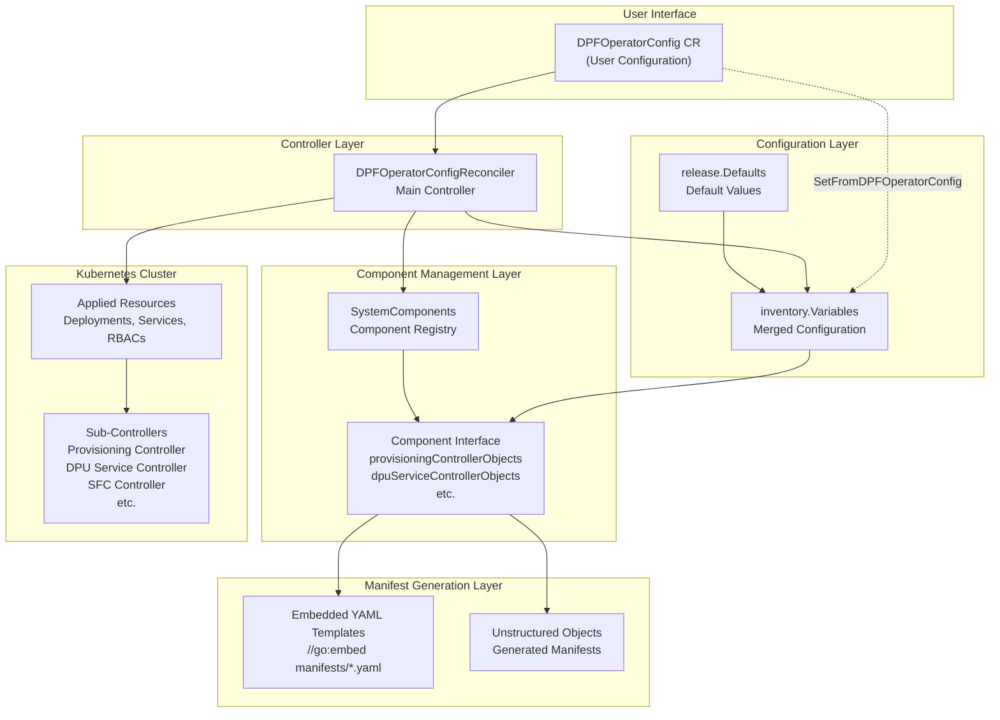
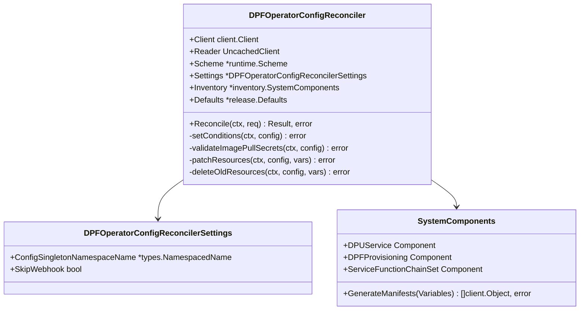
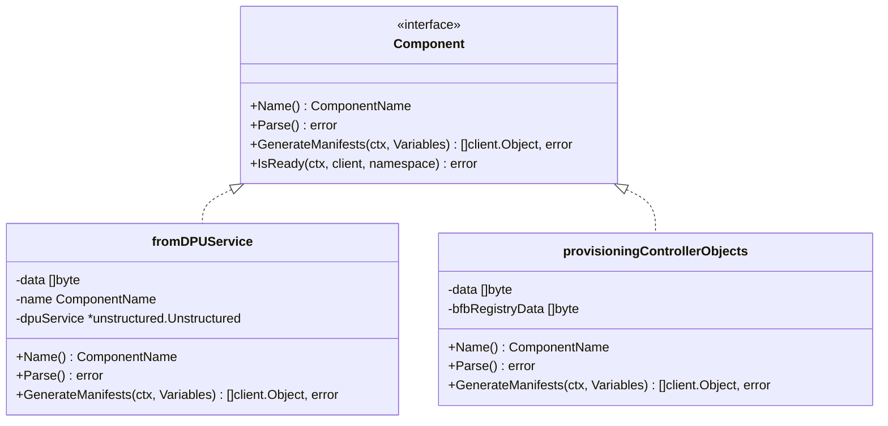
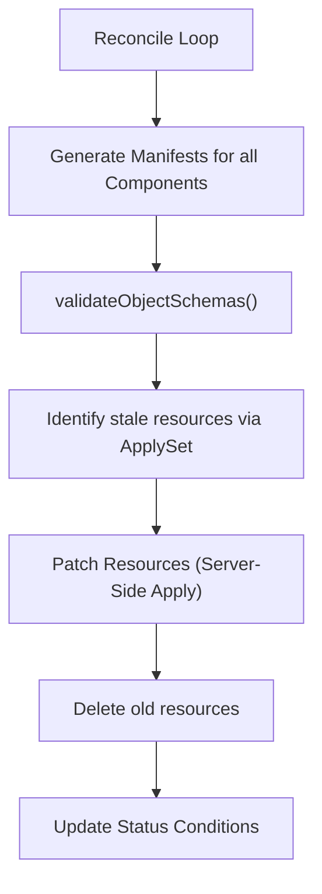

<!-- source: DeepWiki mcp.deepwiki.com · repo NVIDIA/doca-platform · page 2.2 Operator Controller Architecture · fetched 2026-10-26 -->

# Operator Controller Architecture

Relevant source files

The following files were used as context for generating this wiki page:

- [api/operator/v1alpha1/componentconfig_common.go](api/operator/v1alpha1/componentconfig_common.go)
- [cmd/kamaji-cluster-manager/main.go](cmd/kamaji-cluster-manager/main.go)
- [cmd/operator/main.go](cmd/operator/main.go)
- [cmd/servicechainset/main.go](cmd/servicechainset/main.go)
- [cmd/static-cluster-manager/main.go](cmd/static-cluster-manager/main.go)
- [cmd/storage/snap-node-driver/main.go](cmd/storage/snap-node-driver/main.go)
- [config/provisioning/rbac/role.yaml](config/provisioning/rbac/role.yaml)
- [config/provisioning/webhook/manifests.yaml](config/provisioning/webhook/manifests.yaml)
- [deploy/charts/dpf-operator/templates/role.yaml](deploy/charts/dpf-operator/templates/role.yaml)
- [deploy/charts/dpu-networking/Chart.lock](deploy/charts/dpu-networking/Chart.lock)
- [deploy/charts/dpu-networking/Chart.yaml](deploy/charts/dpu-networking/Chart.yaml)
- [deploy/charts/dpu-networking/README.md](deploy/charts/dpu-networking/README.md)
- [deploy/charts/dpu-networking/values.yaml](deploy/charts/dpu-networking/values.yaml)
- [internal/operator/controllers/ca_trust_bundle.go](internal/operator/controllers/ca_trust_bundle.go)
- [internal/operator/controllers/ca_trust_bundle_test.go](internal/operator/controllers/ca_trust_bundle_test.go)
- [internal/operator/controllers/dpfoperatorconfig_controller.go](internal/operator/controllers/dpfoperatorconfig_controller.go)
- [internal/operator/controllers/dpfoperatorconfig_controller_test.go](internal/operator/controllers/dpfoperatorconfig_controller_test.go)
- [internal/operator/controllers/object_schema_validation_test.go](internal/operator/controllers/object_schema_validation_test.go)
- [internal/operator/controllers/reconcile_delete.go](internal/operator/controllers/reconcile_delete.go)
- [internal/operator/controllers/reconcile_delete_test.go](internal/operator/controllers/reconcile_delete_test.go)
- [internal/operator/inventory/component_versions.go](internal/operator/inventory/component_versions.go)
- [internal/operator/inventory/dpuservice_per_dpucluster_manifests_test.go](internal/operator/inventory/dpuservice_per_dpucluster_manifests_test.go)
- [internal/operator/inventory/from_dpu_service_manifests.go](internal/operator/inventory/from_dpu_service_manifests.go)
- [internal/operator/inventory/from_dpu_service_manifests_test.go](internal/operator/inventory/from_dpu_service_manifests_test.go)
- [internal/operator/inventory/inventory.go](internal/operator/inventory/inventory.go)
- [internal/operator/inventory/manifests/provisioning-controller.yaml](internal/operator/inventory/manifests/provisioning-controller.yaml)
- [internal/operator/inventory/sfc_controller_manifests.go](internal/operator/inventory/sfc_controller_manifests.go)
- [internal/operator/inventory/sfc_controller_manifests_test.go](internal/operator/inventory/sfc_controller_manifests_test.go)
- [internal/operator/utils/validation.go](internal/operator/utils/validation.go)
- [internal/operator/utils/validation_test.go](internal/operator/utils/validation_test.go)
- [internal/provisioning/bfbregistry/bfb_registry_creator.go](internal/provisioning/bfbregistry/bfb_registry_creator.go)
- [internal/provisioning/bfbregistry/bfb_registry_creator_test.go](internal/provisioning/bfbregistry/bfb_registry_creator_test.go)
- [internal/provisioning/controllers/dpu/dpu_controller.go](internal/provisioning/controllers/dpu/dpu_controller.go)
- [internal/provisioning/webhooks/dpudiscovery_webhook.go](internal/provisioning/webhooks/dpudiscovery_webhook.go)
- [internal/provisioning/webhooks/dpudiscovery_webhook_test.go](internal/provisioning/webhooks/dpudiscovery_webhook_test.go)
- [internal/provisioning/webhooks/suite_test.go](internal/provisioning/webhooks/suite_test.go)
- [internal/release/version.go](internal/release/version.go)

## Purpose and Scope

This document describes the internal architecture of the DPF Operator controller, specifically the `DPFOperatorConfigReconciler` and its associated systems. It covers how the operator processes the `DPFOperatorConfig` custom resource, manages configuration through the `Variables` struct, generates Kubernetes manifests from embedded templates, and deploys sub-controllers like the Provisioning Controller and DPU Service Controller.

For details about the `DPFOperatorConfig` CRD structure and configuration options, see [DPFOperatorConfig CRD](#2.1).

## Architecture Overview

The DPF Operator follows a hierarchical controller pattern where a central `DPFOperatorConfigReconciler` manages the lifecycle of multiple sub-controllers. The architecture consists of four main layers:

Title: DPF Operator Architecture Layers

**Sources:** [internal/operator/controllers/dpfoperatorconfig_controller.go:77-84](), [internal/operator/inventory/variables.go:102-179]()

## DPFOperatorConfigReconciler

### Core Structure

The `DPFOperatorConfigReconciler` is the main controller responsible for reconciling `DPFOperatorConfig` resources. Its structure is defined as:

Title: DPFOperatorConfigReconciler Code Entities

The controller restricts reconciliation to a single `DPFOperatorConfig` instance identified by the `ConfigSingletonNamespaceName` setting, which defaults to `dpfoperatorconfig` in the `dpf-operator-system` namespace.

**Sources:** [internal/operator/controllers/dpfoperatorconfig_controller.go:57-61](), [internal/operator/controllers/dpfoperatorconfig_controller.go:77-84](), [internal/operator/controllers/dpfoperatorconfig_controller.go:87-94]()

### Reconciliation Entry Point

The `Reconcile` function implements the main control loop. It handles the lifecycle of all system components by transforming the `DPFOperatorConfig` spec into a set of `Variables` which are then passed to the `Inventory` to generate the final manifests.

Key responsibilities during reconciliation:
1. **Singleton Validation**: Ensures only the designated singleton config is reconciled.
2. **Secret Validation**: Verifies all referenced `imagePullSecrets` exist.
3. **Variables Construction**: Builds merged configuration from defaults and user spec.
4. **Manifest Generation**: Generates Kubernetes manifests for all enabled components.
5. **Resource Application**: Applies manifests using server-side apply with `ForceOwnership`.
6. **Status Management**: Updates condition status to reflect current state.

**Sources:** [internal/operator/controllers/dpfoperatorconfig_controller.go:57-61](), [internal/operator/controllers/dpfoperatorconfig_controller.go:73]()

## Variables System

### Variables Structure

The `Variables` struct serves as the central configuration aggregator, merging default values with user-provided configuration. It acts as the source of truth for the manifest generation pipeline.

| Field Category | Purpose |
|----------------|---------|
| **DPU Cluster Config** | DPU cluster configurations tracked via `DPUClusters []*dpucluster.Config`. |
| **Path Configuration** | File system paths on DPU nodes (e.g., `DPUCNIBinPath`, `DPUOpenvSwitchRunPath`). |
| **Component Control** | Enable/disable components via `DisableSystemComponents map[ComponentName]bool`. |
| **Image Configuration** | Container images per component/container via `Images map[string]string`. |
| **Resource Configuration** | CPU/memory resource requirements via `Resources map[string]corev1.ResourceRequirements`. |
| **Replica Configuration** | Replica counts for controllers via `Replicas map[string]*int32`. |
| **Helm Configuration** | Helm chart URLs via `HelmCharts map[ComponentName]string`. |
| **Network Configuration** | MTU and network settings via `Networking`. |

**Sources:** [internal/operator/inventory/variables.go:102-179]()

### Variables Construction Flow

The `SetFromDPFOperatorConfig` function processes the user configuration and updates the `Variables` struct. It handles:
- **Global Overrides**: Applying global image overrides from `Spec.Overrides.Images`.
- **Component Specifics**: Extracting replicas, images, and resource requirements for components like `ProvisioningController` or `DPUServiceController`.
- **System Settings**: Mapping networking settings (MTU) and storage settings (PVC names) to the `Variables` struct.

**Sources:** [internal/operator/inventory/variables.go:181-426]()

## Manifest Generation Pipeline

### Component Interface

All system components implement the `Component` interface, which defines the contract for manifest generation:

Title: Component Interface Hierarchy

**Sources:** [internal/operator/inventory/inventory.go:30-53](), [internal/operator/inventory/from_dpu_service_manifests.go:44-49](), [internal/operator/inventory/provisioning_controller_manifests.go:35-42]()

### Manifest Generation Process

The generation process involves taking embedded YAML templates and applying "Edits" (mutations) based on the `Variables`.

1. **Parsing**: Embedded YAML is converted to `unstructured.Unstructured` objects.
2. **Filtering**: If a component is marked as disabled in `Variables.DisableSystemComponents`, no manifests are generated.
3. **Mutation**:
    - **Namespace**: Objects are moved to the target namespace.
    - **Labels**: Standard DPF labels and versioning labels are added.
    - **Images/Resources**: Deployment/DaemonSet containers are updated using `helmPathsProvider` to find the correct JSON paths in the manifests.
    - **Helm Values**: For `DPUService` objects, specific values (like `enabled: true`) are injected into the `.spec.helmChart.values`.
    - **SPIFFE**: Request workload identity if `SpiffeEnabled` is set for eligible components.

**Sources:** [internal/operator/inventory/from_dpu_service_manifests.go:80-89](), [internal/operator/inventory/from_dpu_service_manifests.go:94-117](), [internal/operator/inventory/from_dpu_service_manifests.go:119-137]()

### System Components and Sub-Controllers

The operator manages several sub-controllers and system services. Some are deployed once per management cluster, while others are instantiated per DPU cluster.

| Component | Management Mode | Role |
|-----------|-----------------|------|
| `ProvisioningController` | Single | Manages DPU lifecycle and BFB installation. |
| `DPUServiceController` | Single | Orchestrates DPU services via ArgoCD. |
| `SFCController` | Single | Manages Service Function Chains. |
| `SRIOVDevicePlugin` | Per DPU Cluster | Manages SR-IOV device plugin on DPU nodes. |
| `NVIPAMController` | Per DPU Cluster | Manages IP allocation for DPU services. |

**Sources:** [internal/operator/inventory/from_dpu_service_manifests.go:51-67](), [internal/operator/inventory/inventory.go:83-107]()

## Reconciliation Flow

### Server-Side Apply Strategy

The operator uses Kubernetes Server-Side Apply to manage resources. This ensures that the operator "owns" specific fields and can safely update them without interfering with other controllers or manual changes, while also being able to "force" state when necessary.

Title: DPF Resource Reconciliation Logic

The reconciler uses `client.ForceOwnership` and a specific field owner name `dpfoperatorconfig-controller`.

**Sources:** [internal/operator/controllers/dpfoperatorconfig_controller.go:69-74](), [internal/operator/controllers/object_schema_validation.go:37-65]()

### Condition Management

The operator maintains the health of the DPF system through a set of conditions on the `DPFOperatorConfig` status:

- **Ready**: Overall system readiness.
- **SystemComponentsReconciled**: Whether manifests were successfully generated and applied.
- **ImagePullSecretsReconciled**: Whether all referenced secrets exist.
- **PreUpgradeValidationReady**: Ensures the system is in a safe state for upgrades.
- **CATrustBundleReady**: Tracks the status of CA trust bundles for secure communication.

**Sources:** [internal/operator/controllers/dpfoperatorconfig_controller.go:151-185](), [internal/operator/controllers/dpfoperatorconfig_controller_test.go:154-162]()

---

