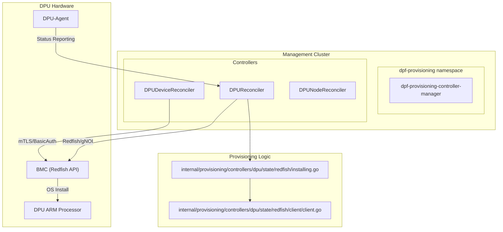
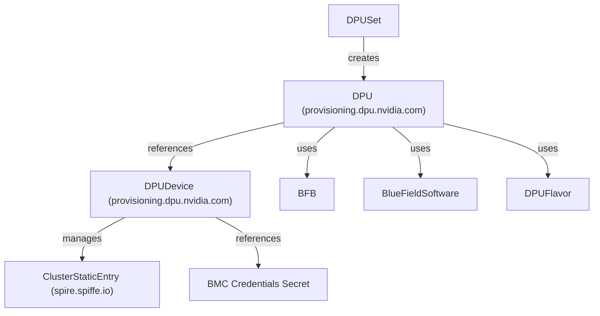

<!-- source: DeepWiki mcp.deepwiki.com · repo NVIDIA/doca-platform · page 3 Provisioning System · fetched 2026-10-26 -->

# Provisioning System

Relevant source files

The following files were used as context for generating this wiki page:

- [api/provisioning/v1alpha1/dpu_types.go](api/provisioning/v1alpha1/dpu_types.go)
- [api/provisioning/v1alpha1/dpudevice_types.go](api/provisioning/v1alpha1/dpudevice_types.go)
- [api/provisioning/v1alpha1/zz_generated.deepcopy.go](api/provisioning/v1alpha1/zz_generated.deepcopy.go)
- [config/provisioning/crd/bases/provisioning.dpu.nvidia.com_dpudevices.yaml](config/provisioning/crd/bases/provisioning.dpu.nvidia.com_dpudevices.yaml)
- [config/provisioning/crd/bases/provisioning.dpu.nvidia.com_dpus.yaml](config/provisioning/crd/bases/provisioning.dpu.nvidia.com_dpus.yaml)
- [deploy/charts/dpf-operator/templates/crds/apiextensions.k8s.io_v1_customresourcedefinition_dpudevices.provisioning.dpu.nvidia.com.yaml](deploy/charts/dpf-operator/templates/crds/apiextensions.k8s.io_v1_customresourcedefinition_dpudevices.provisioning.dpu.nvidia.com.yaml)
- [deploy/charts/dpf-operator/templates/crds/apiextensions.k8s.io_v1_customresourcedefinition_dpus.provisioning.dpu.nvidia.com.yaml](deploy/charts/dpf-operator/templates/crds/apiextensions.k8s.io_v1_customresourcedefinition_dpus.provisioning.dpu.nvidia.com.yaml)
- [docs/public/advanced-configuration/per-dpu-bmc-credentials.md](docs/public/advanced-configuration/per-dpu-bmc-credentials.md)
- [internal/provisioning/controllers/dpu/state/rebooting_test.go](internal/provisioning/controllers/dpu/state/rebooting_test.go)
- [internal/provisioning/controllers/dpu/state/redfish/client/client.go](internal/provisioning/controllers/dpu/state/redfish/client/client.go)
- [internal/provisioning/controllers/dpu/state/redfish/diag/diag.go](internal/provisioning/controllers/dpu/state/redfish/diag/diag.go)
- [internal/provisioning/controllers/dpu/state/redfish/diag/diag_test.go](internal/provisioning/controllers/dpu/state/redfish/diag/diag_test.go)
- [internal/provisioning/controllers/dpu/state/redfish/firmware_update.go](internal/provisioning/controllers/dpu/state/redfish/firmware_update.go)
- [internal/provisioning/controllers/dpu/state/redfish/firmware_update_test.go](internal/provisioning/controllers/dpu/state/redfish/firmware_update_test.go)
- [internal/provisioning/controllers/dpu/state/redfish/installing.go](internal/provisioning/controllers/dpu/state/redfish/installing.go)
- [internal/provisioning/controllers/dpu/state/redfish/installing_test.go](internal/provisioning/controllers/dpu/state/redfish/installing_test.go)
- [internal/provisioning/controllers/dpu/state/redfish/mock/redfish.go](internal/provisioning/controllers/dpu/state/redfish/mock/redfish.go)
- [internal/provisioning/controllers/dpu/state/redfish/mock/redfish_test.go](internal/provisioning/controllers/dpu/state/redfish/mock/redfish_test.go)
- [internal/provisioning/controllers/dpu/util/reboot_helpers.go](internal/provisioning/controllers/dpu/util/reboot_helpers.go)
- [internal/provisioning/controllers/dpudevice/dpudevice_controller.go](internal/provisioning/controllers/dpudevice/dpudevice_controller.go)
- [internal/provisioning/controllers/dpudevice/dpudevice_controller_test.go](internal/provisioning/controllers/dpudevice/dpudevice_controller_test.go)

The Provisioning System manages the complete lifecycle of DPU (Data Processing Unit) hardware from initial discovery through operational readiness. It orchestrates multi-phase provisioning workflows, firmware installation, cluster join operations, and node maintenance coordination across diverse DPU hardware platforms.

The system supports three installation interfaces—gNOI, Redfish, and HostAgent—each optimized for different deployment environments and security models. It coordinates with the DPF Operator for configuration management and integrates with DPU cluster management for tenant isolation.

For detailed coverage of specific subsystems, see:
- [DPUSet and DPU Lifecycle Management](#3.1) — Document the DPUSet controller's reconciliation logic, DPU selection via label selectors, revision management with rolling updates, and the complete DPU state machine from Initializing to Ready
- [BFB (BlueField Bundle) Management](#3.2) — Explain the BFB registry service, how BFB images are served over HTTP, BFCFG file generation, and the BFB installation flow via different interfaces
- [Host Agent Implementation](#3.3) — Detail the host agent's architecture, its dual-container design (DMS and hostagent), communication via gNMI, and deployment in both Kubernetes and non-Kubernetes environments
- [DPUFlavor and DPUFlavorTemplate Configuration Profiles](#3.4) — Document the DPUFlavor CRD structure including GRUB parameters, nvconfig settings for SR-IOV/VFs, OVS bridge configurations, system files, and how flavors are applied during provisioning. Also document the DPUFlavorTemplate CRD for per-DPU flavor rendering from Go templates using DPUDevice.spec.values, including the dpfctl flavor-template render command.
- [DPUNode and DPUNodeMaintenance](#3.5) — Explain the DPUNode controller's management of physical hosts, reboot orchestration (external, script, gNOI), node maintenance coordination, and the DPUNodeMaintenance resource for applying node effects
- [DPU Installation State Handlers](#3.6) — Document the state-specific handlers for DPU provisioning phases, particularly the Redfish installing state with task submission/monitoring and timeout handling
- [DPU Agent Operations](#3.7) — Document the DPU-side agent's sequential operation pipeline, including NVConfig management, Sub-Function creation, kubelet configuration, reboot logic, and status reporting back to the management cluster
- [BlueField Software and BF4 Provisioning](#3.8) — Explain the BlueFieldSoftware CRD for BF4 devices, PLDM firmware bundle management, ISO-based installation via Virtual Media, and the firmware version enforcement workflow

## Architecture Overview

**Provisioning Controller Deployment**

The provisioning controller runs as a high-availability deployment in the management cluster. It manages multiple resource controllers and webhooks, utilizing a state machine to transition DPUs through provisioning phases [api/provisioning/v1alpha1/dpu_types.go:47-95]().

**Sources:** [api/provisioning/v1alpha1/dpu_types.go:47-95](), [internal/provisioning/controllers/dpu/state/redfish/client/client.go:48-118](), [internal/provisioning/controllers/dpu/state/redfish/installing.go:48-139]()

## Resource Hierarchy

**Resource Relationships and Ownership**

The system manages the DPU lifecycle through several layers of Custom Resources. `DPUDevice` represents the physical hardware and its BMC connectivity, while `DPU` represents the logical provisioning instance [api/provisioning/v1alpha1/dpudevice_types.go:29-56]().

**Key Resources:**

| Resource | Purpose | Controller |
|----------|---------|------------|
| `DPUDevice` | Physical DPU hardware identity, BMC address, and mTLS cert status [api/provisioning/v1alpha1/dpudevice_types.go:62-88]() | `DPUDeviceReconciler` |
| `DPU` | Orchestrates the provisioning state machine (Initializing -> Ready) [api/provisioning/v1alpha1/dpu_types.go:51-95]() | `DPUReconciler` |
| `BlueFieldSoftware` | Manages PLDM firmware bundles for BF4 devices [internal/provisioning/controllers/dpu/state/redfish/firmware_update.go:58-73]() | `BlueFieldSoftwareReconciler` |
| `DPUFlavor` | Configuration profile for networking and system settings [api/provisioning/v1alpha1/dpu_types.go:104-105]() | N/A (Static/Template) |

**Sources:** [api/provisioning/v1alpha1/dpudevice_types.go:29-88](), [api/provisioning/v1alpha1/dpu_types.go:51-129](), [internal/provisioning/controllers/dpudevice/dpudevice_controller.go:102-144]()

## Multi-Phase Provisioning Lifecycle

The DPU provisioning lifecycle progresses through distinct phases, each handled by specialized state handlers. The system persists state in the `DPU` resource status [api/provisioning/v1alpha1/dpu_types.go:47-95]().

**Phase Enumeration:**

| Phase | Description |
|-------|-------------|
| `Initializing` | First phase after DPU creation [api/provisioning/v1alpha1/dpu_types.go:58]() |
| `Update Firmware` | Updates DPU firmware for BlueField4 using PLDM bundles [api/provisioning/v1alpha1/dpu_types.go:66]() |
| `OS Installing` | Provisions the DPU OS (BFB) through Redfish or gNOI [api/provisioning/v1alpha1/dpu_types.go:73]() |
| `DPU Config` | DPU agent configures local system settings (nvconfig, OVS) [api/provisioning/v1alpha1/dpu_types.go:68]() |
| `Service Readiness`| Blocks until DPU services are healthy and ready for traffic [api/provisioning/v1alpha1/dpu_types.go:79]() |
| `Ready` | DPU is fully operational [api/provisioning/v1alpha1/dpu_types.go:86]() |

**Sources:** [api/provisioning/v1alpha1/dpu_types.go:47-95](), [internal/provisioning/controllers/dpu/state/redfish/installing.go:48-139]()

## Installation Interfaces

The provisioning system primarily utilizes Redfish for modern DPU hardware management, supporting both BlueField-3 and BlueField-4 [internal/provisioning/controllers/dpu/state/redfish/client/client.go:116-128]().

| Interface | Communication | Key Feature |
|-----------|---------------|-------------|
| **Redfish** | HTTPS to BMC | Supports `SimpleUpdate` for BFBs and PLDM for firmware [internal/provisioning/controllers/dpu/state/redfish/client/client.go:60-78]() |
| **mTLS** | Certificate-based | Secure BMC communication using `dpf-provisioning-redfish-client-secret` [internal/provisioning/controllers/dpu/state/redfish/client/client.go:112-117]() |
| **Virtual Media** | ISO Mounting | Used for BF4 OS installation via `InsertMedia` [internal/provisioning/controllers/dpu/state/redfish/client/client.go:61-63]() |

**Sources:** [internal/provisioning/controllers/dpu/state/redfish/client/client.go:48-128](), [internal/provisioning/controllers/dpu/state/redfish/installing.go:88-104]()

## Security and Identity

Provisioning enforces a zero-trust model by managing BMC credentials and SPIFFE identities.

- **BMC Credentials:** The `DPUDevice` controller manages per-device secrets and handles BMC factory resets [api/provisioning/v1alpha1/dpudevice_types.go:35-37]().
- **SPIFFE Identity:** The `SPIFFEDeregistrationFinalizer` ensures that DPU identities in SPIRE are cleaned up before a device is decommissioned [api/provisioning/v1alpha1/dpudevice_types.go:43-47]().
- **Certificate Rotation:** The system automatically rotates BMC mTLS server certificates using `cert-manager` integration [internal/provisioning/controllers/dpudevice/dpudevice_controller.go:78-90]().

**Sources:** [api/provisioning/v1alpha1/dpudevice_types.go:32-56](), [internal/provisioning/controllers/dpudevice/dpudevice_controller.go:146-168]()

---

