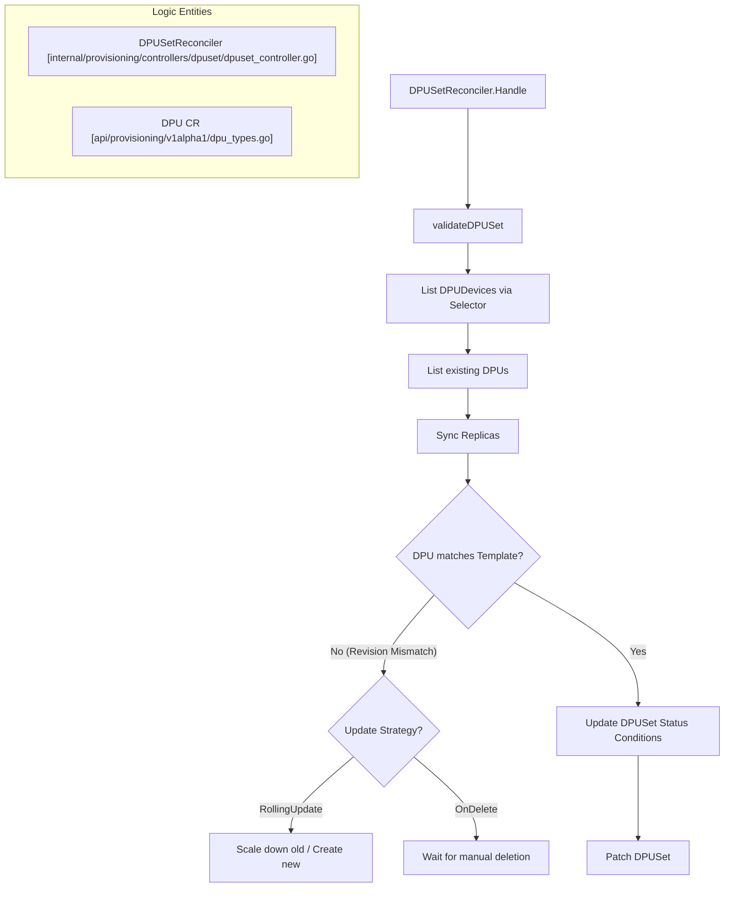
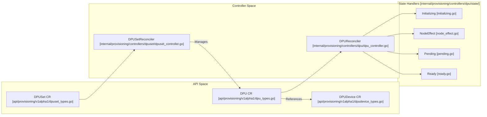

<!-- source: DeepWiki mcp.deepwiki.com · repo NVIDIA/doca-platform · page 3.1 DPUSet and DPU Lifecycle Management · fetched 2026-10-26 -->

# 3.1 DPUSet and DPU Lifecycle Management

Relevant source files

The following files were used as context for generating this wiki page:

- [api/provisioning/v1alpha1/dpu_types.go](api/provisioning/v1alpha1/dpu_types.go)
- [api/provisioning/v1alpha1/dpudevice_types.go](api/provisioning/v1alpha1/dpudevice_types.go)
- [api/provisioning/v1alpha1/dpuset_types.go](api/provisioning/v1alpha1/dpuset_types.go)
- [api/provisioning/v1alpha1/zz_generated.deepcopy.go](api/provisioning/v1alpha1/zz_generated.deepcopy.go)
- [config/provisioning/crd/bases/provisioning.dpu.nvidia.com_dpudevices.yaml](config/provisioning/crd/bases/provisioning.dpu.nvidia.com_dpudevices.yaml)
- [config/provisioning/crd/bases/provisioning.dpu.nvidia.com_dpus.yaml](config/provisioning/crd/bases/provisioning.dpu.nvidia.com_dpus.yaml)
- [config/provisioning/crd/bases/provisioning.dpu.nvidia.com_dpusets.yaml](config/provisioning/crd/bases/provisioning.dpu.nvidia.com_dpusets.yaml)
- [deploy/charts/dpf-operator/templates/crds/apiextensions.k8s.io_v1_customresourcedefinition_dpudevices.provisioning.dpu.nvidia.com.yaml](deploy/charts/dpf-operator/templates/crds/apiextensions.k8s.io_v1_customresourcedefinition_dpudevices.provisioning.dpu.nvidia.com.yaml)
- [deploy/charts/dpf-operator/templates/crds/apiextensions.k8s.io_v1_customresourcedefinition_dpus.provisioning.dpu.nvidia.com.yaml](deploy/charts/dpf-operator/templates/crds/apiextensions.k8s.io_v1_customresourcedefinition_dpus.provisioning.dpu.nvidia.com.yaml)
- [deploy/charts/dpf-operator/templates/crds/apiextensions.k8s.io_v1_customresourcedefinition_dpusets.provisioning.dpu.nvidia.com.yaml](deploy/charts/dpf-operator/templates/crds/apiextensions.k8s.io_v1_customresourcedefinition_dpusets.provisioning.dpu.nvidia.com.yaml)
- [internal/provisioning/controllers/bluefieldsoftware/bluefieldsoftware_controller.go](internal/provisioning/controllers/bluefieldsoftware/bluefieldsoftware_controller.go)
- [internal/provisioning/controllers/dpu/state/initializing.go](internal/provisioning/controllers/dpu/state/initializing.go)
- [internal/provisioning/controllers/dpu/state/initializing_test.go](internal/provisioning/controllers/dpu/state/initializing_test.go)
- [internal/provisioning/controllers/dpu/state/node_effect.go](internal/provisioning/controllers/dpu/state/node_effect.go)
- [internal/provisioning/controllers/dpu/state/node_effect_removal.go](internal/provisioning/controllers/dpu/state/node_effect_removal.go)
- [internal/provisioning/controllers/dpu/state/node_effect_removal_test.go](internal/provisioning/controllers/dpu/state/node_effect_removal_test.go)
- [internal/provisioning/controllers/dpu/state/node_effect_test.go](internal/provisioning/controllers/dpu/state/node_effect_test.go)
- [internal/provisioning/controllers/dpu/state/pending.go](internal/provisioning/controllers/dpu/state/pending.go)
- [internal/provisioning/controllers/dpu/state/pending_test.go](internal/provisioning/controllers/dpu/state/pending_test.go)
- [internal/provisioning/controllers/dpu/state/ready.go](internal/provisioning/controllers/dpu/state/ready.go)
- [internal/provisioning/controllers/dpu/state/ready_test.go](internal/provisioning/controllers/dpu/state/ready_test.go)
- [internal/provisioning/controllers/dpuset/dpuset_controller.go](internal/provisioning/controllers/dpuset/dpuset_controller.go)
- [internal/provisioning/controllers/dpuset/dpuset_controller_test.go](internal/provisioning/controllers/dpuset/dpuset_controller_test.go)
- [internal/provisioning/controllers/dpuset_controller_test.go](internal/provisioning/controllers/dpuset_controller_test.go)
- [internal/provisioning/controllers/util/dpu_agent_bootstrap.go](internal/provisioning/controllers/util/dpu_agent_bootstrap.go)
- [internal/provisioning/controllers/util/dpu_agent_bootstrap_test.go](internal/provisioning/controllers/util/dpu_agent_bootstrap_test.go)
- [internal/provisioning/dpuagent/operations/hostosinit/hostosinit_test.go](internal/provisioning/dpuagent/operations/hostosinit/hostosinit_test.go)
- [internal/provisioning/dpuagent/operations/nvconfig/resolve.go](internal/provisioning/dpuagent/operations/nvconfig/resolve.go)
- [internal/provisioning/webhooks/dpu_test.go](internal/provisioning/webhooks/dpu_test.go)
- [internal/provisioning/webhooks/dpuset_webhook.go](internal/provisioning/webhooks/dpuset_webhook.go)
- [internal/provisioning/webhooks/dpuset_webhook_test.go](internal/provisioning/webhooks/dpuset_webhook_test.go)

This document details the reconciliation logic and state machine transitions for the `DPUSet` and `DPU` resources. These controllers are responsible for orchestrating the end-to-end provisioning of BlueField DPUs, from hardware selection to a "Ready" state within a Kubernetes cluster.

## DPUSet Controller

The `DPUSet` controller ([internal/provisioning/controllers/dpuset/dpuset_controller.go:65-70]()) acts as a higher-level orchestrator, similar to a Kubernetes `Deployment`. It manages a collection of `DPU` resources based on a template and ensures the desired state is maintained across a fleet of devices.

### DPU Selection and Targeting
A `DPUSet` identifies which physical devices it should manage using label selectors. It targets `DPUDevice` resources, which represent the physical hardware discovered on the hosts.

*   **`dpuDeviceSelector`**: Defines the selector for `DPUDevices` that the `DPUSet` should target to create a corresponding `DPU` CR ([api/provisioning/v1alpha1/dpuset_types.go:50-52]()).
*   **`dpuNodeSelector`**: Selects `DPUNodes` (physical hosts) with specific labels ([api/provisioning/v1alpha1/dpuset_types.go:97-98]()).
*   **`dpuSelector`**: (Deprecated) Legacy field for selecting DPUs by labels ([api/provisioning/v1alpha1/dpuset_types.go:143-150]()).

### Revision Management and Rolling Updates
The `DPUSet` controller supports two strategies for updating DPUs when the `DPUTemplate` changes ([api/provisioning/v1alpha1/dpuset_types.go:78-90]()):

1.  **`OnDelete`**: A new `DPU` CR is only created when the user manually deletes the old `DPU` CR ([api/provisioning/v1alpha1/dpuset_types.go:85-86]()).
2.  **`RollingUpdate`**: Gradually scales down old DPUs and scales up new ones to minimize disruption ([api/provisioning/v1alpha1/dpuset_types.go:88-89]()).

The controller calculates a **template digest** ([internal/provisioning/controllers/dpuset/dpuset_controller.go:27]()) to detect changes in the specification. When a change is detected, it manages the transition according to the chosen strategy.

### DPUSet Reconciliation Flow

Sources: [internal/provisioning/controllers/dpuset/dpuset_controller.go:80-112](), [api/provisioning/v1alpha1/dpuset_types.go:78-100]()

## DPU Lifecycle and State Machine

The `DPU` controller manages the lifecycle of a single device. The status of a DPU is represented by the `DPUPhase` ([api/provisioning/v1alpha1/dpu_types.go:48]()).

### Phase Transitions
The DPU moves through a series of sequential phases to reach readiness:

| Phase | Description |
| :--- | :--- |
| `Initializing` | Initial state after CR creation. Validates prerequisites like `DPUDevice` and `DPUNode` existence ([api/provisioning/v1alpha1/dpu_types.go:58]()). |
| `Node Effect` | Applies taints, drains, or labels to the host node via `DPUNodeMaintenance` ([api/provisioning/v1alpha1/dpu_types.go:60]()). |
| `Pending` | Waiting for external resources like BFB images or `BlueFieldSoftware` to be ready ([api/provisioning/v1alpha1/dpu_types.go:62]()). |
| `Update Firmware` | Specifically for BlueField4, handles firmware bundle updates ([api/provisioning/v1alpha1/dpu_types.go:65-66]()). |
| `Prepare BFB` | Preparing the BFB and `bf.cfg` configuration files ([api/provisioning/v1alpha1/dpu_types.go:63-64]()). |
| `Initialize Interface` | Setting up Redfish accounts or DMS pods for communication ([api/provisioning/v1alpha1/dpu_types.go:71-72]()). |
| `OS Installing` | The actual flashing of the DPU OS/Firmware via gNOI or Redfish ([api/provisioning/v1alpha1/dpu_types.go:73-74]()). |
| `DPU Config` | DPU Agent configures internal settings such as NVConfig ([api/provisioning/v1alpha1/dpu_types.go:67-68]()). |
| `DPU Cluster Config` | Joining the DPU to the target Kubernetes cluster ([api/provisioning/v1alpha1/dpu_types.go:75-76]()). |
| `Service Readiness` | Waits for DPU services to become ready and releases host OS init holds ([api/provisioning/v1alpha1/dpu_types.go:79-82]()). |
| `Ready` | DPU is fully provisioned and operational ([api/provisioning/v1alpha1/dpu_types.go:85-86]()). |

Sources: [api/provisioning/v1alpha1/dpu_types.go:51-95]()

### Node Effect Logic
Before provisioning, the DPU controller often needs to evacuate or mark the host node to prevent workloads from being disrupted by DPU reboots. This is handled by the `NodeEffect` handler ([internal/provisioning/controllers/dpu/state/node_effect.go:35]()).

*   It creates a `DPUNodeMaintenance` object ([internal/provisioning/controllers/dpu/state/node_effect.go:80-85]()).
*   It supports various actions: `Drain`, `Taint`, `CustomLabel`, `CustomAction`, and `Hold` ([api/provisioning/v1alpha1/dpuset_types.go:35-42]()).
*   It waits for the maintenance to be applied before transitioning to the next phase ([internal/provisioning/controllers/dpu/state/node_effect.go:116-125]()).

### DPU Operational Readiness
Beyond the provisioning phases, the DPF tracks "Operational Readiness" via `DPUOperationalConditionType` ([api/provisioning/v1alpha1/dpu_types.go:132-136]()). These conditions monitor the health of the DPU after it has joined the cluster:
*   `DPUOperationalCondReady`: Summary condition for overall readiness ([api/provisioning/v1alpha1/dpu_types.go:135-136]()).
*   `DPUOperationalCondNodeProblemsReady`: Monitors host node problems via node-problem-detector ([api/provisioning/v1alpha1/dpu_types.go:137-138]()).

Sources: [api/provisioning/v1alpha1/dpu_types.go:131-150]()

## Code Entity Mapping

The following diagram bridges the high-level lifecycle concepts to the specific implementation classes and state handlers in the codebase.

Sources: [internal/provisioning/controllers/dpuset/dpuset_controller.go:65](), [api/provisioning/v1alpha1/dpu_types.go:28](), [internal/provisioning/controllers/dpu/state/node_effect.go:35](), [api/provisioning/v1alpha1/dpudevice_types.go:30]()

## Key Implementation Details

### Finalizers and Protection
To ensure clean teardown, the DPU uses `provisioning.dpu.nvidia.com/dpu-protection` ([api/provisioning/v1alpha1/dpu_types.go:52]()) and the DPUSet uses `provisioning.dpu.nvidia.com/dpuset-protection` ([api/provisioning/v1alpha1/dpuset_types.go:83]()). 

`DPUDevice` also uses a protection finalizer to prevent deletion while a DPU is actively using the hardware ([api/provisioning/v1alpha1/dpudevice_types.go:33]()).

### Revision Management
The `DPUSet` controller tracks revisions using a hash of the template. When the template changes, the controller determines which DPUs need to be updated based on the `StrategyType` ([api/provisioning/v1alpha1/dpuset_types.go:80-90]()).

### Validation
The `validateDPUSet` function ensures that when using the Redfish installation interface, disruptive `NodeEffect` actions (like `Drain`, `Taint`, or `CustomLabel`) are not allowed, as Redfish-based provisioning is designed for out-of-band management where host OS interaction might be restricted ([internal/provisioning/controllers/dpuset/dpuset_controller.go:114-123]()).

Sources: [internal/provisioning/controllers/dpuset/dpuset_controller.go:114-123](), [api/provisioning/v1alpha1/dpuset_types.go:83](), [api/provisioning/v1alpha1/dpudevice_types.go:32-34]()

---

