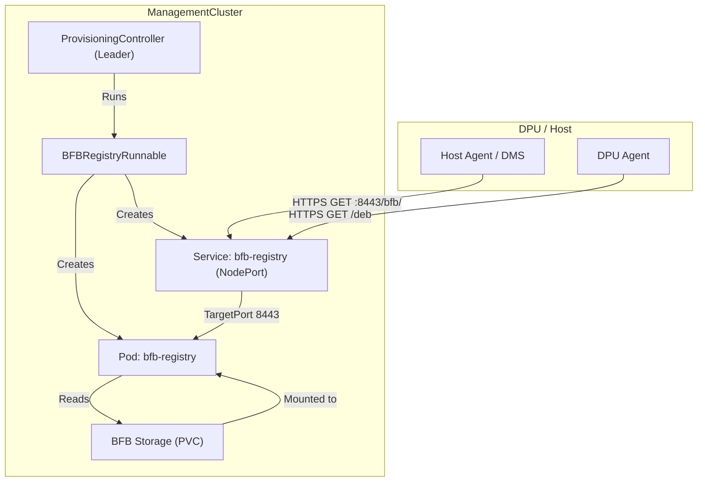
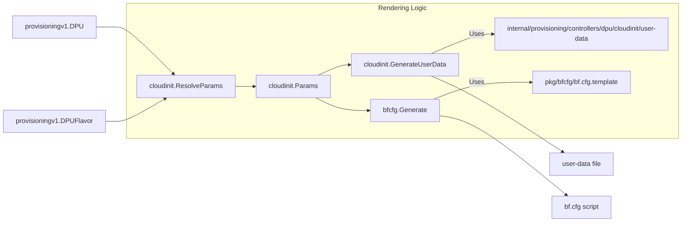

<!-- source: DeepWiki mcp.deepwiki.com · repo NVIDIA/doca-platform · page 3.2 BFB (BlueField Bundle) Management · fetched 2026-10-26 -->

# BFB (BlueField Bundle) Management

Relevant source files

The following files were used as context for generating this wiki page:

- [api/dpuservice/v1alpha1/dpuserviceconfiguration_types.go](api/dpuservice/v1alpha1/dpuserviceconfiguration_types.go)
- [api/provisioning/v1alpha1/bfb_types.go](api/provisioning/v1alpha1/bfb_types.go)
- [config/dpuservice/crd/bases/svc.dpu.nvidia.com_dpuserviceconfigurations.yaml](config/dpuservice/crd/bases/svc.dpu.nvidia.com_dpuserviceconfigurations.yaml)
- [config/provisioning/crd/bases/provisioning.dpu.nvidia.com_bfbs.yaml](config/provisioning/crd/bases/provisioning.dpu.nvidia.com_bfbs.yaml)
- [config/provisioning/rbac/role.yaml](config/provisioning/rbac/role.yaml)
- [config/provisioning/webhook/manifests.yaml](config/provisioning/webhook/manifests.yaml)
- [deploy/charts/dpf-operator/templates/crds/apiextensions.k8s.io_v1_customresourcedefinition_bfbs.provisioning.dpu.nvidia.com.yaml](deploy/charts/dpf-operator/templates/crds/apiextensions.k8s.io_v1_customresourcedefinition_bfbs.provisioning.dpu.nvidia.com.yaml)
- [deploy/charts/dpf-operator/templates/crds/apiextensions.k8s.io_v1_customresourcedefinition_dpuserviceconfigurations.svc.dpu.nvidia.com.yaml](deploy/charts/dpf-operator/templates/crds/apiextensions.k8s.io_v1_customresourcedefinition_dpuserviceconfigurations.svc.dpu.nvidia.com.yaml)
- [deploy/charts/dpf-operator/templates/role.yaml](deploy/charts/dpf-operator/templates/role.yaml)
- [internal/operator/controllers/dpfoperatorconfig_controller.go](internal/operator/controllers/dpfoperatorconfig_controller.go)
- [internal/operator/controllers/dpfoperatorconfig_controller_test.go](internal/operator/controllers/dpfoperatorconfig_controller_test.go)
- [internal/operator/controllers/object_schema_validation_test.go](internal/operator/controllers/object_schema_validation_test.go)
- [internal/operator/inventory/manifests/provisioning-controller.yaml](internal/operator/inventory/manifests/provisioning-controller.yaml)
- [internal/provisioning/bfbregistry/bfb_registry_creator.go](internal/provisioning/bfbregistry/bfb_registry_creator.go)
- [internal/provisioning/bfbregistry/bfb_registry_creator_test.go](internal/provisioning/bfbregistry/bfb_registry_creator_test.go)
- [internal/provisioning/controllers/bfb/bfb_controller.go](internal/provisioning/controllers/bfb/bfb_controller.go)
- [internal/provisioning/controllers/bfb/state/downloading.go](internal/provisioning/controllers/bfb/state/downloading.go)
- [internal/provisioning/controllers/bfb/state/downloading_test.go](internal/provisioning/controllers/bfb/state/downloading_test.go)
- [internal/provisioning/controllers/bfb/state/error.go](internal/provisioning/controllers/bfb/state/error.go)
- [internal/provisioning/controllers/bfb/state/error_test.go](internal/provisioning/controllers/bfb/state/error_test.go)
- [internal/provisioning/controllers/bfb/state/factory.go](internal/provisioning/controllers/bfb/state/factory.go)
- [internal/provisioning/controllers/bfb/state/initializing.go](internal/provisioning/controllers/bfb/state/initializing.go)
- [internal/provisioning/controllers/bfb/state/ready.go](internal/provisioning/controllers/bfb/state/ready.go)
- [internal/provisioning/controllers/bfb_controller_test.go](internal/provisioning/controllers/bfb_controller_test.go)
- [internal/provisioning/controllers/dpu/cloudinit/cloudinit.go](internal/provisioning/controllers/dpu/cloudinit/cloudinit.go)
- [internal/provisioning/controllers/dpu/cloudinit/cloudinit_test.go](internal/provisioning/controllers/dpu/cloudinit/cloudinit_test.go)
- [internal/provisioning/controllers/dpu/cloudinit/user-data](internal/provisioning/controllers/dpu/cloudinit/user-data)
- [internal/provisioning/controllers/dpu/dpu_controller.go](internal/provisioning/controllers/dpu/dpu_controller.go)
- [internal/provisioning/controllers/dpu/state/prepare_bfb_artifact.go](internal/provisioning/controllers/dpu/state/prepare_bfb_artifact.go)
- [internal/provisioning/controllers/dpu/state/prepare_bfb_artifact_test.go](internal/provisioning/controllers/dpu/state/prepare_bfb_artifact_test.go)
- [internal/provisioning/controllers/events/events.go](internal/provisioning/controllers/events/events.go)
- [internal/provisioning/controllers/util/download_error.go](internal/provisioning/controllers/util/download_error.go)
- [internal/provisioning/controllers/util/download_error_test.go](internal/provisioning/controllers/util/download_error_test.go)
- [internal/provisioning/webhooks/bfb_types_test.go](internal/provisioning/webhooks/bfb_types_test.go)
- [internal/provisioning/webhooks/dpudiscovery_webhook.go](internal/provisioning/webhooks/dpudiscovery_webhook.go)
- [internal/provisioning/webhooks/dpudiscovery_webhook_test.go](internal/provisioning/webhooks/dpudiscovery_webhook_test.go)
- [internal/provisioning/webhooks/suite_test.go](internal/provisioning/webhooks/suite_test.go)
- [pkg/bfcfg/bf.cfg.template](pkg/bfcfg/bf.cfg.template)
- [pkg/bfcfg/bfcfg.go](pkg/bfcfg/bfcfg.go)
- [pkg/bfcfg/bfcfg_test.go](pkg/bfcfg/bfcfg_test.go)

## Purpose and Scope

The BFB (BlueField Bundle) management system provides a centralized registry and lifecycle management for BlueField firmware images. A BFB image contains the operating system, drivers, and firmware components required to boot and configure NVIDIA BlueField DPU hardware. 

This document details the BFB registry service, which serves BFB images over HTTPS to DPUs during installation, the generation of `bf.cfg` (BlueField Configuration) files and cloud-init `user-data` via Go templates, and the orchestration of BFB delivery across different installation interfaces (Redfish, gNOI, and HostAgent).

## BFB Registry Service

The BFB Registry is an internal service that serves BFB files and generated configuration files over HTTPS. It is deployed by the Provisioning Controller and runs as a Pod named `bfb-registry` within the management cluster [internal/provisioning/bfbregistry/bfb_registry_creator.go:43]().

### Architecture and Data Flow

The BFB Registry utilizes an Nginx-based container that mounts a shared volume (PVC) containing BFB images. It provides a RESTful interface for DPUs to pull installation artifacts. Following the HTTPS migration, the registry serves traffic on port `8443` and requires TLS verification [internal/provisioning/bfbregistry/bfb_registry_creator.go:51]().

*Sources: [internal/provisioning/bfbregistry/bfb_registry_creator.go:82-91](), [internal/provisioning/bfbregistry/bfb_registry_creator.go:48-52]()*

### Registry Implementation Details
The registry is implemented as a `BFBRegistryRunnable` which is started by the provisioning manager [internal/provisioning/bfbregistry/bfb_registry_creator.go:82-93]().

- **HTTPS Migration**: The plain-HTTP listener (port 8082) has been removed. The service now uses port `8443` [internal/provisioning/bfbregistry/bfb_registry_creator.go:48-51]().
- **Certificate Management**: The registry uses a server certificate issued by the `dpf-provisioning-issuer` [internal/provisioning/bfbregistry/bfb_registry_creator.go:56-58](). The certificate includes the `KubernetesAPIServerVIP` in its SANs to ensure hostagent VIP-based downloads pass TLS verification [internal/provisioning/bfbregistry/bfb_registry_creator.go:86-90]().
- **Storage**: BFB images are stored at `/var/lib/nvidia/dpf/bfb` [internal/provisioning/bfbregistry/bfb_registry_creator.go:52]().

## BFCFG and Cloud-Init Generation

The installation process relies on two primary configuration artifacts:
1.  **`bf.cfg`**: A shell script executed by the BlueField installer (rshim/Redfish) to customize the initial OS installation [pkg/bfcfg/bfcfg.go:30]().
2.  **`user-data`**: A cloud-init configuration file written to the DPU OS seed directory to handle post-boot configuration like networking, users, and DPU agent installation [internal/provisioning/controllers/dpu/cloudinit/cloudinit.go:54-55]().

### The Template Engine
The generation logic resides in `pkg/bfcfg` and `internal/provisioning/controllers/dpu/cloudinit`.

| Component | Logic | Source |
| :--- | :--- | :--- |
| **bf.cfg Template** | Embedded default or ConfigMap-based override. | [pkg/bfcfg/bfcfg.go:75-76]() |
| **user-data Template** | Embedded `user-data` file using `text/template`. | [internal/provisioning/controllers/dpu/cloudinit/cloudinit.go:47-49]() |
| **Params Struct** | `cloudinit.Params` contains DPU-specific values (Hostname, MTU, SPIFFE settings). | [internal/provisioning/controllers/dpu/cloudinit/cloudinit.go:66-114]() |

### Code Entity Association: Configuration Rendering
This diagram shows how the DPU reconciler resolves parameters to generate the final installation scripts.

*Sources: [internal/provisioning/controllers/dpu/cloudinit/cloudinit.go:159-175](), [pkg/bfcfg/bfcfg.go:117-149]()*

## BFB Installation Flow

The `DPUReconciler` maps DPU phases to specific state handlers based on the `DPUInstallInterface` configured in the `DPUOptions` [internal/provisioning/controllers/dpu/dpu_controller.go:97-125]().

### Interface Specific Handlers

| Interface | Phase: DPUOSInstalling Handler | Implementation Detail |
| :--- | :--- | :--- |
| **HostAgent / gNOI** | `hostagent.Installing` | Leverages the Host Agent to push BFB over rshim. [internal/provisioning/controllers/dpu/dpu_controller.go:102]() |
| **Redfish** | `redfish.Installing` | Submits an OS installation task to the BMC. [internal/provisioning/controllers/dpu/dpu_controller.go:107]() |

### BFB Resource Lifecycle
The `BFB` Custom Resource (CR) tracks the availability and metadata of a specific bundle.

1.  **Downloading**: The controller fetches the image from the specified URL [internal/provisioning/controllers/bfb/state/downloading.go:25]().
2.  **Ready**: Once downloaded, the controller extracts versions (BSP, DOCA, Firmware) and updates the status [api/provisioning/v1alpha1/bfb_types.go:94-122]().

## Security and Identity Integration

A critical part of BFB management is the injection of identity during provisioning.

- **SPIFFE Mode**: If `SpiffeMode` is enabled in `Params`, the `user-data` template renders configuration for the `spire-agent`, `spiffe-helper`, and the `dpu-hw-attestor` [internal/provisioning/controllers/dpu/cloudinit/user-data:95-170]().
- **CA Trust**: The `CATrustBundle` is written to `/usr/local/share/ca-certificates/dpf-ca.crt` on the DPU to ensure the DPU OS trusts the `bfb-registry` HTTPS server [internal/provisioning/controllers/dpu/cloudinit/user-data:197-202]().
- **RBAC**: The provisioning manager role includes permissions to manage `bfbs`, `bfbs/status`, and `bfbs/finalizers` [internal/operator/inventory/manifests/provisioning-controller.yaml:314-344]().

Sources:
- BFB Registry Creation: [internal/provisioning/bfbregistry/bfb_registry_creator.go]()
- DPU Phase Handlers: [internal/provisioning/controllers/dpu/dpu_controller.go]()
- Cloud-init Params: [internal/provisioning/controllers/dpu/cloudinit/cloudinit.go]()
- Cloud-init Template: [internal/provisioning/controllers/dpu/cloudinit/user-data]()
- BFB API Types: [api/provisioning/v1alpha1/bfb_types.go]()

---

