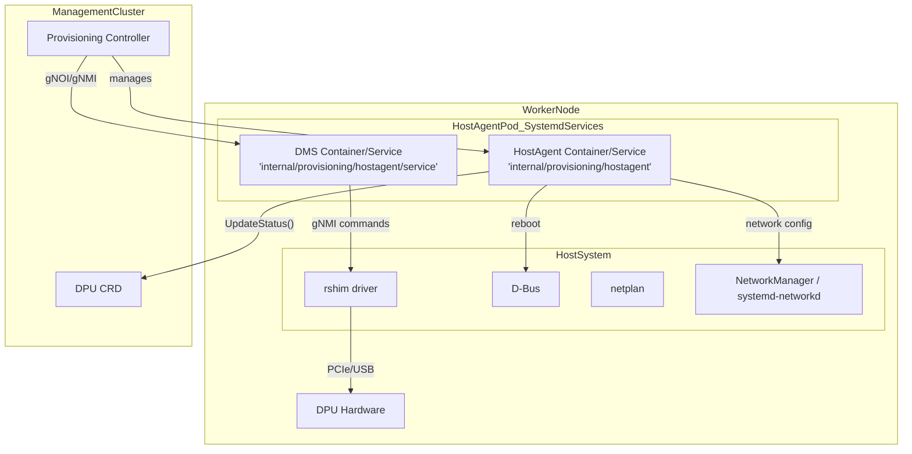
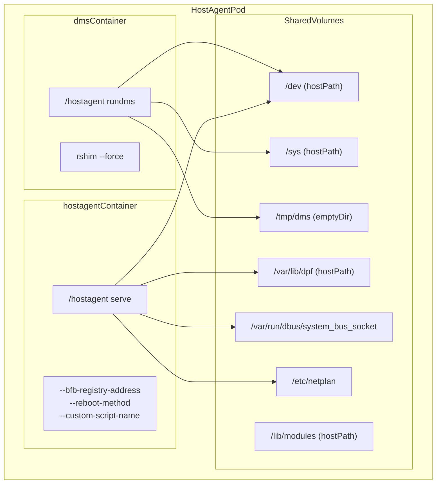

<!-- source: DeepWiki mcp.deepwiki.com · repo NVIDIA/doca-platform · page 3.3 Host Agent Implementation · fetched 2026-10-26 -->

# Host Agent Implementation

Relevant source files

The following files were used as context for generating this wiki page:

- [cmd/dpuagent/main_linux_test.go](cmd/dpuagent/main_linux_test.go)
- [cmd/hostagent/app/server.go](cmd/hostagent/app/server.go)
- [cmd/hostagent/main.go](cmd/hostagent/main.go)
- [cmd/hostagent/options/options.go](cmd/hostagent/options/options.go)
- [cmd/hostagent/subcmds/root.go](cmd/hostagent/subcmds/root.go)
- [cmd/hostagent/subcmds/rundms.go](cmd/hostagent/subcmds/rundms.go)
- [cmd/hostagent/subcmds/serve.go](cmd/hostagent/subcmds/serve.go)
- [docs/public/advanced-configuration/host-installation-for-non-k8s-env/non-k8s-host-installation.md](docs/public/advanced-configuration/host-installation-for-non-k8s-env/non-k8s-host-installation.md)
- [docs/public/advanced-configuration/multi-dpu-ovnk-hbn.md](docs/public/advanced-configuration/multi-dpu-ovnk-hbn.md)
- [docs/public/release-notes/README.md](docs/public/release-notes/README.md)
- [docs/public/release-notes/v25.10.0.md](docs/public/release-notes/v25.10.0.md)
- [docs/public/release-notes/v25.10.1.md](docs/public/release-notes/v25.10.1.md)
- [docs/public/release-notes/v26.4.0.md](docs/public/release-notes/v26.4.0.md)
- [docs/public/release-notes/v26.4.1.md](docs/public/release-notes/v26.4.1.md)
- [internal/provisioning/controllers/dpu/state/hostagent/installing.go](internal/provisioning/controllers/dpu/state/hostagent/installing.go)
- [internal/provisioning/controllers/dpunode/util/option.go](internal/provisioning/controllers/dpunode/util/option.go)
- [internal/provisioning/controllers/node_controller_test.go](internal/provisioning/controllers/node_controller_test.go)
- [internal/provisioning/controllers/util/dms/util.go](internal/provisioning/controllers/util/dms/util.go)
- [internal/provisioning/controllers/util/future/future.go](internal/provisioning/controllers/util/future/future.go)
- [internal/provisioning/controllers/util/future/future_test.go](internal/provisioning/controllers/util/future/future_test.go)
- [internal/provisioning/controllers/util/reboot/util.go](internal/provisioning/controllers/util/reboot/util.go)
- [internal/provisioning/hostagent/controller.go](internal/provisioning/hostagent/controller.go)
- [internal/provisioning/hostagent/networkmanager/network_manager.go](internal/provisioning/hostagent/networkmanager/network_manager.go)
- [internal/provisioning/hostagent/networkmanager/network_manager_test.go](internal/provisioning/hostagent/networkmanager/network_manager_test.go)
- [internal/provisioning/hostagent/networkmanager/network_req.go](internal/provisioning/hostagent/networkmanager/network_req.go)
- [internal/provisioning/hostagent/networkmanager/network_req_test.go](internal/provisioning/hostagent/networkmanager/network_req_test.go)
- [internal/provisioning/hostagent/networkmanager/suite_test.go](internal/provisioning/hostagent/networkmanager/suite_test.go)
- [internal/provisioning/hostagent/nodemanager/nodemanager.go](internal/provisioning/hostagent/nodemanager/nodemanager.go)
- [internal/provisioning/hostagent/phase/configfw/configfw.go](internal/provisioning/hostagent/phase/configfw/configfw.go)
- [internal/provisioning/hostagent/phase/install/install.go](internal/provisioning/hostagent/phase/install/install.go)
- [internal/provisioning/hostagent/phase/interfaceinit/interface_initialize.go](internal/provisioning/hostagent/phase/interfaceinit/interface_initialize.go)
- [internal/provisioning/hostagent/phase/interfaceinit/interface_initialize_test.go](internal/provisioning/hostagent/phase/interfaceinit/interface_initialize_test.go)
- [internal/provisioning/hostagent/phase/network/hostnetwork.go](internal/provisioning/hostagent/phase/network/hostnetwork.go)
- [internal/provisioning/hostagent/phase/reboot/reboot.go](internal/provisioning/hostagent/phase/reboot/reboot.go)
- [internal/provisioning/hostagent/phase/reboot/store.go](internal/provisioning/hostagent/phase/reboot/store.go)
- [internal/provisioning/hostagent/phase/reboot/store_test.go](internal/provisioning/hostagent/phase/reboot/store_test.go)
- [internal/provisioning/hostagent/phase/reboot/sync.go](internal/provisioning/hostagent/phase/reboot/sync.go)
- [internal/provisioning/hostagent/phase/reboot/sync_test.go](internal/provisioning/hostagent/phase/reboot/sync_test.go)
- [internal/provisioning/hostagent/service/installation_service.go](internal/provisioning/hostagent/service/installation_service.go)
- [internal/provisioning/hostagent/service/installation_service_test.go](internal/provisioning/hostagent/service/installation_service_test.go)
- [internal/provisioning/hostagent/service/types/types.go](internal/provisioning/hostagent/service/types/types.go)
- [internal/provisioning/hostagent/util/cmd_test.go](internal/provisioning/hostagent/util/cmd_test.go)
- [internal/provisioning/hostagent/util/network.go](internal/provisioning/hostagent/util/network.go)
- [internal/provisioning/hostagent/util/network_test.go](internal/provisioning/hostagent/util/network_test.go)
- [internal/provisioning/hostagent/util/pci.go](internal/provisioning/hostagent/util/pci.go)
- [internal/provisioning/hostagent/util/pci_test.go](internal/provisioning/hostagent/util/pci_test.go)

The host agent is a critical component of the DPF provisioning system that runs on each worker node to manage DPU hardware. It provides the bridge between Kubernetes control plane operations and the physical DPU devices attached to the host. The host agent architecture supports two deployment modes: as a Kubernetes pod with dual containers or as standalone systemd services in non-Kubernetes environments.

## Architecture Overview

The host agent implements a dual-process design where two separate processes run on each host:

**Host Agent Architecture**

| Component | Process | Primary Functions |
|-----------|---------|-------------------|
| **DMS** | `/hostagent rundms` | gNMI/gNOI server, command execution, DPU communication [internal/provisioning/controllers/util/dms/util.go:43]() |
| **Host Agent** | `/hostagent serve` | BFB installation, network configuration, reboot orchestration [internal/provisioning/controllers/util/dms/util.go:44]() |
| **rshim** | Kernel driver | Low-level DPU communication channel [internal/provisioning/controllers/util/dms/util.go:42]() |

Sources: [internal/provisioning/controllers/util/dms/util.go:39-49](), [cmd/hostagent/subcmds/serve.go:48-129](), [internal/provisioning/hostagent/nodemanager/nodemanager.go:77-86]()

## Dual-Container Design

In Kubernetes deployments, the host agent runs as a single pod with two containers that share certain resources but serve distinct purposes:

**Container Configuration**

### DMS Container

The DMS container provides the gNMI/gNOI server interface for remote management:

- **Entrypoint**: `rshim --force --foreground` followed by `/hostagent rundms` [internal/provisioning/controllers/util/dms/util.go:131-138](), [internal/provisioning/controllers/util/dms/util.go:175]()
- **Purpose**: Exposes gNMI endpoints for command execution and status queries.
- **Privileges**: Runs with `privileged: true` security context [internal/provisioning/controllers/util/dms/util.go:169-171]()
- **Key Volumes**: `/dev`, `/sys`, `/tmp/dms`, `/var/run/dbus/system_bus_socket` [internal/provisioning/controllers/util/dms/util.go:146-168]().

### HostAgent Container

The host agent container performs the actual provisioning operations:

- **Entrypoint**: `/hostagent serve --bfb-registry-address=<addr> [--reboot-method=<method>] [--custom-script-name=<script>]` [internal/provisioning/controllers/util/dms/util.go:187-189]()
- **Purpose**: Downloads and installs BFB images, configures networking, manages reboots.
- **Network Management**: Uses `networkmanager.NetworkManager` to configure VFs and OOB bridges [internal/provisioning/hostagent/networkmanager/network_manager.go:85-93]().
- **Privileges**: Runs with `privileged: true` security context [internal/provisioning/controllers/util/dms/util.go:182-184]()

Sources: [internal/provisioning/controllers/util/dms/util.go:103-240]()

## Host Management Service

The `InstallationService` runs within the HostAgent container and provides a REST API for DPUs to communicate back to the host and management cluster:

**Installation Service API**
| Endpoint | Method | Function |
|----------|--------|----------|
| `/update-status` | POST | Updates DPU CR status with agent conditions and startup time [internal/provisioning/hostagent/service/installation_service.go:112-116]() |
| `/get-object` | GET | Proxies requests to the K8s API to retrieve specific objects [internal/provisioning/hostagent/service/installation_service.go:117-125]() |
| `/configure-host-vfs` | POST | Triggers host-side VF and bridge configuration [internal/provisioning/hostagent/service/installation_service.go:132-135]() |
| `/trigger-reboot` | POST | Initiates DPU or Host reboot based on the configured method [internal/provisioning/hostagent/service/installation_service.go:136-140]() |
| `/deb/`, `/rpm/` | GET | Serves agent packages to DPUs over the `tmfifo_net` interface [internal/provisioning/hostagent/service/installation_service.go:153-154]() |

### Networking Topology
The service listens on IPv6 link-local addresses (`fe80::1`) on `tmfifo_net` interfaces created by the rshim driver [internal/provisioning/hostagent/service/installation_service.go:53-60](). It also provides an HTTP forward proxy on port `11030` to allow DPUs to reach external resources like the BFB registry [internal/provisioning/hostagent/service/installation_service.go:181-182]().

Sources: [internal/provisioning/hostagent/service/installation_service.go:102-160]()

## Network Configuration

The `NetworkManager` manages host-side networking for DPUs, including SR-IOV VFs and OOB bridges:

- **Backend Detection**: Automatically detects `NetworkManager` or `systemd-networkd` [internal/provisioning/hostagent/networkmanager/network_manager.go:99-103]().
- **VF Management**: Ensures VFs are unmanaged by the host's primary network stack to avoid conflicts [internal/provisioning/hostagent/networkmanager/network_manager.go:106-108]().
- **OOB Bridge**: Creates and manages the Out-of-Band bridge (default: `br-dpu`) for DPU control plane traffic [internal/provisioning/hostagent/util/network.go:78]().
- **Persistence**: Saves network requests to a local directory to persist configuration across reboots [internal/provisioning/hostagent/networkmanager/network_manager.go:142-170]().

Sources: [internal/provisioning/hostagent/networkmanager/network_manager.go:63-133](), [internal/provisioning/hostagent/util/network.go:96-154]()

## Node and Device Registration

The `NodeManager` is responsible for registering the host and its DPUs in the Kubernetes API:

1. **DPUDevice Registration**: Discovers DPUs via sysfs and creates `DPUDevice` CRs for each [internal/provisioning/hostagent/nodemanager/nodemanager.go:127-172]().
2. **DPUNode Registration**: Creates a `DPUNode` CR representing the physical host, including hardware labels and reboot capabilities [internal/provisioning/hostagent/nodemanager/nodemanager.go:174-250]().
3. **Status Reporting**: Periodically updates the `DPUNode` status [internal/provisioning/hostagent/nodemanager/nodemanager.go:79-85]().

Sources: [internal/provisioning/hostagent/nodemanager/nodemanager.go:62-124]()

## Non-Kubernetes Deployment

For non-Kubernetes worker nodes, the host agent is deployed as systemd services using `containerd` to run the hostdriver image:

| Service | Function |
|---------|----------|
| `rshim.service` | Manages the rshim driver for DPU communication [docs/public/advanced-configuration/host-installation-for-non-k8s-env/non-k8s-host-installation.md:142-143]() |
| `dpf-dmsd.service` | Runs the DMS server container [docs/public/advanced-configuration/host-installation-for-non-k8s-env/non-k8s-host-installation.md:116-140]() |
| `dpf-host-agent.service` | Runs the Host Agent container with bootstrap kubeconfig [docs/public/advanced-configuration/host-installation-for-non-k8s-env/non-k8s-host-installation.md:153-176]() |

The `dpf-host-agent.service` uses a bootstrap kubeconfig to register with the management cluster and acquire a permanent client certificate [docs/public/advanced-configuration/host-installation-for-non-k8s-env/non-k8s-host-installation.md:21-60]().

Sources: [docs/public/advanced-configuration/host-installation-for-non-k8s-env/non-k8s-host-installation.md:1-176]()

---

