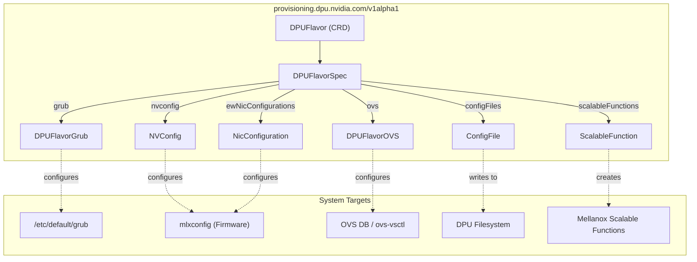
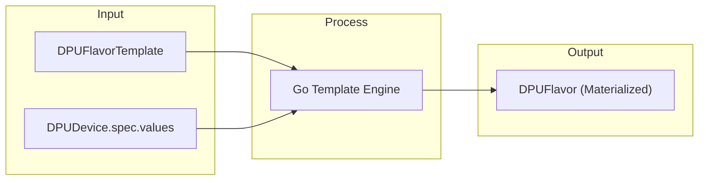
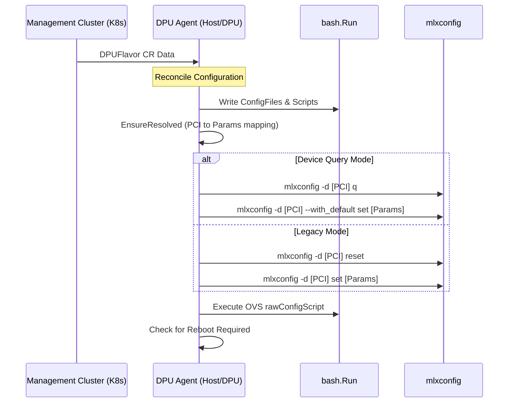

<!-- source: DeepWiki mcp.deepwiki.com · repo NVIDIA/doca-platform · page 3.4 DPUFlavor and DPUFlavorTemplate Configuration Profiles · fetched 2026-10-26 -->

# DPUFlavor and DPUFlavorTemplate Configuration Profiles

Relevant source files

The following files were used as context for generating this wiki page:

- [api/provisioning/v1alpha1/dpuflavor_types.go](api/provisioning/v1alpha1/dpuflavor_types.go)
- [config/provisioning/crd/bases/provisioning.dpu.nvidia.com_dpuflavors.yaml](config/provisioning/crd/bases/provisioning.dpu.nvidia.com_dpuflavors.yaml)
- [deploy/charts/dpf-operator/templates/crds/apiextensions.k8s.io_v1_customresourcedefinition_dpuflavors.provisioning.dpu.nvidia.com.yaml](deploy/charts/dpf-operator/templates/crds/apiextensions.k8s.io_v1_customresourcedefinition_dpuflavors.provisioning.dpu.nvidia.com.yaml)
- [docs/public/developer-guides/api/dpuflavor.md](docs/public/developer-guides/api/dpuflavor.md)
- [docs/public/developer-guides/api/dpuflavortemplate.md](docs/public/developer-guides/api/dpuflavortemplate.md)
- [docs/public/release-notes/v26.10.0.md](docs/public/release-notes/v26.10.0.md)
- [docs/public/user-guides/host-trusted/use-cases/hbn-ovnk-snap/manifests/05-dpudeployment-installation/dpuflavor.yaml](docs/public/user-guides/host-trusted/use-cases/hbn-ovnk-snap/manifests/05-dpudeployment-installation/dpuflavor.yaml)
- [docs/public/user-guides/host-trusted/use-cases/hbn-ovnk/manifests/05-dpudeployment-installation/dpuflavor-hbn-ovnk.yaml](docs/public/user-guides/host-trusted/use-cases/hbn-ovnk/manifests/05-dpudeployment-installation/dpuflavor-hbn-ovnk.yaml)
- [docs/public/user-guides/host-trusted/use-cases/hbn-snap/manifests/04.1-dpudeployment-installation-nvme/dpuflavor.yaml](docs/public/user-guides/host-trusted/use-cases/hbn-snap/manifests/04.1-dpudeployment-installation-nvme/dpuflavor.yaml)
- [docs/public/user-guides/host-trusted/use-cases/hbn-snap/manifests/04.2-dpudeployment-installation-virtiofs/dpuflavor.yaml](docs/public/user-guides/host-trusted/use-cases/hbn-snap/manifests/04.2-dpudeployment-installation-virtiofs/dpuflavor.yaml)
- [docs/public/user-guides/host-trusted/use-cases/hbn/manifests/04-dpudeployment-installation/hbn-dpuflavor.yaml](docs/public/user-guides/host-trusted/use-cases/hbn/manifests/04-dpudeployment-installation/hbn-dpuflavor.yaml)
- [docs/public/user-guides/zero-trust/use-cases/hbn-snap/manifests/03.1-dpudeployment-installation-nvme/dpuflavor.yaml](docs/public/user-guides/zero-trust/use-cases/hbn-snap/manifests/03.1-dpudeployment-installation-nvme/dpuflavor.yaml)
- [docs/public/user-guides/zero-trust/use-cases/hbn-snap/manifests/03.2-dpudeployment-installation-virtiofs/dpuflavor.yaml](docs/public/user-guides/zero-trust/use-cases/hbn-snap/manifests/03.2-dpudeployment-installation-virtiofs/dpuflavor.yaml)
- [docs/public/user-guides/zero-trust/use-cases/hbn/manifests/03.1-dpudeployment-installation-pf/hbn-dpuflavor.yaml](docs/public/user-guides/zero-trust/use-cases/hbn/manifests/03.1-dpudeployment-installation-pf/hbn-dpuflavor.yaml)
- [docs/public/user-guides/zero-trust/use-cases/hbn/manifests/03.2-dpudeployment-installation-pf-vf/hbn-dpuflavor.yaml](docs/public/user-guides/zero-trust/use-cases/hbn/manifests/03.2-dpudeployment-installation-pf-vf/hbn-dpuflavor.yaml)
- [internal/provisioning/dpuagent/operations/nodelabels/node_labels.go](internal/provisioning/dpuagent/operations/nodelabels/node_labels.go)
- [internal/provisioning/dpuagent/operations/nodelabels/node_labels_test.go](internal/provisioning/dpuagent/operations/nodelabels/node_labels_test.go)
- [internal/provisioning/dpuagent/operations/nvconfig/nvconfig.go](internal/provisioning/dpuagent/operations/nvconfig/nvconfig.go)
- [internal/provisioning/dpuagent/operations/nvconfig/nvconfig_test.go](internal/provisioning/dpuagent/operations/nvconfig/nvconfig_test.go)
- [internal/provisioning/dpuagent/operations/nvconfig/resolve_test.go](internal/provisioning/dpuagent/operations/nvconfig/resolve_test.go)
- [internal/provisioning/webhooks/dpuflavor_webhook.go](internal/provisioning/webhooks/dpuflavor_webhook.go)
- [internal/provisioning/webhooks/dpuflavor_webhook_test.go](internal/provisioning/webhooks/dpuflavor_webhook_test.go)
- [test/apivalidation/provisioning_api_validation_test.go](test/apivalidation/provisioning_api_validation_test.go)
- [test/e2e/dpuservice_tenant_namespace.go](test/e2e/dpuservice_tenant_namespace.go)
- [test/objects/application/dpuserviceconfig-hbn-tenant.yaml](test/objects/application/dpuserviceconfig-hbn-tenant.yaml)
- [test/objects/infrastructure/dpuflavor-hbn-ovn.yaml](test/objects/infrastructure/dpuflavor-hbn-ovn.yaml)
- [test/objects/infrastructure/dpuflavor-physical.yaml](test/objects/infrastructure/dpuflavor-physical.yaml)
- [test/objects/infrastructure/dpuflavor.yaml](test/objects/infrastructure/dpuflavor.yaml)
- [test/objects/infrastructure/dpuflavortemplate-physical.yaml](test/objects/infrastructure/dpuflavortemplate-physical.yaml)

## Purpose and Scope

`DPUFlavor` is a Kubernetes Custom Resource Definition (CRD) that defines reusable configuration profiles for DPU provisioning. A `DPUFlavor` encapsulates all hardware and software configuration parameters needed to prepare a DPU for a specific use case, including firmware settings (`nvconfig`), kernel parameters (`grub`), network configuration, OVS bridge topology, and custom system files.

`DPUFlavorTemplate` extends this by allowing per-DPU customization using Go templates, where values are sourced from the `DPUDevice` resource. This enables unique settings (like MAC addresses or specific IDs) while maintaining a common profile structure.

## DPUFlavor in the Provisioning Workflow

`DPUFlavor` resources are referenced by `DPUSet` or `DPUDeployment` objects. During the provisioning cycle, the DPU Agent (running on the host or DPU) reads the `DPUFlavor` spec to apply low-level configurations.

### Entity Relationship Diagram

The following diagram maps the high-level configuration domains to the specific code entities defined in the `DPUFlavor` API.

Sources: [api/provisioning/v1alpha1/dpuflavor_types.go:35-118](), [config/provisioning/crd/bases/provisioning.dpu.nvidia.com_dpuflavors.yaml:40-200]()

## DPUFlavor Resource Structure

The `DPUFlavor` resource is defined in `api/provisioning/v1alpha1/dpuflavor_types.go`. Key characteristics include:
- **Immutability**: The `DPUFlavorSpec` is immutable once created to ensure consistency across a DPU fleet [api/provisioning/v1alpha1/dpuflavor_types.go:34-35]().
- **Scope**: It is a namespaced resource, typically residing in `dpf-operator-system` [config/provisioning/crd/bases/provisioning.dpu.nvidia.com_dpuflavors.yaml:16-16]().

### Configuration Domains

#### 1. GRUB and Sysctl
The `grub` field defines kernel boot parameters, while `sysctl` manages runtime kernel parameters.
- `KernelParameters`: A list of strings applied to the DPU's boot loader (e.g., `hugepagesz=2048kB`) [api/provisioning/v1alpha1/dpuflavor_types.go:133-137]().
- `Sysctl`: Parameters applied via `sysctl -w` on the DPU, stored in `/etc/sysctl.d/99-dpf.conf` [docs/public/developer-guides/api/dpuflavor.md:32-32]().

#### 2. NVConfig (Firmware Settings)
The `nvconfig` section configures firmware-level parameters through `mlxconfig`.
- **Device Selectors**: Supports wildcard `*` (applies to all devices) or specific ports like `p0`, `p1` [api/provisioning/v1alpha1/dpuflavor_types.go:42-45]().
- **Validation**: If `*` is used, it must be the only entry in the list [api/provisioning/v1alpha1/dpuflavor_types.go:48-49]().
- **Force Mode**: Some parameters hidden by firmware (e.g., `FORCE_ETH_PCI_SUBCLASS`) require `force: true` to bypass `mlxconfig q` deferral filters [docs/public/developer-guides/api/dpuflavor.md:143-154]().

#### 3. OVS Configuration
The `ovs` section contains a `rawConfigScript` [api/provisioning/v1alpha1/dpuflavor_types.go:145-149](). This shell script is executed on the DPU to:
- Initialize DOCA settings (e.g., `other_config:doca-init=true`) [test/objects/infrastructure/dpuflavor.yaml:91-91]().
- Create bridges like `br-sfc` and `br-hbn` [test/objects/infrastructure/dpuflavor.yaml:107-112]().
- Configure hardware offload (`hw-offload=true`) [test/objects/infrastructure/dpuflavor.yaml:93-93]().

#### 4. Scalable Functions (SFs)
Configures sub-functions on the DPU. Currently, only the `dma` type is supported, primarily for SNAP services on BlueField-4 socket-direct systems [api/provisioning/v1alpha1/dpuflavor_types.go:126-131]().
- `count`: Number of SFs to create (must be 1 for `dma`) [api/provisioning/v1alpha1/dpuflavor_types.go:134-134]().
- `sfNumStart`: The SF number to start allocation from (defaults to 8000 for `dma`) [docs/public/developer-guides/api/dpuflavor.md:66-66]().

#### 5. Configuration Files and Node Labeling
The `configFiles` array allows writing arbitrary files. A key use case is DPU node labeling:
- Scripts placed in `/var/lib/dpf/dpuagent/node-label-scripts/` are executed by the DPU agent [docs/public/release-notes/v26.10.0.md:31-31]().
- Output format: `key-suffix=value` is converted to `scripts.dpu.nvidia.com/key-suffix=value` labels on the Kubernetes Node [docs/public/release-notes/v26.10.0.md:31-31]().

## DPUFlavorTemplate

`DPUFlavorTemplate` allows generating `DPUFlavor` resources dynamically for each DPU. It uses Go templates in its `spec` and resolves variables from `DPUDevice.spec.values`.

### Template Rendering Logic
The `dpfctl` tool provides a `flavor-template render` command to preview how a template will be materialized for a specific device [docs/public/developer-guides/api/dpuflavor.md:342-342]().

## Implementation and Data Flow

The `DPUFlavor` is processed by the DPU Agent in a sequential pipeline.

### NVConfig Application (mlxconfig)
The `ConfigureNVConfig` operation handles firmware settings. It supports two modes:
1. **Legacy Mode**: Resets target devices, then applies all parameters.
2. **Device Query Mode**: Uses `--with_default set`, querying `mlxconfig q` first to defer parameters that firmware hasn't exposed yet (e.g., parameters gated by another setting) [internal/provisioning/dpuagent/operations/nvconfig/nvconfig.go:145-152]().

### Configuration Application Flow

Sources: [internal/provisioning/dpuagent/operations/nvconfig/nvconfig.go:93-153](), [test/objects/infrastructure/dpuflavor.yaml:81-121]()

## Technical Reference: Resource Management

The `DPUFlavor` acts as a resource gate for DPU placement:
- `dpuResources`: Total minimum resources (CPU, Memory) required on the DPU for this flavor [api/provisioning/v1alpha1/dpuflavor_types.go:76-81]().
- `systemReservedResources`: Resources consumed by the OS, OVS, and DPF system that are *not* available for DPU Services [api/provisioning/v1alpha1/dpuflavor_types.go:82-86]().

## Validation Logic
The system enforces strict validation via Webhooks and CEL (Common Expression Language) rules:
- **Immutability**: The entire spec is protected by `self == oldSelf` [api/provisioning/v1alpha1/dpuflavor_types.go:34-34]().
- **NVConfig Uniqueness**: Each device entry in `nvconfig` must be unique (case-insensitive) [api/provisioning/v1alpha1/dpuflavor_types.go:50-50]().
- **Template Exclusivity**: `DPUTemplateSpec` (used in `DPUSet`) must specify exactly one of `dpuFlavor` or `dpuFlavorTemplate` [test/apivalidation/provisioning_api_validation_test.go:126-162]().

Sources: [api/provisioning/v1alpha1/dpuflavor_types.go:34-72](), [internal/provisioning/webhooks/dpuflavor_webhook_test.go:144-224](), [test/apivalidation/provisioning_api_validation_test.go:126-162]()

---

