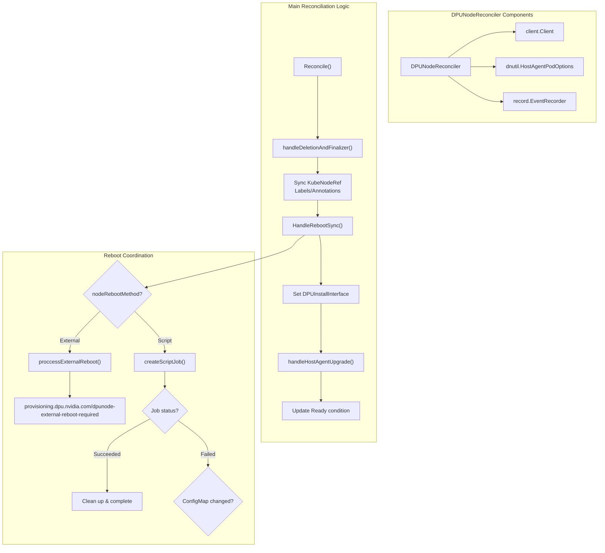
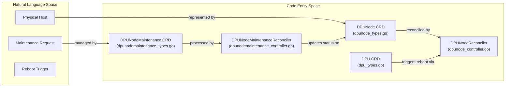

<!-- source: DeepWiki mcp.deepwiki.com · repo NVIDIA/doca-platform · page 3.5 DPUNode and DPUNodeMaintenance · fetched 2026-10-26 -->

# DPUNode and DPUNodeMaintenance

<details>
<summary>Relevant source files</summary>

The following files were used as context for generating this wiki page:

- [api/provisioning/v1alpha1/dpunode_types.go](api/provisioning/v1alpha1/dpunode_types.go)
- [config/provisioning/crd/bases/provisioning.dpu.nvidia.com_dpunodes.yaml](config/provisioning/crd/bases/provisioning.dpu.nvidia.com_dpunodes.yaml)
- [deploy/charts/dpf-operator/templates/crds/apiextensions.k8s.io_v1_customresourcedefinition_dpunodes.provisioning.dpu.nvidia.com.yaml](deploy/charts/dpf-operator/templates/crds/apiextensions.k8s.io_v1_customresourcedefinition_dpunodes.provisioning.dpu.nvidia.com.yaml)
- [docs/public/developer-guides/api/dpunode.md](docs/public/developer-guides/api/dpunode.md)
- [internal/provisioning/controllers/dpu/state/dpu_config.go](internal/provisioning/controllers/dpu/state/dpu_config.go)
- [internal/provisioning/controllers/dpu/state/dpu_config_test.go](internal/provisioning/controllers/dpu/state/dpu_config_test.go)
- [internal/provisioning/controllers/dpu/state/redfish/client/reset_test.go](internal/provisioning/controllers/dpu/state/redfish/client/reset_test.go)
- [internal/provisioning/controllers/dpu/state/redfish/rebooting.go](internal/provisioning/controllers/dpu/state/redfish/rebooting.go)
- [internal/provisioning/controllers/dpu/state/redfish/rebooting_test.go](internal/provisioning/controllers/dpu/state/redfish/rebooting_test.go)
- [internal/provisioning/controllers/dpu/state/suite_test.go](internal/provisioning/controllers/dpu/state/suite_test.go)
- [internal/provisioning/controllers/dpu_controller_test.go](internal/provisioning/controllers/dpu_controller_test.go)
- [internal/provisioning/controllers/dpunode/dpunode_controller.go](internal/provisioning/controllers/dpunode/dpunode_controller.go)
- [internal/provisioning/controllers/dpunode/dpunode_controller_test.go](internal/provisioning/controllers/dpunode/dpunode_controller_test.go)
- [internal/provisioning/controllers/dpunode/node_controller.go](internal/provisioning/controllers/dpunode/node_controller.go)
- [internal/provisioning/controllers/dpunode/node_controller_test.go](internal/provisioning/controllers/dpunode/node_controller_test.go)
- [internal/provisioning/controllers/dpunode/suite_test.go](internal/provisioning/controllers/dpunode/suite_test.go)
- [internal/provisioning/controllers/dpunode_controller_test.go](internal/provisioning/controllers/dpunode_controller_test.go)
- [internal/provisioning/controllers/dpunodemaintenance/dpunodemaintenance_controller.go](internal/provisioning/controllers/dpunodemaintenance/dpunodemaintenance_controller.go)
- [internal/provisioning/controllers/dpunodemaintenance/dpunodemaintenance_controller_test.go](internal/provisioning/controllers/dpunodemaintenance/dpunodemaintenance_controller_test.go)
- [internal/provisioning/controllers/dpunodemaintenance_controller_test.go](internal/provisioning/controllers/dpunodemaintenance_controller_test.go)
- [internal/provisioning/controllers/dpuset/suite_test.go](internal/provisioning/controllers/dpuset/suite_test.go)
- [internal/provisioning/controllers/util/util.go](internal/provisioning/controllers/util/util.go)
- [internal/provisioning/controllers/util/util_test.go](internal/provisioning/controllers/util/util_test.go)
- [test/mock/dms/pkg/controllers/hostagent_server.go](test/mock/dms/pkg/controllers/hostagent_server.go)

</details>


This document describes the DPUNode and DPUNodeMaintenance custom resources and their controllers, which manage physical hosts with DPUs attached and coordinate maintenance operations across these hosts.

**DPUNode** represents a physical x86 host with one or more DPU (Data Processing Unit) devices attached. It manages host-level operations including reboot orchestration, host agent upgrades, and readiness tracking. [api/provisioning/v1alpha1/dpunode_types.go:7-11](), [docs/public/developer-guides/api/dpunode.md:7-11]()

**DPUNodeMaintenance** coordinates node maintenance operations by applying node effects (drain, taint, labels, custom actions) while enforcing safety constraints to prevent disrupting too many hosts simultaneously. [internal/provisioning/controllers/dpunodemaintenance/dpunodemaintenance_controller.go:47-51]()

---

## DPUNode Resource

The `DPUNode` CR represents a physical x86 host that contains one or more DPU devices. It serves as the anchor point for host-level operations and tracks the readiness of the entire host. [docs/public/developer-guides/api/dpunode.md:9-11]()

### Specification Fields

| Field | Type | Description |
|-------|------|-------------|
| `nodeRebootMethod` | `NodeRebootMethod` | Defines how the host should be rebooted. Options: `external`, `script`, `hostAgent`, `none`, `gNOI` (deprecated) |
| `dpus` | `[]DPURef` | References to DPUDevice objects attached to this host |
| `nodeDMSAddress` | `DMSAddress` | (Deprecated) IP and port where DMS is exposed |

**Sources:** [api/provisioning/v1alpha1/dpunode_types.go:155-177](), [docs/public/developer-guides/api/dpunode.md:22-31]()

### NodeRebootMethod Options

Exactly one of the fields below must be set; the API server defaults `nodeRebootMethod` to `{hostAgent: {}}` when omitted. [api/provisioning/v1alpha1/dpunode_types.go:123-124](), [docs/public/developer-guides/api/dpunode.md:34]()

```go
type NodeRebootMethod struct {
    GNOI      *GNOI      // Deprecated: Use HostAgent instead
    HostAgent *HostAgent // Use host agent to reboot
    External  *External  // Reboot via external means
    Script    *Script    // Execute custom reboot script
    None      *None      // Skip host reboot (for hostless devices)
}
```
**Sources:** [api/provisioning/v1alpha1/dpunode_types.go:124-145]()

*   **External Reboot**: User manually reboots the host. The controller waits for the `dpunode-external-reboot-required` annotation to be removed. [internal/provisioning/controllers/dpunode/dpunode_controller.go:593-605]()
*   **Script Reboot**: A ConfigMap containing a pod template is referenced. The controller creates a Job from this template to execute the reboot script. [internal/provisioning/controllers/dpunode/dpunode_controller.go:449-460]()
*   **HostAgent/gNOI Reboot**: The host agent or DMS pod reboots the host programmatically. [docs/public/developer-guides/api/dpunode.md:38-41]()
*   **None**: Used for hostless devices where DPF manages the DPU reboot directly through Redfish, skipping the host-level reboot logic. [api/provisioning/v1alpha1/dpunode_types.go:141-144]()

### Status Fields

| Field | Type | Description |
|-------|------|-------------|
| `conditions` | `[]metav1.Condition` | Status conditions tracking host state |
| `dpuInstallInterface` | `string` | Interface used for DPU installation (`gNOI`, `hostAgent`, `redfish`) |
| `kubeNodeRef` | `string` | Name of the Kubernetes Node object (if host is in cluster) |
| `rebootInProgress` | `bool` | Indicates if host is currently rebooting |
| `rebootMethod` | `string` | Aggregated host-level reboot method (`PowerCycle`, `SystemLevelReset`) |

**Sources:** [api/provisioning/v1alpha1/dpunode_types.go:185-215](), [docs/public/developer-guides/api/dpunode.md:60-70]()

---

## DPUNode Controller Architecture

The DPUNode controller (`DPUNodeReconciler`) manages the lifecycle of physical hosts, coordinates reboots, and tracks host readiness. [internal/provisioning/controllers/dpunode/dpunode_controller.go:88-95]()

### Controller Structure and Data Flow


**Sources:** [internal/provisioning/controllers/dpunode/dpunode_controller.go:88-194](), [internal/provisioning/controllers/dpunode/dpunode_controller.go:215-300]()

### Reconciliation Logic

The main reconciliation loop performs the following operations:

1.  **Deletion Handling**: When a `DPUNode` is being deleted, the controller deletes all associated `DPU` and `DPUDevice` objects and removes the finalizer `provisioning.dpu.nvidia.com/dpunode-protection`. [internal/provisioning/controllers/dpunode/dpunode_controller.go:142-144](), [api/provisioning/v1alpha1/dpunode_types.go:31]()
2.  **Node Synchronization**: If the `DPUNode` has an owner reference to a Kubernetes `Node`, it copies labels and annotations from Node to `DPUNode`. [internal/provisioning/controllers/dpunode/dpunode_controller.go:155-165]()
3.  **Reboot Synchronization**: Coordinates host reboots based on `nodeRebootMethod` when DPUs reach the `DPURebooting` phase. [internal/provisioning/controllers/dpunode/dpunode_controller.go:230-245](), [internal/provisioning/controllers/dpu/state/dpu_config.go:104-112]()
4.  **Host Agent Upgrade**: For non-Kubernetes environments, manages host agent upgrades by checking DPF version labels. [internal/provisioning/controllers/dpunode/dpunode_controller.go:277-285]()
5.  **Readiness Evaluation**: Determines if the host is ready by checking `DPUNodeMaintenance` status and DPU phases. [internal/provisioning/controllers/dpunode/dpunode_controller.go:293-298]()

**Sources:** [internal/provisioning/controllers/dpunode/dpunode_controller.go:88-300]()

---

## Host Reboot Methods

### Aggregated Reboot Intent

On a multi-DPU host, `status.rebootMethod` carries the most disruptive operation requested by any child DPU. `PowerCycle` (reboot Host, DPU BMC, and DPU OS) takes precedence over `SystemLevelReset` (reboot Host OS only). [docs/public/developer-guides/api/dpunode.md:72-90]()

### Script Reboot Implementation

The controller executes a custom reboot script by wrapping a `PodTemplateSpec` from a `ConfigMap` into a `batchv1.Job`. [internal/provisioning/controllers/dpunode/dpunode_controller.go:449-460]()

Key environment variables injected into the Job:
*   `DPUNODE_NAME`: The name of the `DPUNode`. [internal/provisioning/controllers/dpunode/dpunode_controller.go:63]()
*   `DPUNODE_REBOOT_METHOD`: The aggregated reboot method. [internal/provisioning/controllers/dpunode/dpunode_controller.go:71]()
*   `DPUNODE_REBOOT_METHODS_PER_DPU`: A comma-separated list of `<dpu-name>=<method>`. [internal/provisioning/controllers/dpunode/dpunode_controller.go:76]()

The controller also mounts a `dpf-pod-info` volume containing pod labels and annotations via the Downward API. [internal/provisioning/controllers/dpunode/dpunode_controller.go:57-62]()

**Sources:** [internal/provisioning/controllers/dpunode/dpunode_controller.go:53-83](), [internal/provisioning/controllers/dpunode/dpunode_controller.go:664-778]()

---

## DPUNodeMaintenance Resource

The `DPUNodeMaintenance` CR coordinates maintenance operations on hosts by applying node effects while enforcing safety constraints. [internal/provisioning/controllers/dpunodemaintenance/dpunodemaintenance_controller.go:47-51]()

### Specification Fields

| Field | Type | Description |
|-------|------|-------------|
| `dpuNodeName` | `string` | Name of the DPUNode to apply maintenance to |
| `nodeEffect` | `NodeEffect` | The effect to apply (Drain, Taint, CustomLabel, CustomAction, Hold) |
| `requestor` | `[]string` | List of requestors requiring this maintenance |

**Sources:** [api/provisioning/v1alpha1/dpunodemaintenance_types.go:102-109]()

### Safety Mechanisms

The controller enforces two primary safety constraints:

1.  **MaxUnavailableDPUNodes**: Limits the number of hosts that can be in a not-ready state simultaneously. The default is `50`. [internal/provisioning/controllers/dpunodemaintenance/dpunodemaintenance_controller.go:50](), [internal/provisioning/controllers/dpunodemaintenance/dpunodemaintenance_controller.go:130-136]()
2.  **MultiDPUOperationsSyncWaitTime**: For hosts with multiple DPUs, the controller waits for all DPUs on the same host to reach the maintenance phase before applying disruptive actions. [internal/provisioning/controllers/dpunodemaintenance/dpunodemaintenance_controller.go:283-300]()

**Sources:** [internal/provisioning/controllers/dpunodemaintenance/dpunodemaintenance_controller.go:124-137](), [internal/provisioning/controllers/dpunodemaintenance/dpunodemaintenance_controller.go:253-300]()

---

## Node Effect Implementations

The `DPUNodeMaintenanceReconciler` handles different effect types:

| Effect | Implementation Detail |
|--------|-----------------------|
| **Drain** | Creates a `NodeMaintenance` CR for the `maintenance-operator`. [internal/provisioning/controllers/dpunodemaintenance/dpunodemaintenance_controller.go:397-425]() |
| **Taint** | Adds a specific taint to the target Kubernetes `Node`. [internal/provisioning/controllers/dpunodemaintenance/dpunodemaintenance_controller.go:478-490]() |
| **CustomLabel** | Applies user-defined labels to the target Kubernetes `Node`. [internal/provisioning/controllers/dpunodemaintenance/dpunodemaintenance_controller.go:351-360]() |
| **CustomAction** | Executes a custom logic pod via a `batchv1.Job`. [internal/provisioning/controllers/dpunodemaintenance/dpunodemaintenance_controller.go:523-550]() |
| **Hold** | Sets a `hold` annotation and stops until manually resumed. [internal/provisioning/controllers/dpunodemaintenance/dpunodemaintenance_controller.go:614-629]() |

**Sources:** [internal/provisioning/controllers/dpunodemaintenance/dpunodemaintenance_controller.go:351-629]()

---

## System Coordination


**Sources:** [internal/provisioning/controllers/dpunode/dpunode_controller.go:17-51](), [internal/provisioning/controllers/dpunodemaintenance/dpunodemaintenance_controller.go:17-45]()

### DPUNode Controller Watches
The `DPUNodeReconciler` sets up watches for the following resources to ensure timely updates:
*   `provisioningv1.DPUNode`: Primary resource. [internal/provisioning/controllers/dpunode/dpunode_controller.go:782]()
*   `corev1.Node`: To sync labels and annotations. [internal/provisioning/controllers/dpunode/dpunode_controller.go:785-787]()
*   `provisioningv1.DPU`: To monitor phase transitions (e.g., to `DPURebooting`). [internal/provisioning/controllers/dpunode/dpunode_controller.go:792-794]()
*   `batchv1.Job`: To track script-based reboot progress. [internal/provisioning/controllers/dpunode/dpunode_controller.go:799-801]()

**Sources:** [internal/provisioning/controllers/dpunode/dpunode_controller.go:780-805]()

---

