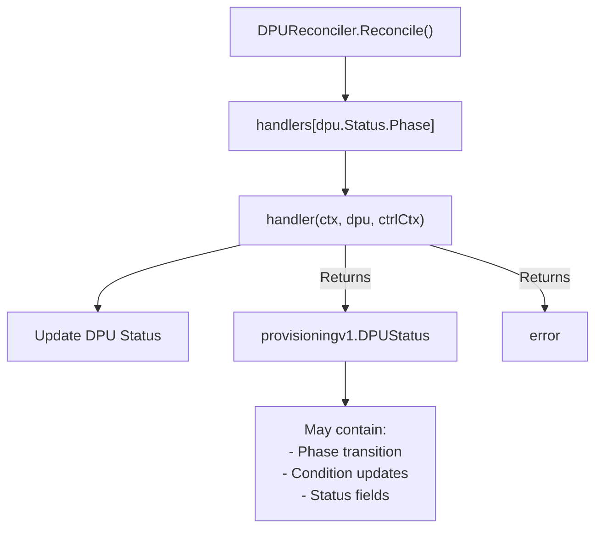
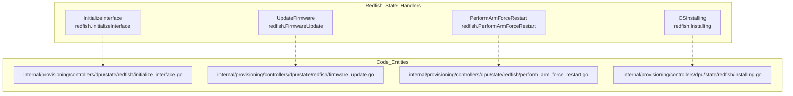
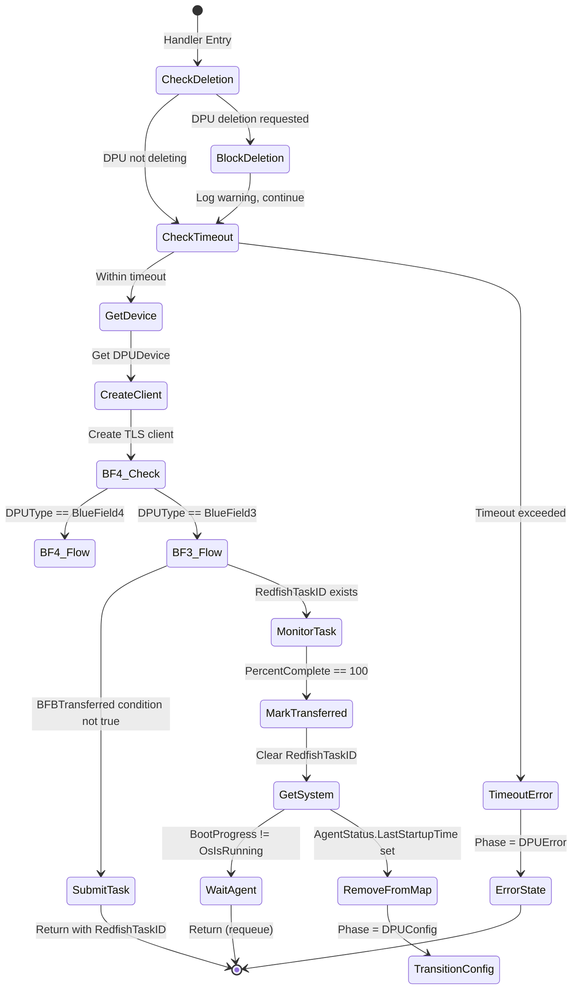
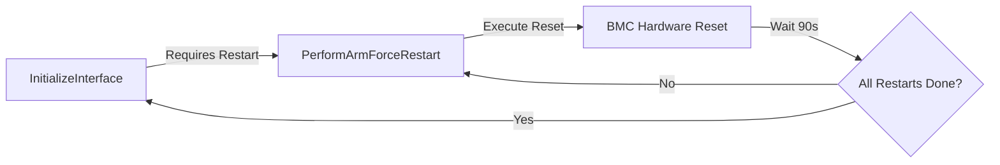

<!-- source: DeepWiki mcp.deepwiki.com · repo NVIDIA/doca-platform · page 3.6 DPU Installation State Handlers · fetched 2026-10-26 -->

# DPU Installation State Handlers

<details>
<summary>Relevant source files</summary>

The following files were used as context for generating this wiki page:

- [docs/public/advanced-configuration/per-dpu-bmc-credentials.md](docs/public/advanced-configuration/per-dpu-bmc-credentials.md)
- [internal/provisioning/controllers/dpu/state/deleting.go](internal/provisioning/controllers/dpu/state/deleting.go)
- [internal/provisioning/controllers/dpu/state/dpu_cluster_config.go](internal/provisioning/controllers/dpu/state/dpu_cluster_config.go)
- [internal/provisioning/controllers/dpu/state/dpu_cluster_config_test.go](internal/provisioning/controllers/dpu/state/dpu_cluster_config_test.go)
- [internal/provisioning/controllers/dpu/state/prepare_bfb.go](internal/provisioning/controllers/dpu/state/prepare_bfb.go)
- [internal/provisioning/controllers/dpu/state/prepare_bfb_test.go](internal/provisioning/controllers/dpu/state/prepare_bfb_test.go)
- [internal/provisioning/controllers/dpu/state/rebooting_test.go](internal/provisioning/controllers/dpu/state/rebooting_test.go)
- [internal/provisioning/controllers/dpu/state/redfish/client/client.go](internal/provisioning/controllers/dpu/state/redfish/client/client.go)
- [internal/provisioning/controllers/dpu/state/redfish/client/rshim_test.go](internal/provisioning/controllers/dpu/state/redfish/client/rshim_test.go)
- [internal/provisioning/controllers/dpu/state/redfish/config_fw_params.go](internal/provisioning/controllers/dpu/state/redfish/config_fw_params.go)
- [internal/provisioning/controllers/dpu/state/redfish/config_fw_params_test.go](internal/provisioning/controllers/dpu/state/redfish/config_fw_params_test.go)
- [internal/provisioning/controllers/dpu/state/redfish/diag/diag.go](internal/provisioning/controllers/dpu/state/redfish/diag/diag.go)
- [internal/provisioning/controllers/dpu/state/redfish/diag/diag_test.go](internal/provisioning/controllers/dpu/state/redfish/diag/diag_test.go)
- [internal/provisioning/controllers/dpu/state/redfish/firmware_update.go](internal/provisioning/controllers/dpu/state/redfish/firmware_update.go)
- [internal/provisioning/controllers/dpu/state/redfish/firmware_update_test.go](internal/provisioning/controllers/dpu/state/redfish/firmware_update_test.go)
- [internal/provisioning/controllers/dpu/state/redfish/initialize_interface.go](internal/provisioning/controllers/dpu/state/redfish/initialize_interface.go)
- [internal/provisioning/controllers/dpu/state/redfish/initialize_interface_test.go](internal/provisioning/controllers/dpu/state/redfish/initialize_interface_test.go)
- [internal/provisioning/controllers/dpu/state/redfish/installing.go](internal/provisioning/controllers/dpu/state/redfish/installing.go)
- [internal/provisioning/controllers/dpu/state/redfish/installing_test.go](internal/provisioning/controllers/dpu/state/redfish/installing_test.go)
- [internal/provisioning/controllers/dpu/state/redfish/mock/redfish.go](internal/provisioning/controllers/dpu/state/redfish/mock/redfish.go)
- [internal/provisioning/controllers/dpu/state/redfish/mock/redfish_test.go](internal/provisioning/controllers/dpu/state/redfish/mock/redfish_test.go)
- [internal/provisioning/controllers/dpu/state/redfish/perform_arm_force_restart.go](internal/provisioning/controllers/dpu/state/redfish/perform_arm_force_restart.go)
- [internal/provisioning/controllers/dpu/state/redfish/perform_arm_force_restart_test.go](internal/provisioning/controllers/dpu/state/redfish/perform_arm_force_restart_test.go)
- [internal/provisioning/controllers/dpu/util/arm_restart_tracker.go](internal/provisioning/controllers/dpu/util/arm_restart_tracker.go)
- [internal/provisioning/controllers/dpu/util/capacity.go](internal/provisioning/controllers/dpu/util/capacity.go)
- [internal/provisioning/controllers/dpu/util/join_command.go](internal/provisioning/controllers/dpu/util/join_command.go)
- [internal/provisioning/controllers/dpu/util/join_command_test.go](internal/provisioning/controllers/dpu/util/join_command_test.go)
- [internal/provisioning/controllers/dpu/util/reboot_helpers.go](internal/provisioning/controllers/dpu/util/reboot_helpers.go)
- [internal/provisioning/controllers/dpudevice/dpudevice_controller.go](internal/provisioning/controllers/dpudevice/dpudevice_controller.go)
- [internal/provisioning/controllers/dpudevice/dpudevice_controller_test.go](internal/provisioning/controllers/dpudevice/dpudevice_controller_test.go)
- [internal/provisioning/controllers/suite_test.go](internal/provisioning/controllers/suite_test.go)
- [test/mock/dms/pkg/controllers/dms_server_test.go](test/mock/dms/pkg/controllers/dms_server_test.go)

</details>


This document describes the state-specific handlers used during DPU provisioning phases. These handlers implement the logic for each phase of the DPU provisioning lifecycle, with particular focus on the Redfish installing state handler which manages BFB installation via Redfish API, task monitoring, and timeout handling.

For information about the overall DPU lifecycle state machine, see [DPUSet and DPU Lifecycle Management](#3.1). For details on installation interfaces (Redfish, gNOI, HostAgent), see [Host Agent Implementation](#3.3).

---

## Handler Architecture

State handlers are functions that implement the logic for each phase of DPU provisioning. The DPU controller maintains a map of phase-to-handler mappings and invokes the appropriate handler during reconciliation based on the current DPU phase.

### Phase Handler Interface

All phase handlers conform to the signature used by the `PhaseHandlerFunc` type (implied by usage in the DPU reconciler):

```go
type PhaseHandlerFunc func(context.Context, *provisioningv1.DPU, *dutil.ControllerContext) (provisioningv1.DPUStatus, error)
```

**Parameters:**
- `context.Context` - Request context with optional metadata.
- `*provisioningv1.DPU` - Current DPU resource being reconciled.
- `*dutil.ControllerContext` - Controller dependencies including client, scheme, recorder, and configuration options. [internal/provisioning/controllers/dpu/util/capacity.go:34-40]()

**Returns:**
- `provisioningv1.DPUStatus` - Next status for the DPU (may include phase transition).
- `error` - Error if handler execution failed (triggers requeue with backoff).



**Sources:** [internal/provisioning/controllers/dpu/state/redfish/installing.go:48-50](), [internal/provisioning/controllers/dpu/state/redfish/initialize_interface.go:49-51]()

---

## Handler Registration

Handlers are registered in the provisioning controller's main function based on the configured `DPUInstallInterface`. Common handlers apply to all interfaces, while interface-specific handlers vary by installation method.

### Interface-Specific Handlers (Redfish)

The Redfish interface includes specific handlers for hardware interaction phases, firmware updates, and ARM restarts.



**Sources:** [internal/provisioning/controllers/dpu/state/redfish/initialize_interface.go:49](), [internal/provisioning/controllers/dpu/state/redfish/firmware_update.go:45](), [internal/provisioning/controllers/dpu/state/redfish/perform_arm_force_restart.go:60](), [internal/provisioning/controllers/dpu/state/redfish/installing.go:48]()

---

## Redfish Installing State Handler

The Redfish installing state handler (`redfish.Installing`) manages BFB installation via the Redfish API. This handler is the most complex due to its asynchronous task-based nature and timeout handling requirements. [internal/provisioning/controllers/dpu/state/redfish/installing.go:48]()

### Handler Flow



**Sources:** [internal/provisioning/controllers/dpu/state/redfish/installing.go:48-139]()

### Task Submission and Monitoring (BF3)

For BlueField 3, the handler uses `submitAndMonitorBfbInstallTask`. [internal/provisioning/controllers/dpu/state/redfish/installing.go:102]()

1. **Submit**: Calls `client.InstallBFB` using the `SimpleUpdate` Redfish action. [internal/provisioning/controllers/dpu/state/redfish/client/client.go:60]()
2. **Monitor**: Polls `redfish/v1/TaskService/Tasks`. [internal/provisioning/controllers/dpu/state/redfish/client/client.go:65]()
3. **Completion**: When the task is complete, it marks `DPUCondBFBTransferred`. [internal/provisioning/controllers/dpu/state/redfish/installing.go:100-104]()

### BlueField 4 Installation Flow

For BF4, the flow uses Virtual Media and ISO-based installation:
1. **ISO Insertion**: Uses `VirtualMedia.InsertMedia` to mount the OS ISO. [internal/provisioning/controllers/dpu/state/redfish/client/client.go:62]()
2. **Boot Target**: Sets the boot target to Virtual Media via `installOsBf4`. [internal/provisioning/controllers/dpu/state/redfish/installing.go:97]()

### Timeout and Diagnostics

The handler implements installation timeout based on `ctrlCtx.Options.OSInstallTimeout`. [internal/provisioning/controllers/dpu/state/redfish/installing.go:59]()
If a timeout occurs, it performs a "best-effort rail hint" by checking the BMC System Event Log (SEL) for hardware issues like `12V_ATX` low voltage or PCIe power drops. [internal/provisioning/controllers/dpu/state/redfish/installing.go:64](), [internal/provisioning/controllers/dpu/state/redfish/client/client.go:101]()

---

## ARM Force Restart Handler

The `redfish.PerformArmForceRestart` handler executes multi-reboot cycles required for BIOS/Secure Boot settings to take effect. [internal/provisioning/controllers/dpu/state/redfish/perform_arm_force_restart.go:60]()

### Multi-Reboot Logic
1. **Tracker**: Uses an `ArmRestartTracker` to track attempts and timestamps. [internal/provisioning/controllers/dpu/state/redfish/perform_arm_force_restart.go:70](), [internal/provisioning/controllers/dpu/util/arm_restart_tracker.go:27]()
2. **Interval**: Enforces a `MinRestartInterval` (90 seconds) between restarts to allow UEFI processing. [internal/provisioning/controllers/dpu/state/redfish/perform_arm_force_restart.go:41]()
3. **Action**: Triggers a BMC-level hardware reset using `ComputerSystem.Reset` (BF3) or `Oem/NvidiaChassis.Reset` (BF4). [internal/provisioning/controllers/dpu/state/redfish/client/client.go:87-93]()



**Sources:** [internal/provisioning/controllers/dpu/state/redfish/perform_arm_force_restart.go:147-162]()

---

## Firmware Update Handler (BF4)

The `redfish.FirmwareUpdate` handler manages PLDM firmware bundles for BF4 devices. [internal/provisioning/controllers/dpu/state/redfish/firmware_update.go:45]()

1. **Check Versions**: Compares current BMC, ERoT, and SBIOS versions against the `BlueFieldSoftware` spec via `checkFirmwareVersions`. [internal/provisioning/controllers/dpu/state/redfish/firmware_update.go:129-149]()
2. **Update**: If versions mismatch, it uploads the PLDM bundle via `update-multipart`. [internal/provisioning/controllers/dpu/state/redfish/client/client.go:78]()
3. **Reboot**: Transitions to `DPURebooting` to apply the firmware. [internal/provisioning/controllers/dpu/state/redfish/firmware_update.go:119]()

---

## Summary of Redfish API Constants

The handlers interact with the following key Redfish endpoints defined in the client:

| Endpoint Purpose | Redfish URI Path |
|------------------|------------------|
| BFB Installation | `redfish/v1/UpdateService/Actions/UpdateService.SimpleUpdate` |
| Task Monitoring | `redfish/v1/TaskService/Tasks` |
| Virtual Media | `redfish/v1/Managers/{MANAGER_ID}/VirtualMedia/{MEDIA_ID}/Actions/VirtualMedia.InsertMedia` |
| Multipart Update | `redfish/v1/UpdateService/update-multipart` |
| System Reset | `redfish/v1/Systems/{SYSTEM_ID}/Actions/ComputerSystem.Reset` |
| Event Log (SEL) | `redfish/v1/Systems/{SYSTEM_ID}/LogServices/SEL/Entries` |
| Chassis Reset | `redfish/v1/Chassis/{CHASSIS_ID}/Actions/Oem/NvidiaChassis.Reset` |

**Sources:** [internal/provisioning/controllers/dpu/state/redfish/client/client.go:48-101]()

---

