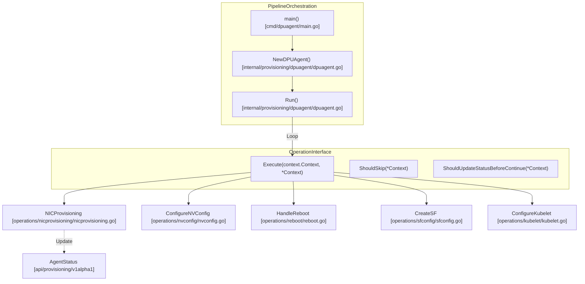
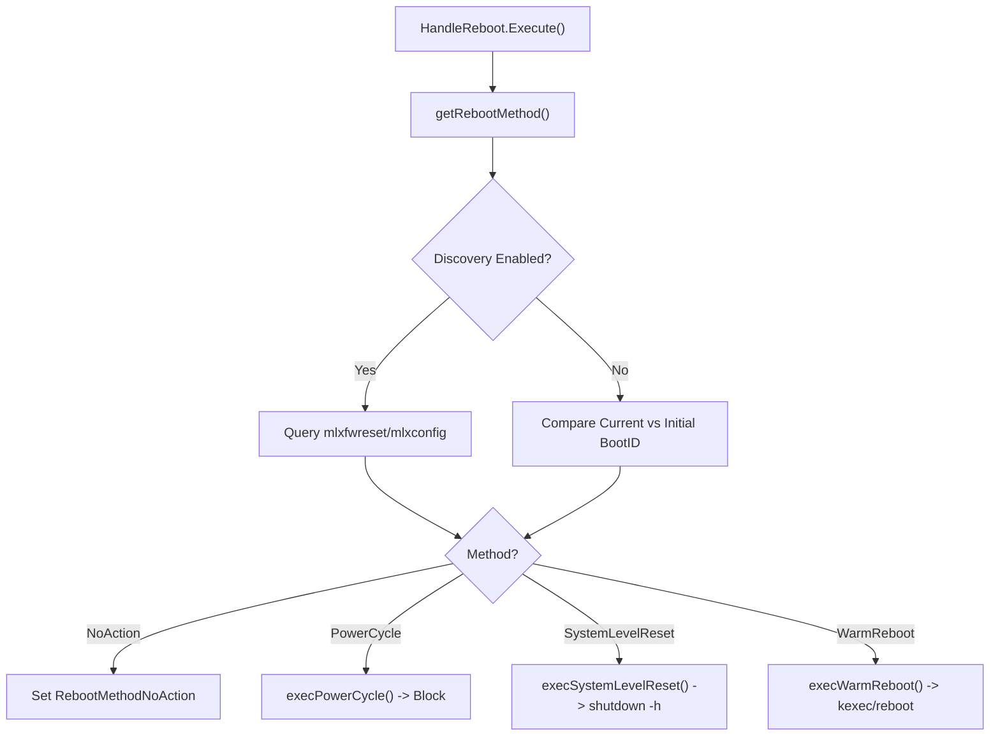

<!-- source: DeepWiki mcp.deepwiki.com · repo NVIDIA/doca-platform · page 3.7 DPU Agent Operations · fetched 2026-10-26 -->

# DPU Agent Operations

Relevant source files

The following files were used as context for generating this wiki page:

- [api/provisioning/v1alpha1/dpuflavor_types.go](api/provisioning/v1alpha1/dpuflavor_types.go)
- [cmd/dpuagent/main.go](cmd/dpuagent/main.go)
- [cmd/dpuagent/opts/options.go](cmd/dpuagent/opts/options.go)
- [config/provisioning/crd/bases/provisioning.dpu.nvidia.com_dpuflavors.yaml](config/provisioning/crd/bases/provisioning.dpu.nvidia.com_dpuflavors.yaml)
- [deploy/charts/dpf-operator/templates/crds/apiextensions.k8s.io_v1_customresourcedefinition_dpuflavors.provisioning.dpu.nvidia.com.yaml](deploy/charts/dpf-operator/templates/crds/apiextensions.k8s.io_v1_customresourcedefinition_dpuflavors.provisioning.dpu.nvidia.com.yaml)
- [docs/public/developer-guides/api/dpuflavor.md](docs/public/developer-guides/api/dpuflavor.md)
- [internal/provisioning/dpuagent/ca_trust_bundle_watch.go](internal/provisioning/dpuagent/ca_trust_bundle_watch.go)
- [internal/provisioning/dpuagent/dpuagent.go](internal/provisioning/dpuagent/dpuagent.go)
- [internal/provisioning/dpuagent/dpuagent_test.go](internal/provisioning/dpuagent/dpuagent_test.go)
- [internal/provisioning/dpuagent/operations/containerd/containerd.go](internal/provisioning/dpuagent/operations/containerd/containerd.go)
- [internal/provisioning/dpuagent/operations/containerd/containerd_test.go](internal/provisioning/dpuagent/operations/containerd/containerd_test.go)
- [internal/provisioning/dpuagent/operations/dpumode/dpumode.go](internal/provisioning/dpuagent/operations/dpumode/dpumode.go)
- [internal/provisioning/dpuagent/operations/dpumode/dpumode_test.go](internal/provisioning/dpuagent/operations/dpumode/dpumode_test.go)
- [internal/provisioning/dpuagent/operations/kubelet/kubelet.go](internal/provisioning/dpuagent/operations/kubelet/kubelet.go)
- [internal/provisioning/dpuagent/operations/kubelet/kubelet_test.go](internal/provisioning/dpuagent/operations/kubelet/kubelet_test.go)
- [internal/provisioning/dpuagent/operations/netplan/netplan.go](internal/provisioning/dpuagent/operations/netplan/netplan.go)
- [internal/provisioning/dpuagent/operations/netplan/netplan_test.go](internal/provisioning/dpuagent/operations/netplan/netplan_test.go)
- [internal/provisioning/dpuagent/operations/nicprovisioning/nicprovisioning.go](internal/provisioning/dpuagent/operations/nicprovisioning/nicprovisioning.go)
- [internal/provisioning/dpuagent/operations/nicprovisioning/nicprovisioning_test.go](internal/provisioning/dpuagent/operations/nicprovisioning/nicprovisioning_test.go)
- [internal/provisioning/dpuagent/operations/nvconfig/nvconfig.go](internal/provisioning/dpuagent/operations/nvconfig/nvconfig.go)
- [internal/provisioning/dpuagent/operations/nvconfig/nvconfig_test.go](internal/provisioning/dpuagent/operations/nvconfig/nvconfig_test.go)
- [internal/provisioning/dpuagent/operations/nvconfig/resolve_test.go](internal/provisioning/dpuagent/operations/nvconfig/resolve_test.go)
- [internal/provisioning/dpuagent/operations/reboot/reboot.go](internal/provisioning/dpuagent/operations/reboot/reboot.go)
- [internal/provisioning/dpuagent/operations/reboot/reboot_test.go](internal/provisioning/dpuagent/operations/reboot/reboot_test.go)
- [internal/provisioning/dpuagent/operations/sfconfig/dma.go](internal/provisioning/dpuagent/operations/sfconfig/dma.go)
- [internal/provisioning/dpuagent/operations/sfconfig/sfconfig.go](internal/provisioning/dpuagent/operations/sfconfig/sfconfig.go)
- [internal/provisioning/dpuagent/operations/sfconfig/sfconfig_test.go](internal/provisioning/dpuagent/operations/sfconfig/sfconfig_test.go)
- [internal/provisioning/dpuagent/operations/type.go](internal/provisioning/dpuagent/operations/type.go)
- [internal/provisioning/dpuagent/operations/vfmac/vfmac.go](internal/provisioning/dpuagent/operations/vfmac/vfmac.go)
- [internal/provisioning/dpuagent/util/util.go](internal/provisioning/dpuagent/util/util.go)
- [internal/provisioning/dpuagent/util/util_test.go](internal/provisioning/dpuagent/util/util_test.go)
- [internal/provisioning/utils/netplan/netplan.go](internal/provisioning/utils/netplan/netplan.go)
- [internal/provisioning/utils/netplan/netplan_test.go](internal/provisioning/utils/netplan/netplan_test.go)
- [internal/provisioning/utils/pci/pci.go](internal/provisioning/utils/pci/pci.go)
- [internal/provisioning/utils/pci/pci_test.go](internal/provisioning/utils/pci/pci_test.go)
- [internal/provisioning/webhooks/dpuflavor_webhook.go](internal/provisioning/webhooks/dpuflavor_webhook.go)
- [internal/provisioning/webhooks/dpuflavor_webhook_test.go](internal/provisioning/webhooks/dpuflavor_webhook_test.go)
- [pkg/vfmac/README.md](pkg/vfmac/README.md)
- [pkg/vfmac/vfmac.go](pkg/vfmac/vfmac.go)
- [pkg/vfmac/vfmac_test.go](pkg/vfmac/vfmac_test.go)
- [test/apivalidation/provisioning_api_validation_test.go](test/apivalidation/provisioning_api_validation_test.go)
- [test/objects/infrastructure/dpuflavor-physical-bf4.yaml](test/objects/infrastructure/dpuflavor-physical-bf4.yaml)

The DPU Agent is a specialized binary that runs on the DPU ARM subsystem to perform host-local provisioning tasks. It executes a sequential pipeline of operations to configure the network, system parameters, hardware settings (NVConfig), and the local Kubernetes environment (kubelet) before reporting its status back to the management cluster.

## Execution Pipeline

The `DPUAgent` manages a series of `Operation` objects defined in `internal/provisioning/dpuagent/operations/type.go`. Each operation is executed until success, with retries governed by a configurable interval.

### Operation Sequence
The agent executes the following operations in order:

1.  **Kernel and Network Setup**: Loads required kernel modules and applies Netplan configurations for OOB and communication channels [internal/provisioning/dpuagent/dpuagent.go:92-94]().
2.  **Identity and Discovery**: Retrieves the latest `DPU` resource from the management cluster and identifies physical NIC ports [internal/provisioning/dpuagent/dpuagent.go:96]().
3.  **Hardware Provisioning**: Performs NIC firmware updates (for BF4/Astra) and applies `nvconfig` settings using the `mlxconfig` tool [internal/provisioning/dpuagent/dpuagent.go:107-108]().
4.  **System Configuration**: Manages OS packages, systemd services, sysctl parameters, and GRUB kernel command-line arguments [internal/provisioning/dpuagent/dpuagent.go:99-104]().
5.  **Reboot Management**: Orchestrates necessary reboots if hardware or kernel changes require them [internal/provisioning/dpuagent/dpuagent.go:109]().
6.  **Virtualization and Networking**: Configures DPU modes, creates Sub-Functions (SFs), sets VF MAC addresses, and runs OVS configuration scripts [internal/provisioning/dpuagent/dpuagent.go:111-113]().
7.  **Kubelet Lifecycle**: Removes built-in BlueField kubelet configurations, generates new bootstrap configurations, and starts the kubelet to join the DPU cluster [internal/provisioning/dpuagent/dpuagent.go:115-116]().
8.  **Status Reporting**: Reports final node labels and conditions back to the management cluster [internal/provisioning/dpuagent/dpuagent.go:117-118]().

### Code Entity Mapping: Agent Pipeline
The following diagram maps the logical execution stages to the specific implementation classes and functions.

Title: "DPU Agent Operation Pipeline"

Sources: [internal/provisioning/dpuagent/dpuagent.go:89-125](), [internal/provisioning/dpuagent/operations/type.go:34-43](), [cmd/dpuagent/main.go:77-127]()

## Hardware and NIC Provisioning

### NVConfig Management
The `ConfigureNVConfig` operation manages hardware parameters on the ConnectX controllers. It supports two modes:
*   **Legacy (Boot-ID based)**: Resets all target PCI devices and then applies the full parameter list from the `DPUFlavor` [internal/provisioning/dpuagent/operations/nvconfig/nvconfig.go:129-146]().
*   **Device-Query (RebootMethodDiscovery)**: Uses `--with_default set` to avoid unnecessary resets. It queries the current state and only applies changes if they differ from the default or current values [internal/provisioning/dpuagent/operations/nvconfig/nvconfig.go:148-174]().

### BF4 Astra Provisioning
For BlueField-4 devices, the `NICProvisioning` operation handles Astra-specific firmware and configuration. It downloads firmware from the BFB registry, starts a local DMS (Device Management Service) server, and applies Spectrum-X configurations [internal/provisioning/dpuagent/operations/nicprovisioning/nicprovisioning.go:116-175]().

Sources: [internal/provisioning/dpuagent/operations/nvconfig/nvconfig.go:80-176](), [internal/provisioning/dpuagent/operations/nicprovisioning/nicprovisioning.go:79-94]()

## Reboot Orchestration

The agent determines if a reboot is necessary based on `mlxconfig` output or changes to the GRUB configuration.

### Reboot Logic and Methods
The `HandleReboot` operation evaluates the required reboot method:
*   **RebootMethodPowerCycle**: Required for critical hardware changes (e.g., `DELAY_HOST_OS_INIT`) [internal/provisioning/dpuagent/operations/reboot/reboot.go:80-88]().
*   **RebootMethodSystemLevelReset**: Triggers a host-level shutdown [internal/provisioning/dpuagent/operations/reboot/reboot.go:167-168]().
*   **RebootMethodFirmwareReset**: Uses `mlxfwreset` for non-disruptive NIC resets when possible [internal/provisioning/dpuagent/operations/reboot/reboot.go:169-170]().
*   **RebootMethodDPUWarmReboot**: Used for kernel command-line changes [internal/provisioning/dpuagent/operations/reboot/reboot.go:171-172]().

Title: "Reboot Decision Flow"

Sources: [internal/provisioning/dpuagent/operations/reboot/reboot.go:128-176](), [internal/provisioning/dpuagent/operations/reboot/reboot.go:47-76]()

## Kubelet Configuration and Node Joining

The agent prepares the DPU to join the DPU cluster by configuring the local `kubelet`.

### Operation Sequence
1.  **RemoveBuiltinKubelet**: Deletes the default factory kubelet configuration (e.g., `90-kubelet-bluefield.conf`) to prevent conflicts with the DPF-managed kubelet [internal/provisioning/dpuagent/operations/kubelet/kubelet.go:83-97]().
2.  **ConfigureKubelet**: 
    *   Retrieves a bootstrap token from a Secret in the management cluster [internal/provisioning/dpuagent/operations/kubelet/kubelet.go:223-225]().
    *   Generates a `bootstrap-kubelet.conf` and a `config.yaml` for the kubelet [internal/provisioning/dpuagent/operations/kubelet/kubelet.go:230-250]().
    *   Creates a systemd drop-in file (`10-bf.conf`) to point the kubelet to these configuration files [internal/provisioning/dpuagent/operations/kubelet/kubelet.go:50-59]().
3.  **StartKubelet**: Disables the kubelet from starting automatically on boot (to ensure SFs are created first) and then starts it manually [internal/provisioning/dpuagent/operations/kubelet/kubelet.go:142-157]().

Sources: [internal/provisioning/dpuagent/operations/kubelet/kubelet.go:17-39](), [internal/provisioning/dpuagent/operations/kubelet/kubelet.go:159-184]()

## Status Reporting

Throughout the pipeline, the agent maintains an in-memory `AgentStatus` struct within the `operations.Context`.

### Data Flow
*   **Condition Updates**: Each operation reports its success or failure by updating a `metav1.Condition` in the status [internal/provisioning/dpuagent/dpuagent.go:164-168]().
*   **Synchronization**: The agent periodically patches the `DPU` resource in the management cluster using `updateStatusUntilSuccess`. This ensures that the provisioning controller can track progress and handle timeouts [internal/provisioning/dpuagent/dpuagent.go:131-136]().
*   **Completion Marker**: Once all operations finish, the agent writes a `configuration-complete` file to `/run/dpu-agent` to signal readiness to other local processes [internal/provisioning/dpuagent/dpuagent.go:71-73]().

Sources: [internal/provisioning/dpuagent/dpuagent.go:131-136](), [internal/provisioning/dpuagent/operations/type.go:73-75](), [internal/provisioning/dpuagent/dpuagent.go:156-175]()

---

