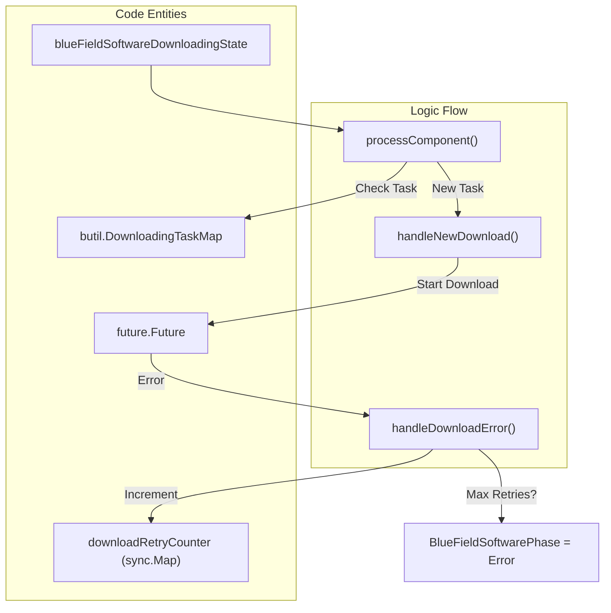

<!-- source: DeepWiki mcp.deepwiki.com · repo NVIDIA/doca-platform · page 3.8 BlueField Software and BF4 Provisioning · fetched 2026-10-26 -->

# BlueField Software and BF4 Provisioning

<details>
<summary>Relevant source files</summary>

The following files were used as context for generating this wiki page:

- [api/provisioning/v1alpha1/bluefield_types.go](api/provisioning/v1alpha1/bluefield_types.go)
- [config/provisioning/crd/bases/provisioning.dpu.nvidia.com_bluefieldsoftwares.yaml](config/provisioning/crd/bases/provisioning.dpu.nvidia.com_bluefieldsoftwares.yaml)
- [deploy/charts/dpf-operator/templates/crds/apiextensions.k8s.io_v1_customresourcedefinition_bluefieldsoftwares.provisioning.dpu.nvidia.com.yaml](deploy/charts/dpf-operator/templates/crds/apiextensions.k8s.io_v1_customresourcedefinition_bluefieldsoftwares.provisioning.dpu.nvidia.com.yaml)
- [internal/provisioning/controllers/bluefieldsoftware/state/deleting.go](internal/provisioning/controllers/bluefieldsoftware/state/deleting.go)
- [internal/provisioning/controllers/bluefieldsoftware/state/downloading.go](internal/provisioning/controllers/bluefieldsoftware/state/downloading.go)
- [internal/provisioning/controllers/bluefieldsoftware/state/downloading_test.go](internal/provisioning/controllers/bluefieldsoftware/state/downloading_test.go)
- [internal/provisioning/controllers/bluefieldsoftware/state/error.go](internal/provisioning/controllers/bluefieldsoftware/state/error.go)
- [internal/provisioning/controllers/bluefieldsoftware/state/error_test.go](internal/provisioning/controllers/bluefieldsoftware/state/error_test.go)
- [internal/provisioning/controllers/bluefieldsoftware/state/extracting.go](internal/provisioning/controllers/bluefieldsoftware/state/extracting.go)
- [internal/provisioning/controllers/bluefieldsoftware/state/extracting_test.go](internal/provisioning/controllers/bluefieldsoftware/state/extracting_test.go)
- [internal/provisioning/controllers/bluefieldsoftware/state/ready.go](internal/provisioning/controllers/bluefieldsoftware/state/ready.go)
- [internal/provisioning/controllers/bluefieldsoftware/util/task.go](internal/provisioning/controllers/bluefieldsoftware/util/task.go)
- [internal/provisioning/controllers/bluefieldsoftware/util/task_test.go](internal/provisioning/controllers/bluefieldsoftware/util/task_test.go)
- [internal/provisioning/controllers/bluefieldsoftware_controller_test.go](internal/provisioning/controllers/bluefieldsoftware_controller_test.go)
- [test/e2e/config-provisioning-zt-physical-bf4.yaml](test/e2e/config-provisioning-zt-physical-bf4.yaml)
- [test/objects/application/dpudeployment-zerotrust-bf4.yaml](test/objects/application/dpudeployment-zerotrust-bf4.yaml)
- [test/objects/infrastructure/bluefieldsoftware-bf4.yaml](test/objects/infrastructure/bluefieldsoftware-bf4.yaml)
- [test/objects/infrastructure/dpuset-zerotrust-bf4.yaml](test/objects/infrastructure/dpuset-zerotrust-bf4.yaml)

</details>


This page documents the provisioning workflow for BlueField-4 (BF4) devices, focusing on the `BlueFieldSoftware` Custom Resource Definition (CRD), PLDM firmware bundle management, and ISO-based installation via Redfish Virtual Media.

## Overview

BlueField-4 provisioning introduces a distinct lifecycle compared to previous generations. While BF3 relies on BlueField Bundles (BFB) for unified updates, BF4 utilizes a decomposed approach involving **PLDM Firmware Bundles** for hardware components (BMC, ERoT, UEFI) and **OS ISOs** for the operating system installation [api/provisioning/v1alpha1/bluefield_types.go:91-118](). The DPF Provisioning Controller orchestrates these via Redfish APIs, enforcing specific firmware versions before proceeding to OS installation.

## BlueFieldSoftware CRD

The `BlueFieldSoftware` resource acts as a registry for the artifacts required to provision a BF4 DPU. It manages the downloading, extraction, and version tracking of firmware and OS images.

### Resource Structure
The `BlueFieldSpec` defines the source URLs for the required components:
*   `osIso`: The ISO image used for the DPU OS installation [api/provisioning/v1alpha1/bluefield_types.go:95]().
*   `pldmFwBundle`: A map of PSID to PLDM firmware bundle URLs used for baseline DPU updates. Keys are matched case-insensitively against the BMC-reported `DPUDevice` status PSID [api/provisioning/v1alpha1/bluefield_types.go:97-103]().
*   `platformPldmFwBundle`: Optional bundle for E/W NIC firmware updates [api/provisioning/v1alpha1/bluefield_types.go:105-109]().
*   `nicFw`: Direct link to NIC firmware binary, mutually exclusive with `platformPldmFwBundle` [api/provisioning/v1alpha1/bluefield_types.go:111-117]().

### Lifecycle State Machine
The `BlueFieldSoftware` controller transitions through the following phases:
1.  **Initializing**: Initial state upon creation [api/provisioning/v1alpha1/bluefield_types.go:51]().
2.  **Downloading**: The controller fetches the remote artifacts to local storage (typically a PV mounted on the controller). It implements a retry mechanism with a maximum of 3 attempts per component [internal/provisioning/controllers/bluefieldsoftware/state/downloading.go:45,52-57]().
3.  **Extracting**: PLDM bundles are unpacked using a specialized service (accessible via Unix Domain Socket at `/var/run/dpf/pldm-unpack.sock`) to identify individual component versions [internal/provisioning/controllers/bluefieldsoftware/state/extracting.go:45-47,85-111]().
4.  **Ready**: Artifacts are validated, extracted, and available for DPU provisioning [api/provisioning/v1alpha1/bluefield_types.go:57]().
5.  **Error**: A state entered after terminal failures or exhausted retries. The controller may attempt to retry recoverable errors within a `RetryWindow` of 30 minutes [internal/provisioning/controllers/bluefieldsoftware/state/error.go:32-38]().

**Sources:** [api/provisioning/v1alpha1/bluefield_types.go:33-75](), [internal/provisioning/controllers/bluefieldsoftware/state/downloading.go:60-90](), [internal/provisioning/controllers/bluefieldsoftware/state/error.go:40-79]()

---

## BF4 Provisioning Workflow

Provisioning a BF4 DPU involves a multi-stage process handled by the DPU controller when targeting BF4 hardware.

### Firmware Version Enforcement
Before OS installation, the controller ensures the DPU hardware is running the exact versions specified in the `BlueFieldSoftware` status.

1.  **Verification**: The controller queries the BMC via Redfish to check current versions of BMC, ERoT, SBIOS, and NIC firmware [internal/provisioning/controllers/bluefieldsoftware/state/extracting_test.go:69-76]().
2.  **Update**: If versions mismatch, the controller triggers a PLDM bundle update. In certain environments, a force flag `provisioning.dpu.nvidia.com/force-fw-update` can be used to allow downgrades or overrides [test/objects/infrastructure/dpuset-zerotrust-bf4.yaml:15-19]().
3.  **Finalization**: Completion is tracked in the `BlueFieldSoftware` status to prevent redundant extractions if the pod restarts [internal/provisioning/controllers/bluefieldsoftware/state/extracting.go:121-125]().

### ISO Installation via Virtual Media
Once firmware is aligned, the OS is installed using Redfish Virtual Media:
*   **Virtual Media Insertion**: The controller provides the URI to the `osIso` hosted by the DPF registry.
*   **Boot Target Configuration**: The boot source is configured to ensure the DPU boots from the mounted ISO.
*   **Version Tracking**: The `BluefieldSoftwareVersions` struct tracks the user-facing DOCA version and raw OS ISO version derived from the filename [api/provisioning/v1alpha1/bluefield_types.go:142-150]().

---

## Technical Architecture Diagrams

### BlueField Software Extraction Data Flow
This diagram associates the code entities involved in the extraction process with the system components.

```mermaid
graph TD
    subgraph "Natural Language Space"
        User["User/Admin"]
        Firmware["PLDM Firmware"]
    end

    subgraph "Code Entity Space (DPF Operator)"
        BFS_CR["provisioningv1.BlueFieldSoftware CR"]
        BFS_EXT["blueFieldSoftwareExtractingState"]
        UNPACK_REQ["unpackRequest struct"]
        UNPACK_RES["unpackResponse struct"]
    end

    subgraph "System/Filesystem Space"
        UDS["/var/run/dpf/pldm-unpack.sock"]
        BFB_DIR["/bfb/components"]
        UNPACK_BIN["PLDM Unpack Service"]
    end

    User -->|Creates| BFS_CR
    BFS_EXT -->|Handle()| BFS_CR
    BFS_EXT -->|callPldmUnpackService()| UDS
    UDS -.->|JSON| UNPACK_BIN
    UNPACK_BIN -->|Write Artifacts| BFB_DIR
    BFS_EXT -->|applyUnpackedComponentsToDownloaded()| BFS_CR
    BFS_EXT -.->|Uses| UNPACK_REQ
    UNPACK_BIN -.->|Returns| UNPACK_RES
```
**Sources:** [internal/provisioning/controllers/bluefieldsoftware/state/extracting.go:44-84](), [internal/provisioning/controllers/bluefieldsoftware/state/extracting.go:134-144](), [internal/provisioning/controllers/bluefieldsoftware/state/extracting.go:198-204]()

### Component Download and Retry Logic
This diagram illustrates the association between the `BlueFieldSoftware` state and the internal task management.


**Sources:** [internal/provisioning/controllers/bluefieldsoftware/state/downloading.go:48-53](), [internal/provisioning/controllers/bluefieldsoftware/state/downloading.go:109-123](), [internal/provisioning/controllers/bluefieldsoftware/state/downloading.go:142-185](), [internal/provisioning/controllers/bluefieldsoftware/util/task.go:32]()

## Component Management Utility
The `internal/provisioning/controllers/bluefieldsoftware/util` package provides critical helpers for filename generation and task naming to prevent collisions in shared storage.

| Function | Purpose | Reference |
| :--- | :--- | :--- |
| `PldmTaskName` | Generates distinct download task names per PSID | [internal/provisioning/controllers/bluefieldsoftware/util/task.go:123-129]() |
| `PldmComponentFilename` | Creates on-disk filenames incorporating Namespace, Name, and PSID | [internal/provisioning/controllers/bluefieldsoftware/util/task.go:134-142]() |
| `SpecURLForComponent` | Resolves URLs for single-valued components (ISO, Platform Bundle) | [internal/provisioning/controllers/bluefieldsoftware/util/task.go:55-65]() |
| `FilenameFromHTTPURL` | Sanitizes and extracts the base filename from a remote URL | [internal/provisioning/controllers/bluefieldsoftware/util/task.go:84-104]() |

**Sources:** [internal/provisioning/controllers/bluefieldsoftware/util/task.go:1-142]()

---

