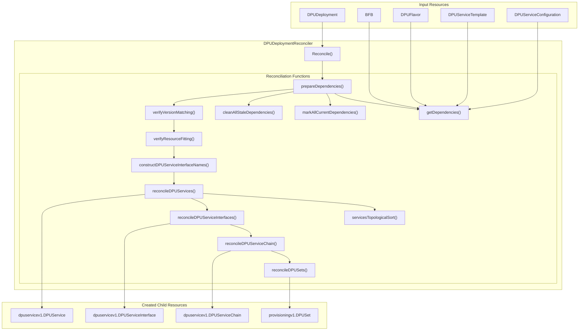
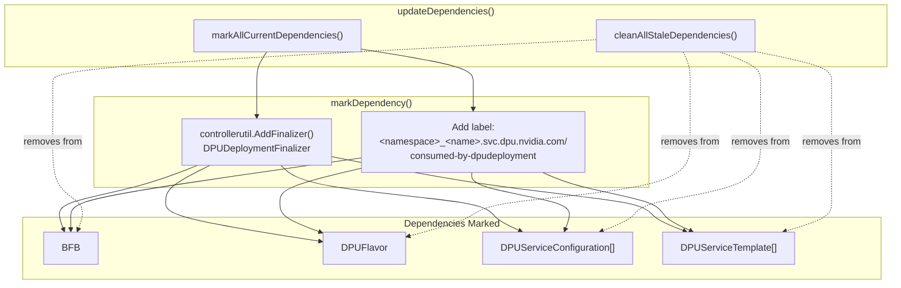

<!-- source: DeepWiki mcp.deepwiki.com · repo NVIDIA/doca-platform · page 4.1 DPUDeployment Orchestration · fetched 2026-10-26 -->

# DPUDeployment Orchestration

<details>
<summary>Relevant source files</summary>

The following files were used as context for generating this wiki page:

- [api/dpuservice/v1alpha1/dpudeployment_types.go](api/dpuservice/v1alpha1/dpudeployment_types.go)
- [api/dpuservice/v1alpha1/zz_generated.deepcopy.go](api/dpuservice/v1alpha1/zz_generated.deepcopy.go)
- [config/dpuservice/crd/bases/svc.dpu.nvidia.com_dpudeployments.yaml](config/dpuservice/crd/bases/svc.dpu.nvidia.com_dpudeployments.yaml)
- [deploy/charts/dpf-operator/templates/crds/apiextensions.k8s.io_v1_customresourcedefinition_dpudeployments.svc.dpu.nvidia.com.yaml](deploy/charts/dpf-operator/templates/crds/apiextensions.k8s.io_v1_customresourcedefinition_dpudeployments.svc.dpu.nvidia.com.yaml)
- [docs/public/advanced-configuration/README.md](docs/public/advanced-configuration/README.md)
- [docs/public/advanced-configuration/service-readiness.md](docs/public/advanced-configuration/service-readiness.md)
- [docs/public/advanced-configuration/zero-trust-advanced-configuration.md](docs/public/advanced-configuration/zero-trust-advanced-configuration.md)
- [docs/public/developer-guides/api/dpudeployment.md](docs/public/developer-guides/api/dpudeployment.md)
- [docs/public/developer-guides/api/dpuset.md](docs/public/developer-guides/api/dpuset.md)
- [docs/public/operational-readiness/observability/guides/operational-readiness.md](docs/public/operational-readiness/observability/guides/operational-readiness.md)
- [docs/public/user-guides/host-trusted/use-cases/hbn-ovnk/manifests/05-dpudeployment-installation/dpudeployment.yaml](docs/public/user-guides/host-trusted/use-cases/hbn-ovnk/manifests/05-dpudeployment-installation/dpudeployment.yaml)
- [docs/public/user-guides/host-trusted/use-cases/hbn/manifests/04-dpudeployment-installation/dpudeployment.yaml](docs/public/user-guides/host-trusted/use-cases/hbn/manifests/04-dpudeployment-installation/dpudeployment.yaml)
- [docs/public/user-guides/host-trusted/use-cases/ovnk/manifests/05-dpudeployment-installation/dpudeployment.yaml](docs/public/user-guides/host-trusted/use-cases/ovnk/manifests/05-dpudeployment-installation/dpudeployment.yaml)
- [docs/public/user-guides/host-trusted/use-cases/ovnk/manifests/05-dpudeployment-installation/dpuflavor-ovn.yaml](docs/public/user-guides/host-trusted/use-cases/ovnk/manifests/05-dpudeployment-installation/dpuflavor-ovn.yaml)
- [dpuservices/argus/DPUFlavor.yaml](dpuservices/argus/DPUFlavor.yaml)
- [dpuservices/firefly/DPUFlavor.yaml](dpuservices/firefly/DPUFlavor.yaml)
- [internal/dpuservice/controllers/dpudeployment_controller.go](internal/dpuservice/controllers/dpudeployment_controller.go)
- [internal/dpuservice/controllers/dpudeployment_controller_dpuservice.go](internal/dpuservice/controllers/dpudeployment_controller_dpuservice.go)
- [internal/dpuservice/controllers/dpudeployment_controller_dpuservicechain.go](internal/dpuservice/controllers/dpudeployment_controller_dpuservicechain.go)
- [internal/dpuservice/controllers/dpudeployment_controller_dpuserviceinterface.go](internal/dpuservice/controllers/dpudeployment_controller_dpuserviceinterface.go)
- [internal/dpuservice/controllers/dpudeployment_controller_test.go](internal/dpuservice/controllers/dpudeployment_controller_test.go)
- [test/apivalidation/dpuservice_api_validation_test.go](test/apivalidation/dpuservice_api_validation_test.go)

</details>


## Purpose and Scope

The `DPUDeploymentReconciler` is the high-level orchestration controller responsible for managing the complete lifecycle of DPU-based services. It coordinates the creation and management of child resources (DPUSets, DPUServices, DPUServiceChains, and DPUServiceInterfaces) based on a declarative `DPUDeployment` specification. This page covers the controller internals, dependency resolution, version coordination, and disruptive upgrade handling.

For information about the DPUService resources themselves and their lifecycle, see [DPUService Resources](#4.2). For details on service chains and interface management, see [Service Chains and Interfaces](#4.3).

Sources: [internal/dpuservice/controllers/dpudeployment_controller.go:53-55](), [api/dpuservice/v1alpha1/dpudeployment_types.go:133-149]()

## Architecture Overview



**DPUDeploymentReconciler Function Flow**

The controller implements a staged reconciliation pattern where each phase validates dependencies before proceeding. The `Reconcile()` function orchestrates the overall flow, calling specialized functions for each phase. Dependencies are loaded and marked first, followed by version and resource validation, and finally child resource creation in dependency order.

Sources: [internal/dpuservice/controllers/dpudeployment_controller.go:197-248](), [internal/dpuservice/controllers/dpudeployment_controller.go:254-368]()

## Controller Structure

The `DPUDeploymentReconciler` is defined at [internal/dpuservice/controllers/dpudeployment_controller.go:97-100]():

| Field | Type | Purpose |
|-------|------|---------|
| `Client` | `client.Client` | Kubernetes API client for resource operations |
| `Scheme` | `*runtime.Scheme` | Runtime scheme for type registration |

### Controller Setup

The `SetupWithManager()` function at [internal/dpuservice/controllers/dpudeployment_controller.go:109-125]() configures:

**Primary Resource:**
- `DPUDeployment` - Main reconciliation target

**Watched Dependencies:**
- `BFB` → triggers `BFBToDPUDeployment()` handler
- `BlueFieldSoftware` → triggers `BlueFieldSoftwareToDPUDeployment()` handler
- `DPUFlavor` → triggers `DPUFlavorToDPUDeployment()` handler
- `DPUFlavorTemplate` → triggers `DPUFlavorTemplateToDPUDeployment()` handler
- `DPUServiceConfiguration` → triggers `DPUServiceConfigurationToDPUDeployment()` handler
- `DPUServiceTemplate` → triggers `DPUServiceTemplateToDPUDeployment()` handler

**Owned Child Resources:**
- `DPUService` - Service pods
- `DPUServiceChain` - Network topology
- `DPUServiceInterface` - Network interfaces
- `DPUSet` - Provisioning sets

Each dependency handler lists all DPUDeployments that reference the changed resource and enqueues them for reconciliation.

Sources: [internal/dpuservice/controllers/dpudeployment_controller.go:109-125](), [internal/dpuservice/controllers/dpudeployment_controller.go:128-145](), [internal/dpuservice/controllers/dpudeployment_controller.go:148-165]()

## Dependency Management

### Dependency Loading

The `dpuDeploymentDependencies` struct at [internal/dpuservice/controllers/dpudeployment_controller.go:189-194]() holds all required dependencies:

```go
type dpuDeploymentDependencies struct {
	BFB                      *provisioningv1.BFB
	DPUFlavor                *provisioningv1.DPUFlavor
	DPUServiceConfigurations map[string]*dpuservicev1.DPUServiceConfiguration
	DPUServiceTemplates      map[string]*dpuservicev1.DPUServiceTemplate
}
```

The `getDependencies()` function at [internal/dpuservice/controllers/dpudeployment_controller.go:613-666]() performs dependency resolution:

1. **BFB Lookup**: Fetches BFB from `dpuDeployment.Spec.DPUs.BFB` in the same namespace. Returns error if BFB not in `Ready` phase.
2. **DPUFlavor Lookup**: Fetches DPUFlavor from `dpuDeployment.Spec.DPUs.Flavor`.
3. **Service Dependencies**: For each entry in `dpuDeployment.Spec.Services`:
   - Fetches `DPUServiceTemplate` by name from `ServiceTemplate` field.
   - Fetches `DPUServiceConfiguration` by name from `ServiceConfiguration` field.
   - Validates `deploymentServiceName` matches the service key.
   - Checks `DPUServiceTemplate` is Ready with matching `ObservedGeneration`.

The function returns an error if any dependency is missing or not ready, preventing partial deployments.

Sources: [internal/dpuservice/controllers/dpudeployment_controller.go:189-194](), [internal/dpuservice/controllers/dpudeployment_controller.go:613-666]()

### Dependency Marking



**Dependency Protection Mechanism**

The `markDependency()` function at [internal/dpuservice/controllers/dpudeployment_controller.go:515-537]() protects dependencies by adding:

- **Finalizer**: `dpuservicev1.DPUDeploymentFinalizer` (defined as `svc.dpu.nvidia.com/dpudeployment`) prevents deletion while referenced.
- **Label**: Key format is `<namespace>_<name>.svc.dpu.nvidia.com/consumed-by-dpudeployment` with empty value, enabling queries for resources consumed by specific DPUDeployments.

The `markAllCurrentDependencies()` function at [internal/dpuservice/controllers/dpudeployment_controller.go:400-431]() iterates through all dependencies and applies these markers.

The `cleanAllStaleDependencies()` function at [internal/dpuservice/controllers/dpudeployment_controller.go:434-512]() removes markers from resources no longer referenced.

Sources: [internal/dpuservice/controllers/dpudeployment_controller.go:400-431](), [internal/dpuservice/controllers/dpudeployment_controller.go:434-512](), [internal/dpuservice/controllers/dpudeployment_controller.go:515-537]()

## Version and Resource Validation

### Version Matching

The `verifyVersionMatching()` function at [internal/dpuservice/controllers/dpudeployment_controller.go:577-610]() validates version compatibility:

1. **Get BFB Version**: Retrieves the version string from the BFB status.
2. **Parse BFB Version**: Uses `semver.NewVersion()` to parse the version.
3. **Check Each Service**: For each `DPUServiceTemplate`:
   - Retrieves version constraints from `Status.Versions` map.
   - Parses constraint using `semver.NewConstraint()`.
   - Calls `constraint.Check(bfbVersion)` to verify compatibility.

This prevents deployment of services with incompatible version requirements, such as a service requiring a specific BlueField Bundle version that isn't provided.

Sources: [internal/dpuservice/controllers/dpudeployment_controller.go:577-610]()

### Resource Fitting

The `verifyResourceFitting()` function at [internal/dpuservice/controllers/dpudeployment_controller.go:541-574]() ensures sufficient capacity:

1. **Calculate Available Resources**: Calls `dpfutils.GetAllocatableResources()` using `DPUFlavor.Spec.DPUResources` and `DPUFlavor.Spec.SystemReservedResources`.
2. **Sum Service Requirements**: Iterates through all `DPUServiceTemplates` and accumulates totals in `corev1.ResourceList`.
3. **Check Fit**: Verifies that requested resources do not exceed available resources.

The function is called early in reconciliation to fail fast on resource constraints.

Sources: [internal/dpuservice/controllers/dpudeployment_controller.go:541-574]()

## Service Dependency Resolution

### Topological Sorting

The `servicesTopologicalSort()` function at [internal/dpuservice/controllers/dpudeployment_controller_dpuservice.go:595-656]() implements dependency ordering:

1. **Create Graph**: Initializes `simple.NewDirectedGraph()`.
2. **Add Edges**: For each service's `DependsOn` list, adds a directed edge from the service to its dependency.
3. **Topological Sort**: Calls `topo.Sort(graph)` to determine the order.
4. **Reverse Order**: Reverses the sorted list so dependencies come first.

This ensures that services are reconciled in an order that satisfies their inter-dependencies (e.g., OVN-K must be ready before HBN in certain configurations).

Sources: [internal/dpuservice/controllers/dpudeployment_controller_dpuservice.go:595-656](), [internal/dpuservice/controllers/dpudeployment_controller_dpuservice.go:102-105]()

## Child Resource Creation

### DPUService Reconciliation

The `reconcileDPUServices()` function at [internal/dpuservice/controllers/dpudeployment_controller_dpuservice.go:62-192]() orchestrates service lifecycle:

1. **Calculate Version Digest**: Calls `calculateDPUServiceVersionDigest()` using a digest of the config and template specs.
2. **Generate New Revision**: Calls `generateDPUService()` which creates a name with a random suffix and sets the `svc.dpu.nvidia.com/dpuservice-version` annotation.
3. **Match Existing Revisions**: Calls `getCurrentAndStaleDPUServices()` to find matching or old revisions.
4. **Apply Strategy**:
   - **Current Found**: Reconciles the current revision and cleans up old ones if ready.
   - **Old Found**: Handles the transition from old to new revision (potentially disruptive).
   - **None**: Creates the first revision.

Sources: [internal/dpuservice/controllers/dpudeployment_controller_dpuservice.go:62-192](), [internal/dpuservice/controllers/dpudeployment_controller_dpuservice.go:372-385]()

### Node Labeling Strategy

The controller uses a `dpuNodeLabels map[string]string` to coordinate upgrades across components.

| Function | Label Key Format | When Used |
|----------|------------------|-----------|
| `getDPUServiceVersionLabelKey()` | `svc.dpu.nvidia.com/dpuservice-<serviceName>-version` | Standard DPUServices |
| `getInClusterDPUServiceVersionLabelKey()` | `svc.dpu.nvidia.com/dpuservice-in-cluster-version-<hash>` | In-cluster DPUServices |
| `dpuServiceChainVersionLabelAnnotationKey` | `svc.dpu.nvidia.com/dpuservicechain-version` | DPUServiceChains |

These labels are applied to the `DPUSet` template, which propagates them to the DPU nodes. Node selectors in services, interfaces, and chains match these labels to target nodes running specific versions.

Sources: [internal/dpuservice/controllers/dpudeployment_controller.go:54-65](), [internal/dpuservice/controllers/dpudeployment_controller_dpuservice.go:422-431]()

### DPUServiceInterface Reconciliation

Manages network interfaces associated with services:
- Uses the same version digest as its parent DPUService.
- Reconciled via `reconcileDPUServiceInterfaces()` at [internal/dpuservice/controllers/dpudeployment_controller_dpuserviceinterface.go:47-190]().
- Cleanup is tied to the parent DPUService lifecycle.

Sources: [internal/dpuservice/controllers/dpudeployment_controller_dpuserviceinterface.go:47-190]()

### DPUServiceChain Reconciliation

Manages the switch topology and service chaining:
- Version digest calculated from the switches configuration.
- Supports disruptive upgrades when the chain configuration changes significantly.

Sources: [internal/dpuservice/controllers/dpudeployment_controller_dpuservicechain.go:40-142]()

### DPUSet Reconciliation

The final stage creates or updates DPUSets:
- Reconciled via `reconcileDPUSets()` at [internal/dpuservice/controllers/dpudeployment_controller.go:672-754]().
- Applies all collected node labels from services and chains.
- Configures `NodeEffect` (drain, taint, reboot) for disruptive changes.

Sources: [internal/dpuservice/controllers/dpudeployment_controller.go:672-754]()

## Disruptive Upgrade Handling

### Upgrade Strategy

The upgrade strategy is determined by `upgradePolicy.ShouldApplyNodeEffect()`.

**Non-Disruptive Path**:
- Updates existing revision in-place.
- Keeps same name and NodeSelector.

**Disruptive Path**:
- Generates new revision name with random suffix.
- Pauses old revisions via `pauseStaleDPUServices()`.
- Sets NodeSelector to new version label.
- DPUSets apply labels, triggering maintenance and provisioning on nodes.
- Requeues until the new revision is Ready.

Sources: [internal/dpuservice/controllers/dpudeployment_controller_dpuservice.go:228-290](), [internal/dpuservice/controllers/dpudeployment_controller_dpuservice.go:544-576]()

### Node Effect Coordination

The controller coordinates node effects through the DPUSet system. When a disruptive change is detected (`hasDisruptiveChanges=true`), the DPUSet is updated with maintenance configurations. This triggers the `DPUNodeMaintenance` system, which may drain pods and taint nodes during the DPU reprovisioning process.

Sources: [internal/dpuservice/controllers/dpudeployment_controller.go:672-754](), [api/dpuservice/v1alpha1/dpudeployment_types.go:150-166]()

## Reconciliation Flow

### Main Reconcile Loop

The `Reconcile()` function at [internal/dpuservice/controllers/dpudeployment_controller.go:197-248]() implements the main loop:

1. **Object Retrieval**: Gets DPUDeployment from cluster.
2. **Patch Setup**: Creates `patch.NewSerialPatcher()` for status updates.
3. **Deletion Check**: Routes to `reconcileDelete()` if deletion timestamp set.
4. **Finalizer Check**: Adds `DPUDeploymentFinalizer` if missing.
5. **Normal Reconciliation**: Calls `reconcile()` which executes the staged functions (PrepDeps -> Verify -> RecSvc -> RecIF -> RecChain -> RecSets).

Sources: [internal/dpuservice/controllers/dpudeployment_controller.go:197-248](), [internal/dpuservice/controllers/dpudeployment_controller.go:254-368]()

### Deletion Flow

The `reconcileDelete()` function at [internal/dpuservice/controllers/dpudeployment_controller.go:766-900]() implements ordered cleanup:

1. **Delete Non-DPUSet Children**: Deletes `DPUService`, `DPUServiceInterface`, and `DPUServiceChain` objects first.
2. **Wait for Cleanup**: Requeues until non-set children are gone.
3. **Delete DPUSets**: Deletes all `DPUSet` objects.
4. **Clean Dependencies**: Removes finalizers and labels from BFB, DPUFlavor, etc., via `releaseDependencies()`.
5. **Remove Finalizer**: Removes the DPUDeployment finalizer to allow object deletion.

Sources: [internal/dpuservice/controllers/dpudeployment_controller.go:766-900](), [internal/dpuservice/controllers/dpudeployment_controller.go:902-951]()

## Status Conditions

The controller maintains several condition types defined in `api/dpuservice/v1alpha1/dpudeployment_types.go`:

| Condition Type | Description |
|----------------|-------------|
| `PrerequisitesReady` | All dependencies (BFB, Flavor, Templates) available. |
| `VersionMatchingReady` | Service versions compatible with BFB. |
| `ResourceFittingReady` | Resources fit within DPU capacity. |
| `DPUSetsReconciled` | DPUSets created/updated. |
| `DPUServicesReconciled` | DPUServices created/updated. |
| `Ready` | Overall aggregate ready state. |

Sources: [api/dpuservice/v1alpha1/dpudeployment_types.go:51-79](), [internal/dpuservice/controllers/dpudeployment_controller.go:217-230]()

---

