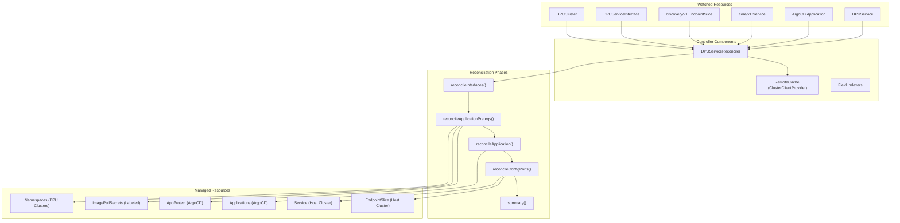
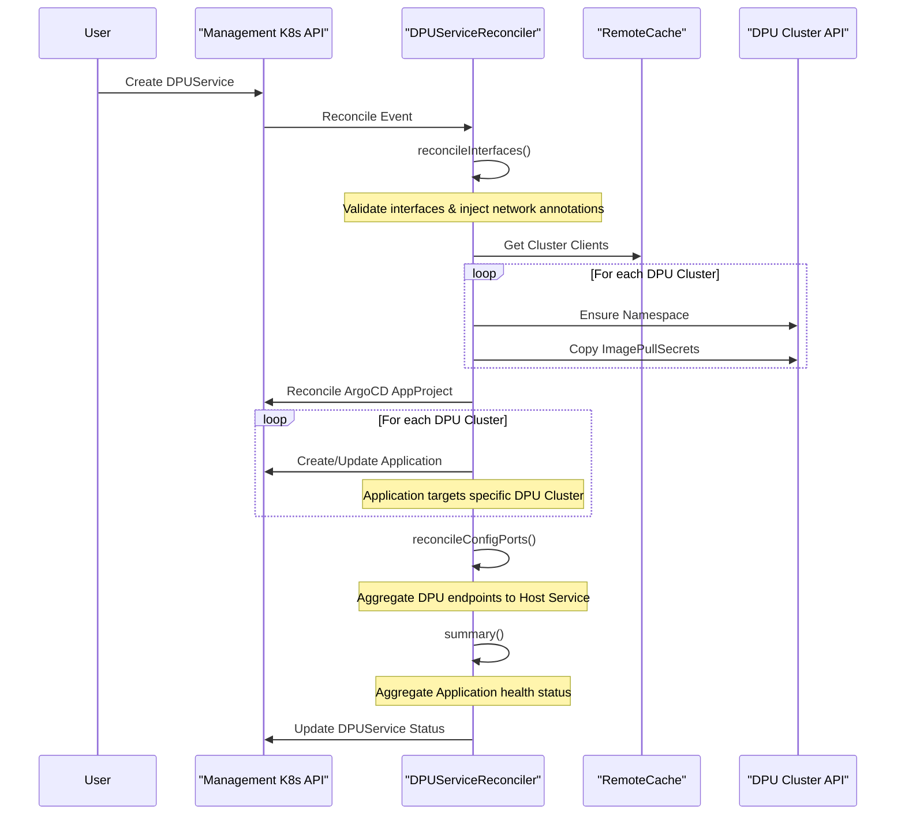

<!-- source: DeepWiki mcp.deepwiki.com · repo NVIDIA/doca-platform · page 4.2 DPUService Resources · fetched 2026-10-26 -->

# DPUService Resources

Relevant source files

The following files were used as context for generating this wiki page:

- [api/dpuservice/v1alpha1/dpuservice_types.go](api/dpuservice/v1alpha1/dpuservice_types.go)
- [api/dpuservice/v1alpha1/dpuserviceconfiguration_types.go](api/dpuservice/v1alpha1/dpuserviceconfiguration_types.go)
- [api/provisioning/v1alpha1/bfb_types.go](api/provisioning/v1alpha1/bfb_types.go)
- [cmd/dpuservice/main.go](cmd/dpuservice/main.go)
- [config/dpuservice/crd/bases/svc.dpu.nvidia.com_dpuserviceconfigurations.yaml](config/dpuservice/crd/bases/svc.dpu.nvidia.com_dpuserviceconfigurations.yaml)
- [config/dpuservice/crd/bases/svc.dpu.nvidia.com_dpuservices.yaml](config/dpuservice/crd/bases/svc.dpu.nvidia.com_dpuservices.yaml)
- [config/dpuservice/crd/bases/svc.dpu.nvidia.com_dpuservicetemplates.yaml](config/dpuservice/crd/bases/svc.dpu.nvidia.com_dpuservicetemplates.yaml)
- [config/dpuservice/rbac/role.yaml](config/dpuservice/rbac/role.yaml)
- [config/provisioning/crd/bases/provisioning.dpu.nvidia.com_bfbs.yaml](config/provisioning/crd/bases/provisioning.dpu.nvidia.com_bfbs.yaml)
- [deploy/charts/dpf-operator/templates/crds/apiextensions.k8s.io_v1_customresourcedefinition_bfbs.provisioning.dpu.nvidia.com.yaml](deploy/charts/dpf-operator/templates/crds/apiextensions.k8s.io_v1_customresourcedefinition_bfbs.provisioning.dpu.nvidia.com.yaml)
- [deploy/charts/dpf-operator/templates/crds/apiextensions.k8s.io_v1_customresourcedefinition_dpuserviceconfigurations.svc.dpu.nvidia.com.yaml](deploy/charts/dpf-operator/templates/crds/apiextensions.k8s.io_v1_customresourcedefinition_dpuserviceconfigurations.svc.dpu.nvidia.com.yaml)
- [deploy/charts/dpf-operator/templates/crds/apiextensions.k8s.io_v1_customresourcedefinition_dpuservices.svc.dpu.nvidia.com.yaml](deploy/charts/dpf-operator/templates/crds/apiextensions.k8s.io_v1_customresourcedefinition_dpuservices.svc.dpu.nvidia.com.yaml)
- [deploy/charts/dpf-operator/templates/crds/apiextensions.k8s.io_v1_customresourcedefinition_dpuservicetemplates.svc.dpu.nvidia.com.yaml](deploy/charts/dpf-operator/templates/crds/apiextensions.k8s.io_v1_customresourcedefinition_dpuservicetemplates.svc.dpu.nvidia.com.yaml)
- [internal/argocd/utils.go](internal/argocd/utils.go)
- [internal/argocd/utils_test.go](internal/argocd/utils_test.go)
- [internal/dpuservice/controllers/dpudeployment_controller_node.go](internal/dpuservice/controllers/dpudeployment_controller_node.go)
- [internal/dpuservice/controllers/dpudeployment_controller_node_test.go](internal/dpuservice/controllers/dpudeployment_controller_node_test.go)
- [internal/dpuservice/controllers/dpuready_controller.go](internal/dpuservice/controllers/dpuready_controller.go)
- [internal/dpuservice/controllers/dpuready_controller_conditions.go](internal/dpuservice/controllers/dpuready_controller_conditions.go)
- [internal/dpuservice/controllers/dpuready_controller_conditions_test.go](internal/dpuservice/controllers/dpuready_controller_conditions_test.go)
- [internal/dpuservice/controllers/dpuready_controller_test.go](internal/dpuservice/controllers/dpuready_controller_test.go)
- [internal/dpuservice/controllers/dpuservice_controller.go](internal/dpuservice/controllers/dpuservice_controller.go)
- [internal/dpuservice/controllers/dpuservice_controller_test.go](internal/dpuservice/controllers/dpuservice_controller_test.go)
- [internal/dpuservice/controllers/indexers.go](internal/dpuservice/controllers/indexers.go)
- [internal/dpuservice/controllers/suite_test.go](internal/dpuservice/controllers/suite_test.go)
- [internal/dpuservice/utils/chartutils.go](internal/dpuservice/utils/chartutils.go)
- [internal/dpuservice/utils/chartutils_test.go](internal/dpuservice/utils/chartutils_test.go)
- [internal/dpuservicechain/controllers/dpuservicechain_controller_test.go](internal/dpuservicechain/controllers/dpuservicechain_controller_test.go)
- [internal/dpuservicechain/controllers/dpuserviceinterface_controller_test.go](internal/dpuservicechain/controllers/dpuserviceinterface_controller_test.go)
- [internal/operator/inventory/manifests/dpuservice-controller.yaml](internal/operator/inventory/manifests/dpuservice-controller.yaml)
- [internal/provisioning/webhooks/bfb_types_test.go](internal/provisioning/webhooks/bfb_types_test.go)
- [internal/provisioning/webhooks/dpucluster_types_test.go](internal/provisioning/webhooks/dpucluster_types_test.go)

This document describes the `DPUService` custom resource and its controller, which manages the lifecycle of workloads deployed to DPU clusters. The `DPUServiceReconciler` is responsible for creating ArgoCD applications, reconciling network interfaces, managing image pull secrets, and handling service exposure through ConfigPorts. For information about service readiness monitoring and node tainting, see [DPUReady and Operational Conditions](#4.4). For network topology and interface types, see [Service Chains and Interfaces](#4.3).

## DPUService Resource Overview

The `DPUService` CRD represents a single workload to be deployed on DPU clusters via ArgoCD. Each `DPUService` references a Helm chart and can optionally attach network interfaces, expose ports, and deploy to either DPU clusters or the host cluster.

**Key Responsibilities:**
- Create and manage ArgoCD `Application` resources for GitOps deployment [internal/dpuservice/controllers/dpuservice_controller.go:826-829]().
- Reconcile `DPUServiceInterface` attachments and inject network annotations [internal/dpuservice/controllers/dpuservice_controller.go:558-565]().
- Manage image pull secrets across DPU clusters [internal/dpuservice/controllers/dpuservice_controller.go:1212-1215]().
- Handle service exposure via `ConfigPorts` (Service and EndpointSlice creation) [internal/dpuservice/controllers/dpuservice_controller.go:1423-1428]().
- Support pause/resume for maintenance operations [internal/dpuservice/controllers/dpuservice_controller.go:1061-1065]().
- Maintain finalizers and cleanup on deletion [internal/dpuservice/controllers/dpuservice_controller.go:193-198]().

### DPUService Spec Fields

| Field | Type | Description |
|-------|------|-------------|
| `helmChart` | `HelmChart` | Source repository, chart name, version, and release name. |
| `serviceDaemonSet` | `ServiceDaemonSetValues` | Pod template configuration including node selector, resources, and annotations. |
| `serviceID` | `*string` | Unique identifier for the service, required if interfaces are provided. |
| `interfaces` | `[]string` | List of `DPUServiceInterface` names to attach. |
| `deployInCluster` | `*bool` | If true, deploys to host cluster instead of DPU clusters. |
| `dpuClusterSelector` | `*metav1.LabelSelector` | Selects which DPU clusters to target (nil = all clusters). |
| `configPorts` | `*ConfigPorts` | Configuration for exposing service ports on the host cluster. |
| `paused` | `*bool` | If true, reconciliation is paused and applications are annotated to skip sync. |

Sources: [api/dpuservice/v1alpha1/dpuservice_types.go:134-159]()

## DPUServiceReconciler Architecture

Sources: [internal/dpuservice/controllers/dpuservice_controller.go:72-86](), [internal/dpuservice/controllers/dpuservice_controller.go:127-160]()

### Controller Entry Point

The `DPUServiceReconciler` is initialized in `cmd/dpuservice/main.go` with a `RemoteCache` that provides access to DPU cluster clients [internal/dpuservice/controllers/suite_test.go:165-171](). It watches several resource types to trigger reconciliation:

- `DPUService` (primary resource)
- `Application` (filtered by label)
- `Service` (filtered by label) 
- `EndpointSlice` (filtered by label)
- `DPUServiceInterface` (using `requestsForDPUServiceInterface` map function)
- `DPUCluster` (mapped to relevant DPUServices)

Sources: [internal/dpuservice/controllers/dpuservice_controller.go:127-160](), [cmd/dpuservice/main.go:160-170]()

## Service Lifecycle Management

### Creation and Reconciliation Flow

Sources: [internal/dpuservice/controllers/dpuservice_controller.go:427-526]()

### Deletion Flow

When a `DPUService` is deleted, the `reconcileDelete()` method handles cleanup:

1.  **Delete Applications**: It lists and deletes all ArgoCD `Application` resources associated with the service [internal/dpuservice/controllers/dpuservice_controller.go:206-209]().
2.  **Wait for Cleanup**: If applications still exist, it requeues the reconciliation [internal/dpuservice/controllers/dpuservice_controller.go:211-213]().
3.  **Interface Cleanup**: Removes ownership annotations from `DPUServiceInterface` resources [internal/dpuservice/controllers/dpuservice_controller.go:218-221]().
4.  **Secret Cleanup**: Deletes mirrored image pull secrets if no other services in the namespace require them [internal/dpuservice/controllers/dpuservice_controller.go:223-225]().
5.  **ConfigPort Cleanup**: Deletes host-side `Service` and `EndpointSlice` resources [internal/dpuservice/controllers/dpuservice_controller.go:227-229]().
6.  **Finalizer Removal**: Removes the `dpu.nvidia.com/dpuservice` finalizer [internal/dpuservice/controllers/dpuservice_controller.go:240-245]().

Sources: [internal/dpuservice/controllers/dpuservice_controller.go:193-245]()

## Interface Reconciliation

The `reconcileInterfaces()` function manages the attachment of network interfaces to services.

### Validation and Annotation

The controller validates that:
- The referenced `DPUServiceInterface` exists in the same namespace [internal/dpuservice/controllers/dpuservice_controller.go:585-588]().
- The interface is not already consumed by another `DPUService` [internal/dpuservice/controllers/dpuservice_controller.go:604-608]().

If valid, it adds the `dpu.nvidia.com/consumed-by` annotation to the `DPUServiceInterface` [internal/dpuservice/controllers/dpuservice_controller.go:653-655]() and injects the `k8s.v1.cni.cncf.io/networks` annotation into the pod template [internal/dpuservice/controllers/dpuservice_controller.go:722-725]().

Sources: [internal/dpuservice/controllers/dpuservice_controller.go:558-615](), [api/dpuservice/v1alpha1/dpuservice_types.go:52-53]()

### Dynamic Resource Injection

Based on the `DPUServiceNAD` associated with the interfaces, the controller calculates the required resources (e.g., SR-IOV VFs) and updates the `ServiceDaemonSet` resource requests/limits accordingly [internal/dpuservice/controllers/dpuservice_controller.go:369-425]().

Sources: [internal/dpuservice/controllers/dpuservice_controller.go:369-425]()

## ArgoCD Application Management

The controller creates one ArgoCD `Application` per DPU cluster selected by the `dpuClusterSelector` [internal/dpuservice/controllers/dpuservice_controller.go:961-965]().

**Key Application Configuration:**
- **Namespace**: Deployed into the same namespace as the `DPUService` on the DPU cluster [internal/dpuservice/controllers/dpuservice_controller.go:1020-1022]().
- **Project**: Uses `doca-platform-project-dpu` (or `doca-platform-project-host` if `deployInCluster` is true) [internal/dpuservice/controllers/dpuservice_controller.go:1016-1018]().
- **Sync Policy**: Configured for automated prune and self-heal [internal/dpuservice/controllers/dpuservice_controller.go:1030-1035]().
- **Helm Values**: The `ServiceDaemonSet` values and `ServiceID` are passed as Helm parameters [internal/dpuservice/controllers/dpuservice_controller.go:1101-1150]().

Sources: [internal/dpuservice/controllers/dpuservice_controller.go:826-959](), [internal/dpuservice/controllers/dpuservice_controller.go:961-1059]()

## ConfigPorts Feature

`ConfigPorts` allow exposing service ports from DPU clusters onto the host cluster network by creating a host-side `Service` and aggregating DPU node IPs into `EndpointSlice` resources.

### Reconciliation Mechanism

1.  **Node Discovery**: The controller identifies DPU nodes matching the service's `nodeSelector` [internal/dpuservice/controllers/dpuservice_controller.go:1830-1835]().
2.  **Address Extraction**: It retrieves the `InternalIP` of the matching nodes [internal/dpuservice/controllers/dpuservice_controller.go:1845-1850]().
3.  **Host Service**: A `Service` (type `NodePort` or `ClusterIP`) is created on the host cluster without a selector [internal/dpuservice/controllers/dpuservice_controller.go:1423-1450]().
4.  **EndpointSlice**: `EndpointSlice` resources are created, mapping the host service to the DPU node IPs [internal/dpuservice/controllers/dpuservice_controller.go:1490-1519]().

Sources: [internal/dpuservice/controllers/dpuservice_controller.go:1423-1519](), [internal/dpuservice/controllers/dpuservice_controller.go:1789-1890]()

## Pause Mechanism for Maintenance

The controller supports a pause mechanism to stop reconciliation during maintenance:

- **Manual Pause**: Setting `spec.paused: true` in the `DPUService` resource [internal/dpuservice/controllers/dpuservice_controller.go:1061-1065]().
- **Internal Pause**: The `pauseDPUServiceReconciler` atomic boolean allows global pausing of the reconciler logic (primarily for testing) [internal/dpuservice/controllers/dpuservice_controller.go:88-90]().

When paused, the controller adds the `argocd.argoproj.io/skip-reconcile: "true"` annotation to managed ArgoCD Applications to prevent ArgoCD from performing sync operations [internal/dpuservice/controllers/dpuservice_controller.go:1075-1080]().

Sources: [internal/dpuservice/controllers/dpuservice_controller.go:79-81](), [internal/dpuservice/controllers/dpuservice_controller.go:1061-1099]()

## DPUReady and Operational Conditions

The `DPUReadyReconciler` monitors the health of service pods and other operational metrics to determine if a DPU (and its host node) is ready for workloads.

### Aggregation Logic

The reconciler aggregates several conditions into a `DPUOperationalCondReady` summary:
- **NodeProblemsReady**: Checks for standard Kubernetes node pressures [internal/dpuservice/controllers/dpuready_controller_conditions.go:112]().
- **CriticalPodsReady**: Monitors pods of services labeled as `svc.dpu.nvidia.com/critical` [internal/dpuservice/controllers/dpuready_controller_conditions.go:113]().
- **InterfacesReady**: Validates that all `DPUServiceInterface` resources are in a `Ready` state [internal/dpuservice/controllers/dpuready_controller_conditions.go:115]().
- **ChainsReady**: Validates that all `DPUServiceChain` resources are in a `Ready` state [internal/dpuservice/controllers/dpuready_controller_conditions.go:116]().

Sources: [internal/dpuservice/controllers/dpuready_controller_conditions.go:111-118](), [internal/dpuservice/controllers/dpuready_controller.go:88-92]()

### Node Tainting

If a DPU node is not ready (operational conditions are not met), the reconciler can apply a taint `dpu.nvidia.com/dpu-ready` with the `NoSchedule` effect to the host node [internal/dpuservice/controllers/dpuready_controller.go:77-80](). This prevents pods from being scheduled on nodes where required DPU services are unhealthy. This behavior can be disabled via the `--disable-dpu-ready-taints` flag [cmd/dpuservice/main.go:88-89]().

Sources: [internal/dpuservice/controllers/dpuready_controller.go:74-83](), [cmd/dpuservice/main.go:105-108]()

---

