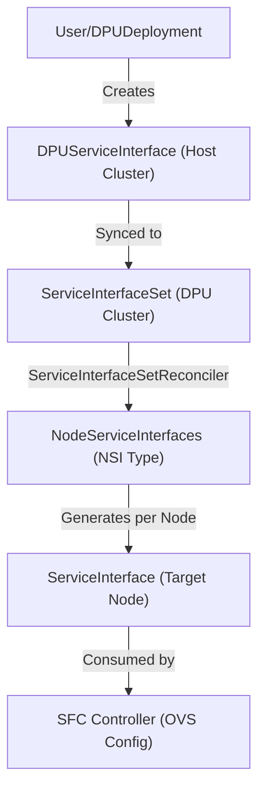
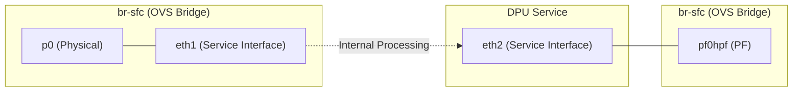
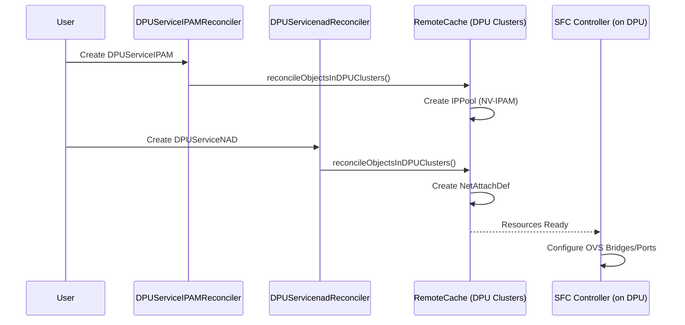

<!-- source: DeepWiki mcp.deepwiki.com · repo NVIDIA/doca-platform · page 4.3 Service Chains and Interfaces · fetched 2026-10-26 -->

# Service Chains and Interfaces

Relevant source files

The following files were used as context for generating this wiki page:

- [api/dpuservice/v1alpha1/dpuservicenad_types.go](api/dpuservice/v1alpha1/dpuservicenad_types.go)
- [api/dpuservice/v1alpha1/nodeserviceinterfaces_types.go](api/dpuservice/v1alpha1/nodeserviceinterfaces_types.go)
- [api/dpuservice/v1alpha1/serviceinterface_types.go](api/dpuservice/v1alpha1/serviceinterface_types.go)
- [config/dpuservice/crd/bases/svc.dpu.nvidia.com_dpuserviceinterfaces.yaml](config/dpuservice/crd/bases/svc.dpu.nvidia.com_dpuserviceinterfaces.yaml)
- [config/dpuservice/crd/bases/svc.dpu.nvidia.com_dpuservicenads.yaml](config/dpuservice/crd/bases/svc.dpu.nvidia.com_dpuservicenads.yaml)
- [config/dpuservice/crd/bases/svc.dpu.nvidia.com_serviceinterfaces.yaml](config/dpuservice/crd/bases/svc.dpu.nvidia.com_serviceinterfaces.yaml)
- [config/dpuservice/crd/bases/svc.dpu.nvidia.com_serviceinterfacesets.yaml](config/dpuservice/crd/bases/svc.dpu.nvidia.com_serviceinterfacesets.yaml)
- [deploy/charts/dpf-operator/templates/crds/apiextensions.k8s.io_v1_customresourcedefinition_dpuserviceinterfaces.svc.dpu.nvidia.com.yaml](deploy/charts/dpf-operator/templates/crds/apiextensions.k8s.io_v1_customresourcedefinition_dpuserviceinterfaces.svc.dpu.nvidia.com.yaml)
- [deploy/charts/dpf-operator/templates/crds/apiextensions.k8s.io_v1_customresourcedefinition_dpuservicenads.svc.dpu.nvidia.com.yaml](deploy/charts/dpf-operator/templates/crds/apiextensions.k8s.io_v1_customresourcedefinition_dpuservicenads.svc.dpu.nvidia.com.yaml)
- [deploy/charts/dpu-networking/charts/servicechainset-controller/templates/crds/svc.dpu.nvidia.com_serviceinterfaces.yaml](deploy/charts/dpu-networking/charts/servicechainset-controller/templates/crds/svc.dpu.nvidia.com_serviceinterfaces.yaml)
- [deploy/charts/dpu-networking/charts/servicechainset-controller/templates/crds/svc.dpu.nvidia.com_serviceinterfacesets.yaml](deploy/charts/dpu-networking/charts/servicechainset-controller/templates/crds/svc.dpu.nvidia.com_serviceinterfacesets.yaml)
- [deploy/charts/dpu-networking/charts/servicechainset-controller/templates/role.yaml](deploy/charts/dpu-networking/charts/servicechainset-controller/templates/role.yaml)
- [deploy/charts/dpu-networking/charts/sfc-controller/templates/crds/svc.dpu.nvidia.com_serviceinterfaces.yaml](deploy/charts/dpu-networking/charts/sfc-controller/templates/crds/svc.dpu.nvidia.com_serviceinterfaces.yaml)
- [docs/public/developer-guides/api/dpuservicechain.md](docs/public/developer-guides/api/dpuservicechain.md)
- [docs/public/developer-guides/api/dpuserviceipam.md](docs/public/developer-guides/api/dpuserviceipam.md)
- [hack/tools/dpfdev/cmd/crdify.go](hack/tools/dpfdev/cmd/crdify.go)
- [hack/tools/dpfdev/cmd/crdify_test.go](hack/tools/dpfdev/cmd/crdify_test.go)
- [hack/tools/dpfdev/cmd/test/crdify_base.yaml](hack/tools/dpfdev/cmd/test/crdify_base.yaml)
- [internal/dpuservicechain/controllers/dpuserviceipam_controller.go](internal/dpuservicechain/controllers/dpuserviceipam_controller.go)
- [internal/dpuservicechain/controllers/dpuserviceipam_controller_test.go](internal/dpuservicechain/controllers/dpuserviceipam_controller_test.go)
- [internal/dpuservicechain/controllers/dpuserviceipam_ipamallocator.go](internal/dpuservicechain/controllers/dpuserviceipam_ipamallocator.go)
- [internal/dpuservicechain/controllers/dpuserviceipam_ipamallocator_benchmark_test.go](internal/dpuservicechain/controllers/dpuserviceipam_ipamallocator_benchmark_test.go)
- [internal/dpuservicechain/controllers/dpuserviceipam_ipamallocator_test.go](internal/dpuservicechain/controllers/dpuserviceipam_ipamallocator_test.go)
- [internal/dpuservicechain/controllers/dpuservicenad_controller.go](internal/dpuservicechain/controllers/dpuservicenad_controller.go)
- [internal/dpuservicechain/controllers/dpuservicenad_controller_test.go](internal/dpuservicechain/controllers/dpuservicenad_controller_test.go)
- [internal/dpuservicechain/utils/iputils/iprange.go](internal/dpuservicechain/utils/iputils/iprange.go)
- [internal/dpuservicechain/utils/iputils/iprange_test.go](internal/dpuservicechain/utils/iputils/iprange_test.go)
- [internal/dpuservicechain/utils/iputils/iputils_suite_test.go](internal/dpuservicechain/utils/iputils/iputils_suite_test.go)
- [internal/dpuservicechain/webhooks/dpuserviceipam_webhook.go](internal/dpuservicechain/webhooks/dpuserviceipam_webhook.go)
- [internal/dpuservicechain/webhooks/dpuserviceipam_webhook_test.go](internal/dpuservicechain/webhooks/dpuserviceipam_webhook_test.go)
- [internal/pod-ipam-injector/controllers/suite_test.go](internal/pod-ipam-injector/controllers/suite_test.go)
- [internal/servicechainset/controllers/serviceinterfaceset_controller.go](internal/servicechainset/controllers/serviceinterfaceset_controller.go)
- [internal/servicechainset/controllers/serviceinterfaceset_controller_nsi_test.go](internal/servicechainset/controllers/serviceinterfaceset_controller_nsi_test.go)
- [internal/servicechainset/controllers/serviceinterfaceset_controller_test.go](internal/servicechainset/controllers/serviceinterfaceset_controller_test.go)
- [internal/servicechainset/controllers/suite_test.go](internal/servicechainset/controllers/suite_test.go)
- [internal/servicechainset/predicates/nsi_predicates.go](internal/servicechainset/predicates/nsi_predicates.go)
- [internal/sfccontroller/controllers/nodeserviceinterfaces_controller.go](internal/sfccontroller/controllers/nodeserviceinterfaces_controller.go)
- [internal/utils/interface_resolver.go](internal/utils/interface_resolver.go)
- [internal/utils/interface_resolver_test.go](internal/utils/interface_resolver_test.go)
- [internal/utils/nsi_indexer.go](internal/utils/nsi_indexer.go)
- [test/apivalidation/dpuservicenad_api_validation_test.go](test/apivalidation/dpuservicenad_api_validation_test.go)

This document describes the `DPUServiceChain` and `DPUServiceInterface` custom resources, which together define the data plane topology and wiring for services running on DPUs. These resources specify how physical network ports, logical service ports, and OVS bridges are interconnected to form the service chain architecture.

For information about deploying services through DPUDeployment, see [DPUDeployment Orchestration](#4.1). For details about the DPUService resources themselves, see [DPUService Resources](#4.2).

## Purpose and Scope

Service chains define the data plane connectivity between physical network interfaces and service endpoints on the DPU. This connectivity is realized through Open vSwitch (OVS) bridges configured during DPU provisioning. The system creates and manages several primary custom resources:

- **DPUServiceInterface**: Represents individual network ports (physical or logical) that can be attached to services [api/dpuservice/v1alpha1/serviceinterface_types.go:29]().
- **DPUServiceChain**: Defines the topology of switches and how ports are connected within those switches [docs/public/developer-guides/api/dpuservicechain.md:12-13]().
- **DPUServiceIPAM**: Manages IP address allocation for service interfaces [api/dpuservice/v1alpha1/dpuserviceipam_types.go:132]().
- **DPUServiceNAD**: Handles Network Attachment Definitions for secondary networking [api/dpuservice/v1alpha1/dpuservicenad_types.go:27]().

These resources are consumed by the **SFC (Service Function Chain) Controller** on the DPU nodes to provision the necessary network configurations [docs/public/developer-guides/api/dpuservicechain.md:21-35]().

## DPUServiceInterface Resource

A `DPUServiceInterface` represents a single network interface or port. These are used as building blocks for `DPUServiceChain` topologies.

### Interface Types

The `interfaceType` field in `ServiceInterfaceSpec` determines the underlying implementation [api/dpuservice/v1alpha1/serviceinterface_types.go:51-58]():

| Interface Type | Description |
|---------------|-------------|
| `physical`    | Represents physical network ports (e.g., `p0`, `p1`) [api/dpuservice/v1alpha1/serviceinterface_types.go:34](). |
| `pf`          | Physical Function representors, often used for host connectivity (e.g., `pf0hpf`) [api/dpuservice/v1alpha1/serviceinterface_types.go:36](). |
| `vf`          | Virtual Function representors [api/dpuservice/v1alpha1/serviceinterface_types.go:38](). |
| `service`     | Logical ports attached to a specific `DPUService` [api/dpuservice/v1alpha1/serviceinterface_types.go:44](). |
| `vlan`        | VLAN tagged interfaces [api/dpuservice/v1alpha1/serviceinterface_types.go:31](). |
| `patch`       | OVS patch ports connecting two bridges [api/dpuservice/v1alpha1/serviceinterface_types.go:42](). |
| `ovn`         | (Deprecated) OVN-specific patch port configuration [api/dpuservice/v1alpha1/serviceinterface_types.go:78-81](). |

### Logical Hierarchy

The framework uses a "Set" pattern to manage resources across multiple DPU clusters. The `ServiceInterfaceSetReconciler` handles the propagation from the management cluster to DPU clusters [internal/servicechainset/controllers/serviceinterfaceset_controller.go:76-79]().

**Diagram: DPUServiceInterface Resource Propagation**

Sources: [docs/public/developer-guides/api/dpuservicechain.md:15-35](), [internal/servicechainset/controllers/serviceinterfaceset_controller.go:59-71](), [api/dpuservice/v1alpha1/nodeserviceinterfaces_types.go:26]()

## DPUServiceChain Resource

A `DPUServiceChain` allows users to define how to steer traffic on the DPU. It organizes interfaces into logical "switches" (which map to OVS bridges) [docs/public/developer-guides/api/dpuservicechain.md:12-13]().

### Configuration Structure

The `switches` object defines the topology. A common configuration includes:
- **ports**: A list of `serviceInterface` references identified by `matchLabels` [docs/public/developer-guides/api/dpuservicechain.md:170-175]().
- **serviceMTU**: Defines the MTU for traffic between services. Defaults to 1500 and cannot exceed the `highspeedMTU` in `DPFOperatorConfig` [docs/public/developer-guides/api/dpuservicechain.md:204-210]().

### Example Topology: p0 -> eth1 -> eth2 -> pf0hpf

In this example, traffic enters via physical port `p0`, passes through a service with two interfaces (`eth1`, `eth2`), and exits to the host via `pf0hpf` [docs/public/developer-guides/api/dpuservicechain.md:158-187]().

**Diagram: Traffic Flow in a Service Chain**

Sources: [docs/public/developer-guides/api/dpuservicechain.md:158-214]()

## IPAM and Secondary Networking

The DPF provides integrated IP Address Management (IPAM) and secondary network support for service chains.

### DPUServiceIPAM
The `DPUServiceIPAMReconciler` manages IP pools (using `nv-ipam`) across DPU clusters [internal/dpuservicechain/controllers/dpuserviceipam_controller.go:62-67]().
- **Modes**: Supports `.spec.subnet` (shared gateway, split into chunks) and `.spec.network` (unique subnet and gateway per node) [docs/public/developer-guides/api/dpuserviceipam.md:11-21]().
- **Multi-DPUCluster**: Uses `MultiDPUClusterExclusionCalculator` to ensure non-overlapping slices across clusters [internal/dpuservicechain/controllers/dpuserviceipam_ipamallocator.go:31-32]().
- **Validation**: The `DPUServiceIPAMValidator` ensures immutability of allocation modes and address families [internal/dpuservicechain/webhooks/dpuserviceipam_webhook.go:43-45]().

### DPUServiceNAD
The `DPUServiceNAD` controller reconciles `NetworkAttachmentDefinition` objects in DPU clusters [internal/dpuservicechain/controllers/dpuservicenad_controller.go:91-96](). 
- **Resource Types**: Supports `vf`, `sf` (Scalable Function), and `veth` [api/dpuservice/v1alpha1/dpuservicenad_types.go:99-104]().
- **CNI Chaining**: Allows adding capabilities like RDMA via `chainedCNIs` [api/dpuservice/v1alpha1/dpuservicenad_types.go:128-135]().

Sources: [internal/dpuservicechain/controllers/dpuserviceipam_controller.go:82-85](), [internal/dpuservicechain/controllers/dpuservicenad_controller.go:65-70](), [docs/public/developer-guides/api/dpuserviceipam.md:117-127]()

## Implementation and Reconciliation

The framework uses a standardized pattern for reconciling host-cluster resources into DPU-cluster objects.

### Reconciliation Flow

**Diagram: Cross-Cluster Reconciliation Flow**

### Key Reconciliation Classes
- **DPUServiceIPAMReconciler**: Manages IP pools and allocations [internal/dpuservicechain/controllers/dpuserviceipam_controller.go:62-67]().
- **DPUServicenadReconciler**: Manages NetworkAttachmentDefinitions [internal/dpuservicechain/controllers/dpuservicenad_controller.go:65-70]().
- **ServiceInterfaceSetReconciler**: Manages sets of interfaces across nodes [internal/servicechainset/controllers/serviceinterfaceset_controller.go:76-79]().

## Constraints and Validation

- **Uniqueness**: Each physical uplink port (e.g., `p0`) must be owned by exactly one `DPUServiceInterface` [docs/public/developer-guides/api/dpuservicechain.md:217-219]().
- **IPAM Pool Selection**: `matchLabels` must select exactly one address pool for each requested family (IPv4/IPv6) [docs/public/developer-guides/api/dpuservicechain.md:235-237]().
- **Namespace Restrictions**: Currently, `DPUServiceIPAM` is only supported in the `dpf-operator-system` namespace [internal/dpuservicechain/webhooks/dpuserviceipam_webhook.go:142-144]().
- **OVS Constraints**: A physical OVS port is associated with a single interface via the `dpf-id` external ID. Violations cause "flapping" readiness in the SFC controller [docs/public/developer-guides/api/dpuservicechain.md:225-229]().

Sources: [docs/public/developer-guides/api/dpuservicechain.md:215-230](), [internal/dpuservicechain/webhooks/dpuserviceipam_webhook.go:106-164](), [api/dpuservice/v1alpha1/serviceinterface_types.go:50-51]()

---

