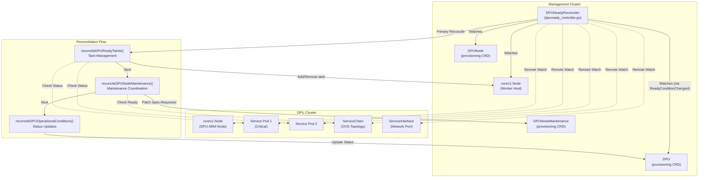
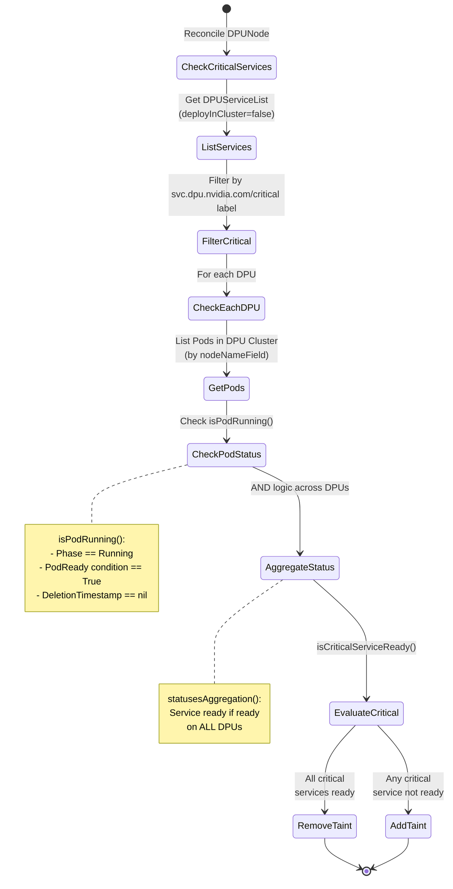
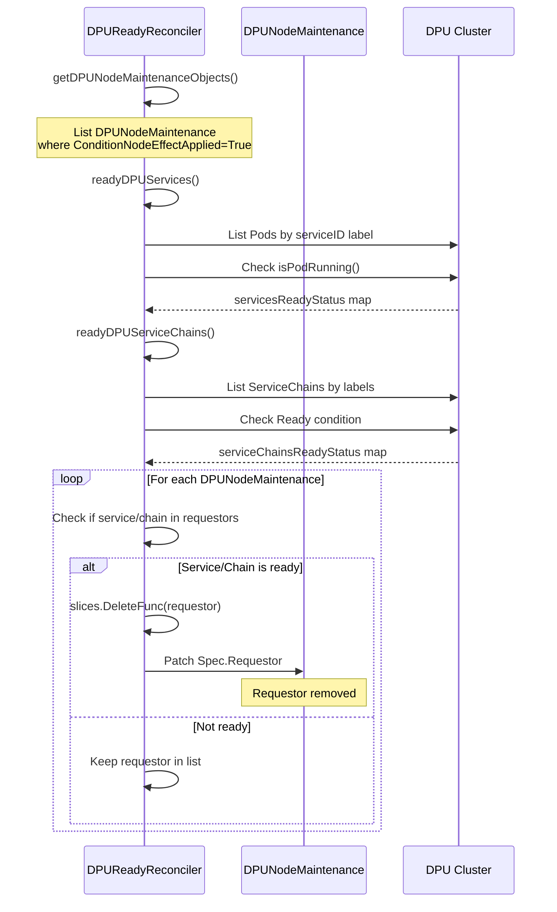
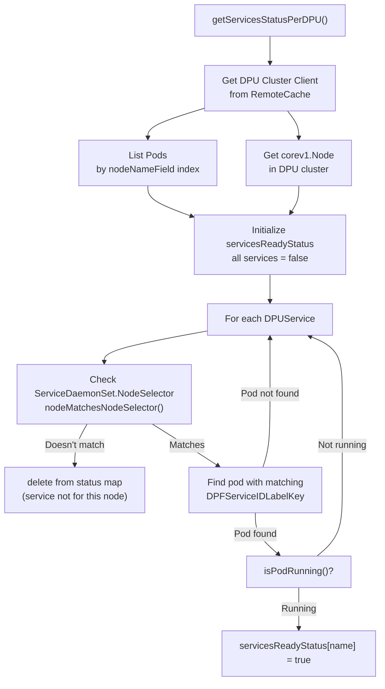

<!-- source: DeepWiki mcp.deepwiki.com · repo NVIDIA/doca-platform · page 4.4 DPUReady and Operational Conditions · fetched 2026-10-26 -->

# DPUReady and Operational Conditions

Relevant source files

The following files were used as context for generating this wiki page:

- [api/dpuservice/v1alpha1/dpuservice_types.go](api/dpuservice/v1alpha1/dpuservice_types.go)
- [cmd/dpuservice/main.go](cmd/dpuservice/main.go)
- [config/dpuservice/crd/bases/svc.dpu.nvidia.com_dpuservices.yaml](config/dpuservice/crd/bases/svc.dpu.nvidia.com_dpuservices.yaml)
- [config/dpuservice/crd/bases/svc.dpu.nvidia.com_dpuservicetemplates.yaml](config/dpuservice/crd/bases/svc.dpu.nvidia.com_dpuservicetemplates.yaml)
- [config/dpuservice/rbac/role.yaml](config/dpuservice/rbac/role.yaml)
- [deploy/charts/dpf-operator/templates/crds/apiextensions.k8s.io_v1_customresourcedefinition_dpuservices.svc.dpu.nvidia.com.yaml](deploy/charts/dpf-operator/templates/crds/apiextensions.k8s.io_v1_customresourcedefinition_dpuservices.svc.dpu.nvidia.com.yaml)
- [deploy/charts/dpf-operator/templates/crds/apiextensions.k8s.io_v1_customresourcedefinition_dpuservicetemplates.svc.dpu.nvidia.com.yaml](deploy/charts/dpf-operator/templates/crds/apiextensions.k8s.io_v1_customresourcedefinition_dpuservicetemplates.svc.dpu.nvidia.com.yaml)
- [internal/argocd/utils.go](internal/argocd/utils.go)
- [internal/argocd/utils_test.go](internal/argocd/utils_test.go)
- [internal/dpuservice/controllers/dpudeployment_controller_node.go](internal/dpuservice/controllers/dpudeployment_controller_node.go)
- [internal/dpuservice/controllers/dpudeployment_controller_node_test.go](internal/dpuservice/controllers/dpudeployment_controller_node_test.go)
- [internal/dpuservice/controllers/dpuready_controller.go](internal/dpuservice/controllers/dpuready_controller.go)
- [internal/dpuservice/controllers/dpuready_controller_conditions.go](internal/dpuservice/controllers/dpuready_controller_conditions.go)
- [internal/dpuservice/controllers/dpuready_controller_conditions_test.go](internal/dpuservice/controllers/dpuready_controller_conditions_test.go)
- [internal/dpuservice/controllers/dpuready_controller_test.go](internal/dpuservice/controllers/dpuready_controller_test.go)
- [internal/dpuservice/controllers/dpuservice_controller.go](internal/dpuservice/controllers/dpuservice_controller.go)
- [internal/dpuservice/controllers/dpuservice_controller_test.go](internal/dpuservice/controllers/dpuservice_controller_test.go)
- [internal/dpuservice/controllers/indexers.go](internal/dpuservice/controllers/indexers.go)
- [internal/dpuservice/controllers/suite_test.go](internal/dpuservice/controllers/suite_test.go)
- [internal/operator/inventory/manifests/dpuservice-controller.yaml](internal/operator/inventory/manifests/dpuservice-controller.yaml)
- [internal/provisioning/controllers/dpu/state/node_effect.go](internal/provisioning/controllers/dpu/state/node_effect.go)
- [internal/provisioning/controllers/dpu/state/node_effect_removal.go](internal/provisioning/controllers/dpu/state/node_effect_removal.go)
- [internal/provisioning/controllers/dpu/state/node_effect_removal_test.go](internal/provisioning/controllers/dpu/state/node_effect_removal_test.go)
- [internal/provisioning/controllers/dpu/state/node_effect_test.go](internal/provisioning/controllers/dpu/state/node_effect_test.go)
- [internal/provisioning/controllers/dpu/state/ready.go](internal/provisioning/controllers/dpu/state/ready.go)
- [internal/provisioning/controllers/dpu/state/ready_test.go](internal/provisioning/controllers/dpu/state/ready_test.go)
- [internal/provisioning/webhooks/dpucluster_types_test.go](internal/provisioning/webhooks/dpucluster_types_test.go)

## Purpose and Scope

The DPUReady and Operational Conditions subsystem monitors the operational readiness of DPU nodes by tracking the status of critical services deployed on DPUs. It manages node taints to prevent workload scheduling on nodes where critical DPU services are not ready, coordinates maintenance operations by removing requestors when services become operational, and maintains a multi-condition system for tracking operational readiness on `DPU` resources.

This page focuses on the `DPUReadyReconciler` controller and its associated mechanisms. For information about DPU service deployment and lifecycle, see [DPUService Resources](#4.2). For DPU provisioning states, see [DPU Installation State Handlers](#3.6).

**Sources:** [internal/dpuservice/controllers/dpuready_controller.go:1-254]()

---

## Architecture Overview

The `DPUReadyReconciler` operates across multiple clusters, monitoring service pod status in DPU clusters while managing node resources and DPU status in the management cluster.

### DPUReady System Architecture

**Key Components:**

| Component | Type | Responsibility |
|-----------|------|---------------|
| `DPUReadyReconciler` | Controller | Orchestrates readiness monitoring and taint management. [internal/dpuservice/controllers/dpuready_controller.go:63-74]() |
| `reconcileDPUReadyTaints` | Function | Adds/removes taints based on critical service status. [internal/dpuservice/controllers/dpuready_controller.go:256-287]() |
| `reconcileDPUNodeMaintenance` | Function | Removes maintenance requestors for ready services. [internal/dpuservice/controllers/dpuready_controller.go:289-304]() |
| `reconcileDPUOperationalConditions` | Function | Updates DPU operational status conditions. [internal/dpuservice/controllers/dpuready_controller_conditions.go:56-103]() |
| `RemoteCache` | Remote Cache | Provides access to DPU cluster clients and cross-cluster watchers. [internal/dpuservice/controllers/dpuready_controller.go:67-67]() |

**Sources:** [internal/dpuservice/controllers/dpuready_controller.go:63-254](), [internal/dpuservice/controllers/dpuready_controller.go:95-133](), [internal/dpuservice/controllers/dpuready_controller_conditions.go:56-103]()

---

## Taint Management System

The controller manages the `dpu.nvidia.com/dpu-ready` taint on worker nodes to prevent scheduling when critical DPU services are not operational.

### Taint Specification

| Constant | Value | Purpose |
|----------|-------|---------|
| `taintKey` | `dpu.nvidia.com/dpu-ready` | The key for the taint applied to host worker nodes. [internal/dpuservice/controllers/dpuready_controller.go:78-78]() |
| `taintEffect` | `NoSchedule` | Prevents scheduling on non-ready host worker nodes. [internal/dpuservice/controllers/dpuready_controller.go:80-80]() |
| `hostNetworkReadyTaintEffect` | `NoExecute` | Evicts workloads if `HostNetworkReady` is not True. [internal/dpuservice/controllers/dpuready_controller.go:83-83]() |
| `dpuEnabledLabelKey` | `feature.node.kubernetes.io/dpu-enabled` | Identifies nodes requiring DPU ready checks. [internal/dpuservice/controllers/dpuready_controller.go:85-85]() |

**Sources:** [internal/dpuservice/controllers/dpuready_controller.go:77-92]()

### Taint Addition and Removal Logic

The controller evaluates critical service readiness to determine taint state:

**Implementation Details:**

| Function | Location | Purpose |
|----------|----------|---------|
| `reconcileDPUReadyTaints` | [internal/dpuservice/controllers/dpuready_controller.go:256-287]() | Main taint reconciliation logic. |
| `isCriticalServiceReady` | [internal/dpuservice/controllers/dpuready_controller.go:763-772]() | Checks if all critical services are ready. |
| `addTaintIfDoesNotExist` | [internal/dpuservice/controllers/dpuready_controller.go:667-683]() | Adds taint with strategic merge patch. |
| `removeTaintIfExists` | [internal/dpuservice/controllers/dpuready_controller.go:686-702]() | Removes taint if present. |
| `isPodRunning` | [internal/dpuservice/controllers/dpuready_controller.go:705-724]() | Validates pod is truly running and ready. |

**Zero-Trust Mode:** When `scope.node` is nil (zero-trust mode where `KubeNodeRef` is not set), taint operations are skipped as there is no management cluster node to taint. [internal/dpuservice/controllers/dpuready_controller.go:264-266]()

**Disable Taint Management:** The taint management feature can be disabled using the `DisableDPUReadyTaints` field, typically set via the `--disable-dpu-ready-taints` CLI flag. [internal/dpuservice/controllers/dpuready_controller.go:71-71](), [cmd/dpuservice/main.go:105-106]()

**Sources:** [internal/dpuservice/controllers/dpuready_controller.go:256-287](), [internal/dpuservice/controllers/dpuready_controller.go:667-724](), [cmd/dpuservice/main.go:105-108]()

---

## DPUNodeMaintenance Coordination

The controller removes maintenance requestors from `DPUNodeMaintenance` objects when the corresponding services or service chains become operational, allowing node effects (drain/cordon) to be lifted.

### Requestor Format

Requestors follow the pattern: `{namespace}_{dpuDeploymentName}_{objectName}`. [internal/dpuservice/controllers/dpuready_controller.go:351-352]()

### Maintenance Reconciliation Flow

**Key Functions:**

| Function | Purpose | Location |
|----------|---------|----------|
| `reconcileDPUNodeMaintenance` | Orchestrates maintenance patching. | [internal/dpuservice/controllers/dpuready_controller.go:289-304]() |
| `getDPUNodeMaintenanceObjects` | Lists maintenance objects with `NodeEffectApplied=True`. | [internal/dpuservice/controllers/dpuready_controller.go:393-414]() |
| `patchDPUNodeMaintenanceObjects` | Removes requestors for ready services. | [internal/dpuservice/controllers/dpuready_controller.go:331-379]() |
| `readyDPUServices` | Returns list of ready services. | [internal/dpuservice/controllers/dpuready_controller.go:322-329]() |
| `readyDPUServiceChains` | Returns list of ready service chains. | [internal/dpuservice/controllers/dpuready_controller.go:306-320]() |

**Sources:** [internal/dpuservice/controllers/dpuready_controller.go:289-379](), [internal/dpuservice/controllers/dpuready_controller.go:393-414]()

---

## Operational Conditions

The `reconcileDPUOperationalConditions` function maintains a multi-condition status system on `DPU` resources to track various operational aspects.

### Condition Aggregation Logic

The controller aggregates multiple operational signals into a summary `Ready` condition. [internal/dpuservice/controllers/dpuready_controller_conditions.go:86-173]()

| Condition Type | Source | Purpose |
|----------------|--------|---------|
| `NodeProblemsReady` | DPU Cluster Node Conditions | Tracks node-level health (e.g. DiskPressure). [internal/dpuservice/controllers/dpuready_controller_conditions.go:240-272]() |
| `CriticalPodsReady` | Critical Service Pods | Tracks readiness of services labeled `svc.dpu.nvidia.com/critical`. [internal/dpuservice/controllers/dpuready_controller_conditions.go:274-299]() |
| `InterfacesReady` | `ServiceInterface` status | Tracks readiness of DPU network interfaces. [internal/dpuservice/controllers/dpuready_controller_conditions.go:328-356]() |
| `ChainsReady` | `ServiceChain` status | Tracks readiness of service chain topologies. [internal/dpuservice/controllers/dpuready_controller_conditions.go:358-386]() |
| `Ready` (Summary) | `aggregateOperationalReadySummary` | Aggregate condition indicating overall DPU operational readiness. [internal/dpuservice/controllers/dpuready_controller_conditions.go:86-103]() |

**Condition State Mapping:**

| DPU/Node State | Condition Status | Reason |
|----------------|------------------|--------|
| `deletion` | `Unknown` | `AwaitingDeletion` [internal/dpuservice/controllers/dpuready_controller_conditions.go:121-132]() |
| `pending` | `Unknown` | `Pending` (Node not joined yet) [internal/dpuservice/controllers/dpuready_controller_conditions.go:133-144]() |
| `missing` | `False` | `Error` (Node was ready but disappeared) [internal/dpuservice/controllers/dpuready_controller_conditions.go:145-156]() |

**Sources:** [internal/dpuservice/controllers/dpuready_controller_conditions.go:56-173](), [internal/dpuservice/controllers/dpuready_controller_conditions.go:240-386]()

---

## Service Readiness Checks

### Service Status Evaluation

The controller evaluates service readiness by examining pod status in DPU clusters, with special handling for node selector matching. [internal/dpuservice/controllers/dpuready_controller.go:579-653]()

**Sources:** [internal/dpuservice/controllers/dpuready_controller.go:579-653](), [internal/dpuservice/controllers/dpuready_controller.go:705-724]()

---

## Remote Watchers and Event Handlers

The controller registers remote watchers to monitor resources in DPU clusters and trigger reconciliation of the appropriate `DPUNode`.

### Watcher Registration

The `RemoteCache` triggers these callbacks to set up watches in tenant clusters. [internal/dpuservice/controllers/dpuready_controller.go:774-849]()

| Watcher | Resource | Predicates | Purpose |
|---------|----------|-----------|---------|
| `WatchServicePods` | `corev1.Pod` | `DPFServiceIDLabelKey` present | Trigger on service pod ready state changes. [internal/dpuservice/controllers/dpuready_controller.go:774-793]() |
| `WatchServiceChains` | `ServiceChain` | Ready condition changes | Trigger when service chain topology ready state changes. [internal/dpuservice/controllers/dpuready_controller.go:795-813]() |
| `WatchServiceInterfaces` | `ServiceInterface` | Ready condition changes | Trigger when service interface ready state changes. [internal/dpuservice/controllers/dpuready_controller.go:815-833]() |
| `WatchNodes` | `corev1.Node` | Node condition changes | Trigger on node health issues. [internal/dpuservice/controllers/dpuready_controller.go:835-849]() |

**Sources:** [internal/dpuservice/controllers/dpuready_controller.go:774-849](), [internal/dpuservice/controllers/dpuready_controller.go:859-897]()

---

## Field Indexers

The controller requires several field indexers for efficient lookups. [internal/dpuservice/controllers/indexers.go:53-147]()

| Indexer | Resource | Field | Purpose |
|---------|----------|-------|---------|
| `dpuNodeNameField` | `DPU` | `spec.dpuNodeName` | List DPUs by node name. [internal/dpuservice/controllers/indexers.go:55-60]() |
| `dpuNodeMaintenanceDPUNodeNameField` | `DPUNodeMaintenance` | `spec.dpuNodeName` | List maintenance objects by node. [internal/dpuservice/controllers/indexers.go:63-68]() |
| `dpuNodeKubeNodeRefField` | `DPUNode` | `status.kubeNodeRef` | Map corev1.Node to DPUNode. [internal/dpuservice/controllers/indexers.go:71-79]() |
| `nodeNameField` (remote) | `Pod` | `spec.nodeName` | List pods by DPU node name. [internal/dpuservice/controllers/indexers.go:114-122]() |

**Sources:** [internal/dpuservice/controllers/indexers.go:34-147]()

---

