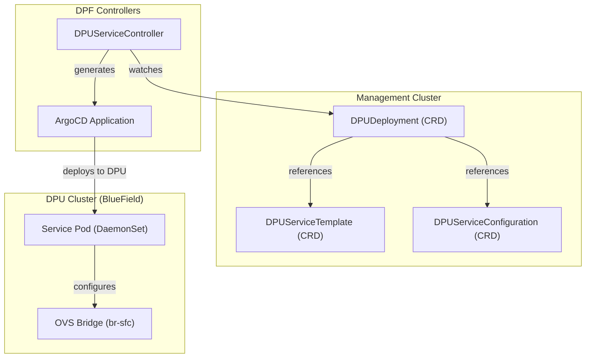
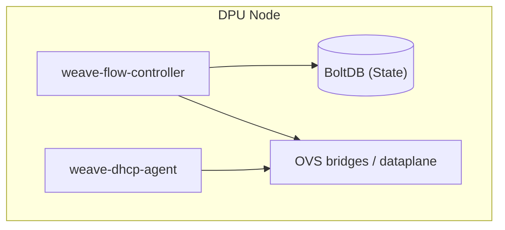
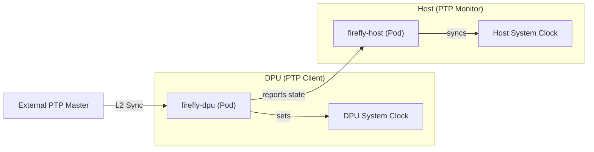
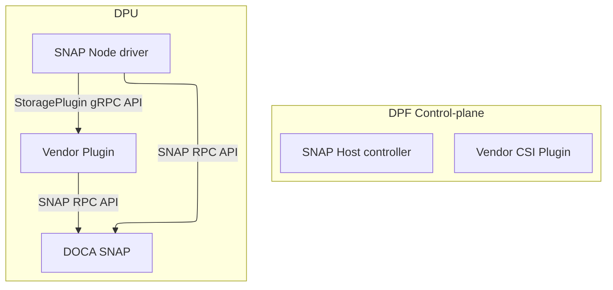

<!-- source: DeepWiki mcp.deepwiki.com · repo NVIDIA/doca-platform · page 4.5 DPUService Catalog and Built-in Services · fetched 2026-10-26 -->

# DPUService Catalog and Built-in Services

<details>
<summary>Relevant source files</summary>

The following files were used as context for generating this wiki page:

- [docs/public/advanced-configuration/dpuservices/README.md](docs/public/advanced-configuration/dpuservices/README.md)
- [docs/public/advanced-configuration/dpuservices/argus.md](docs/public/advanced-configuration/dpuservices/argus.md)
- [docs/public/advanced-configuration/dpuservices/blueman.md](docs/public/advanced-configuration/dpuservices/blueman.md)
- [docs/public/advanced-configuration/dpuservices/doca-telemetry-service.md](docs/public/advanced-configuration/dpuservices/doca-telemetry-service.md)
- [docs/public/advanced-configuration/dpuservices/doca-weave/README.md](docs/public/advanced-configuration/dpuservices/doca-weave/README.md)
- [docs/public/advanced-configuration/dpuservices/doca-weave/vpcctl.md](docs/public/advanced-configuration/dpuservices/doca-weave/vpcctl.md)
- [docs/public/advanced-configuration/dpuservices/firefly.md](docs/public/advanced-configuration/dpuservices/firefly.md)
- [docs/public/developer-guides/architecture/component-description.md](docs/public/developer-guides/architecture/component-description.md)
- [docs/public/developer-guides/services/dpuservice-development.md](docs/public/developer-guides/services/dpuservice-development.md)
- [docs/public/developer-guides/services/storage.md](docs/public/developer-guides/services/storage.md)
- [docs/public/exec_envsubst.sh](docs/public/exec_envsubst.sh)
- [docs/public/release-notes/v24.10.0.md](docs/public/release-notes/v24.10.0.md)
- [docs/public/release-notes/v25.1.0.md](docs/public/release-notes/v25.1.0.md)
- [docs/public/release-notes/v25.1.1.md](docs/public/release-notes/v25.1.1.md)
- [docs/public/release-notes/v25.4.0.md](docs/public/release-notes/v25.4.0.md)
- [docs/public/release-notes/v25.7.0.md](docs/public/release-notes/v25.7.0.md)
- [dpuservices/argus/DPUServiceConfiguration.yaml](dpuservices/argus/DPUServiceConfiguration.yaml)
- [dpuservices/argus/DPUServiceTemplate.yaml](dpuservices/argus/DPUServiceTemplate.yaml)
- [dpuservices/dts/DPUServiceSPX.yaml](dpuservices/dts/DPUServiceSPX.yaml)
- [dpuservices/firefly/DPUServiceTemplate-dpu.yaml](dpuservices/firefly/DPUServiceTemplate-dpu.yaml)
- [dpuservices/firefly/DPUServiceTemplate-host.yaml](dpuservices/firefly/DPUServiceTemplate-host.yaml)
- [dpuservices/weave/DPUDeployment.yaml](dpuservices/weave/DPUDeployment.yaml)
- [dpuservices/weave/DPUServiceConfiguration-dhcp-agent.yaml](dpuservices/weave/DPUServiceConfiguration-dhcp-agent.yaml)
- [dpuservices/weave/DPUServiceConfiguration-flow-controller.yaml](dpuservices/weave/DPUServiceConfiguration-flow-controller.yaml)
- [dpuservices/weave/DPUServiceTemplate.yaml](dpuservices/weave/DPUServiceTemplate.yaml)

</details>


The DOCA Platform Framework (DPF) provides a catalog of built-in DPU services designed to offload networking, storage, and security tasks from the host CPU to the BlueField DPU. These services are managed via declarative Kubernetes resources, specifically `DPUServiceTemplate` and `DPUServiceConfiguration`, and are deployed as containerized workloads on the DPU cluster.

## 1. Service Catalog Overview

The DPF service catalog includes several key DOCA-based services. Each service resides in the `dpuservices/` directory, containing the necessary manifests for deployment.

### Built-in Services Summary

| Service | Name | Purpose | Key Components |
| :--- | :--- | :--- | :--- |
| **HBN** | Host Based Networking | Accelerated BGP/EVPN networking | `doca_hbn` container, `br-hbn` bridge |
| **Argus** | DOCA Argus | AI workload & container threat detection | Memory introspection, IOMMU passthrough |
| **Firefly** | DOCA Firefly | PTP time synchronization | PTP Client (DPU), PTP Monitor (Host) |
| **SNAP** | DOCA SNAP | Block (NVMe) and VirtioFS storage emulation | `doca_vfs`, SPDK/NFS integration |
| **DTS** | DOCA Telemetry | System and network telemetry collection | `DPUServiceSPX` (Service Profile Extension) |
| **Weave** | DOCA Weave | Multi-tenant overlay networking | Flow controller, DHCP agent |
| **BlueMan** | BlueField Manager | DPU management and monitoring | Local DPU health and config |

**Sources:**
- [docs/public/advanced-configuration/dpuservices/argus.md:5-18]()
- [docs/public/advanced-configuration/dpuservices/firefly.md:12-16]()
- [docs/public/advanced-configuration/dpuservices/README.md:7-32]()
- [docs/public/advanced-configuration/dpuservices/doca-weave/README.md:7-17]()

---

## 2. Configuration Model

Services are configured using a two-tier model that separates the service definition from its specific deployment instance.

### DPUServiceTemplate
Defines the "what" of a service. It points to the Helm chart source, version, and basic resource requirements.
*   **File Example:** `dpuservices/argus/DPUServiceTemplate.yaml` [dpuservices/argus/DPUServiceTemplate.yaml:1-12]()
*   **Key Field:** `spec.helmChart.source` defines the repository (e.g., `https://helm.ngc.nvidia.com/nvidia/doca`).

### DPUServiceConfiguration
Defines the "how" for a specific environment. It provides Helm values overrides, image tags, and interface mappings.
*   **File Example:** `dpuservices/firefly/DPUServiceConfiguration-dpu.yaml` [docs/public/advanced-configuration/dpuservices/firefly.md:73-121]()
*   **Key Field:** `spec.serviceConfiguration.helmChart.values` contains the specific DOCA configuration (e.g., PTP profiles).

### Service Configuration Data Flow

The following diagram shows how configuration moves from the Management Cluster to the DPU.

**Title: DPF Service Configuration Pipeline**

**Sources:**
- [docs/public/advanced-configuration/dpuservices/firefly.md:73-180]()
- [docs/public/advanced-configuration/dpuservices/argus.md:52-87]()

---

## 3. Detailed Service Architecture

### 3.1 DOCA Weave
DOCA Weave provides east-west network isolation on BlueField 4 DPUs. It uses hardware-accelerated VXLAN encapsulation to separate tenant traffic independently of the host.

*   **Components:** 
    * `weave-flow-controller`: Manages `VirtualNetwork` and `VirtualNetworkAttachment` state in a BoltDB [docs/public/advanced-configuration/dpuservices/doca-weave/README.md:77-81]().
    * `weave-dhcp-agent`: Serves overlay DHCP on per-NIC bridges [docs/public/advanced-configuration/dpuservices/doca-weave/README.md:96-99]().
*   **API:** Exposes a `NetworkIsolation` gRPC API via `vpcctl` [docs/public/advanced-configuration/dpuservices/doca-weave/README.md:110-116]().

**Title: DOCA Weave Internal Architecture**

**Sources:**
- [docs/public/advanced-configuration/dpuservices/doca-weave/README.md:57-75]()

### 3.2 DOCA Argus
Argus provides hardware-level introspection for threat detection. It requires specific IOMMU settings in the `DPUFlavor` to allow the DPU to scan host memory.

*   **Kernel Requirements:** Must set `intel_iommu=on` and `iommu=pt` on the host [docs/public/advanced-configuration/dpuservices/argus.md:25-30]().
*   **Flavor Config:** The `DPUFlavor` for Argus enables SR-IOV and sets `INTERNAL_CPU_MODEL=1` [docs/public/advanced-configuration/dpuservices/argus.md:138-155]().

### 3.3 DOCA Firefly (PTP)
Firefly implements Precision Time Protocol (PTP). It consists of two components: a DPU component acting as a PTP client and a Host component acting as a monitor.

**Title: Firefly Multi-Component Synchronization**

**Sources:**
- [docs/public/advanced-configuration/dpuservices/firefly.md:18-54]()

### 3.4 DOCA Telemetry Service (DTS)
DTS collects system and network counters (sysfs, ethtool) and exports them via Prometheus or Fluent Bit [docs/public/advanced-configuration/dpuservices/doca-telemetry-service:94-96]().

*   **SPX Mode:** Spectrum-X mode provides broader counter configuration, enabled via `dtsConfigDir: "astra_spectrum_x"` in the Helm values [docs/public/advanced-configuration/dpuservices/doca-telemetry-service:191-211]().

---

## 4. Storage Services (SNAP)
The SNAP service emulates storage devices (NVMe/VirtioFS) on the host using the BlueField DPU.

*   **Components:**
    * `SNAP CSI Plugin`: Kubernetes interface for provisioning [docs/public/developer-guides/services/storage.md:38]().
    * `DOCA SNAP`: The core emulation engine [docs/public/developer-guides/services/storage.md:41]().
    * `SNAP Node Driver`: Orchestrates SNAP RPC calls on the DPU [docs/public/developer-guides/services/storage.md:40]().
*   **Emulation Methods:** Supports NVMe over VF, hot-plugged PF, and Virtio-FS [docs/public/developer-guides/services/storage.md:29-33]().

**Title: SNAP Storage Subsystem Interaction**

**Sources:**
- [docs/public/developer-guides/services/storage.md:51-109]()

---

## 5. Deployment Manifests

Services are deployed by creating a `DPUDeployment` resource that binds a `DPUFlavor` to the service templates.

### Example DPUDeployment for Weave
[dpuservices/weave/DPUDeployment.yaml:1-27]()
```yaml
apiVersion: svc.dpu.nvidia.com/v1alpha1
kind: DPUDeployment
metadata:
  name: doca-weave
spec:
  dpus:
    astraEnabled: true
    blueFieldSoftware: bfsw-xplane-weave
    flavor: flavor-xplane-weave
  services:
    weave-flow-controller:
      serviceTemplate: weave-flow-controller
      serviceConfiguration: weave-flow-controller
    weave-dhcp-agent:
      serviceTemplate: weave-dhcp-agent
      serviceConfiguration: weave-dhcp-agent
```

### OVS Bridge Configuration in DPUFlavor
Each service requires specific OVS bridge setups defined in the `DPUFlavor.spec.ovs.rawConfigScript`. For example, Argus setup ensures the `br-sfc` bridge is configured for netdev datapath and hardware offload.

**Bridge Setup Example:**
[docs/public/advanced-configuration/dpuservices/argus.md:182-198]()
1.  Create `br-sfc` with `datapath_type=netdev`.
2.  Add physical port `p0` to `br-sfc`.
3.  Set `hw-offload=true` for hardware acceleration.

**Sources:**
- [docs/public/advanced-configuration/dpuservices/argus.md:156-209]()
- [docs/public/advanced-configuration/dpuservices/firefly.md:224-250]()

---

