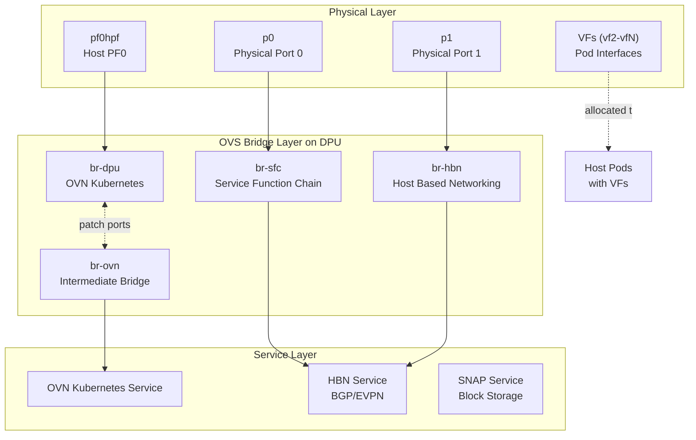
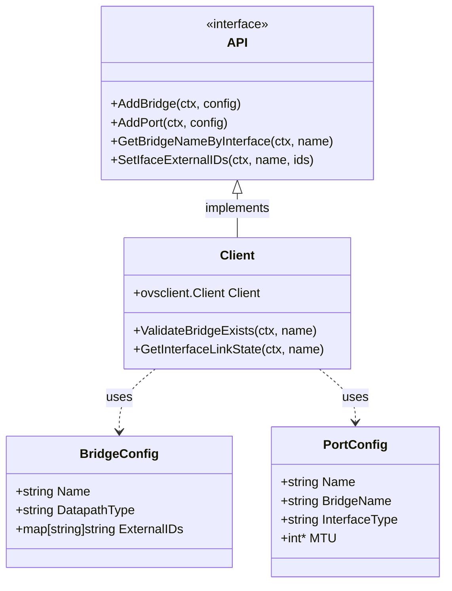
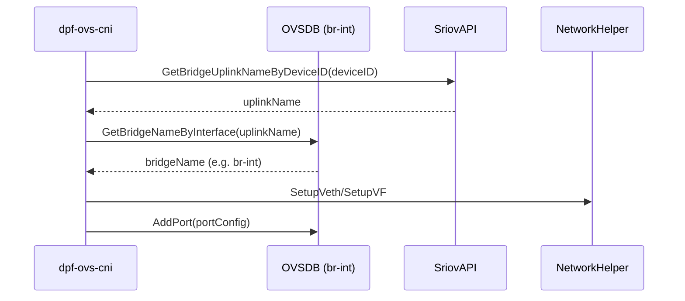

<!-- source: DeepWiki mcp.deepwiki.com · repo NVIDIA/doca-platform · page 5 Networking Components · fetched 2026-10-26 -->

# Networking Components

Relevant source files

The following files were used as context for generating this wiki page:

- [docs/public/user-guides/host-trusted/use-cases/hbn-ovnk-snap/README.md](docs/public/user-guides/host-trusted/use-cases/hbn-ovnk-snap/README.md)
- [docs/public/user-guides/host-trusted/use-cases/hbn-ovnk/README.md](docs/public/user-guides/host-trusted/use-cases/hbn-ovnk/README.md)
- [docs/public/user-guides/host-trusted/use-cases/hbn-snap/README.md](docs/public/user-guides/host-trusted/use-cases/hbn-snap/README.md)
- [docs/public/user-guides/host-trusted/use-cases/hbn/README.md](docs/public/user-guides/host-trusted/use-cases/hbn/README.md)
- [docs/public/user-guides/host-trusted/use-cases/ovnk/README.md](docs/public/user-guides/host-trusted/use-cases/ovnk/README.md)
- [docs/public/user-guides/host-trusted/use-cases/passthrough/README.md](docs/public/user-guides/host-trusted/use-cases/passthrough/README.md)
- [docs/public/user-guides/zero-trust/use-cases/hbn-snap/README.md](docs/public/user-guides/zero-trust/use-cases/hbn-snap/README.md)
- [docs/public/user-guides/zero-trust/use-cases/hbn/README.md](docs/public/user-guides/zero-trust/use-cases/hbn/README.md)
- [docs/public/user-guides/zero-trust/use-cases/passthrough/README.md](docs/public/user-guides/zero-trust/use-cases/passthrough/README.md)
- [docs/public/user-guides/zero-trust/use-cases/vpc/README.md](docs/public/user-guides/zero-trust/use-cases/vpc/README.md)
- [internal/cni/dpf-ovs-cni/plugin/ovs.go](internal/cni/dpf-ovs-cni/plugin/ovs.go)
- [internal/cni/dpf-ovs-cni/plugin/ovs_test.go](internal/cni/dpf-ovs-cni/plugin/ovs_test.go)
- [internal/cni/dpf-ovs-cni/plugin/plugin.go](internal/cni/dpf-ovs-cni/plugin/plugin.go)
- [internal/cni/dpf-ovs-cni/plugin/plugin_suite_test.go](internal/cni/dpf-ovs-cni/plugin/plugin_suite_test.go)
- [internal/cni/dpf-ovs-cni/plugin/plugin_test.go](internal/cni/dpf-ovs-cni/plugin/plugin_test.go)
- [internal/sfccontroller/controllers/stale_test.go](internal/sfccontroller/controllers/stale_test.go)
- [pkg/ovsutils/mock_ovs.go](pkg/ovsutils/mock_ovs.go)
- [pkg/ovsutils/mock_ovs_client.go](pkg/ovsutils/mock_ovs_client.go)
- [pkg/ovsutils/ovs.go](pkg/ovsutils/ovs.go)
- [pkg/ovsutils/ovs_test.go](pkg/ovsutils/ovs_test.go)

This document describes the networking subsystem in the DOCA Platform Framework (DPF), which provides hardware-accelerated networking capabilities for DPUs. The networking components include OVN Kubernetes CNI acceleration, Host Based Networking (HBN), VPC isolation, and OVS bridge management.

## Overview

The DPF networking architecture offloads networking functions to DPUs while providing service function chaining capabilities through Open vSwitch (OVS) bridges. The system supports multiple networking modes including OVN Kubernetes only, HBN+OVN, and HBN+OVN+SNAP configurations.

**DPF Networking Architecture**

Sources: [docs/public/user-guides/host-trusted/use-cases/hbn-ovnk/README.md:9-11]() [docs/public/user-guides/host-trusted/use-cases/hbn-ovnk/README.md:71-78]() [docs/public/user-guides/host-trusted/use-cases/ovnk/README.md:36-37]()

## Networking Subsystems

### OVN Kubernetes CNI Acceleration
OVN Kubernetes is used as the primary CNI. On worker nodes, the data plane is accelerated by offloading OVS flows to the DPU hardware. Pods are connected via Virtual Functions (VFs) injected at creation time. The first two VFs (`vf0`, `vf1`) are reserved for provisioning and OVN-K infrastructure respectively [docs/public/user-guides/host-trusted/use-cases/ovnk/README.md:71-73]().
For details, see [OVN Kubernetes CNI Acceleration](#5.1).

### Host Based Networking (HBN)
HBN provides BGP and EVPN routing directly on the DPU. It integrates with the Top of Rack (ToR) switch to enable advanced routing topologies and unnumbered BGP peering [docs/public/user-guides/zero-trust/use-cases/hbn/README.md:26-28](). It is typically deployed as a `DPUService` [docs/public/user-guides/host-trusted/use-cases/hbn/README.md:11-12]().
For details, see [Host Based Networking (HBN)](#5.2).

### VPC Networking and Isolation
VPC networking enables multi-tenant isolation via OVN. It utilizes `DPUVPC` and `DPUVirtualNetwork` resources to define isolated L2/L3 domains for tenant workloads [docs/public/user-guides/zero-trust/use-cases/vpc/README.md:10-11]().
For details, see [VPC Networking and Network Isolation](#5.3).

### OVS Bridge Management
The system includes an OVS API abstraction layer in `pkg/ovsutils` for managing bridges (e.g., `br-int`, `br-sfc`) and ports. This layer handles DPDK/netdev datapath configuration and provides methods like `AddBridge` and `AddPort` [pkg/ovsutils/ovs.go:52-59]().

**OVS Utility Entity Mapping**

Sources: [pkg/ovsutils/ovs.go:41-72]() [pkg/ovsutils/ovs.go:81-90]() [pkg/ovsutils/ovs.go:93-105]()

For details, see [OVS Bridge Management and Port Operations](#5.4).

### NodeSRIOV Device Plugin
The `NodeSRIOVDevicePlugin` controller manages the lifecycle of SR-IOV device plugin pods on the host. It ensures that VFs are correctly discovered and allocated to Kubernetes pods [docs/public/user-guides/host-trusted/use-cases/hbn-ovnk/README.md:77-78]().
For details, see [NodeSRIOV Device Plugin and Multi-DPU Networking](#5.5).

## CNI Plugin Integration

The `DpfCNI` plugin coordinates with OVS and SR-IOV subsystems to set up pod networking. It utilizes `ovsutils` to manage the lifecycle of OVS ports and interfaces [pkg/ovsutils/ovs.go:59-60]().

**CNI Setup Flow**

Sources: [internal/cni/dpf-ovs-cni/plugin/plugin.go:66-71]() [internal/cni/dpf-ovs-cni/plugin/plugin.go:179-203]()

## Configuration Summary

| Feature | Key Resource / Service | Primary Use Case |
|---------|------------------------|------------------|
| **OVN-K** | `ovn-kubernetes` | Primary Pod CNI with hardware offload [docs/public/user-guides/host-trusted/use-cases/ovnk/README.md:9]() |
| **HBN** | `doca_hbn` | DPU-based BGP/EVPN routing [docs/public/user-guides/host-trusted/use-cases/hbn/README.md:11]() |
| **VPC** | `DPUVPC` | Multi-tenant network isolation [docs/public/user-guides/zero-trust/use-cases/vpc/README.md:11]() |
| **SR-IOV** | `NodeSRIOVDevicePlugin` | VF management for Pods [docs/public/user-guides/host-trusted/use-cases/hbn-ovnk/README.md:77]() |

Sources: [docs/public/user-guides/host-trusted/use-cases/hbn-ovnk/README.md:9-11]() [docs/public/user-guides/zero-trust/use-cases/vpc/README.md:10-11]() [docs/public/user-guides/host-trusted/use-cases/hbn/README.md:165-167]()

---

