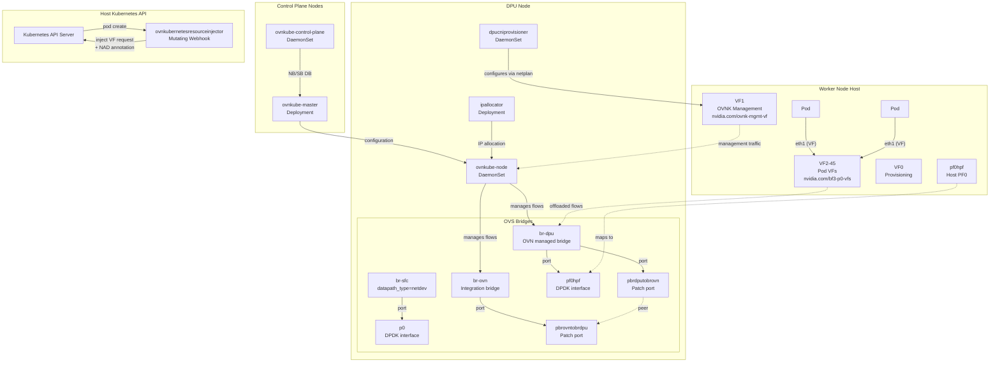
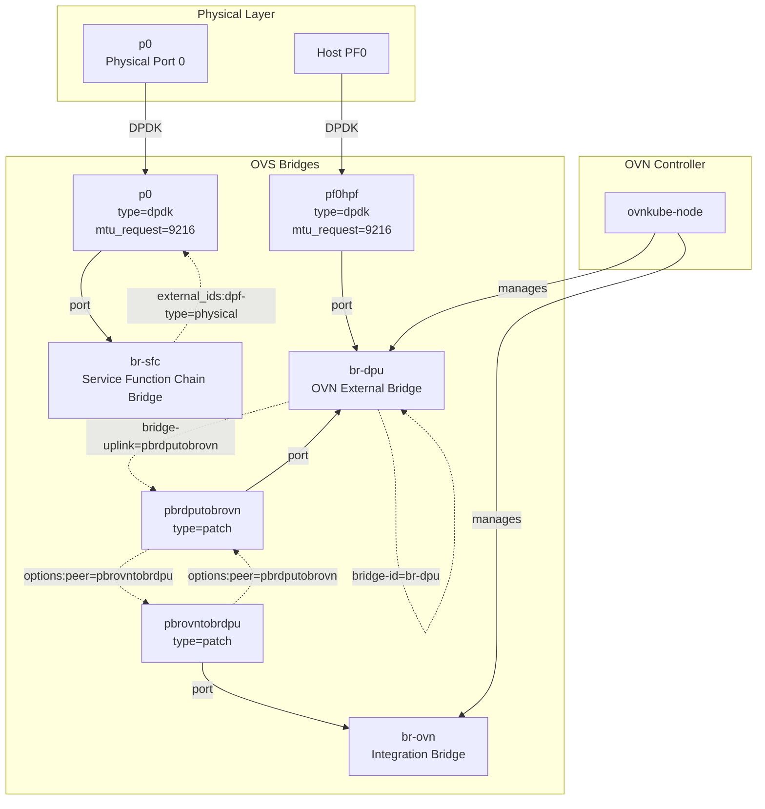
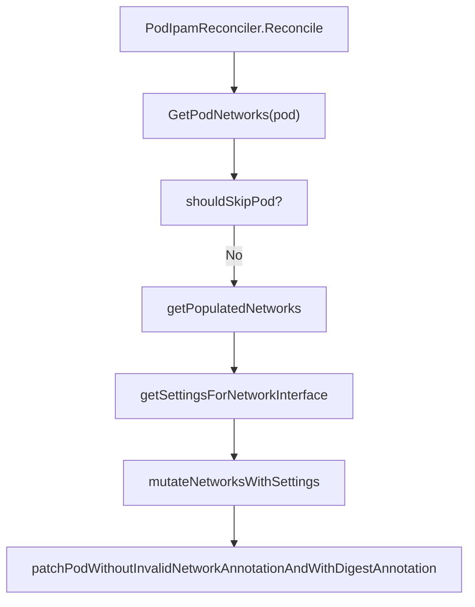
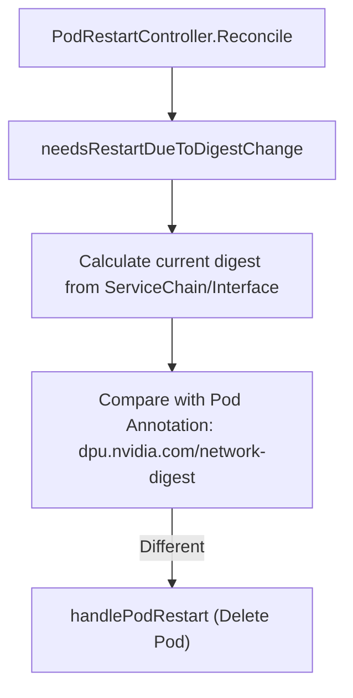
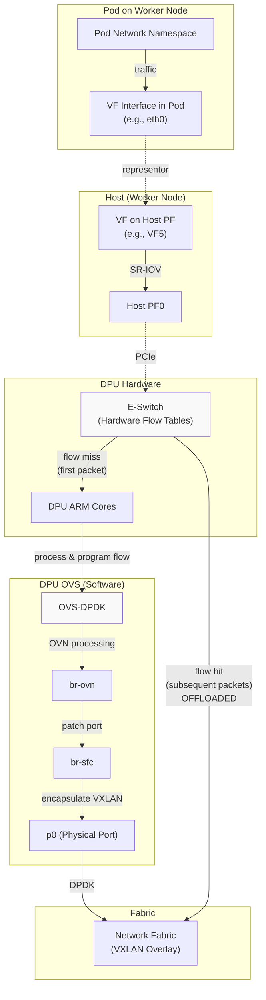

<!-- source: DeepWiki mcp.deepwiki.com · repo NVIDIA/doca-platform · page 5.1 OVN Kubernetes CNI Acceleration · fetched 2026-10-26 -->

# OVN Kubernetes CNI Acceleration

<details>
<summary>Relevant source files</summary>

The following files were used as context for generating this wiki page:

- [Dockerfile.netutils](Dockerfile.netutils)
- [docs/public/user-guides/host-trusted/use-cases/hbn-ovnk-snap/README.md](docs/public/user-guides/host-trusted/use-cases/hbn-ovnk-snap/README.md)
- [docs/public/user-guides/host-trusted/use-cases/hbn-ovnk/README.md](docs/public/user-guides/host-trusted/use-cases/hbn-ovnk/README.md)
- [docs/public/user-guides/host-trusted/use-cases/hbn-snap/README.md](docs/public/user-guides/host-trusted/use-cases/hbn-snap/README.md)
- [docs/public/user-guides/host-trusted/use-cases/hbn/README.md](docs/public/user-guides/host-trusted/use-cases/hbn/README.md)
- [docs/public/user-guides/host-trusted/use-cases/ovnk/README.md](docs/public/user-guides/host-trusted/use-cases/ovnk/README.md)
- [docs/public/user-guides/host-trusted/use-cases/passthrough/README.md](docs/public/user-guides/host-trusted/use-cases/passthrough/README.md)
- [docs/public/user-guides/zero-trust/use-cases/hbn-snap/README.md](docs/public/user-guides/zero-trust/use-cases/hbn-snap/README.md)
- [docs/public/user-guides/zero-trust/use-cases/hbn/README.md](docs/public/user-guides/zero-trust/use-cases/hbn/README.md)
- [docs/public/user-guides/zero-trust/use-cases/passthrough/README.md](docs/public/user-guides/zero-trust/use-cases/passthrough/README.md)
- [docs/public/user-guides/zero-trust/use-cases/vpc/README.md](docs/public/user-guides/zero-trust/use-cases/vpc/README.md)
- [internal/pod-ipam-injector/controllers/podipam_controller.go](internal/pod-ipam-injector/controllers/podipam_controller.go)
- [internal/pod-ipam-injector/controllers/podipam_controller_nsi_test.go](internal/pod-ipam-injector/controllers/podipam_controller_nsi_test.go)
- [internal/pod-ipam-injector/controllers/podipam_controller_test.go](internal/pod-ipam-injector/controllers/podipam_controller_test.go)
- [internal/pod-ipam-injector/controllers/podrestart_controller.go](internal/pod-ipam-injector/controllers/podrestart_controller.go)
- [internal/pod-ipam-injector/controllers/podrestart_controller_test.go](internal/pod-ipam-injector/controllers/podrestart_controller_test.go)
- [test/e2e/external_test.go](test/e2e/external_test.go)
- [test/objects/performance/dpudeployment-ovn-hbn.yaml](test/objects/performance/dpudeployment-ovn-hbn.yaml)
- [test/objects/performance/dpuserviceconfig-ovn.yaml](test/objects/performance/dpuserviceconfig-ovn.yaml)
- [test/utils/utils.go](test/utils/utils.go)

</details>


## Purpose and Scope

This document describes the OVN-Kubernetes CNI acceleration system in DOCA Platform Framework (DPF), which offloads OVN-Kubernetes Container Network Interface (CNI) processing to the DPU. The system provides hardware-accelerated networking for Kubernetes pods by leveraging SR-IOV Virtual Functions (VFs) and DPU hardware offload capabilities.

This page covers:
- OVN-Kubernetes architecture with DPU offload
- CNI plugin components and their interactions
- SR-IOV VF injection mechanism via webhook
- OVS bridge topology on the DPU
- Traffic flow and hardware offload mechanisms
- IPAM integration and pod restart logic

For information about combining OVN-Kubernetes with Host Based Networking (HBN), see [Host Based Networking (HBN)](#5.2). For VPC isolation on top of OVN, see [VPC Networking and Network Isolation](#5.3). For details on how OVN is deployed as a DPUService, see [DPUService Resources](#4.2).

## Architecture Overview

OVN-Kubernetes in DPF operates in a split architecture where control plane components run on control plane nodes and data plane components run offloaded to DPU nodes. Worker nodes use accelerated networking through SR-IOV VFs that connect pods directly to the DPU hardware.

### Component Distribution

**Title: OVN-Kubernetes Component Distribution**



Sources: [docs/public/user-guides/host-trusted/use-cases/ovnk/README.md:9-73](), [docs/public/user-guides/host-trusted/use-cases/hbn-ovnk/README.md:161-171]()

### Key Components

The OVN-Kubernetes acceleration system consists of several key components:

| Component | Location | Resource Type | Purpose |
|-----------|----------|---------------|---------|
| `ovnkube-control-plane` | Control Plane | DaemonSet | Manages OVN NB/SB databases (northd) |
| `ovnkube-master` | Control Plane | Deployment | Cluster-wide OVN controller |
| `ovnkube-node` | DPU | DaemonSet | Configures local OVN controller and OVS flows |
| `dpucniprovisioner` | DPU | DaemonSet | Provisions VF1 on host via netplan, configures management interface |
| `ipallocator` | DPU | Deployment | Provides IPAM service for pod IP allocation |
| `ovnkubernetesresourceinjector` | Host | Deployment | Mutating admission webhook that injects VF resource requests and NAD annotations into pod specs |

The `ovnkube-node` DaemonSet is deployed via the DPU Service mechanism, running in the DPU cluster's namespace (e.g., `dpf-operator-system`) and configured to manage both `br-dpu` and `br-ovn` bridges.

Sources: [docs/public/user-guides/host-trusted/use-cases/ovnk/README.md:147-171](), [docs/public/user-guides/host-trusted/use-cases/hbn-ovnk/README.md:161-171]()

## OVS Bridge Topology

The DPU uses a three-bridge topology configured during DPU provisioning through the DPUFlavor `ovs.rawConfigScript`. This topology enables traffic to flow between physical ports, the host, and OVN overlay networks with hardware offload.

**Title: OVS Bridge Topology on DPU**



Sources: [docs/public/advanced-configuration/dpuservices/argus.md:189-207](), [docs/public/advanced-configuration/dpuservices/firefly.md:253-271]()

### Bridge Configuration

The bridges are configured with specific OVS settings for DOCA acceleration via the DPUFlavor `ovs.rawConfigScript`:

**br-sfc (Service Function Chain Bridge)**
- Created with: `ovs-vsctl --may-exist add-br br-sfc`
- `datapath_type=netdev`: Uses DPDK-accelerated datapath
- `fail_mode=secure`: Drops packets when controller is unavailable
- Port `p0`: DPDK interface with `mtu_request=9216`
- Port `p0` marked with `external_ids:dpf-type=physical`

**br-dpu (OVN External Bridge)**
- Created with: `ovs-vsctl --may-exist add-br br-dpu`
- Managed by `ovnkube-node` (corresponds to `br-ex` in standard OVN-Kubernetes terminology)
- `datapath_type=netdev`: Uses DPDK-accelerated datapath
- `bridge-id=br-dpu`: External ID identifying this bridge
- `bridge-uplink=pbrdputobrovn`: Names the patch port to `br-ovn`
- Port `pf0hpf`: DPDK interface with `mtu_request=9216`, connects to host PF0

**br-ovn (OVN Integration Bridge)**
- Created with: `ovs-vsctl --may-exist add-br br-ovn`
- `datapath_type=netdev`: Uses DPDK-accelerated datapath
- Connected to `br-dpu` via bidirectional patch ports:
  - `pbrovntobrdpu` on `br-ovn` with `options:peer=pbrdputobrovn`
  - `pbrdputobrovn` on `br-dpu` with `options:peer=pbrovntobrdpu`

### Global OVS Settings

The DPUFlavor `ovs.rawConfigScript` configures global OVS settings via `ovs-vsctl` commands:

```bash
ovs-vsctl set Open_vSwitch . other_config:doca-init=true
ovs-vsctl set Open_vSwitch . other_config:dpdk-max-memzones=50000
ovs-vsctl set Open_vSwitch . other_config:hw-offload=true
ovs-vsctl set Open_vSwitch . other_config:pmd-quiet-idle=true
ovs-vsctl set Open_vSwitch . other_config:max-idle=20000
ovs-vsctl set Open_vSwitch . other_config:max-revalidator=5000
ovs-vsctl set Open_vSwitch . other_config:doca-congestion-threshold=60
ovs-vsctl set Open_vSwitch . other_config:flow-limit=500000
ovs-vsctl set Open_vSwitch . other_config:hw-offload-ct-unidir-udp-enabled=true
ovs-vsctl set Open_vSwitch . external-ids:ovn-bridge-datapath-type=netdev
```

| Setting | Value | Purpose |
|---------|-------|---------|
| `doca-init` | `true` | Enable DOCA acceleration framework |
| `dpdk-max-memzones` | `50000` | Increase memory zones for DPDK |
| `hw-offload` | `true` | Enable hardware flow offload to E-Switch |
| `pmd-quiet-idle` | `true` | Reduce CPU usage when idle |
| `max-idle` | `20000` | Flow idle timeout in milliseconds |
| `max-revalidator` | `5000` | Flow revalidation timeout in milliseconds |
| `doca-congestion-threshold` | `60` | Congestion control threshold |
| `flow-limit` | `500000` | Maximum number of flows |
| `hw-offload-ct-unidir-udp-enabled` | `true` | Enable unidirectional UDP connection tracking offload |
| `ovn-bridge-datapath-type` | `netdev` | OVN uses netdev (DPDK) datapath |

Sources: [docs/public/advanced-configuration/dpuservices/argus.md:166-175](), [docs/public/advanced-configuration/dpuservices/firefly.md:230-239]()

## CNI Plugin Architecture

The CNI plugin architecture for OVN-Kubernetes acceleration involves multiple components working together to provide network connectivity to pods with hardware offload.

### Pod IPAM Injection

The `PodIpamReconciler` is responsible for mutating Pod network annotations to include IPAM and MTU settings derived from `ServiceChain` and `ServiceInterface` resources.

**Title: Pod IPAM Injection Logic**



Key Logic in `PodIpamReconciler`:
- **Invalid Network Handling**: The `InvalidNetworkName` ("invalid-network") is used to hold pod readiness until CNI arguments (like MTU) are correctly injected [internal/pod-ipam-injector/controllers/podipam_controller.go:57-65]().
- **Digest Mechanism**: A network digest is stored in `dpu.nvidia.com/network-digest` to track the state of the configuration applied to the pod [internal/pod-ipam-injector/controllers/podipam_controller.go:55]().
- **MTU Injection**: The controller fetches MTU from the `ServiceChain` and injects it into the CNI `args` field of the Multus `NetworkSelectionElement` [internal/pod-ipam-injector/controllers/podipam_controller.go:207-210]().

Sources: [internal/pod-ipam-injector/controllers/podipam_controller.go:47-136](), [internal/pod-ipam-injector/controllers/podipam_controller.go:170-220]()

### Pod Restart Controller

The `PodRestartController` monitors pods for changes in their underlying network configuration. If a `ServiceChain` or `ServiceInterface` changes such that the pod's `network-digest` is no longer valid, the controller restarts the pod to apply the new configuration.

**Title: Pod Restart Detection**



The function `needsRestartDueToDigestChange` compares the digest stored in the pod annotation with a freshly calculated digest based on the current cluster state [internal/pod-ipam-injector/controllers/podrestart_controller.go:131-181]().

Sources: [internal/pod-ipam-injector/controllers/podrestart_controller.go:76-130](), [internal/pod-ipam-injector/controllers/podrestart_controller_test.go:131-181]()

## SR-IOV VF Injection

The OVN-Kubernetes acceleration model requires each pod to have a VF attached for hardware offload. This is accomplished through a Kubernetes mutating webhook that modifies pod specifications before they are created.

### Webhook Configuration

The `ovnkubernetesresourceinjector` webhook is deployed as a Deployment in the host Kubernetes cluster.

**Mutation Logic:**
The webhook modifies pod specifications by adding:
1. **Resource Request:** Injects `nvidia.com/bf3-p0-vfs: "1"` into the first container's resource requests.
2. **Network Annotation:** Adds `k8s.v1.cni.cncf.io/networks` annotation referencing an automatically generated NetworkAttachmentDefinition.

Sources: [docs/public/user-guides/host-trusted/use-cases/ovnk/README.md:69-73](), [docs/public/user-guides/host-trusted/use-cases/hbn-ovnk/README.md:73-78]()

### VF Allocation Strategy

VFs on the host are allocated with a specific strategy:

| VF Index | Purpose | SR-IOV Resource Name | Managed By |
|----------|---------|----------------------|------------|
| VF0 | Provisioning (vf0) | N/A | DPF provisioning controller |
| VF1 | OVN-Kubernetes management | `nvidia.com/ovnk-mgmt-vf` | dpucniprovisioner DaemonSet |
| VF2-VF45 | Pod network interfaces | `nvidia.com/bf3-p0-vfs` | SR-IOV Device Plugin |

Sources: [docs/public/user-guides/host-trusted/use-cases/ovnk/README.md:69-73](), [docs/public/user-guides/host-trusted/use-cases/hbn-ovnk/README.md:73-78]()

## Traffic Flow and Hardware Offload

OVN-Kubernetes with DPU acceleration provides hardware-offloaded packet processing for pod traffic. The packet path differs between control plane nodes (software-only) and worker nodes with DPUs (hardware-offloaded).

**Title: Packet Path with Hardware Offload**



Sources: [docs/public/advanced-configuration/dpuservices/argus.md:166-175](), [docs/public/advanced-configuration/dpuservices/ovnvpc/README.md:89-110]()

## Prerequisites and Dependencies

### Network Requirements

**Control Plane Nodes:**
- OVS packages installed (e.g., `openvswitch-switch` for Ubuntu 24.04).
- Out-of-band management port should be configured as OVS bridge port with "bridge-uplink" metadata.

**Worker Nodes:**
- OVS packages NOT installed (OVS runs on DPU, not on host).
- Only port p0 (DPU uplink) is used in this deployment.
- Host high-speed port (Host PF0) must have DHCP enabled.
- MTU of the port statically set to 1500.

**DHCP Server Requirements:**
The high-speed network requires an external DHCP server with special configuration:
- DHCP server must NOT assign a default gateway to clients.
- DHCP server must provide gateway via DHCP option 121 (classless static routes).
- Option 121 encodes a route to a "dummy" IP subnet (`169.254.99.100/32`) with next-hop = actual default gateway.

Sources: [docs/public/user-guides/host-trusted/use-cases/ovnk/README.md:25-45](), [docs/public/user-guides/host-trusted/use-cases/hbn-ovnk/README.md:25-45]()

### Kubernetes Requirements

**Node Labels and Annotations:**

Control plane nodes require:
```yaml
labels:
  k8s.ovn.org/zone-name: $KUBERNETES_NODE_NAME
```

Worker nodes require:
```yaml
labels:
  k8s.ovn.org/dpu-host: ""
  k8s.ovn.org/zone-name: $KUBERNETES_NODE_NAME
annotations:
  k8s.ovn.org/remote-zone-migrated: $KUBERNETES_NODE_NAME
```

Sources: [docs/public/user-guides/host-trusted/use-cases/ovnk/README.md:54-69](), [docs/public/user-guides/host-trusted/use-cases/hbn-ovnk/README.md:58-70]()

---

